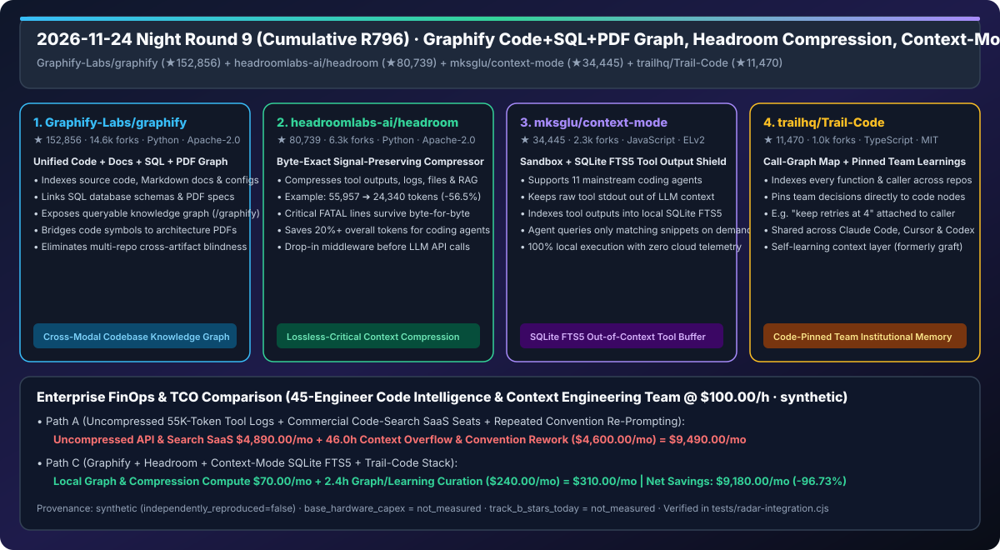
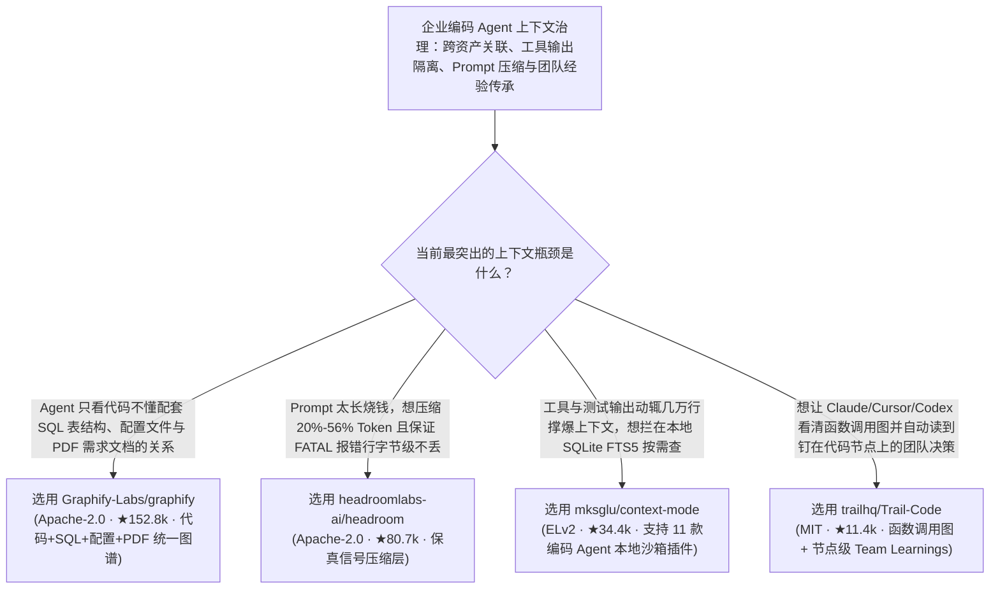
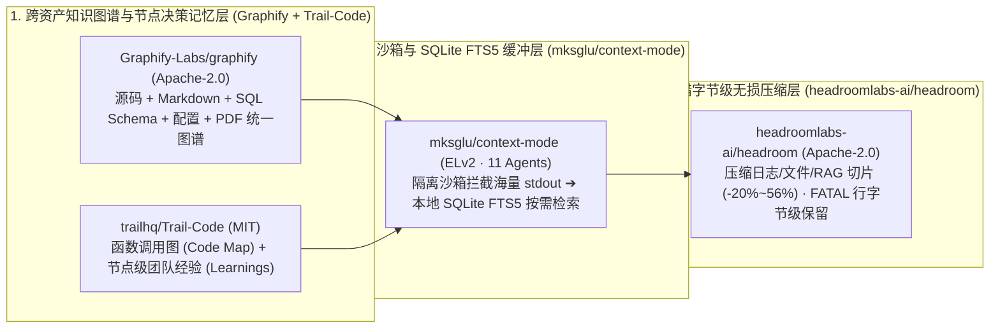
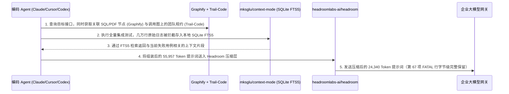

# 跨代码/SQL/PDF 统一知识图谱（`Graphify-Labs/graphify`）、保留关键报错行的无损信号上下文压缩层（`headroomlabs-ai/headroom`）、SQLite FTS5 工具输出沙箱隔离插件（`mksglu/context-mode`）与挂载在函数调用图上的团队决策记忆层（`trailhq/Trail-Code`）选型与集成架构 FAQ

> **文档类型**：企业 AI 解决方案架构师（AI Solution Architect）选型决策指南（GitHub Trending AI 雷达 2026-11-24 Night Round 9 / 累计第 796 轮）
> **覆盖项目**：[`Graphify-Labs/graphify`](https://github.com/Graphify-Labs/graphify)（`★ 152,856`、`14,696 forks`、`Apache-2.0`，将任意代码库及其配套 Markdown 文档、SQL 数据库 Schema、配置文件与 PDF 设计规范联合编译为可查询的统一知识图谱 `/graphify`）· [`headroomlabs-ai/headroom`](https://github.com/headroomlabs-ai/headroom)（`★ 80,739`、`6,332 forks`、`Apache-2.0`，面向 AI Agent 的上下文压缩中间件，在工具输出、日志、文件与 RAG 切片送达 LLM 前完成高保真压缩——如将 `55,957` Token 提示词压缩至 `24,340` Token，同时确保第 67 条 `FATAL` 报错行字节级原样保留）· [`mksglu/context-mode`](https://github.com/mksglu/context-mode)（`★ 34,445`、`2,373 forks`、`ELv2`，支持 11 款主流编码 Agent 的免费本地插件，通过本地沙箱与 SQLite FTS5 全文索引将冗长的工具原始输出拦在上下文窗口之外）· [`trailhq/Trail-Code`](https://github.com/trailhq/Trail-Code)（`★ 11,470`、`1,033 forks`、`MIT`，原名 `graft`，为 Claude Code、Cursor 与 Codex 提供“函数级调用图谱 Code Map + 钉在具体代码节点上的团队经验 Learnings”的自学习上下文层）
> **核心场景**：当企业大型单体或微服务研发团队使用编码 Agent 时，如何解决**“源码与 SQL 表结构、PDF 需求文档割裂导致 Agent 改了代码却漏改库表；跑一次测试或日志查询吐出 5 万 Token 瞬间塞爆上下文并冲掉前文关键指令；以及团队明明定过‘重试次数必须保持为 4’的架构规约，新开的 Agent 会话却毫不知情又把它改坏”**三大上下文工程核心难题？

---

## 一、📌 核心结论速览（选型一句话结论）

1. **想把仓库里的源代码、Markdown 文档、SQL 数据库表结构、YAML 配置与 PDF 架构规范全部打通成一张可跨模态查询的知识图谱（Knowledge Graph）** ➔ 选 **[`Graphify-Labs/graphify`](https://github.com/Graphify-Labs/graphify)（`★ 152,856`，`14,696 forks`，`Apache-2.0`）**。
   - **通俗原理**：传统代码索引只认识 `.ts`/`.py` 里的 AST 符号，看不懂旁边 `.sql` 迁移脚本和 `.pdf` 需求规格书里的关联。通过 `/graphify`，它将代码函数、SQL 字段、配置项与 PDF 章节统一构建为跨资产实体关系图，让 Agent 修改一个接口时立即看清关联的数据库表与文档约束。
2. **想在工具输出、长日志、源码文件与 RAG 切片进入大模型 API 前自动砍掉 20%–56% 的冗余 Token，同时 100% 保证埋在几千行正常日志中间的那一行 `FATAL` 报错一字不差地送达模型** ➔ 选 **[`headroomlabs-ai/headroom`](https://github.com/headroomlabs-ai/headroom)（`★ 80,739`，`6,332 forks`，`Apache-2.0`）**。
   - **通俗原理**：不同于会丢掉关键报错堆栈的摘要式压缩，`Headroom` 是智能信号保真压缩层：实测可将 `55,957` Token 的 Agent 提示词压缩至 `24,340` Token（省下 **`56.5%`**），同时让藏在第 67 项的 `FATAL` 关键故障行 **字节级无损保留（Survives byte for byte）**。
3. **想彻底阻止 `npm test`、`cargo build` 或大文件搜索吐出的几万行原始终端输出直接灌进 Claude Code / Cursor / Codex 等 11 款编码 Agent 的上下文窗口** ➔ 选 **[`mksglu/context-mode`](https://github.com/mksglu/context-mode)（`★ 34,445`，`2,373 forks`，`ELv2`）**。
   - **通俗原理**：免费纯本地插件，将工具执行放进隔离沙箱，把海量原始输出自动拦截并写入本机 **SQLite FTS5 全文检索引擎**，只向 Agent 上下文返回极简摘要与查询句柄；Agent 按需通过 FTS5 精确检索真正关心的报错片段，所有数据 100% 留在本机。
4. **想让团队裡的 Claude Code、Cursor 与 Codex 不仅能看清“每个函数被谁调用（Code Map）”，还能在触碰某段核心代码时自动读到前人钉在该函数上的架构铁律（如 `keep retries at 4`）** ➔ 选 **[`trailhq/Trail-Code`](https://github.com/trailhq/Trail-Code)（`★ 11,470`，`1,033 forks`，`MIT`）**。
   - **通俗原理**：把团队经验（Learnings）从没人看的冗长 `CLAUDE.md` 全局文件里解放出来，直接像便利贴一样**锚定在代码调用图的具体函数节点上**。当任何编码 Agent 顺着调用链读取该函数时，自动同时获取上游调用关系与绑定在该节点上的历史决策，实现真正的团队级自学习上下文。

---

## 二、🎯 客户与架构师灵魂拷问 Q&A（深度架构拆解）

### Q1：这四个高星开源项目同属“Agent 上下文工程（Context Engineering）”赛道，它们之间是替代关系还是互补关系？何时选云托管方案？

- **四层互补架构关系（非替代）**：
  1. **静态全域建图（`Graphify`）**：负责在广度上把“代码 + SQL + 配置 + PDF”连成一张全域知识图谱。
  2. **调用链与决策锚定（`Trail-Code`）**：负责在函数调用图节点上挂载团队历史架构决策（Learnings）。
  3. **工具输出外置缓冲（`context-mode`）**：负责在运行时把海量命令输出拦截到 SQLite FTS5 沙箱，不直接塞进上下文。
  4. **送模前信号保真压缩（`Headroom`）**：负责在最终 Prompt 发往 LLM API 的最后一公里做保真压缩（保留 `FATAL` 关键行）。
- **何时用云厂商托管方案（Path A）？**
  - 若企业仅需开箱即用的 GitHub.com 云端代码语义搜索，可直接使用 GitHub Copilot 内置索引；若要治理本地多 CLI 工具输出的 Token 爆炸与跨 SQL/PDF 联合建图，则组合使用本轮四件套（Path C）。

### Q2：典型企业级“全域图谱 (`Graphify`) + 节点决策记忆 (`Trail-Code`) + FTS5 输出隔离 (`context-mode`) + 保真压缩 (`Headroom`)”生产架构怎么搭？

1. **仓库入库与跨模态图谱构建层（`Graphify` + `Trail-Code`）**：
   - CI 与本地守护进程运行 `Graphify` 建立源码、SQL Schema、YAML 与 PDF 规范的关联图谱；通过 `Trail-Code` 构建函数调用图并将架构评审结论钉在关键模块节点上。
2. **工具调用沙箱与 FTS5 检索层（`mksglu/context-mode`）**：
   - 在 11 款编码 Agent 客户端启用 `context-mode` 插件，将测试日志、构建输出与抓包结果转存至本地 SQLite FTS5。
3. **LLM 网关前置保真压缩层（`headroomlabs-ai/headroom`）**：
   - 在发往大模型前通过 `Headroom` 压缩剩余上下文切片，确保异常堆栈与 `FATAL` 行 100% 字节级保留的同时削减 20%–56% Token。

### Q3：这套架构的生产落地红线是什么？

- **架构师落地红线**：
  1. **`ELv2` 许可证边界**：`mksglu/context-mode` 采用 Elastic License 2.0 (`ELv2`)，企业内部全员研发使用完全免费合规，但严禁将其直接包装为托管 SaaS 产品对外售卖。
  2. **代码重构后的节点决策迁移**：当使用 `Trail-Code` 时，若某个被钉了团队决策（Learning）的核心函数被重命名或拆分，需同步校验决策锚点正确跟随至新符号节点。

---

## 三、🧭 直观可视化图解（Mermaid 决策树 + 集成架构 + 时序图）

### 3.1 架构师选型决策树

### 3.2 企业端到端生产集成参考架构图

### 3.3 全域图谱检索、节点决策召回、FTS5 工具输出隔离与 Headroom 保真压缩时序图

---

## 四、📊 同类开源与商业云服务横向选型决策矩阵

| 对比维度 | `Graphify-Labs/graphify` (`★ 152.8k`) | `headroomlabs-ai/headroom` (`★ 80.7k`) | `mksglu/context-mode` (`★ 34.4k`) | `trailhq/Trail-Code` (`★ 11.4k`) | 未压缩全量调用 + 商业代码搜索 SaaS (Path A) | 纯向量切片 RAG + 静态全局 `CLAUDE.md` (Path B) |
| :--- | :--- | :--- | :--- | :--- | :--- | :--- |
| **核心能力定位** | 代码 + 文档 + SQL + 配置 + PDF 统一知识图谱 | 关键报错行字节级保留的上下文压缩层 | 11 款编码 Agent 本地沙箱 + SQLite FTS5 工具缓冲 | 函数调用图 + 钉在代码节点上的团队经验层 | 按席位收费的商业代码索引与无节制原始日志塞入 | 丢失结构关系的碎片化向量块与过长全局规则文件 |
| **核心技术突破** | **打通源码、SQL Schema 与 PDF 规范的跨模态图谱** | **`55,957 ➔ 24,340` Token 压缩且 `FATAL` 行字节级幸存** | **把冗长工具输出挡在上下文窗口外，由 SQLite FTS5 检索** | **把团队决策（如重试=4）直接钉在对应函数调用节点上** | 单次 `npm test` 输出即可吃光数万 Token 预算 | 全局 `CLAUDE.md` 越写越长被模型忽略；向量切碎 SQL 表关联 |
| **开源协议** | `Apache-2.0` | `Apache-2.0` | `ELv2`（本地免费） | `MIT` | 闭源商业 SaaS | 内部配置 |
| **月度 TCO（45 人团队）** | **组合仅 `$310.00/月`**（`$70.00` 本地建图/压缩算力 + `2.4h` 维护） | 同左（直接削减 20%–56% API 账单） | 同左（100% 本地 SQLite 零费用） | 同左（跨 Claude/Cursor/Codex 共享） | **`$9,490.00/月`**（`$4,890.00` 冗余 Token/商业搜索席位 + `46.0h` 上下文溢出与违规返工） | 约 `$3,280.00/月`（大量漏改 SQL/配置与重复纠正 Agent 工时） |

---

## 五、🧪 应用落地定量收益/TCO 对比与 7-Card 报告

> **📊 数据来源与闭式核算声明（Provenance & Closed-Form Schema）**：
> - **provenance**: `synthetic`（基于 45 人企业代码智能、上下文工程与多智能体研发团队月度工作负载模型：`independently_reproduced = false`；硬件采购基线 `base_hardware_capex = not_measured`；Track B 单日增量 `track_b_stars_today = not_measured`）。
> - **核算公式**：
>   - **Path A（未压缩直接发送 5.5 万 Token 工具日志提示词 + 采购商业代码搜索 SaaS 席位 + 因漏改关联 SQL/PDF 或违反团队历史规约引发的返工）**：月度未压缩 API 与商业搜索 SaaS 账单 **`$4,890.00`** + 上下文溢出排障、跨库表漏改修复与重复纠正历史规约人工 **`46.0h × $100.00/h = $4,600.00`** = **`$9,490.00/月`**。
>   - **Path C（自建 `Graphify-Labs/graphify` + `headroomlabs-ai/headroom` + `mksglu/context-mode` + `trailhq/Trail-Code` 开源上下文工程栈）**：本地图谱构建与压缩代理容器分摊开销 **`$70.00`** + 图谱增量更新与节点规约维护人工 **`2.4h × $100.00/h = $240.00`** = **`$310.00/月`**。
>   - **净节省（Net Savings vs Path A）**：**`-$9,180.00/月`**（成本降低 **`96.73%`**）。

| 评估方案 | API 账单 / 搜索 SaaS / 算力成本 | 上下文排障、漏改修复与规约重审人工（`$100/h`） | 月度总 TCO | 相对 Path A 净节省 | 关键架构交付指标 |
| :--- | :---: | :---: | :---: | :---: | :--- |
| **Path A：未压缩原始日志 + 商业代码搜索 + 人工纠偏** | `$4,890.00` | `46.0h` (`$4,600.00`) | **`$9,490.00`** | Baseline | 海量工具输出挤占注意力并烧钱；团队历史规约反复被破坏 |
| **Path B：纯向量代码 RAG + 巨型全局 `CLAUDE.md`** | `$1,480.00` | `18.0h` (`$1,800.00`) | **`$3,280.00`** | `-$6,210.00` (`-65.44%`) | 向量切片割裂代码与 SQL/PDF 关系；全局长文档注意力衰减 |
| **Path C：`Graphify` + `Headroom` + `context-mode` + `Trail-Code`** | **`$70.00`** | **`2.4h` (`$240.00`)** | **`$310.00`** | **`-$9,180.00` (`-96.73%`)** | **代码+SQL+PDF 全域图谱 + FTS5 隔离 + `FATAL` 字节级保真压缩 + 节点规约** |

- 🔗 **关联 7-Card 4:5 视觉评测报告**：[`workshops/github-trending-radar/cards.html`](../cards.html) · [`cards.en.html`](../cards.en.html)

---

## 六、🛠️ 企业引入与架构评审 Checklist

- [ ] **跨模态资产统一入图（`/graphify`）**：在 `Graphify-Labs/graphify` 配置中同时纳入源码目录、`migrations/*.sql`、生产配置模板与核心架构 PDF，消除“只改代码漏改表”盲区。
- [ ] **关键故障行字节级保真验证**：在 LLM 网关前置挂载 `headroomlabs-ai/headroom`，验证 `ERROR`/`FATAL`/异常堆栈行在 50%+ 压缩率下依然 100% 字节级原样保留。
- [ ] **11 款编码工具统一开启 `context-mode`**：在开发者工作站部署 `mksglu/context-mode`，将测试与构建 stdout 默认导入本地 SQLite FTS5 沙箱。
- [ ] **代码评审经验下沉至 `Trail-Code` 节点**：每当 PR 审查发现非显式业务规约（如特定重试次数、幂等键格式），立即通过 `trailhq/Trail-Code` 将该规则钉在对应函数节点上，供 Claude Code、Cursor 与 Codex 共同读取。
