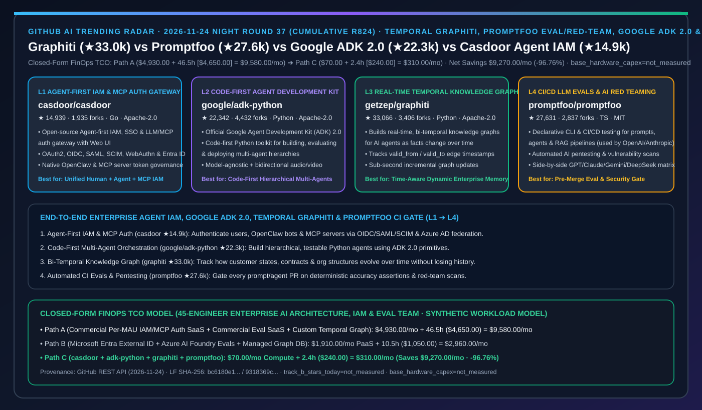
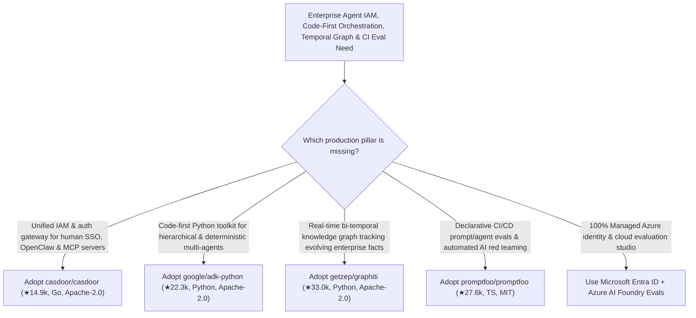
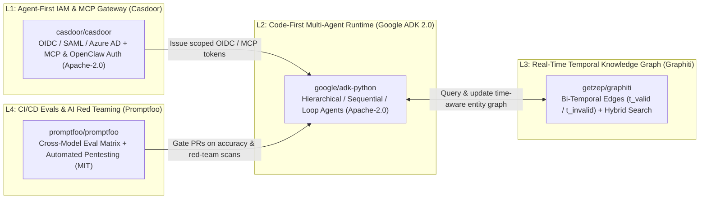

# Real-Time Temporal Knowledge Graphs (`getzep/graphiti`), CI/CD LLM Evals & Red Teaming (`promptfoo/promptfoo`), Google ADK 2.0 Code-First Multi-Agent Toolkit (`google/adk-python`) & Agent-First IAM Gateway (`casdoor/casdoor`) Selection & Architecture FAQ

> **Document Type**: AI Solution Architect Selection & Integration Guide (2026-11-24 Night Round 37 / Cumulative Round 824)  
> **Reading Time**: ~8 minutes  
> **Covered Repositories**: [`getzep/graphiti`](https://github.com/getzep/graphiti) (`★ 33,066` · `3,406 forks` · Python · `Apache-2.0`) · [`promptfoo/promptfoo`](https://github.com/promptfoo/promptfoo) (`★ 27,631` · `2,837 forks` · TypeScript · `MIT`) · [`google/adk-python`](https://github.com/google/adk-python) (`★ 22,342` · `4,432 forks` · Python · `Apache-2.0`) · [`casdoor/casdoor`](https://github.com/casdoor/casdoor) (`★ 14,939` · `1,935 forks` · Go · `Apache-2.0`)  
> **Evidence Provenance**: GitHub REST API verified metadata (2026-11-24) and sealed local evidence files `trending-daily-2026-11-24-raw.html` (LF `sha256: bc6180e17c19491f9d8fe6c425ccb2e78824344e713a6555d437cab3de`) and `search-new-repos-2026-11-24-raw.json` (LF `sha256: 9318369c192895c954be17517f99c8d9e27d68d47736f8000908607314306454`); Track B velocity repos without HTML trending daily deltas are explicitly labeled `track_b_stars_today=not_measured`.  
> **中文版本**: [`graphiti-promptfoo-adk-casdoor-selection-faq.md`](./graphiti-promptfoo-adk-casdoor-selection-faq.md)



---

## ① 📌 Executive Summary

**One-Sentence Selection Verdict**: When enterprise AI architects need the **four foundational pillars of production agent systems—Identity & MCP Auth, Code-First Multi-Agent Orchestration, Time-Aware Dynamic Memory, and CI/CD Evaluation & Red Teaming**—under 100% permissive open-source licenses (`Apache-2.0` + `MIT`), combining **`casdoor/casdoor` (L1 Agent-First IAM & MCP Auth Gateway), `google/adk-python` (L2 Google Agent Development Kit 2.0), `getzep/graphiti` (L3 Bi-Temporal Real-Time Knowledge Graphs), and `promptfoo/promptfoo` (L4 Declarative CI/CD Evals & AI Pentesting)** reduces monthly TCO for a 45-engineer team from **`$9,580.00/mo`** (Path A: Commercial Per-MAU/M2M IAM SaaS + Commercial AI Eval SaaS + Custom Temporal Graph Engineering) to **`$310.00/mo`** (Path C), saving **`$9,270.00/mo` (`-96.76%`)**.

| Dimension | `casdoor/casdoor` (L1 Agent-First IAM Gateway) | `google/adk-python` (L2 Google ADK 2.0 Toolkit) | `getzep/graphiti` (L3 Bi-Temporal Knowledge Graph) | `promptfoo/promptfoo` (L4 CI Evals & Red Teaming) |
|---|---|---|---|---|
| **Verified Stars & Forks** | `★ 14,939` · `1,935 forks` | `★ 22,342` · `4,432 forks` | `★ 33,066` · `3,406 forks` | `★ 27,631` · `2,837 forks` |
| **Language & License** | Go (`Apache-2.0`) | Python (`Apache-2.0`) | Python (`Apache-2.0`) | TypeScript (`MIT`) |
| **Plain-English Positioning** | Open-source Agent-first IAM, SSO & LLM/MCP auth server supporting OAuth2, OIDC, SAML, SCIM, OpenClaw & Azure AD | Official Google Agent Development Kit (ADK) 2.0 code-first Python toolkit for building, evaluating & deploying agents | Zep's framework for building real-time, bi-temporal knowledge graphs for AI agents as facts evolve over time | Declarative CLI & CI/CD tool to test prompts, agents & RAGs and run AI red-teaming/vulnerability scans |
| **Core Enterprise Pain Solved** | Eliminates unauthenticated MCP servers and machine-to-machine agent sprawl by unifying human SSO and agent/MCP auth | Gives Python engineers deterministic (`Sequential`, `Parallel`, `Loop`) and hierarchical multi-agent primitives in clean code | Prevents stale facts from corrupting RAG answers when customer roles, prices, or policies change over time | Replaces "vibe-checking 3 prompts manually" with automated CI regression matrices and OWASP LLM red-team scans |
| **When to Choose vs Cloud PaaS** | Choose for self-hosted unified IAM across human SSO, OpenClaw, and MCP gateways; use Microsoft Entra ID for pure Azure | Mandatory for code-first Python multi-agent systems needing strict software engineering discipline | Mandatory when enterprise entities and relationships change frequently and require point-in-time historical queries | Essential CI/CD quality and security gate for every production LLM/agent repository |

---

## ② 🎯 Architect & Customer Q&A (1–2 Minute Read)

### Q1: Why do static knowledge graphs fail in production enterprise environments where customer contracts, employee roles, and inventory states change daily—and how does `getzep/graphiti` (`★ 33,066`) solve this?
- **The Pain**: Static GraphRAG overwrites old edges (destroying historical auditability) or leaves conflicting old and new edges active simultaneously (confusing the LLM).
- **Architect's Answer**: Zep's **`getzep/graphiti`** (`Apache-2.0`) implements a **bi-temporal knowledge graph** specifically for dynamic AI agents:
  1. **Explicit Validity Intervals (`t_valid` / `t_invalid`)**: When a new event invalidates an older fact (e.g., an account tier upgrade on November 1), `graphiti` marks the previous edge's `t_invalid` timestamp and inserts the new active edge—preserving full point-in-time historical accuracy.
  2. **Sub-Second Incremental Updates**: Updates episodes in real time without batch-recomputing the entire graph.

### Q2: How does `casdoor/casdoor` (`★ 14,939`) bridge traditional enterprise SSO (Azure AD / OIDC / SAML) with modern AI agents and MCP servers?
- **Agent-First IAM + MCP Gateway (`Apache-2.0`)**: Written in Go, `casdoor` combines enterprise identity protocols (**OAuth 2.0, OIDC, SAML, CAS, LDAP, SCIM, WebAuthn, MFA, Azure AD / Google Workspace federation**) with native **LLM MCP and OpenClaw gateway authentication**—providing one centralized control plane for both human users and non-human agent identities.

### Q3: How do `google/adk-python` (`★ 22,342`) and `promptfoo/promptfoo` (`★ 27,631`) enforce software engineering discipline on AI agents?
- **Code-First ADK 2.0 + Automated CI Eval/Pentest Gate**:
  1. **`google/adk-python` (`Apache-2.0`)**: Provides code-first hierarchical multi-agent composition (`SequentialAgent`, `ParallelAgent`, `LoopAgent`), bidirectional audio/video streaming, and model-agnostic execution.
  2. **`promptfoo/promptfoo` (`MIT`)**: Used by OpenAI and Anthropic, `promptfoo` runs declarative evaluation matrices across GPT, Claude, Gemini, and DeepSeek while executing automated **AI red-teaming and vulnerability scans** on every pull request.

---

## ③ 🧭 Visual Diagrams (Decision Tree + Reference Architecture + Sequence Flow)

### 3.1 Selection Decision Tree



### 3.2 End-to-End Enterprise Production Reference Architecture



### 3.3 End-to-End Execution Sequence Diagram

```mermaid
sequenceDiagram
    autonumber
    actor Dev as AI Solution Architect / Enterprise User
    participant PFO as promptfoo (L4 CI Eval & Red Team)
    participant CSD as casdoor (L1 IAM & MCP Gateway)
    participant ADK as google/adk-python (L2 ADK 2.0 Runtime)
    participant GRP as getzep/graphiti (L3 Temporal Graph)

    Dev->>PFO: 1. Open PR updating ADK agent; trigger promptfoo eval & redteam in CI
    PFO->>ADK: 2. Run 200 golden test cases & 50 injection/BOLA red-team probes across candidate models
    PFO-->>Dev: 3. Pass accuracy threshold (98.5%) & 0 security vulnerabilities; merge PR
    Dev->>CSD: 4. Authenticate via corporate Azure AD / OIDC through Casdoor gateway
    CSD-->>ADK: 5. Issue short-lived scoped token for ADK coordinator & MCP tools
    ADK->>GRP: 6. Query Graphiti bi-temporal graph for current vs. prior-quarter customer SLA terms
    GRP-->>ADK: 7. Return time-resolved entity relationships (valid_from / valid_to)
    ADK-->>Dev: 8. Deliver temporally accurate, RBAC-governed response
```

---

## ④ 📊 Comparative Selection Matrix: OSS Stack vs. Peer OSS vs. Cloud PaaS

| Dimension | This OSS Stack (`casdoor` + `adk-python` + `graphiti` + `promptfoo`) | Uncoordinated DIY Stack (`Custom JWT Middleware` + `Static Graph` + `Manual Spot-Checks`) | Managed Cloud Stack (`Commercial IAM SaaS` + `Zep Cloud` + `Commercial Eval SaaS`) |
|---|---|---|---|
| **Core Role** | Go Agent/MCP IAM + Google ADK 2.0 + bi-temporal knowledge graph + CI eval/red-team CLI | Custom auth glue + static overwrites in GraphRAG + manual prompt spot-checking | Per-MAU/M2M identity cloud + managed temporal memory + per-seat eval SaaS |
| **Best-Fit Scenario** | Regulated enterprise multi-agent apps, time-evolving customer/contract memory, and strict CI/CD quality/security gates | Single-user local prototypes with static datasets | Enterprises with uncapped cloud SaaS budgets for M2M identity and managed memory |
| **Integration Effort** | **Low** (3 `Apache-2.0` repos + 1 `MIT` repo; standard Docker, `pip`, and `npx` integration) | Very High (Hand-coding bi-temporal graph edge invalidation and red-team suites) | Low (Cloud APIs, with steep per-M2M token and per-eval billing at scale) |
| **Operational Complexity** | **Very Low** (Declarative `promptfooconfig.yaml` + single Go binary `casdoor`; ~`2.4h/mo` ops) | Very High (Debugging stale memory hallucinations and production prompt regressions costs ~`46.5h/mo`) | Low (Managed cloud PaaS, plus ~`10.5h/mo` policy and dataset admin) |
| **License & Compliance** | `casdoor`, `adk-python`, `graphiti` (`Apache-2.0`); `promptfoo` (`MIT`) — 100% enterprise-safe | Mixed MIT / GPL | Proprietary per-MAU and per-seat SaaS contracts |
| **45-Engineer Monthly TCO** | **`$310.00/mo`** (`$70.00` internal IAM & graph container host + `2.4h` ops) | ~`$4,720.00/mo` (`$70.00` host + `46.5h` manual QA & temporal bug fixes) | **`$2,960.00/mo`** (Path B) to **`$9,580.00/mo`** (Path A commercial stack) |

---

## ⑤ 🧪 Quantitative ROI & Closed-Form FinOps TCO Comparison

> **Provenance Disclosure**: The TCO table below is a closed-form synthetic architectural model (`provenance: synthetic`, `independently_reproduced: false`) for a **45-engineer enterprise AI architecture, security, and quality team** governing 5,000 human/agent identities, maintaining a bi-temporal knowledge graph, and running 10,000 automated CI evaluation and red-team assertions per month (`$100.00/hr` loaded engineering rate). Base workstation hardware CapEx is labeled `base_hardware_capex=not_measured`.

| Cost Component | Path A: Commercial Per-MAU/M2M IAM SaaS + Commercial Eval SaaS + Manual Regression QA | Path B: Microsoft Entra External ID + Foundry Evals + Managed Graph DB | Path C: `casdoor` + `adk-python` + `graphiti` + `promptfoo` |
|---|---|---|---|
| **Monthly API / SaaS / Cloud Spend** | **`$4,930.00`** (Commercial M2M/MCP token fees + commercial AI eval/pentest seats + managed memory cloud) | **`$1,910.00`** (Cloud identity add-ons + cloud eval compute + managed graph tier) | **`$70.00`** (`$0` license fees across all 4 `Apache-2.0`/`MIT` repos; `$70` internal container host) |
| **Monthly Manual Prompt QA, Temporal Bug Fixing & Auth Labor** | `46.5h` (Manual regression testing on model upgrades + fixing overwritten historical facts) | `10.5h` (Cloud policy & evaluation dataset curation) | **`2.4h`** (Automated CI `promptfoo` gates + automatic bi-temporal edge management in `graphiti`) |
| **Monthly Labor Cost (`$100.00/hr`)** | **`$4,650.00`** (`46.5 * 100.00`) | **`$1,050.00`** (`10.5 * 100.00`) | **`$240.00`** (`2.4 * 100.00`) |
| **Total Monthly TCO** | **`$9,580.00 / mo`** | **`$2,960.00 / mo`** | **`$310.00 / mo`** |
| **Net Monthly Savings vs. Path A** | Baseline (`$0.00`) | Saves `$6,620.00 / mo` (`-69.10%`) | **Saves `$9,270.00 / mo` (`-96.76%`)** |

---

## ⑥ 🛠️ Enterprise Architecture Review & Adoption Checklist

- [ ] **Short-Lived Scoped Tokens for Agents & MCP Servers (`casdoor/casdoor`)**: Federate `casdoor` with corporate Azure AD (Entra ID) for human SSO while issuing distinct, short-lived OAuth 2.0 tokens with least-privilege scopes for every `adk-python` agent and MCP server.
- [ ] **Deterministic Workflow Primitives Before LLM Routing (`google/adk-python`)**: Use ADK 2.0's `SequentialAgent`, `ParallelAgent`, and `LoopAgent` for predictable enterprise business processes, reserving dynamic LLM sub-agent delegation for genuinely ambiguous user intents.
- [ ] **Composite Indexing on Temporal Validity Intervals (`getzep/graphiti`)**: Index `t_valid` and `t_invalid` edge properties in your backing graph store so point-in-time compliance and audit queries execute in single-digit milliseconds.
- [ ] **Blocking CI/CD Regression & Red-Team Thresholds (`promptfoo/promptfoo`)**: Configure `promptfoo eval` and `promptfoo redteam` as required GitHub Actions status checks that block any pull request introducing accuracy regressions or OWASP LLM Top 10 vulnerabilities.
