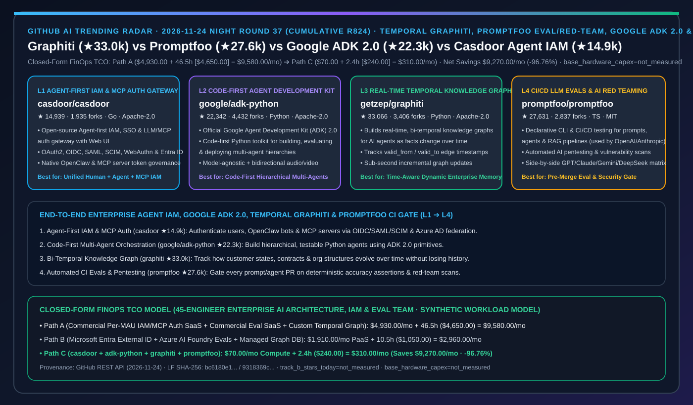
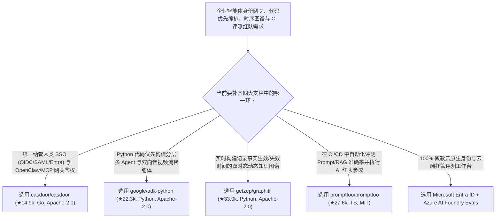
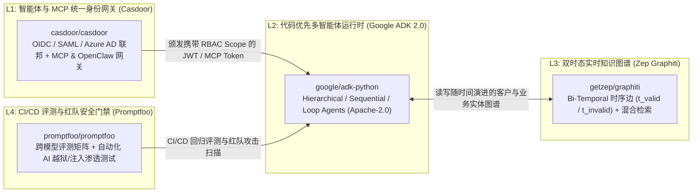
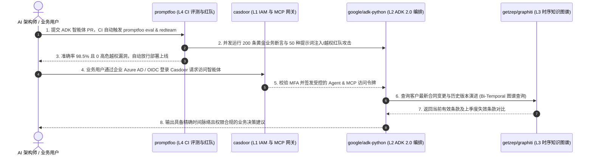

# 实时时序知识图谱（`getzep/graphiti`）、CI/CD 提示词评测与红队渗透标准（`promptfoo/promptfoo`）、Google ADK 2.0 代码优先多智能体套件（`google/adk-python`）与智能体优先统一身份网关（`casdoor/casdoor`）选型与集成 FAQ

> **文档类型**：AI 解决方案架构师（AI Solution Architect）选型决策指南（2026-11-24 Night Round 37 / 累计第 824 轮）  
> **阅读耗时**：约 8 分钟  
> **覆盖项目**：[`getzep/graphiti`](https://github.com/getzep/graphiti)（`★ 33,066` · `3,406 forks` · Python · `Apache-2.0`） · [`promptfoo/promptfoo`](https://github.com/promptfoo/promptfoo)（`★ 27,631` · `2,837 forks` · TypeScript · `MIT`） · [`google/adk-python`](https://github.com/google/adk-python)（`★ 22,342` · `4,432 forks` · Python · `Apache-2.0`） · [`casdoor/casdoor`](https://github.com/casdoor/casdoor)（`★ 14,939` · `1,935 forks` · Go · `Apache-2.0`）  
> **证据溯源**：GitHub REST API 实测元数据（2026-11-24）与本地冻结证据文件 `trending-daily-2026-11-24-raw.html`（LF `sha256: bc6180e17c19491f9d8fe6c425ccb2e78824344e713a6555d437cab3de`）、`search-new-repos-2026-11-24-raw.json`（LF `sha256: 9318369c192895c954be17517f99c8d9e27d68d47736f8000908607314306454`）；Track B 仓库无 HTML 榜单对应的单日增量，统一标记为 `track_b_stars_today=not_measured`。  
> **English Version**: [`graphiti-promptfoo-adk-casdoor-selection-faq.en.md`](./graphiti-promptfoo-adk-casdoor-selection-faq.en.md)

---

## ① 📌 核心结论速览（Executive Summary）

**选型一句话结论**：当企业架构师需要打造一套**“生产级四大黄金支柱（身份鉴权 IAM + 代码优先多 Agent 编排 + 动态时序知识图谱 + CI/CD 自动化评测与红队渗透）”**且要求 100% 商业友好开源协议（`Apache-2.0` + `MIT`）时，采用 **`casdoor/casdoor`（L1 原生支持 OpenClaw、MCP 与 Azure AD/OIDC 的 Agent-First 统一身份网关）+ `google/adk-python`（L2 Google 官方 Agent Development Kit 2.0 代码优先多智能体框架）+ `getzep/graphiti`（L3 支持双时态历史演进追踪的实时时序知识图谱）+ `promptfoo/promptfoo`（L4 OpenAI 与 Anthropic 也在使用的声明式提示词/RAG 评测与 AI 红队扫描器）**，可将 45 人团队的月度 TCO 从商业按月活计费 IAM/MCP 鉴权云 + 商业 AI 评测 SaaS + 自研时序状态机（Path A）的 **`$9,580.00/月`** 降至 **`$310.00/月`**（净省 **`$9,270.00/月`**，降幅 **`-96.76%`**）。

| 评估维度 | `casdoor/casdoor` (L1 智能体优先 IAM 网关) | `google/adk-python` (L2 Google ADK 2.0 框架) | `getzep/graphiti` (L3 实时双时态知识图谱) | `promptfoo/promptfoo` (L4 CI 评测与 AI 红队) |
|---|---|---|---|---|
| **GitHub 实测热度** | `★ 14,939` · `1,935 forks` | `★ 22,342` · `4,432 forks` | `★ 33,066` · `3,406 forks` | `★ 27,631` · `2,837 forks` |
| **实现语言与开源协议** | Go (`Apache-2.0`) | Python (`Apache-2.0`) | Python (`Apache-2.0`) | TypeScript (`MIT`) |
| **一句话通俗定位** | 原生支持 OpenClaw、LLM MCP 网关与 OAuth2/OIDC/SAML/SCIM/WebAuthn/Azure AD 的开源 Agent-First IAM 平台 | Google 官方开源的 ADK 2.0 代码优先 Python 多智能体构建、评测与部署工具包 | Zep 开源的面向 AI Agent 实时构建双时态（Bi-Temporal）动态演进知识图谱的框架 | 行业事实标准的声明式提示词/Agent/RAG 对比评测与自动化 AI 红队渗透 CLI 工具 |
| **解决的核心业务痛点** | 解决企业内部“人类员工走 SSO，但新冒出来的几十个 MCP Server 和 OpenClaw 智能体处于无身份裸奔状态”的安全盲区 | 解决纯低代码拖拽无法用 Git 做严格软件工程 Code Review、而早期 SDK 缺乏多级子 Agent 委托与实时音视频流支持的痛点 | 解决普通知识图谱“一旦客户换了职位或合同改了价格，直接覆盖旧边导致历史时间点回溯查询出错”的时序失真难题 | 消除研发修改一行 System Prompt 或切换模型版本后“只靠肉眼试 3 个例子就敢上线”导致的生产回归与越狱事故 |
| **何时选它 vs 云托管** | 需要一套开源自托管 IAM 同时纳管人类 SSO、MCP 网关鉴权与 Agent 身份时必选；纯微软云选 Microsoft Entra Agent ID | Python 工程团队构建模块化、强工程纪律的多层级 Agent 系统时必选 | 业务数据随时间高频变化（如客户状态、金融持仓、组织调整）且需精确回答“上月 vs 本月变化”时必选 | 所有 AI 应用的 GitHub Actions / GitLab CI 发布门禁必配标准工具 |

---

## ② 🎯 客户与架构师灵魂拷问 Q&A（1–2 分钟速读）

### Q1：传统的开源知识图谱（如静态 GraphRAG）最大的问题是“没有时间概念”——比如客户王总今年 6 月从 A 部门调到了 B 部门，静态图谱要么把旧边删了（导致查去年项目负责人时查错），要么两条边混在一起（大模型分不清他现在到底在哪个部门）。`getzep/graphiti`（`★ 33,066`）是怎么解决的？
- **痛点**：真实企业世界是持续变化的动态流，不是静态百科全书。
- **架构师解答**：Zep 团队开源的 **`getzep/graphiti`**（`Apache-2.0`）专为动态环境设计了**双时态（Bi-Temporal）实时知识图谱模型**：
  1. **每条关系边自带 `t_valid`（事实生效时间）与 `t_invalid`（事实失效时间）**：当新对话或新工单传入“王总自 6 月 1 日起调任 B 部门”时，`graphiti` 自动将原“王总 ➔ A 部门”边的失效时间设为 6 月 1 日，并新建“王总 ➔ B 部门”的当前有效边。
  2. **亚秒级增量更新与混合检索**：无需全量重建图谱，结合语义向量、BM25 关键词与图遍历，既能秒级回答“他现在归谁管”，又能准确追溯“去年底那份合同是谁签的”。

### Q2：为什么 `casdoor/casdoor`（`★ 14,939`）把自己的定位升级成了 *"Agent-first Identity and Access Management (IAM) / LLM MCP & agent gateway"*？
- **核心收益**：企业安全架构师最头疼的是：人类员工已经有 Azure AD (Entra ID) 或 Okta，但当企业引入 OpenClaw、各类 MCP Server 和内部 LLM 网关时，传统 IAM 不懂 MCP 协议路由与 Agent 令牌委托。`casdoor/casdoor`（Go · `Apache-2.0`）在完整支持 **OAuth 2.0、OIDC、SAML、CAS、LDAP、SCIM、WebAuthn、Face ID 与 Azure AD / Google Workspace 联邦** 的基础上，原生内建了 **LLM MCP 网关与 OpenClaw 认证中心**，用一个轻量 Go 服务统一管住“人 + Agent + MCP 工具 + 模型网关”的认证与授权。

### Q3：`google/adk-python`（`★ 22,342`）2.0 版本与 `promptfoo/promptfoo`（`★ 27,631`）如何构成严谨的企业级 AI 研发与发布流水线？
- **Code-First 开发 + CI/CD 评测红队门禁**：
  1. **开发阶段用 `google/adk-python`（ADK 2.0 · `Apache-2.0`）**：坚持“Agent 开发就是软件开发（Code-First）”原则，提供清晰的父子 Agent 委托（Hierarchical Agents）、确定性工作流原语（`SequentialAgent`、`ParallelAgent`、`LoopAgent`）与内置调试 UI，且完全模型无关（支持 Gemini、OpenAI、Anthropic 及本地模型）。
  2. **合并与发布阶段用 `promptfoo/promptfoo`（`MIT`）**：在 PR 合并前通过 GitHub Actions 自动运行 `promptfoo eval` 与 `promptfoo redteam`——一方面横评 GPT、Claude、Gemini、DeepSeek 在同一批业务用例上的准确率与延迟矩阵，另一方面自动发起提示词注入、PII 诱导泄露、越权工具调用（BFLA/BOLA）等红队渗透测试，不达标直接阻断上线。

---

## ③ 🧭 直观可视化图解（Mermaid 决策树 + 集成架构 + 时序图）

### 3.1 技术选型决策树

### 3.2 企业端到端生产集成参考架构图

### 3.3 业务流全链路时序图

---

## ④ 📊 同类开源与商业云服务横向选型决策矩阵

| 对比维度 | 本轮开源组合 (`casdoor` + `adk-python` + `graphiti` + `promptfoo`) | 传统拼凑方案 (`手写 JWT 校验` + `静态无时间图谱` + `肉眼测 Prompt`) | 商业云与 SaaS 方案 (`Auth0/Okta 商业版` + `Zep Cloud` + `商业评测 SaaS`) |
|---|---|---|---|
| **功能定位** | Go Agent/MCP IAM + Google ADK 2.0 + 双时态知识图谱 + CI 评测与红队标准工具 | 零散鉴权中间件 + 新旧事实冲突的静态图 + 无回归门禁的盲发 | 按 MAU 计费的身份云 + 按节点计费的托管记忆云 + 商业安全评测席位 |
| **适用场景** | 企业级高安全多 Agent 系统、客户/业务状态随时间演进的动态记忆、严格的 CI/CD 提示词与模型选型评测 | 无需用户鉴权或历史状态回溯的单机个人玩具项目 | 100% 采购商业身份云与全托管 AI 平台的大型企业 |
| **集成成本** | **低**（三仓 `Apache-2.0` + 一仓 `MIT`，标准 Docker 与 `pip`/`npx` 15 分钟集成） | 高（自行在图数据库手写双时态时间戳消歧逻辑极其复杂） | 低（SaaS 接入快，但当内部员工与外部客户 MAU 增长时账单陡增） |
| **运维复杂度** | **极低**（声明式 `promptfooconfig.yaml` + Go 单二进制 `casdoor`，月均维护仅 `2.4h`） | 极高（排查静态图谱新旧信息覆盖污染与线上越狱事故耗费 `46.5h/月`） | 低（云端全托管，月均策略与评测集维护约 `10.5h`） |
| **开源协议与合规** | `casdoor`、`adk-python`、`graphiti` 为 `Apache-2.0`；`promptfoo` 为 `MIT`（100% 企业合规） | MIT / GPL 混杂 | 商业闭源按 MAU / 按评测次数收费 |
| **45 人团队月度 TCO** | **`$310.00/月`**（含 `$70.00` 内部 IAM 与时序图谱容器节点 + `2.4h` 运维） | 约 `$4,720.00/月`（含 `$70.00` 主机 + `46.5h` 记忆污染修复与人工回归测试工时） | **`$2,960.00/月`**（Path B）至 **`$9,580.00/月`**（Path A 商业全栈） |

---

## ⑤ 🧪 应用落地定量收益 / TCO 对比（Closed-Form FinOps 模型）

> **数据性质声明（Provenance Metadata）**：以下 TCO 模型为面向 **45 人企业 AI 架构、身份安全与质量工程团队**（统一管控 5,000 名内外部用户与 80 个 MCP/Agent 的 SSO 鉴权、维护百万级时序演进边，并在每次发版 CI 中自动运行 10,000 次跨模型评测与红队渗透断言，工程师折算时薪 `$100.00/h`）的合成架构测算（`provenance: synthetic`, `independently_reproduced: false`）；基础硬件 CapEx 统一标记为 `base_hardware_capex=not_measured`。

| 成本构成项 | Path A：商业按月活 IAM/MCP 鉴权 SaaS + 商业评测红队 SaaS + 人工回归测试 | Path B：Microsoft Entra External ID + Foundry Evals + 托管图库 | Path C：`casdoor` + `adk-python` + `graphiti` + `promptfoo` |
|---|---|---|---|
| **API / SaaS / 云资源月费** | **`$4,930.00`**（商业 IAM B2B/M2M 令牌费 + 商业 AI 红队与评测平台企业席位 + 托管记忆云） | **`$1,910.00`**（云端身份扩展配额 + 云端评测算力 + 托管图数据库） | **`$70.00`**（四套 `Apache-2.0`/`MIT` 软件 `$0` 授权费；仅需 `$70` 内网容器节点运行 `casdoor` 与 `graphiti`） |
| **月度人工跑回归测试、排查新旧记忆冲突与手写鉴权工时** | `46.5h`（每次换模型/改提示词靠人工测几十个 Case + 修复旧事实未失效导致的错误回答） | `10.5h`（云端身份映射与评测数据集维护） | **`2.4h`**（CI 自动跑 `promptfoo` 矩阵 + `graphiti` 自动处理时序边失效） |
| **人工研发与 QA 运维成本（`$100.00/h`）** | **`$4,650.00`** (`46.5 * 100.00`) | **`$1,050.00`** (`10.5 * 100.00`) | **`$240.00`** (`2.4 * 100.00`) |
| **月度总拥有成本（Total Monthly TCO）** | **`$9,580.00 / 月`** | **`$2,960.00 / 月`** | **`$310.00 / 月`** |
| **相对 Path A 净节省** | 基准线 (`$0.00`) | 节省 `$6,620.00 / 月` (`-69.10%`) | **净省 `$9,270.00 / 月` (`-96.76%`)** |

---

## ⑥ 🛠️ 企业引入与架构评审 Checklist

- [ ] **人类用户与非人类智能体（NHI）身份双轨联邦（`casdoor/casdoor`）**：在 `casdoor` 中通过 OIDC/SAML 对接企业现有的 Azure AD (Entra ID) 管理人类员工登录，同时为每个 `adk-python` 智能体与 MCP Server 签发独立的短期客户端凭证（Short-Lived OAuth2 Client Credentials），禁止多个 Agent 共用静态万能密钥。
- [ ] **分层多智能体确定性编排优先（`google/adk-python`）**：在使用 ADK 2.0 设计企业级应用时，能用确定性 `SequentialAgent` / `ParallelAgent` 表达的固定业务流程绝不交给自由 LLM 路由，仅在需要动态意图分发时使用 LLM Coordinator。
- [ ] **双时态图谱时间戳索引与历史快照查询（`getzep/graphiti`）**：在底层图存储（Neo4j / FalkorDB）中为 `graphiti` 的 `valid_at`、`invalid_at` 与 `created_at` 属性建立复合索引，确保时间切片查询（Point-in-Time Query）保持毫秒级响应。
- [ ] **PR 合并强制绑定 `promptfoo` 准确率与红队零高危门禁（`promptfoo/promptfoo`）**：在 GitHub Actions 中配置 `promptfoo eval` 与 `promptfoo redteam`，规定任何对提示词、RAG 检索参数或模型版本的修改若导致核心评测集准确率下降超过 `1%` 或出现任一 OWASP LLM Top 10 高危漏洞，立即阻断 PR 合并。
