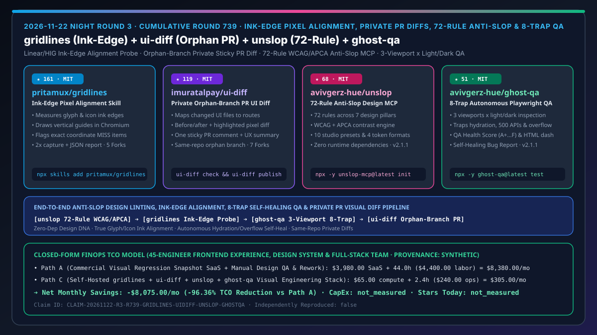
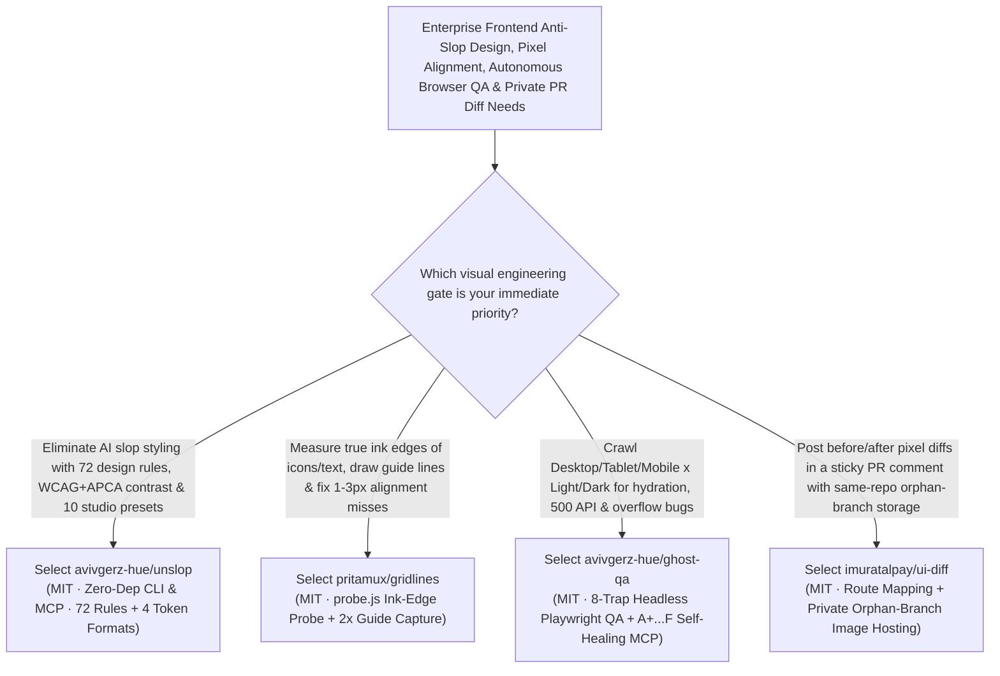
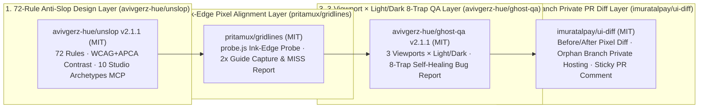
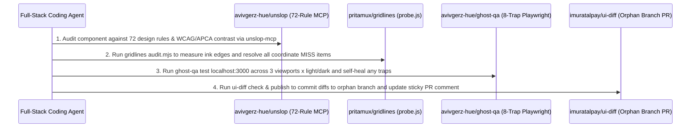

# Ink-Edge Pixel Alignment Probe (`pritamux/gridlines`), Orphan-Branch Private PR Pixel Diff (`imuratalpay/ui-diff`), 72-Rule WCAG/APCA Anti-Slop Design MCP (`avivgerz-hue/unslop`) & 8-Trap 3-Viewport Autonomous Playwright QA (`avivgerz-hue/ghost-qa`) Selection & Architecture FAQ

> **Document Type**: Enterprise AI Solution Architect Selection & Integration Guide (GitHub Trending AI Radar — 2026-11-22 Night Round 3 / Cumulative Round 739)
> **Covered Repositories**: [`pritamux/gridlines`](https://github.com/pritamux/gridlines) (`★ 161`, `5 forks`, `MIT`: agent skill and headless Chromium `probe.js` / `audit.mjs` that measures the real ink edges of text, icons, and controls, draws vertical guide lines, flags every pixel miss, and saves a 2× annotated capture + JSON report) · [`imuratalpay/ui-diff`](https://github.com/imuratalpay/ui-diff) (`★ 119`, `7 forks`, `MIT`: TypeScript CLI and agent skill that maps changed UI files to routes, renders before/after screenshots and highlighted pixel diffs into a single sticky PR comment, and stores images privately on an orphan branch of the same repository) · [`avivgerz-hue/unslop`](https://github.com/avivgerz-hue/unslop) (`★ 68`, `6 forks`, `MIT`, `v2.1.1`: zero-runtime-dependency 72-rule UI/UX design linter, WCAG + APCA contrast engine, 10 studio archetypes, and native MCP server) · [`avivgerz-hue/ghost-qa`](https://github.com/avivgerz-hue/ghost-qa) (`★ 51`, `6 forks`, `MIT`, `v2.1.1`: 8-trap autonomous headless Playwright QA agent & MCP server testing 3 viewports × light/dark themes to generate `A+…F` health scores and self-healing bug reports)
> **Core Scenario**: When enterprise frontend and full-stack teams using coding agents (Claude Code, Cursor, Codex, GitHub Copilot) struggle with **generic purple-gradient "AI slop" styling, 1–3px icon/text misalignment in sidebars and toolbars, agents declaring victory without opening a browser (leaving React hydration errors, 500ing APIs, and mobile overflow), and PR reviewers lacking private before/after visual diffs**, how do you chain **`avivgerz-hue/unslop` ➔ `pritamux/gridlines` ➔ `avivgerz-hue/ghost-qa` ➔ `imuratalpay/ui-diff`** into an automated design and QA gate?

---

## 1. 📌 Executive Summary (One-Line Selection Verdict)

1. **Need an agent skill that measures actual glyph and icon ink edges (not just DOM bounding boxes), draws vertical alignment guides, and lists exact pixel misses (`MISS y56 trailing: 15px vs 12px`) so sidebars, toolbars, and tables snap onto shared axes?** ➔ Choose **[`pritamux/gridlines`](https://github.com/pritamux/gridlines) (`★ 161`, `5 forks`, `MIT`)**.
   - **Plain-English Mechanism**: Grounded in Karri Saarinen's Linear sidebar rhythm rules and Apple's Human Interface Guidelines, `skills/gridlines/probe.js` and `audit.mjs` load your page in headless Chromium (or run interactively via `window.__gridlines()`), measure ink edges of text, SVG icons, and controls, output a 2× annotated guide capture plus structured JSON miss report, and guide the coding agent to fix every stray padding offset.
2. **Need automated before/after screenshots, highlighted pixel diffs, and a concise UX summary posted as one sticky PR comment—with all images stored privately inside an orphan branch of the same Git repository?** ➔ Choose **[`imuratalpay/ui-diff`](https://github.com/imuratalpay/ui-diff) (`★ 119`, `7 forks`, `MIT`)**.
   - **Plain-English Mechanism**: `ui-diff check` detects changed UI files between `base` and `head`, maps them to routes, and renders composite before/after/diff images in `.ui-diff/compare/`. Running `ui-diff publish` commits the images to an **orphan branch of the same repository** and updates a single sticky PR comment—ensuring zero unreleased UI screenshots ever leave your GitHub repository permissions boundary.
3. **Need a zero-runtime-dependency UI/UX design linter and MCP server (`npx -y unslop-mcp@latest init`) that audits 72 rules across 7 design pillars, enforces WCAG + APCA contrast, and applies 10 studio-grade archetypes?** ➔ Choose **[`avivgerz-hue/unslop`](https://github.com/avivgerz-hue/unslop) (`★ 68`, `6 forks`, `MIT`)**.
   - **Plain-English Mechanism**: Audits JSX/TSX, HTML, Vue, Svelte, CSS, and Tailwind codebases against 72 design engineering rules, extracts Design DNA, exports 4 token formats, and emits prioritized transformation blueprints that replace generic AI slop with token-driven studio precision.
4. **Need a zero-config autonomous headless Playwright QA engine (`npx -y ghost-qa@latest test http://localhost:3000`) that crawls Desktop/Tablet/Mobile × Light/Dark modes and hands the coding agent a structured Self-Healing Bug Report before it finishes?** ➔ Choose **[`avivgerz-hue/ghost-qa`](https://github.com/avivgerz-hue/ghost-qa) (`★ 51`, `6 forks`, `MIT`)**.
   - **Plain-English Mechanism**: Launches a live 8-Trap Deep Browser Inspection Engine across **3 viewports × light/dark themes**, safely interacts with controls, traps React hydration errors, console exceptions, 500 API responses, dead links, and mobile overflow, grades the app from `A+` to `F`, and drives the agent to fix its own runtime/layout bugs autonomously.

---

## 2. 🎯 Architect & Customer Deep-Dive Q&A

### Q1: Why does AI-assisted frontend velocity often stall during Design QA and PR review? How do these four tools automate the visual verification loop?

- **Four Frontend Bottlenecks Solved**:
  1. **Generic "AI slop" visual aesthetics & contrast failures ➔ `avivgerz-hue/unslop`**: Enforces 72 design rules, WCAG + APCA contrast math, and 10 studio archetypes directly via MCP.
  2. **1–3px optical misalignment between icons and labels ➔ `pritamux/gridlines`**: Measures true ink edges and reports exact coordinate misses (`MISS y120 vertical-centre: 3px vs 0px`).
  3. **Blind coding agents declaring completion with broken DOM/hydration ➔ `avivgerz-hue/ghost-qa`**: Runs 8-trap headless Playwright inspection across 3 viewports × light/dark themes and returns a self-healing bug report.
  4. **Slow visual PR reviews & third-party screenshot hosting risks ➔ `imuratalpay/ui-diff`**: Publishes a single sticky PR comment backed by same-repo orphan-branch image storage.
- **When to Choose Managed Cloud Visual Testing SaaS (Path B)?**
  - If your consumer web app requires cross-browser cloud device farms (real iOS Safari / Samsung Internet), pair **Chromatic / Percy + Azure Playwright Workspaces**; for local agent self-healing and zero-egress repository-private PR diffs, deploy this 4-repo `MIT` stack (Path C).

### Q2: How do we wire `unslop`, `gridlines`, `ghost-qa`, and `ui-diff` into an end-to-end frontend delivery pipeline?

1. **72-Rule Design DNA & Contrast Gate (`avivgerz-hue/unslop`)**:
   - Run `unslop-mcp` during component authoring to enforce token consistency and WCAG/APCA contrast.
2. **Ink-Edge Optical Alignment Pass (`pritamux/gridlines`)**:
   - Run `audit.mjs` on navigation, sidebars, and tables until all vertical guide `MISS` entries are resolved.
3. **3-Viewport × Light/Dark 8-Trap Self-Healing QA (`avivgerz-hue/ghost-qa`)**:
   - Run `ghost-qa test http://localhost:3000` and require a passing `A/A+` health score with zero hydration or overflow traps.
4. **Orphan-Branch Private Sticky PR Diff (`imuratalpay/ui-diff`)**:
   - Run `ui-diff check` and `ui-diff publish` in CI or the agent session to post before/after pixel diffs to the PR.

### Q3: What are the operational best practices for running this stack?

- **Shared Headless Chromium Cache**:
  - Point `PW_DIR` at a shared local Playwright browser cache so `gridlines`, `ghost-qa`, and `ui-diff` reuse the same Chromium binary across local sessions and CI runners.

---

## 3. 🧭 Visual Architecture & Workflow Diagrams (Mermaid)

### 3.1 Solution Architect Selection Decision Tree

### 3.2 End-to-End Enterprise Reference Architecture

### 3.3 End-to-End Frontend Visual Verification Sequence Diagram

---

## 4. 📊 Peer Open-Source vs. Commercial Cloud Selection Matrix

| Dimension | `pritamux/gridlines` (`★ 161`) | `imuratalpay/ui-diff` (`★ 119`) | `avivgerz-hue/unslop` (`★ 68`) | `avivgerz-hue/ghost-qa` (`★ 51`) | Commercial Cloud Visual Regression SaaS + Manual Design QA Reviews (Path A) | Manual Redline Screenshots + Ad-Hoc Playwright Scripts (Path B) |
| :--- | :--- | :--- | :--- | :--- | :--- | :--- |
| **Primary Role** | Ink-edge vertical alignment probe & agent skill | Same-repo orphan-branch sticky PR pixel diff | 72-rule WCAG/APCA anti-slop design linter & MCP | 8-trap 3-viewport × light/dark autonomous Playwright QA | Per-snapshot commercial cloud visual regression SaaS + manual UI review | Manual designer redlines & brittle hand-written E2E scripts |
| **Key Differentiator** | **Measures true glyph/icon ink edges + 2× guide capture** | **Stores PR diff images on same-repo orphan branch (100% private)** | **Zero runtime deps + 72 rules + WCAG/APCA contrast engine** | **Zero test scripts + 8-trap inspection + `A+…F` self-healing loop** | High per-snapshot overage fees; uploads unreleased UI to external cloud storage | Misses dark-mode/mobile overflow & subtle 2px ink-edge drift |
| **License** | `MIT` | `MIT` | `MIT` | `MIT` | Proprietary SaaS | Internal manual workflow |
| **Monthly TCO (45-Eng Team)** | **`$305.00/mo` combined** (`$65.00` shared CI runner + `2.4h` ops) | Included (`$0` external image hosting via orphan branch) | Included (zero runtime dependencies) | Included (local/CI headless Playwright) | **`$8,380.00/mo`** (`$3,980.00` visual snapshot SaaS + `44.0h` manual UI QA/rework) | ~`$2,900.00/mo` (manual pixel redlining & QA regression labor) |

---

## 5. 🧪 Quantitative Enterprise ROI / FinOps TCO Model & 7-Card Report

> **📊 Provenance & Closed-Form Declaration**:
> - **provenance**: `synthetic` (45-engineer enterprise frontend experience, design system, and full-stack delivery team workload model: `independently_reproduced = false`; `base_hardware_capex = not_measured`; `track_b_stars_today = not_measured`).
> - **Closed-Form Equations**:
>   - **Path A (Commercial Cloud Visual Regression Snapshot SaaS + Commercial Accessibility Scanners + Manual Designer Pixel Redlining & Multi-Viewport QA Rework)**: Monthly commercial visual snapshot & accessibility SaaS bills **`$3,980.00`** + manual design QA, pixel alignment rework, and PR screenshot curation labor **`44.0h × $100.00/h = $4,400.00`** = **`$8,380.00/mo`**.
>   - **Path C (Self-Hosted `pritamux/gridlines` + `imuratalpay/ui-diff` + `avivgerz-hue/unslop` + `avivgerz-hue/ghost-qa` Stack)**: Shared headless Chromium CI runner compute **`$65.00`** + archetype & route config maintenance labor **`2.4h × $100.00/h = $240.00`** = **`$305.00/mo`**.
>   - **Net Monthly Savings vs. Path A**: **`-$8,075.00/mo`** (**`96.36%`** TCO reduction).

| Evaluation Path | Visual SaaS / Runner Compute | Design QA & Frontend Rework Labor (`$100/h`) | Total Monthly TCO | Net Savings vs. Path A | Architectural Delivery Impact |
| :--- | :---: | :---: | :---: | :---: | :--- |
| **Path A: Commercial Visual Snapshot SaaS + Manual Design QA** | `$3,980.00` | `44.0h` (`$4,400.00`) | **`$8,380.00`** | Baseline | High per-snapshot fees; external screenshot hosting; no in-session self-healing |
| **Path B: Manual Redline Screenshots + Custom Playwright Scripts** | `$1,300.00` | `16.0h` (`$1,600.00`) | **`$2,900.00`** | `-$5,480.00` (`-65.39%`) | Lacks ink-edge coordinate probing, 72-rule anti-slop linting & orphan-branch PR diffs |
| **Path C: `gridlines` + `ui-diff` + `unslop` + `ghost-qa`** | **`$65.00`** | **`2.4h` (`$240.00`)** | **`$305.00`** | **`-$8,075.00` (`-96.36%`)** | **72-rule anti-slop + ink-edge alignment + 8-trap 3-viewport QA + private PR diffs** |

- 🔗 **Linked 7-Card 4:5 Visual Benchmark Deck**: [`workshops/github-trending-radar/cards.en.html`](../cards.en.html) · [`cards.html`](../cards.html)

---

## 6. 🛠️ Enterprise Adoption & Architecture Review Checklist

- [ ] **1. Enforce 72-Rule Design Engineering & WCAG/APCA Contrast with `avivgerz-hue/unslop`**: Initialize `unslop-mcp` in frontend repositories to eliminate generic AI slop styling and export standardized design tokens.
- [ ] **2. Run Ink-Edge Optical Alignment Passes with `pritamux/gridlines`**: Execute `audit.mjs` on sidebars, headers, and tables until all coordinate `MISS` items reach zero.
- [ ] **3. Gate Agent Task Completion on `avivgerz-hue/ghost-qa`**: Require coding agents to run `ghost-qa test` across Desktop/Tablet/Mobile × Light/Dark viewports and self-heal any hydration, API 500, or overflow traps before handoff.
- [ ] **4. Publish Private Sticky PR Visual Diffs with `imuratalpay/ui-diff`**: Configure `ui-diff check` and `ui-diff publish` so before/after pixel diffs are committed to a same-repo orphan branch and surfaced in one sticky PR comment.
