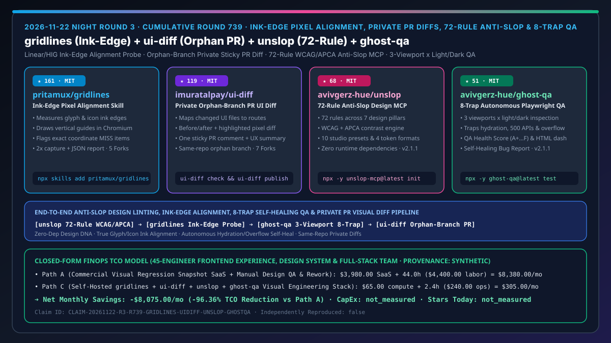
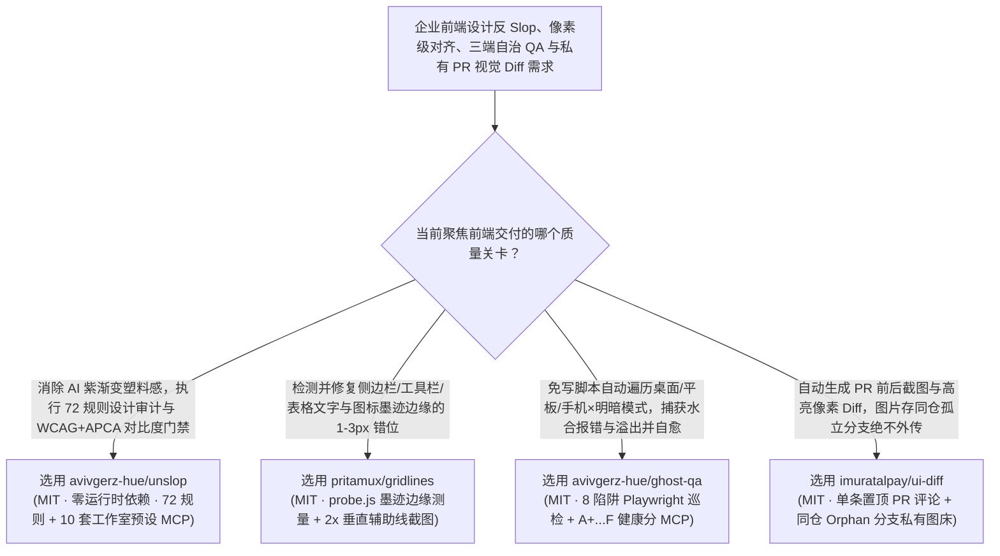
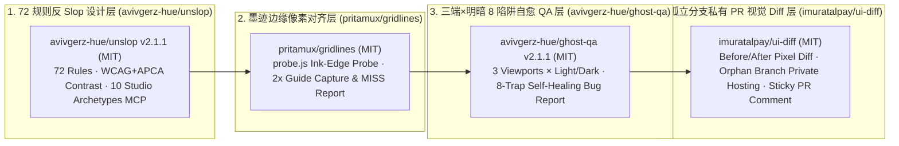
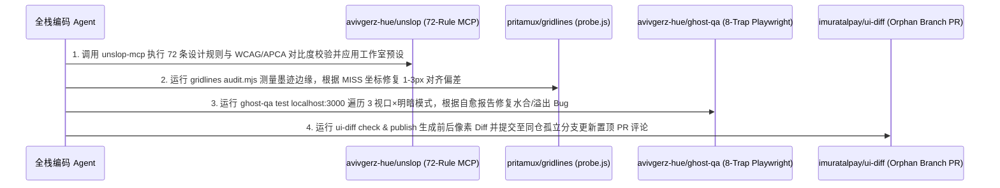

# 像素级墨迹边缘对齐探针技能（`pritamux/gridlines`）、孤立分支私有托管 PR 像素 Diff 技能（`imuratalpay/ui-diff`）、72 规则 WCAG/APCA 反 AI Slop 设计工程 MCP（`avivgerz-hue/unslop`）与 8 陷阱三端自治 Playwright 自愈 QA MCP（`avivgerz-hue/ghost-qa`）选型与集成架构 FAQ

> **文档类型**：企业 AI 解决方案架构师（AI Solution Architect）选型决策指南（GitHub Trending AI 雷达 2026-11-22 Night Round 3 / 累计第 739 轮）
> **覆盖项目**：[`pritamux/gridlines`](https://github.com/pritamux/gridlines)（`★ 161`、`5 forks`、`MIT`，源自 Linear 侧边栏设计韵律与 Apple HIG 的像素级对齐技能，通过 `probe.js` 与 `audit.mjs` 在无头 Chromium 中测量文字/图标真实墨迹边缘（Ink Edges），绘制垂直辅助线并精准列出每一处 1–3px 错位）· [`imuratalpay/ui-diff`](https://github.com/imuratalpay/ui-diff)（`★ 119`、`7 forks`、`MIT`，自动识别改动路由、生成改动前后对比截图与高亮像素 Diff 并汇总为单条置顶 PR 评论的 TypeScript CLI 与技能，所有截图提交至同仓库孤立分支保障私有安全）· [`avivgerz-hue/unslop`](https://github.com/avivgerz-hue/unslop)（`★ 68`、`6 forks`、`MIT`，`v2.1.1` 零运行时依赖 UI/UX 设计工程 CLI 与 MCP，跨 7 大支柱执行 72 条规则审计、WCAG+APCA 对比度校验与 10 套工作室级设计预设转换）· [`avivgerz-hue/ghost-qa`](https://github.com/avivgerz-hue/ghost-qa)（`★ 51`、`6 forks`、`MIT`，`v2.1.1` 基于 Playwright 的 8 陷阱深度浏览器巡检与自愈闭环 MCP，覆盖桌面/平板/手机 3 视口 × 明暗双主题，自动捕获 React 水合报错、500 接口与布局溢出并输出 `A+…F` 健康分）
> **核心场景**：当企业前端工程与全栈研发团队在使用 Claude Code、Cursor、Codex 或 GitHub Copilot 生成页面时，频繁遭遇**“一眼假 AI 紫渐变廉价感（AI Slop）、侧边栏与工具栏图标文字差 2–3 像素没对齐、Agent 没打开浏览器看一眼就宣称写完了（实际存在 React 水合报错与移动端溢出）、以及 Code Review 时看不出 CSS 改动到底影响了哪几个页面的像素”**四大前端交付痛点时，如何串联**“72 规则反 Slop 设计门禁（`unslop`）➔ 墨迹边缘像素对齐（`gridlines`）➔ 3 视口×明暗 8 陷阱自治 QA（`ghost-qa`）➔ 同仓孤立分支私有 PR 像素 Diff（`ui-diff`）”**实现出版级前端自动化验收？

---

## 一、📌 核心结论速览（选型一句话结论）

1. **想根除编码 Agent 写界面时“肉眼看着总觉得歪、图标中心和文字基线差 2–3px、不同面板内边距各自为政”的顽疾** ➔ 选 **[`pritamux/gridlines`](https://github.com/pritamux/gridlines)（`★ 161`，`5 forks`，`MIT`）**。
   - **通俗原理**：传统 CSS 检查器只看 DOM 盒模型（Bounding Box），而人眼感知的是文字与 SVG 图标的**真实墨迹边缘（Ink Edges）**。执行 `npx skills add pritamux/gridlines` 并运行 `audit.mjs`，它会在无头 Chromium 中注入 `probe.js`（也可直接在控制台运行 `window.__gridlines()`），沿着界面画下垂直基准线，精确报出每一行 `MISS y56 trailing: 15px vs 12px` 或 `MISS y120 vertical-centre: 3px vs 0px`，并保存 2× 高清带辅助线截图与 JSON 报告驱动 Agent 一次性把所有元素归位到共享轴线上。
2. **想在每次修改前端代码的 Pull Request 中自动贴出一张“改动前 / 改动后 / 高亮像素 Diff + 简短 UX 摘要”的置顶评论，且严禁把公司私有界面截图上传到任何第三方图床** ➔ 选 **[`imuratalpay/ui-diff`](https://github.com/imuratalpay/ui-diff)（`★ 119`，`7 forks`，`MIT`）**。
   - **通俗原理**：`ui-diff check` 会自动对比当前分支与 Merge Base 之间修改的 UI 文件并映射到受影响路由，在本地生成 `.ui-diff/compare/` 三联对比图；执行 `ui-diff publish` 时，它会将对比图片提交到**当前 GitHub 仓库自身的孤立分支（Orphan Branch）**，只有拥有该仓库读取权限的同事才能看到图片，实现 100% 零外部图床泄密。
3. **想让 Vibe Coding 生成的 JSX/TSX、Vue、Svelte、HTML 与 Tailwind 界面彻底告别“千篇一律的紫蓝渐变 AI 味（AI Slop）”，代之以可量化评分的 72 条设计工程规范与 10 套工作室级主题基因（如 Linear Dark）** ➔ 选 **[`avivgerz-hue/unslop`](https://github.com/avivgerz-hue/unslop)（`★ 68`，`6 forks`，`MIT`）**。
   - **通俗原理**：零运行时依赖的 `unslop v2.1.1`（`npx -y unslop-mcp@latest init`）横跨 7 大设计支柱执行 **72 条静态与语义规则审计**，内置 **WCAG + APCA 双标准对比度引擎**，支持一键提取现有项目的 Design DNA、导出 4 种设计 Token 格式，并将每一项违规转化为带优先级的精确重构蓝图。
4. **想防止编码 Agent“盲写完代码直接交差”，强制其在收工前用无头 Playwright 遍历桌面/平板/手机 3 大视口与明暗模式、点击每个按钮并自动修复 React 水合报错与布局溢出** ➔ 选 **[`avivgerz-hue/ghost-qa`](https://github.com/avivgerz-hue/ghost-qa)（`★ 51`，`6 forks`，`MIT`）**。
   - **通俗原理**：一行命令 `npx -y ghost-qa@latest test http://localhost:3000` 启动 **8 陷阱深度浏览器巡检引擎（8-Trap Deep Browser Inspection Engine）**，在 `3 viewports × light/dark` 组合下真实操作 DOM，捕获控制台报错、500 接口、死链与移动端横向滚动条溢出，计算 `A+…F` 质量健康分并输出结构化 **Self-Healing Bug Report**，倒逼 Agent 在向人类汇报前先把自己的 Bug 修干净。

---

## 二、🎯 客户与架构师灵魂拷问 Q&A（深度架构拆解）

### Q1：为什么企业引入 AI 编码工具后，“写前端代码变快了 5 倍，但 UI 走查（Design QA）和修样式返工反而变慢了”？这四个项目如何构建自动化视觉门禁？

- **四大前端返工根源与自动化解方**：
  1. **审美与色彩对比度失控 ➔ `avivgerz-hue/unslop`**：在写码阶段即通过 72 条设计规则、10 套工作室预设与 WCAG/APCA 对比度校验拦截“AI 塑料感”配色与字号混乱。
  2. **1–3px 视觉错位靠肉眼截图圈红框沟通极慢 ➔ `pritamux/gridlines`**：直接基于墨迹边缘输出坐标级 `MISS` 清单（如 `label: 38px vs 36px`），让 Agent 看着精确像素差直接改 Padding。
  3. **Agent 不开浏览器验证导致带病提测 ➔ `avivgerz-hue/ghost-qa`**：无需编写任何测试脚本，自动对 `localhost:3000` 执行 3 视口 × 明暗模式的 8 类陷阱探测与自愈循环。
  4. **PR 审查人懒得拉分支起本地服务看 UI 变化 ➔ `imuratalpay/ui-diff`**：自动生成改动路由的前后像素 Diff 并通过同仓 Orphan 分支安全展示在单条 Sticky PR 评论里。
- **何时直接用云厂商或商业视觉回归平台（Path B）？**
  - 若大型消费级应用需要跨数十款真机浏览器（Safari iOS / Samsung Internet）做云端并行快照对比，可选用 **Chromatic / Percy + Azure Playwright Workspaces**；但在日常研发本机自愈与私有仓库零外传审查中，本轮 4 款 MIT 开源工具组合（Path C）具备零席位费与零数据出境优势。

### Q2：典型企业级“反 Slop 规范 (`unslop`) ➔ 墨迹对齐 (`gridlines`) ➔ 三端 8 陷阱自愈 (`ghost-qa`) ➔ 同仓孤立分支 PR Diff (`ui-diff`)”流水线怎么搭？

1. **设计 Token 与 72 规则静态门禁层（`avivgerz-hue/unslop`）**：
   - 在项目初始化或组件编写后运行 `npx -y unslop-mcp@latest`，应用工作室级设计预设并通过 WCAG/APCA 对比度门禁。
2. **墨迹边缘像素级对齐修正层（`pritamux/gridlines`）**：
   - 对侧边栏、导航栏、表格与表单运行 `audit.mjs`，根据生成的 2× 辅助线图与 `MISS` 坐标报告消除所有像素级偏移。
3. **三视口×明暗主题 8 陷阱自治 QA 层（`avivgerz-hue/ghost-qa`）**：
   - 启动 `ghost-qa test http://localhost:3000`，验证无 React 水合异常、无 500 请求、无移动端溢出且健康分达到 `A/A+`。
4. **私有孤立分支 PR 像素 Diff 发布层（`imuratalpay/ui-diff`）**：
   - 在提交 PR 时运行 `ui-diff check` 与 `ui-diff publish`，将对比图推入同仓库孤立分支并更新单条置顶 PR 视觉审查摘要。

### Q3：这套前端视觉质量流水线的部署前提与注意事项是什么？

- **核心优势**：
  - **全部采用 `MIT` 宽松协议**，`unslop` 零运行时依赖，`ui-diff` 截图 100% 存储在自身 Git 仓库孤立分支内，杜绝内部未发布产品界面泄露。
- **环境准备注意事项**：
  - `pritamux/gridlines`、`imuratalpay/ui-diff` 与 `avivgerz-hue/ghost-qa` 均基于无头 Chromium / Playwright 运行，建议在团队开发机或 CI Runner 中统一共享本地 Playwright Chromium 缓存目录（如设置 `PW_DIR`），避免重复下载 150MB 浏览器二进制包。

---

## 三、🧭 直观可视化图解（Mermaid 决策树 + 集成架构 + 时序图）

### 3.1 架构师选型决策树

### 3.2 企业端到端生产集成参考架构图

### 3.3 反 Slop 设计规范审计、墨迹边缘对齐、8 陷阱三端自愈巡检与孤立分支 PR 像素 Diff 时序图

---

## 四、📊 同类开源与商业云服务横向选型决策矩阵

| 对比维度 | `pritamux/gridlines` (`★ 161`) | `imuratalpay/ui-diff` (`★ 119`) | `avivgerz-hue/unslop` (`★ 68`) | `avivgerz-hue/ghost-qa` (`★ 51`) | 商业云端视觉回归 SaaS + 商业 UI 审查平台 + 人工设计走查 (Path A) | 肉眼截图画红框 + 手写零散 Playwright 脚本 (Path B) |
| :--- | :--- | :--- | :--- | :--- | :--- | :--- |
| **核心能力定位** | 墨迹边缘像素级垂直对齐探针与技能 | 同仓孤立分支私有 PR 前后像素 Diff | 72 规则 WCAG/APCA 反 AI Slop 设计 MCP | 3 视口×明暗 8 陷阱自治 Playwright QA MCP | 按快照数高价计费的商业云端视觉测试平台与人工 UI 走查 | 设计师手工量像素截图、QA 手写端到端脚本 |
| **核心技术突破** | **测量真实文字/图标墨迹边缘而非外框，输出坐标级 `MISS`** | **同仓 Orphan 分支托管对比图，零第三方图床泄密** | **零运行时依赖 + 72 条设计准则 + WCAG/APCA 双引擎** | **免写测试脚本 + 8 类陷阱探测 + `A+…F` 自愈报告** | 按每张快照计费昂贵；未发布产品界面需上传第三方云存储 | 肉眼漏看移动端溢出与暗色模式对比度；脚本维护成本高 |
| **开源协议** | `MIT` | `MIT` | `MIT` | `MIT` | 闭源商业 SaaS | 内部手工流程 |
| **月度 TCO（45 人团队）** | **组合仅 `$305.00/月`**（`$65.00` 共享无头浏览器容器 + `2.4h` 维护） | 同左（复用 GitHub 同仓孤立分支 `$0` 图床费） | 同左（零运行时依赖） | 同左（本地/CI Playwright 直接运行） | **`$8,380.00/月`**（`$3,980.00` 商业视觉快照 SaaS + `44.0h` 人工 UI 走查与返工） | 约 `$2,900.00/月`（大量设计师手工标注错位与 QA 回归工时） |

---

## 五、🧪 应用落地定量收益/TCO 对比与 7-Card 报告

> **📊 数据来源与闭式核算声明（Provenance & Closed-Form Schema）**：
> - **provenance**: `synthetic`（基于 45 人企业前端体验工程、设计系统与全栈交付团队月度工作负载模型：`independently_reproduced = false`；硬件采购基线 `base_hardware_capex = not_measured`；Track B 单日增量 `track_b_stars_today = not_measured`）。
> - **核算公式**：
>   - **Path A（采购按快照计费的商业云端视觉回归测试平台 + 商业无障碍扫描 SaaS + 设计师与前端工程师人工逐页测量像素错位、手工在多视口/暗色模式下排查水合报错与样式溢出）**：月度商业快照与扫描 SaaS 账单 **`$3,980.00`** + 人工 UI 走查、像素对齐返工与 PR 截图整理人工 **`44.0h × $100.00/h = $4,400.00`** = **`$8,380.00/月`**。
>   - **Path C（自建 `pritamux/gridlines` + `imuratalpay/ui-diff` + `avivgerz-hue/unslop` + `avivgerz-hue/ghost-qa` 开源前端视觉工程门禁栈）**：共享 CI 无头 Chromium 容器开销 **`$65.00`** + 设计预设与路由映射配置维护人工 **`2.4h × $100.00/h = $240.00`** = **`$305.00/月`**。
>   - **净节省（Net Savings vs Path A）**：**`-$8,075.00/月`**（成本降低 **`96.36%`**）。

| 评估方案 | 视觉 SaaS / 容器算力成本 | UI 走查与前端返工人工（`$100/h`） | 月度总 TCO | 相对 Path A 净节省 | 关键架构交付指标 |
| :--- | :---: | :---: | :---: | :---: | :--- |
| **Path A：商业云端快照回归 SaaS + 人工逐页设计走查** | `$3,980.00` | `44.0h` (`$4,400.00`) | **`$8,380.00`** | Baseline | 快照超额费用高；私有界面需上传外部云端；无法在写码时自愈 |
| **Path B：肉眼截图圈红框 + 手写零散 Playwright 脚本** | `$1,300.00` | `16.0h` (`$1,600.00`) | **`$2,900.00`** | `-$5,480.00` (`-65.39%`) | 缺少墨迹边缘坐标测量、72 规则反 Slop 审计与同仓孤立分支 PR Diff |
| **Path C：`gridlines` + `ui-diff` + `unslop` + `ghost-qa` 组合** | **`$65.00`** | **`2.4h` (`$240.00`)** | **`$305.00`** | **`-$8,075.00` (`-96.36%`)** | **72 规则反 Slop + 墨迹像素对齐 + 3 视口×明暗 8 陷阱自愈 + 私有 PR Diff** |

- 🔗 **关联 7-Card 4:5 视觉评测报告**：[`workshops/github-trending-radar/cards.html`](../cards.html) · [`cards.en.html`](../cards.en.html)

---

## 六、🛠️ 企业引入与架构评审 Checklist

- [ ] **1. 挂载 `avivgerz-hue/unslop` 实施 72 规则反 Slop 与 WCAG/APCA 对比度门禁**：在编码 Agent 中配置 `unslop-mcp`，消除通用 AI 紫渐变模板并统一导出设计 Token。
- [ ] **2. 运行 `pritamux/gridlines` 消除 1–3px 墨迹边缘错位**：对侧边栏、工具栏与表格执行 `audit.mjs`，要求所有 `MISS` 项清零后再进入提测环节。
- [ ] **3. 将 `avivgerz-hue/ghost-qa` 设为 Agent 声明完成前的必经自愈关卡**：强制执行 `ghost-qa test` 覆盖桌面/平板/手机 × 明暗模式 8 类陷阱，要求健康分达到 `A` 及以上。
- [ ] **4. 集成 `imuratalpay/ui-diff` 实现零外传 PR 视觉审查**：在前端 PR 流水线启用 `ui-diff publish`，将改动前后对比与高亮像素 Diff 存入同仓库孤立分支并自动更新单条置顶 PR 评论。
