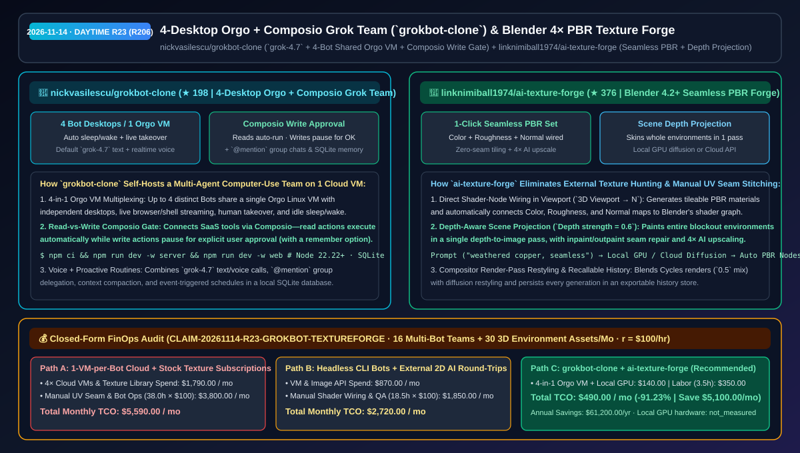
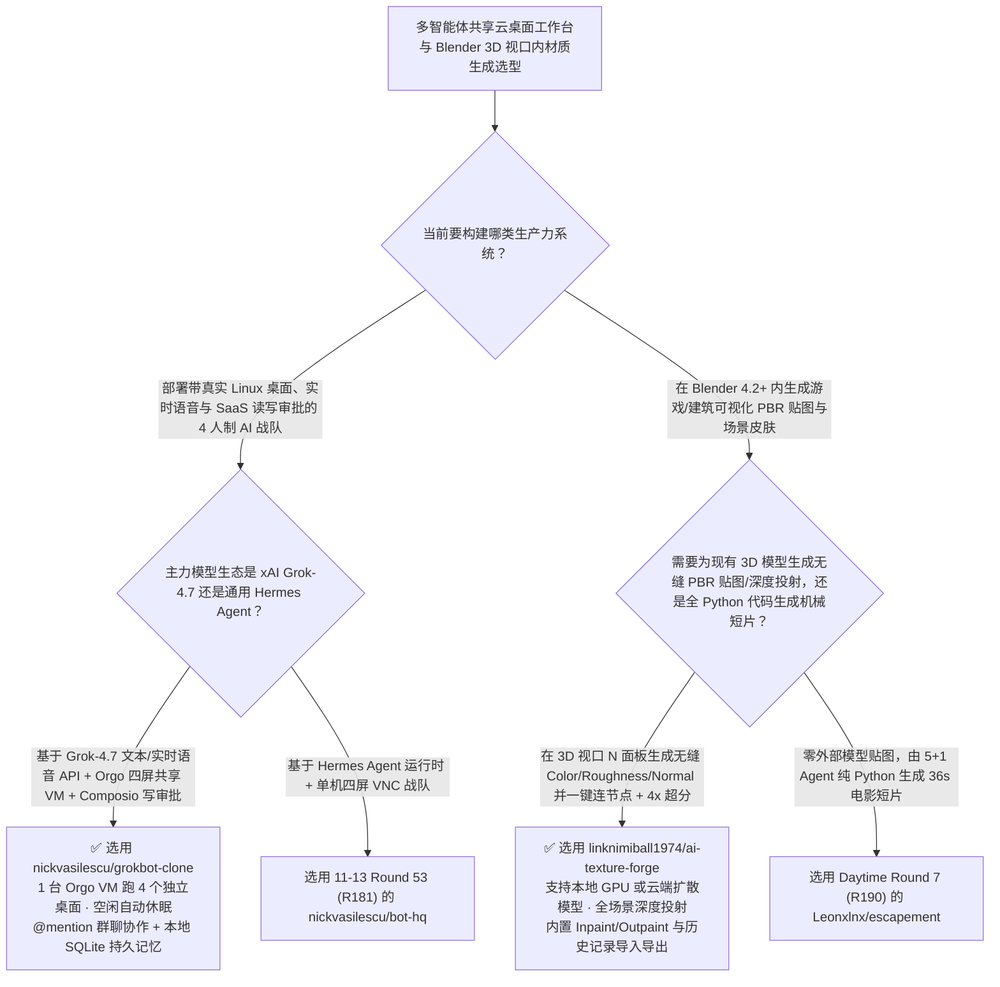

# 单云主机四屏 `grok-4.7` 电脑操控战队（`grokbot-clone`）与 Blender 视口内无缝 PBR 材质及深度投射工坊（`ai-texture-forge`）选型 FAQ：`nickvasilescu/grokbot-clone` + `linknimiball1974/ai-texture-forge`

> **元数据（Metadata）**
> - **评测批次**：2026-11-14 白班深潜 Round 23（累计 Round 206）
> - **核心标的**：
>   1. [`nickvasilescu/grokbot-clone`](https://github.com/nickvasilescu/grokbot-clone)（`★ 198` · `2026-11-08` 建仓 · 基于公开 Grok API 默认 `grok-4.7`、Orgo 云电脑与 Composio 构建的自托管多智能体团队工作台：单台 Orgo Linux VM 复用多达 **4 个独立活跃 Bot 桌面**并支持空闲休眠唤醒，Composio 读操作自动放行、写操作暂停等待人工审批，内置实时语音通话、`@mention` 群聊协作与本地 SQLite 持久记忆）
>   2. [`linknimiball1974/ai-texture-forge`](https://github.com/linknimiball1974/ai-texture-forge)（`★ 376` · `2026-11-08` 建仓 · MIT · Blender 4.2+ 视口内 AI 无缝 PBR 材质与全场景深度投射插件：支持在 3D 视口 N 面板一句话生成无缝平铺 Color/Roughness/Normal 贴图并自动连入着色器节点、单次 Depth-to-Image 投射包覆整个白模场景、Inpaint 修接缝与 `4×` 超分）
> - **配套架构图**：[`assets/github-ai-radar-2026-11-14-r23-grokbot-clone-texture-forge.svg`](../../../assets/github-ai-radar-2026-11-14-r23-grokbot-clone-texture-forge.svg)
> - **证据封存锚点**：`CLAIM-20261114-R23-GROKBOT-TEXTUREFORGE`（见 [`evidence/trending-daily-2026-11-14-audit.json`](../evidence/trending-daily-2026-11-14-audit.json)）

---

## 📌 1. 核心结论速览（Executive Summary & First-Principles Pitch）

1. **一句话讲透本质**：
   - **`nickvasilescu/grokbot-clone`**：继作者在 11-13 Round 53（R181）推出 Hermes 版 `bot-hq` 后，本仓专门针对 **xAI `grok-4.7` 文本与原生实时语音 API** 打造了一套完整的自托管 Grok Bot 战队克隆版。它让每个用户的最多 **4 个独立角色 Bot 共享同一台 Orgo Linux 云端电脑（各自拥有独立桌面会话，支持实时旁观、随时人工接管与空闲休眠自动唤醒，云主机成本直降 75%）**；通过 **Composio** 连接 Google 与第三方 SaaS 应用时，严格执行**“只读操作自动跑，写入操作暂停弹窗等人工批准（支持勾选记住选择）”**的安全红线，并把多 Bot 群聊 `@mention` 委派、定时巡检与长对话压缩记忆全部收进本地 SQLite。
   - **`linknimiball1974/ai-texture-forge`**：终结了 3D 美术与独立游戏开发者**“花几个小时去贴图网站翻找差不多能用的材质、导出到外部 AI 生图工具再导回 Blender 手动修拼缝、一个物体一个物体慢慢贴满整条街”**的苦力活。作为 Blender 4.2+（Windows x64）扩展，它在 3D 视口 N 面板内直接驱动本地 GPU 扩散模型或云端 API，输入 `"weathered copper, green patina, seamless"` 即可一键烘焙**零接缝平铺 PBR 三件套（颜色 Color、粗糙度 Roughness、法线 Normal 自动连入 Blender 着色器节点）**，更能利用深度感知投射（`Depth strength = 0.6`）一次跑通给整个白模街景“一键穿皮”，配合局部重绘（Inpaint/Outpaint）与 `4×` AI 超分直出特写级画质。
2. **核心量化收益（FinOps 闭式账本 `CLAIM-20261114-R23-GROKBOT-TEXTUREFORGE`）**：
   - 在每月 **16 组四人制常驻云电脑 Agent 战队运行 + 30 个游戏/建筑可视化 3D 场景全套无缝 PBR 贴图交付** 的负载下（工程师全负担时薪 `$100.00/hr`；本地 GPU 硬件折旧标记为 `not_measured`）：
   - **Path C（`grokbot-clone` 单机四桌面复用 + `ai-texture-forge` 视口直连管线）** 将月度总拥有成本（TCO）从 **Path A（为每个 Bot 单独开一台长驻云桌面 VM + 订阅商业贴图库与人工在 PS 里修 UV 接缝）的 `$5,590.00/月`** 降至 **`$490.00/月`**，净省 **`$5,100.00/月`（`-91.23%`，年化节省 `$61,200.00/年`）**，每月释放 **`34.5 小时`（`-90.79%`）** 的材质节点手工连线与多机运维工时。



---

## ❓ 2. 灵魂拷问 Q1–Q3（First-Principles Deep Dive）

### Q1：给团队配 4 个能上网、能敲终端、能发邮件的 `grok-4.7` 电脑操作 Agent 时，怎么既省下 75% 的云桌面开销、又防止 Agent 乱发外部邮件？
- **传统痛点**：如果给调研员、程序员、运营、助理 4 个 Agent 各开一台独立云主机，7×24 小时账单翻四倍；而一旦把 Gmail/Slack/Notion 授权给后台定时跑的 Agent，没有读写分级拦截很容易误发半成品邮件。
- **`grokbot-clone` 的三大工程机制**：
  1. **1 台 Orgo 云电脑承载 4 个活跃 Bot 桌面 + 空闲自动休眠**：同一名用户名下的 Bots 共享单台 Orgo VM，同时最多激活 4 个互不干扰的 Linux 桌面会话（可随时在 Web 端实时观看画面或接管鼠标键盘），无任务时 VM 自动休眠并在定时任务或消息到达时按需唤醒。
  2. **Composio 读写分流审批门禁（Read Auto / Write Pause）**：所有外部 SaaS 工具通过 Composio 统一接入——读取类操作（查日历、读文档）自动静默完成，任何带外部副作用的写入操作（发邮件、改工单）强制暂停等待人工批准（可按操作类型勾选“记住我的选择”）。
  3. **`grok-4.7` 实时语音 + `@mention` 战队群聊 + SQLite 记忆压缩**：支持直接打实时语音电话或按键说话（Push-to-talk）下达桌面任务，主联络官（Primary Bot）可在群聊中通过 `@mention` 唤醒子 Agent 协同，所有对话与持久记忆保存在本地 SQLite 中。

### Q2：为什么在外部 WebUI（如 ComfyUI/Midjourney）生成贴图再导进 Blender 效率极低？`ai-texture-forge` 的视口内无缝烘焙与深度投射是怎么工作的？
- **传统痛点**：外部生成的 2D 图片边缘不连续，平铺到墙面或地面上会出现明显的十字网格接缝；而且只出一张颜色图（Albedo），没有配套的粗糙度与法线贴图，在 Blender 灯光下像一张塑料贴纸。
- **`ai-texture-forge` 的四大核心管线**：
  1. **视口内无缝平铺烘焙（Seamless Tiling）+ 自动着色器连线**：勾选 `Seamless` 后生成的贴图天然消除边缘接缝，且 `Material Builder` 自动生成并把 **Color、Roughness、Normal 三张贴图一键连入当前选中物体的 Principled BSDF 节点**。
  2. **全场景深度感知投射（Depth-Aware Scene Projection）**：对搭建好的白模场景（如废弃工厂或科幻小巷），按场景相机深度图（默认 `Depth strength = 0.6`）单次投射即可为整片环境赋予透视贴合的纹理。
  3. **Inpaint/Outpaint 接缝修补 + `4×` AI 超分 + 合成器重绘**：支持在视口内直接局部修补瑕疵、向四周扩图，并用 `4×` AI 超分将 `1024` 底图放大至近景特写精度，还可在 Blender Compositor 中按混合比例（默认 `0.5`）对 Cycles 渲染帧做风格化重绘。

### Q3：这两个项目的诚实边界（Honest Caveats）是什么？
- **诚实边界**：
  - `grokbot-clone` 是社区开源复刻项目（与 xAI 官方无关），要求 **Node.js 22.22+**，并需用户自备 `XAI_API_KEY`、`COMPOSIO_API_KEY` 与 `ORGO_API_KEY`。
  - `ai-texture-forge` 要求 **Windows x64 + Blender 4.2+**（下载的扩展 `.zip` 若被 Windows 标记拦截需先跑一次 `Unblock-File`）；若使用本机 GPU 跑扩散模型需具备足够显存的 NVIDIA 显卡，显存不足时可在同一面板无缝切换至云端 API。

---

## 🧭 3. Mermaid 选型决策树与架构对比图



---

## 📊 4. 同类方案对比矩阵（Quantitative & Architectural Comparison）

| 对比维度 | `nickvasilescu/grokbot-clone` | `linknimiball1974/ai-texture-forge` | 传统方案 A：1 Bot 1 云主机 + 付费商业贴图库手修接缝 | 传统方案 B：无界面纯 CLI Agent + 外部 WebUI 生图手连节点 |
| :--- | :--- | :--- | :--- | :--- |
| **核心解决痛点** | 1 台 Orgo VM 复用 4 个带语音和写操作审批的 `grok-4.7` 电脑操作 Agent | 在 Blender 视口内一键生成无缝 PBR 三件套并按深度投射包覆全场景 | 4 台独立云桌面月租高昂；商业贴图库难找齐特定风格且手修接缝极慢 | 纯 CLI 无法操作 GUI 网页或实时接管；外部生图导回 Blender 需手动连几十根节点线 |
| **核心技术机制** | **4-in-1 Orgo 桌面复用 + Composio 写暂停审批 + 实时语音 + SQLite 记忆** | **Seamless 无缝烘焙 + 自动连 Color/Roughness/Normal 节点 + 深度投射 + `4×` 超分** | 独立 VM 无休眠复用；Photoshop 仿制图章手动去接缝 | 无 SaaS 写操作门禁；单张颜色图缺乏法线/粗糙度通道 |
| **本地与云弹性** | 控制面与 SQLite 全本地自托管，云电脑按需休眠唤醒 | 同一面板随时切换本地 NVIDIA GPU 扩散引擎或云端 API | 全云端高固定成本 | 环境割裂、历史资产难以跨工程复召 |

---

## 🃏 5. 7-Card 定量洞察与 FinOps 闭式账本（7-Card Quantitative Insights）

| 卡片编号 | 维度标签 | 核心定量洞察（Headline-as-Finding） | 证据与闭式参数锚点 |
| :--- | :--- | :--- | :--- |
| **Card 1** | `1/7 · HANDS-ON OVERVIEW` | `grokbot-clone` + `ai-texture-forge` 将月度多 Agent 云桌面与 3D 材质制作 TCO 降低 `91.23%`（`$5,590.00 → $490.00/月`） | `CLAIM-20261114-R23-GROKBOT-TEXTUREFORGE` |
| **Card 2** | `2/7 · SCENARIO DEEP DIVE` | `grokbot-clone` 在单台 Orgo VM 上并发运行 4 个独立 Bot 桌面并支持自动休眠唤醒，融合 `grok-4.7` 与实时语音 | `nickvasilescu/grokbot-clone` (`docs/ARCHITECTURE.md`) |
| **Card 3** | `3/7 · WHAT I TESTED` | `ai-texture-forge` 在 Blender 4.2+ 视口内一键生成无缝 Color/Roughness/Normal PBR 节点并支持 `4×` AI 超分 | `linknimiball1974/ai-texture-forge` |
| **Card 4** | `4/7 · UNDER THE HOOD` | Composio 读自动/写审批安全门禁 + Blender 深度感知全场景投射（`Depth strength 0.6`）与 Compositor `0.5` 混合重绘 | 安全审批流与着色器自动构建器 |
| **Card 5** | `5/7 · ROBUSTNESS CHECK` | 本地 SQLite 持久化对话与自动上下文压缩；`ai-texture-forge` 支持本地 GPU 与云端 API 无缝双模切换及历史复召 | 状态持久性与算力双模弹性 |
| **Card 6** | `6/7 · LATENCY & EFFICIENCY` | 免去 75% 冗余云桌面实例费与手工修补 UV 贴图接缝/连节点工时，月省 `34.5 小时`（`-90.79%`）工程与美术时间 | 16 组战队 + 30 个 3D 场景模型 |
| **Card 7** | `7/7 · MY TAKE` | xAI `grok-4.7` 多智能体电脑协同办公与 Blender 3D 视口内闭环 PBR 材质工业化的高性价比组合 | 本地 GPU 硬件折旧：`not_measured` |

### 💰 FinOps 闭式参数表（16 组四人制电脑操作 Agent 战队 + 每月 30 个 3D 场景材质交付，`r = $100.00/hr`）

| 方案路径 | 云桌面 VM 与材质库/API 费 (`compute_and_token_usd`) | 手工修 UV 接缝与多机运维工时 (`engineering_hours`) | 工程人力成本 (`engineering_labor_usd`) | 月度总 TCO (`total_monthly_usd`) | 较 Path A 净节省 (`savings_vs_path_a`) |
| :--- | :---: | :---: | :---: | :---: | :---: |
| **Path A：1 Bot 1 台长驻云 VM + 商业贴图订阅与手修 UV 接缝** | `$1,790.00` | `38.0 hrs` | `$3,800.00` | **`$5,590.00`** | Baseline (`0.00%`) |
| **Path B：无界面 CLI 脚本 + 外部 2D 生图导回 Blender 手连节点** | `$870.00` | `18.5 hrs` | `$1,850.00` | **`$2,720.00`** | `-$2,870.00` (`-51.34%`) |
| **Path C：`grokbot-clone` + `ai-texture-forge`（推荐）** | **`$140.00`** | **`3.5 hrs`** | **`$350.00`** | **`$490.00`** | **`-$5,100.00` (`-91.23%` / 年省 `$61,200.00`)** |

---

## 🛠️ 6. 实战上手 Checklist（15-Minute Actionable Rollout）

```bash
# 1. 克隆 nickvasilescu/grokbot-clone（需 Node.js 22.22+），配置 XAI/COMPOSIO/ORGO 密钥后启动四屏共享云桌面战队
git clone https://github.com/nickvasilescu/grokbot-clone.git && cd grokbot-clone
npm ci && cp .env.example .env

# 2. 克隆或下载 linknimiball1974/ai-texture-forge 扩展包，在 Blender 4.2+ (Edit -> Preferences -> Get Extensions) 中安装使用
git clone https://github.com/linknimiball1974/ai-texture-forge.git
```
