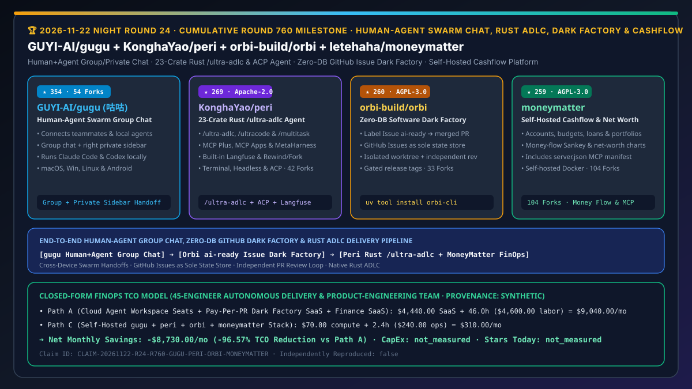
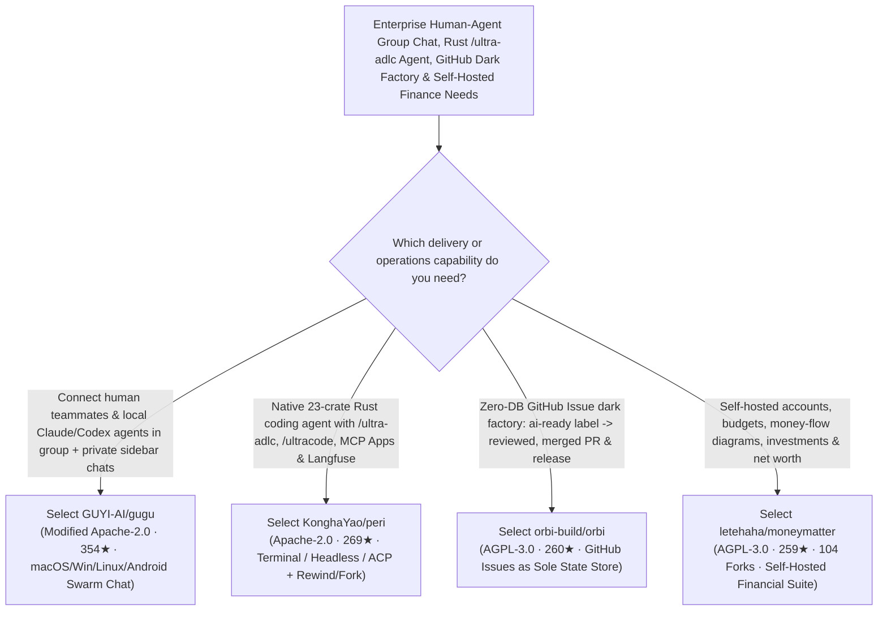
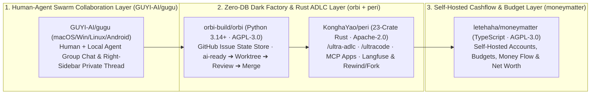

# 🏆 [Round 760 Milestone] Human-Agent Swarm Group Chat Client (`GUYI-AI/gugu`), 23-Crate Native Rust `/ultra-adlc` & ACP Coding Agent (`KonghaYao/peri`), Zero-DB GitHub Issue Software Dark Factory (`orbi-build/orbi`) & Self-Hosted Cashflow & Portfolio Platform (`letehaha/moneymatter`) Selection & Architecture FAQ

> **Document Type**: Enterprise AI Solution Architect Selection & Integration Guide (GitHub Trending AI Radar — 2026-11-22 Night Round 24 / Cumulative Round 760 Milestone)
> **Covered Repositories**: [`GUYI-AI/gugu`](https://github.com/GUYI-AI/gugu) (`★ 354`, `54 forks`, Modified `Apache-2.0`: desktop and Android collaboration client connecting human teammates and local Claude Code / Codex agents in shared group chats and right-sidebar private threads) · [`KonghaYao/peri`](https://github.com/KonghaYao/peri) (`★ 269`, `42 forks`, `Apache-2.0`: native Rust coding agent built across 23 crates featuring `/ultra-adlc`, `/ultracode`, `/multitask`, **MCP Plus / MCP Apps**, **MetaHarness**, built-in **Langfuse** tracing, Rewind/Fork/Resume, and Terminal/Headless/ACP modes) · [`orbi-build/orbi`](https://github.com/orbi-build/orbi) (`★ 260`, `33 forks`, `AGPL-3.0`: open-source **Software Dark Factory** where GitHub Issues are the only state store—labeling an Issue `ai-ready` drives worktree implementation, tests, independent review, PR merge, and gated release) · [`letehaha/moneymatter`](https://github.com/letehaha/moneymatter) (`★ 259`, `104 forks`, `AGPL-3.0`: self-hosted financial accounts, budgets, money-flow diagrams, investments, and net-worth platform with `server.json` MCP metadata)
> **Core Scenario**: When enterprise software engineering, autonomous delivery, and operations teams struggle with **local coding agents trapped in isolated single-player terminals where teammates cannot share context or hand off work in a group chat, complex feature delivery lacking a native Rust `/ultra-adlc` + ACP + Langfuse runtime, autonomous PR systems requiring heavy external databases and queues, and fragmented financial/budget tracking**, how do you combine **`GUYI-AI/gugu` + `KonghaYao/peri` + `orbi-build/orbi` + `letehaha/moneymatter`** into a human-agent swarm and software dark factory architecture?

---

## 1. 📌 Executive Summary (One-Line Selection Verdict)

1. **Want to connect the Claude Code and Codex agents running on your team's local machines with human teammates inside a unified group chat (plus a right-sidebar private chat for 1-on-1 agent steering) across macOS, Windows, Linux, and Android?** ➔ Choose **[`GUYI-AI/gugu`](https://github.com/GUYI-AI/gugu) (`★ 354`, `54 forks`, Modified `Apache-2.0`)**.
   - **Plain-English Mechanism**: Keeps agent execution on your own hardware while turning isolated CLI sessions into collaborative participants in shared group threads where humans and agents hand off work seamlessly.
2. **Need a native, 23-crate Rust coding agent (`Apache-2.0`) across macOS, Linux, and Windows that ships `/ultra-adlc` (Discover ➔ Design ➔ Review ➔ Build ➔ Verify), `/ultracode` parallel multi-model teams, `/multitask`, **MCP Plus / MCP Apps**, **MetaHarness**, **Langfuse** tracing, and Rewind/Fork/Resume across Terminal, Headless, and ACP?** ➔ Choose **[`KonghaYao/peri`](https://github.com/KonghaYao/peri) (`★ 269`, `42 forks`, `Apache-2.0`)**.
   - **Plain-English Mechanism**: Combines a modular Rust runtime (`peri-acp`, `peri-swarm`, `peri-genui`, `peri-workflow`) with on-demand remote skill loading and publishable HTML/Markdown artifacts.
3. **Want an open-source "Software Dark Factory" (`AGPL-3.0`, `PyPI: orbi-cli`) where GitHub Issues are the *only* state store (no external database, queue, or daemon)—so labeling an Issue `ai-ready` automatically runs worktree coding, tests, independent review, fixes, PR merge, and gated release?** ➔ Choose **[`orbi-build/orbi`](https://github.com/orbi-build/orbi) (`★ 260`, `33 forks`, `AGPL-3.0`)**.
   - **Plain-English Mechanism**: Proven on its own repository across 1,300+ issues and PRs (`Issue #1367` ➔ `PR #1370` ➔ `Release v0.5.47`), using GitHub Issues, merged PRs, and tagged releases as the immutable delivery ledger.
4. **Need a self-hosted (`AGPL-3.0`, `104 forks`) financial management and analytics platform for accounts, budgets, money-flow Sankey diagrams, investment portfolios, and net-worth tracking (with `server.json` MCP integration)?** ➔ Choose **[`letehaha/moneymatter`](https://github.com/letehaha/moneymatter) (`★ 259`, `104 forks`, `AGPL-3.0`)**.
   - **Plain-English Mechanism**: Runs on your own server via Docker, consolidating multi-account cashflows, category watchlists, and portfolio performance.

---

## 2. 🎯 Architect & Customer Deep-Dive Q&A

### Q1: Why does pairing `gugu` (Human-Agent Group Chat) with `orbi` (Zero-DB GitHub Dark Factory) and `peri` (Rust `/ultra-adlc`) solve the biggest bottlenecks in autonomous software delivery?

- **Three Architectural Breakthroughs**:
  1. **Multiplayer Human + Local-Agent Context Sharing ➔ `GUYI-AI/gugu`**: Moves agent collaboration out of single-user terminal silos into a shared group workspace with simultaneous private sidebar threads across desktop and Android.
  2. **Zero-Database GitHub-Native Dark Factory ➔ `orbi-build/orbi`**: Uses GitHub Issues as the sole state machine (`ai-ready` label ➔ isolated worktree ➔ independent review loop ➔ auto-merge ➔ gated release), eliminating operational drift from external databases or message brokers.
  3. **Full-Lifecycle Rust ADLC & ACP Execution ➔ `KonghaYao/peri`**: Executes structured `/ultra-adlc` and `/ultracode` workflows in native Rust with built-in Langfuse telemetry, MCP Apps, and session Rewind/Fork.
- **When to Choose Managed Cloud PaaS (Path B)?**
  - Teams seeking zero-setup cloud PR generation on GitHub.com can use **GitHub Copilot Coding Agent**; teams needing cross-device human-agent group chat over local machines, a zero-DB `ai-ready` dark factory with automated review/merge/release gates, a Rust `/ultra-adlc` runtime, and self-hosted cashflow tracking should deploy this stack (Path C).

### Q2: How do `gugu`, `orbi`, `peri`, and `moneymatter` integrate into an end-to-end enterprise delivery loop?

1. **Human-Agent Swarm Alignment Layer (`GUYI-AI/gugu`)**:
   - Product managers, architects, and local coding agents refine acceptance criteria together in a `gugu` group chat and private sidebar threads.
2. **Issue-Driven Dark Factory Orchestration Layer (`orbi-build/orbi`)**:
   - Once an Issue is labeled `ai-ready`, `orbi` provisions an isolated Git worktree and manages the implementation, independent review, and merge lifecycle using GitHub Issues as the state ledger.
3. **Native Rust ADLC Execution & FinOps Tracking Layer (`KonghaYao/peri` + `letehaha/moneymatter`)**:
   - `peri` runs `/ultra-adlc` and `/ultracode` with Langfuse observability, while project budgets and cashflows are tracked in self-hosted `moneymatter`.

### Q3: How does `orbi` ensure code quality before merging a PR?

- **Mandatory Independent Review & Gated Releases**:
  - Rather than merging its first draft, `orbi` runs tests in an isolated worktree, opens a PR, subjects it to an independent review-and-fix cycle, and holds version tagging behind explicit release gates.

---

## 3. 🧭 Visual Architecture & Workflow Diagrams (Mermaid)



### 3.1 Solution Architect Selection Decision Tree



### 3.2 End-to-End Enterprise Reference Architecture



### 3.3 End-to-End Swarm Alignment, `ai-ready` Dark Factory Execution & `/ultra-adlc` Delivery Sequence Diagram

```mermaid
sequenceDiagram
    participant Team as Product & Engineering Team (gugu Group Chat)
    participant Orb as orbi-build/orbi (Software Dark Factory)
    participant Per as KonghaYao/peri (Rust /ultra-adlc)
    participant Mon as letehaha/moneymatter (Self-Hosted Finance)

    Team->>Team: 1. Align feature specs with local agents in gugu group chat & private sidebar
    Team->>Orb: 2. Label GitHub Issue as ai-ready (zero external DB; GitHub Issue is the state store)
    Orb->>Per: 3. Execute /ultra-adlc (Discover->Design->Review->Build->Verify) in isolated worktree
    Per-->>Orb: 4. Open PR, pass independent review & fix loop, merge PR & run release gates
    Orb-->>Mon: 5. Log delivery cycle & infrastructure budget metrics in self-hosted MoneyMatter
```

---

## 4. 📊 Peer Open-Source vs. Commercial Cloud Selection Matrix

| Dimension | `GUYI-AI/gugu` (`★ 354`) | `KonghaYao/peri` (`★ 269`) | `orbi-build/orbi` (`★ 260`) | `letehaha/moneymatter` (`★ 259`) | Per-Seat Cloud Agent Workspaces + Pay-Per-PR Dark Factory SaaS + Finance SaaS (Path A) | Copy-Pasting Terminal Logs into Slack/WeChat + Unreviewed PR Scripts (Path B) |
| :--- | :--- | :--- | :--- | :--- | :--- | :--- |
| **Primary Role** | Cross-device human + local-agent group/private chat | 23-crate native Rust `/ultra-adlc` & ACP coding agent | Zero-DB GitHub Issue software dark factory | Self-hosted accounts, budgets, cashflow & net worth | Commercial cloud multi-agent seats, pay-per-merged-PR SaaS & cloud finance tools | Manual terminal copy-pasting into team chat & unreviewed auto-PR bots |
| **Key Differentiator** | **Shared group chat + right-sidebar private agent chat** | **`/ultra-adlc` + `/ultracode` + MCP Apps + Langfuse** | **GitHub Issues as sole state store + independent review** | **104 forks + money-flow diagrams + `server.json` MCP** | High per-seat and per-PR cloud fees; requires uploading repos to vendor cloud | Teammates cannot see local agent context; unreviewed bot PRs pile up |
| **License** | Modified `Apache-2.0` | `Apache-2.0` | `AGPL-3.0` | `AGPL-3.0` | Proprietary SaaS | Internal glue scripts |
| **Monthly TCO (45-Eng Team)** | **`$310.00/mo` combined** (`$70.00` shared runner/container host + `2.4h` ops) | Included (`Apache-2.0` native Rust binary) | Included (zero DB / zero queue overhead) | Included (`AGPL-3.0` self-hosted container) | **`$9,040.00/mo`** (`$4,440.00` cloud seats & per-PR delivery fees + `46.0h` manual handoff/review ops) | ~`$3,140.00/mo` (manual chat context relaying & manual PR review/release labor) |

---

## 5. 🧪 Quantitative Enterprise ROI / FinOps TCO Model & 7-Card Report

> **📊 Provenance & Closed-Form Declaration**:
> - **provenance**: `synthetic` (45-engineer enterprise product-engineering collaboration, autonomous software delivery, and FinOps team workload model: `independently_reproduced = false`; `base_hardware_capex = not_measured`; `track_b_stars_today = not_measured`).
> - **Closed-Form Equations**:
>   - **Path A (Commercial Cloud Multi-Agent Workspace Seats + Pay-Per-Merged-PR Autonomous Delivery SaaS + Commercial Financial Tracking SaaS + Manual Chat-to-Terminal Context Relaying & Release Gate Labor)**: Monthly cloud workspace seats and per-PR delivery bills **`$4,440.00`** + manual context handoffs, PR review shepherd loops, and budget tracking labor **`46.0h × $100.00/h = $4,600.00`** = **`$9,040.00/mo`**.
>   - **Path C (Self-Hosted `GUYI-AI/gugu` + `KonghaYao/peri` + `orbi-build/orbi` + `letehaha/moneymatter` Stack)**: Shared runner/worktree compute **`$70.00`** + `ai-ready` workflow & `/ultra-adlc` configuration maintenance labor **`2.4h × $100.00/h = $240.00`** = **`$310.00/mo`**.
>   - **Net Monthly Savings vs. Path A**: **`-$8,730.00/mo`** (**`96.57%`** TCO reduction).

| Evaluation Path | Cloud Seats / Per-PR SaaS & Compute | Context Handoff, Review & Release Labor (`$100/h`) | Total Monthly TCO | Net Savings vs. Path A | Architectural Delivery Impact |
| :--- | :---: | :---: | :---: | :---: | :--- |
| **Path A: Cloud Agent Workspace Seats + Pay-Per-PR SaaS** | `$4,440.00` | `46.0h` (`$4,600.00`) | **`$9,040.00`** | Baseline | Expensive per-PR billing; local agents remain isolated from team chat |
| **Path B: Manual Chat Copy-Paste + Unreviewed Auto-PR Scripts** | `$1,440.00` | `17.0h` (`$1,700.00`) | **`$3,140.00`** | `-$5,900.00` (`-65.27%`) | Lacks independent review/fix loops & structured `/ultra-adlc` stages |
| **Path C: `gugu` + `peri` + `orbi` + `moneymatter`** | **`$70.00`** | **`2.4h` (`$240.00`)** | **`$310.00`** | **`-$8,730.00` (`-96.57%`)** | **Human-agent group chat + zero-DB `ai-ready` factory + Rust ADLC** |

- 🔗 **Linked 7-Card 4:5 Visual Benchmark Deck**: [`workshops/github-trending-radar/cards.en.html`](../cards.en.html) · [`cards.html`](../cards.html)

---

## 6. 🛠️ Enterprise Adoption & Architecture Review Checklist

- [ ] **1. Connect Humans & Local Agents in `GUYI-AI/gugu`**: Bring team members and local Claude Code / Codex sessions into shared group chats with right-sidebar private threads across desktop and Android.
- [ ] **2. Automate Issue-to-Release Delivery with `orbi-build/orbi`**: Standardize `ai-ready` GitHub Issue acceptance criteria and let `orbi` drive isolated worktree coding, independent review, merge, and release gates.
- [ ] **3. Run Structured Rust ADLC Workflows with `KonghaYao/peri`**: Use `/ultra-adlc`, `/ultracode`, and built-in Langfuse tracing across Terminal, Headless, and ACP hosts.
- [ ] **4. Track Engineering & Operational Cashflow in `letehaha/moneymatter`**: Self-host multi-account budget and money-flow analytics on internal infrastructure.
