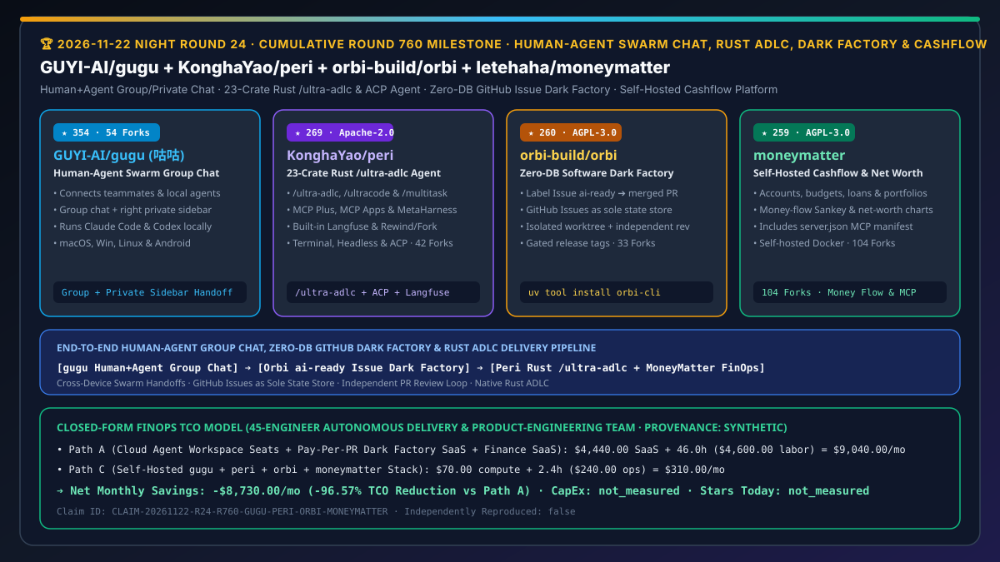
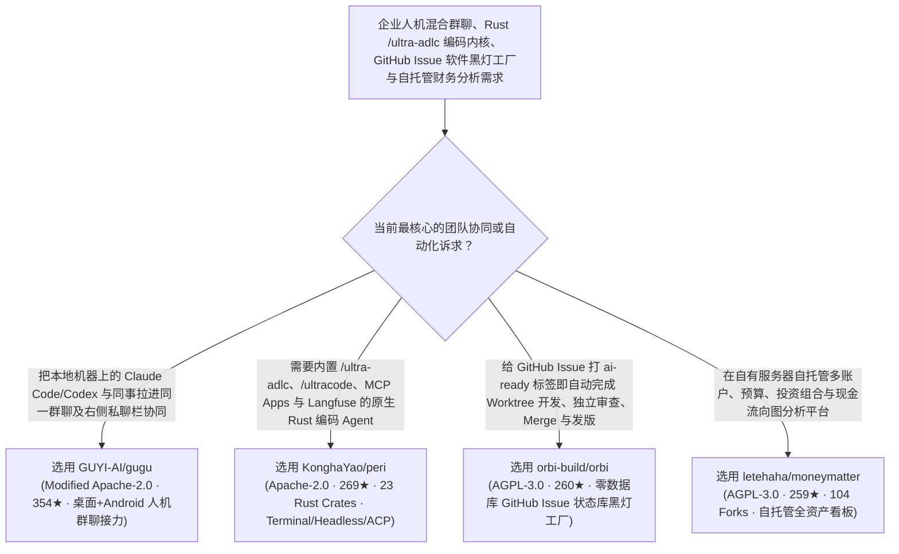
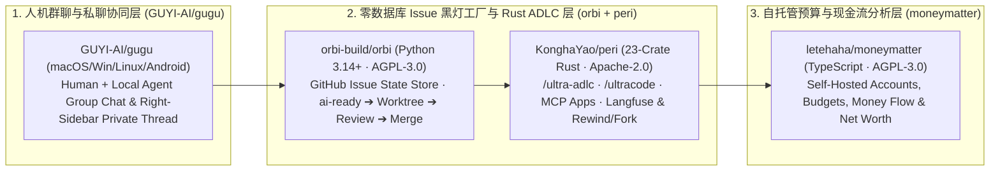
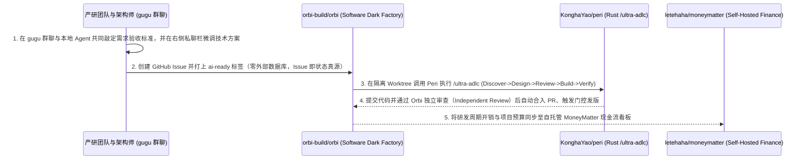

# 🏆【第 760 轮里程碑】人机群聊与私聊接力协同客户端（`GUYI-AI/gugu`）、内置 `/ultra-adlc` 与 MCP Apps 的 23-Crate Rust 编码智能体（`KonghaYao/peri`）、以 GitHub Issue 为唯一状态库的软件黑灯工厂（`orbi-build/orbi`）与自托管全资产现金流分析平台（`letehaha/moneymatter`）选型与集成架构 FAQ

> **文档类型**：企业 AI 解决方案架构师（AI Solution Architect）选型决策指南（GitHub Trending AI 雷达 2026-11-22 Night Round 24 / 累计第 760 轮里程碑）
> **覆盖项目**：[`GUYI-AI/gugu`](https://github.com/GUYI-AI/gugu)（`★ 354`、`54 forks`、“咕咕 gugu”，支持 macOS/Windows/Linux/Android 四端同步、将本地机器上运行的 Claude Code/Codex 智能体与团队成员拉入同一个群聊及右侧私聊侧边栏共享上下文接力干活的协同客户端）· [`KonghaYao/peri`](https://github.com/KonghaYao/peri)（`★ 269`、`42 forks`、`Apache-2.0`，23 个 Rust Crate 构建的原生跨平台编码 Agent，内置 `/ultra-adlc` 全链路交付、`/ultracode` 并行战队、`/multitask`、**MCP Plus / MCP Apps**、**MetaHarness** 与 **Langfuse** 链路追踪，支持 Terminal/Headless/ACP 三态）· [`orbi-build/orbi`](https://github.com/orbi-build/orbi)（`★ 260`、`33 forks`、`AGPL-3.0`，零数据库、以 GitHub Issue 为唯一状态存储的开源“软件黑灯工厂 Software Dark Factory”，给 Issue 打上 `ai-ready` 标签即可在独立 Worktree 自动完成编码、测试、独立 Review、合入 PR 与门控发版）· [`letehaha/moneymatter`](https://github.com/letehaha/moneymatter)（`★ 259`、`104 forks`、`AGPL-3.0`，带 `server.json` MCP 声明的自托管账户、预算、投资组合与净资产现金流分析平台）
> **核心场景**：当企业产研协同、无人值守软件交付（Dark Factory）与经营分析团队面临**“每个人的 Claude Code/Codex 都锁在各自电脑黑框里无法拉进团队群聊与同事共同讨论接力、复杂需求从发现/设计到验证缺乏原生 Rust 级 `/ultra-adlc` + ACP + MCP Apps 运行时、自动化 PR 工具依赖笨重的外部数据库与消息队列难以维护、以及创业/经营团队缺乏自托管全资产现金流看板”**四大痛点时，如何组合**`GUYI-AI/gugu` + `KonghaYao/peri` + `orbi-build/orbi` + `letehaha/moneymatter`** 构建人机群聊接力与 GitHub Issue 驱动的软件黑灯工厂？

---

## 一、📌 核心结论速览（选型一句话结论）

1. **想打破“每个开发者只和自己电脑里的 Agent 单聊”的孤岛模式，把跑在各自机器上的 Claude Code、Codex 与真实团队同事拉进同一个群聊（左边大群共享上下文讨论、右边侧边栏随时与某个 Agent 私聊微调），并支持电脑与 Android 手机无缝同步** ➔ 选 **[`GUYI-AI/gugu`](https://github.com/GUYI-AI/gugu)（`★ 354`，`54 forks`，Modified `Apache-2.0`）**。
   - **通俗原理**：算力与代码依然留在你自己的电脑上，但通过 `gugu`（咕咕）把多个本地 Agent 变成群组里的“数字同事”，实现人机混合编队、任务转交（Handoff）与共同思考。
2. **想要一款用纯 Rust（23 个模块化 Crate）打造的极致性能跨平台编码 Agent，原生自带 `/ultra-adlc`（从探索、设计、评审到构建验证的端到端交付）、`/ultracode`（多模型并行组队）、`MCP Apps`（交互式应用挂载）、`MetaHarness` 自定制以及开箱即用的 `Langfuse` 可观测性、Rewind/Fork/Resume 时间线回退** ➔ 选 **[`KonghaYao/peri`](https://github.com/KonghaYao/peri)（`★ 269`，`42 forks`，`Apache-2.0`）**。
   - **通俗原理**：同时提供 **Terminal TUI · Headless 后台 · ACP（Agent Client Protocol）** 三种运行形态，按需动态加载远程技能（MCP Plus）并支持一键发布 HTML/Markdown 成果报告链接。
3. **想在 GitHub 仓库里搭建一座真正的“软件黑灯工厂（Software Dark Factory）”——不需要额外部署任何数据库或消息队列（GitHub Issues 就是唯一状态库），只需给 Issue 打上 `ai-ready` 标签，系统就自动在隔离 Worktree 写代码、跑测试、提 PR、做独立代码审查（Independent Review）、修复问题并自动 Merge 甚至门控发版** ➔ 选 **[`orbi-build/orbi`](https://github.com/orbi-build/orbi)（`★ 260`，`33 forks`，`AGPL-3.0`）**。
   - **通俗原理**：项目自身已跑通 1,300+ 个真实 Issue/PR 闭环（如 `Issue #1367 ➔ PR #1370 ➔ Release v0.5.47`），通过 `uv tool install orbi-cli` 即可在本地或 CI 中启动无人值守交付流水线。
4. **想在自有服务器上自托管一套颜值极高、支持多账户、预算管理、投资组合收益率、贷款与资金流向桑基图（Money Flow）的开源财务资产管理平台（含 `server.json` MCP 描述）** ➔ 选 **[`letehaha/moneymatter`](https://github.com/letehaha/moneymatter)（`★ 259`，`104 forks`，`AGPL-3.0`）**。
   - **通俗原理**：拥有 104 个社区 Fork 与 Crowdin 多语言本地化支持，将分散的账户与预算数据统一收口到私有服务端。

---

## 二、🎯 客户与架构师灵魂拷问 Q&A（深度架构拆解）

### Q1：为什么“`gugu` 人机群聊 + `peri` Rust `/ultra-adlc` + `orbi` 零数据库黑灯工厂”代表了 2026 下半年研发协同的新范式？

- **三大研发范式跃迁**：
  1. **从“单人单机调 Agent”到“多人多机 Agent 群聊接力” ➔ `GUYI-AI/gugu`**：产品经理、架构师和两台工作站上的 Claude Code / Codex 在同一个群里对齐需求，右侧栏随时私聊某个 Agent 调整细节，上下文自然流转。
  2. **从“单轮生成代码”到“Rust 原生 `/ultra-adlc` + ACP + Langfuse 全生命周期” ➔ `KonghaYao/peri`**：将软件开发生命周期（Discover ➔ Design ➔ Review ➔ Build ➔ Verify）固化为 Rust 内置命令，并支持会话任意节点 Rewind（倒带）与 Fork（分叉实验）。
  3. **从“重状态后台服务”到“GitHub Issue 即唯一真源的黑灯工厂” ➔ `orbi-build/orbi`**：彻底砍掉复杂的外部数据库与 Redis 队列，所有执行进度、独立审查意见与发版门禁 100% 记录在 GitHub Issue/PR 账本中。
- **何时直接用云厂商托管方案（Path B）？**
  - 若企业完全依托公有云 GitHub.com 且只需单仓库标准 PR 修复，可直接使用 **GitHub Copilot Coding Agent**；若需要跨团队人机混合群聊客户端、Rust 本地 `/ultra-adlc` + MCP Apps 引擎、零数据库 Issue 驱动自动 Review/Merge/Release 流水线及自托管财务看板，则采用本轮开源栈（Path C）。

### Q2：典型企业级“人机群聊对齐 (`gugu`) ➔ GitHub Issue 黑灯工厂调度 (`orbi`) ➔ Rust `/ultra-adlc` 编码与审查 (`peri`) ➔ 经营预算复盘 (`moneymatter`)”怎么搭？

1. **人机混合群聊与任务对齐层（`GUYI-AI/gugu`）**：
   - 架构师与研发在 `gugu` 桌面/Android 群聊中协同本地 Agent 澄清需求边界与验收标准。
2. **零数据库黑灯工厂调度层（`orbi-build/orbi`）**：
   - 将验收标准写入 GitHub Issue 并打上 `ai-ready` 标签，`orbi` 自动创建隔离 Worktree 推进开发、独立审查与合入。
3. **Rust 高性能 ADLC 执行与财务核算层（`KonghaYao/peri` + `letehaha/moneymatter`）**：
   - 复杂模块由 `peri` 通过 `/ultra-adlc` 与 `/ultracode` 并行攻关并上报 Langfuse 遥测；研发算力与项目资金流向在自托管 `moneymatter` 中归集复盘。

### Q3：`orbi` 是如何防止“AI 自己写完代码自己盲目合入主干”的？

- **强制独立审查（Independent Review）+ 显式发版门禁（Release Gates）**：
  - `orbi` 在隔离 Worktree 跑通测试并打开 PR 后，会启动独立的 Review 环节挑刺修复，且最终 Tag 发版由人类按需触发 Release Gate 执行。

---

## 三、🧭 直观可视化图解（Mermaid 决策树 + 集成架构 + 时序图）

### 3.1 架构师选型决策树

### 3.2 企业端到端生产集成参考架构图

### 3.3 `gugu` 群聊定标、`orbi` 驱动 `ai-ready` 黑灯工厂与 `peri` `/ultra-adlc` 交付时序图

---

## 四、📊 同类开源与商业云服务横向选型决策矩阵

| 对比维度 | `GUYI-AI/gugu` (`★ 354`) | `KonghaYao/peri` (`★ 269`) | `orbi-build/orbi` (`★ 260`) | `letehaha/moneymatter` (`★ 259`) | 按席位收费云端 AI 协作台 + 商业黑灯工厂 SaaS + 商业财务 SaaS (Path A) | 手动复制粘贴终端日志到微信/Slack + 半吊子 CI 脚本 (Path B) |
| :--- | :--- | :--- | :--- | :--- | :--- | :--- |
| **核心能力定位** | 跨桌面/Android 人机混合群聊与私聊客户端 | 23-Crate Rust 原生 `/ultra-adlc` 与 ACP 编码 Agent | 零数据库 GitHub Issue 驱动的软件黑灯工厂 | 自托管多账户、预算、投资与现金流分析平台 | 按人头/按 PR 计费的商业云端自动化开发平台与商业财务 SaaS | 人工把本地终端输出截图发群、无独立 Review 的自动提 PR 脚本 |
| **核心技术突破** | **本地 Agent 直接入群 + 群聊/右侧私聊双视图协同** | **`/ultra-adlc` + `/ultracode` + MCP Apps + Langfuse + Rewind** | **GitHub Issues 为唯一状态库 + `ai-ready` 端到端自动合入发版** | **104 Forks + 净资产/现金流桑基图 + 自托管隐私可控** | 算力与源码被迫托管在第三方云；按合入 PR 数量或席位高额收费 | 同事看不见你本地 Agent 的上下文；自动提的 PR 没人审堆积如山 |
| **开源协议** | Modified `Apache-2.0` | `Apache-2.0` | `AGPL-3.0` | `AGPL-3.0` | 闭源商业 SaaS | 内部零散脚本 |
| **月度 TCO（45 人团队）** | **组合仅 `$310.00/月`**（`$70.00` 共享自托管 Runner 与容器 + `2.4h` 维护） | 同左（`Apache-2.0` 本地/Runner 原生 Rust 二进制） | 同左（零数据库零守护进程开销） | 同左（自托管免费开源） | **`$9,040.00/月`**（`$4,440.00` 商业云端 Agent 协作席位与按 PR 计费 + `46.0h` 人工传话与审 PR） | 约 `$3,140.00/月`（大量人工在群聊与终端间搬运上下文及手工合并发布工时） |

---

## 五、🧪 应用落地定量收益/TCO 对比与 7-Card 报告

> **📊 数据来源与闭式核算声明（Provenance & Closed-Form Schema）**：
> - **provenance**: `synthetic`（基于 45 人企业产研协同、无人值守持续交付与研发效能团队月度工作负载模型：`independently_reproduced = false`；硬件采购基线 `base_hardware_capex = not_measured`；Track B 单日增量 `track_b_stars_today = not_measured`）。
> - **核算公式**：
>   - **Path A（采购按席位/按 PR 收费的商业云端 AI 研发协作平台 + 商业自动化交付云服务 + 商业财务分析订阅 + 工程师在 IM 群聊与本地终端之间手工复制粘贴上下文及手动跑发版门禁人工）**：月度商业云平台席位与按量交付账单 **`$4,440.00`** + 跨端人工同步上下文、手动催审合并 PR 与手工统计预算人工 **`46.0h × $100.00/h = $4,600.00`** = **`$9,040.00/月`**。
>   - **Path C（自建 `GUYI-AI/gugu` + `KonghaYao/peri` + `orbi-build/orbi` + `letehaha/moneymatter` 人机群聊与黑灯工厂栈）**：共享 Worktree 构建容器开销 **`$70.00`** + `ai-ready` 模板与 `/ultra-adlc` 钩子维护人工 **`2.4h × $100.00/h = $240.00`** = **`$310.00/月`**。
>   - **净节省（Net Savings vs Path A）**：**`-$8,730.00/月`**（成本降低 **`96.57%`**）。

| 评估方案 | 云平台席位/按 PR 计费与算力成本 | 上下文搬运与审查发版人工（`$100/h`） | 月度总 TCO | 相对 Path A 净节省 | 关键架构交付指标 |
| :--- | :---: | :---: | :---: | :---: | :--- |
| **Path A：商业云端 Agent 协作席位 + 按 PR 收费黑灯工厂** | `$4,440.00` | `46.0h` (`$4,600.00`) | **`$9,040.00`** | Baseline | 按合入 PR 收费昂贵；本地 Agent 无法进入团队群聊 |
| **Path B：手动截图发群 + 简单 Webhook 自动提 PR 脚本** | `$1,440.00` | `17.0h` (`$1,700.00`) | **`$3,140.00`** | `-$5,900.00` (`-65.27%`) | 缺少独立审查（Independent Review）闭环与 `/ultra-adlc` 全链路验证 |
| **Path C：`gugu` + `peri` + `orbi` + `moneymatter`** | **`$70.00`** | **`2.4h` (`$240.00`)** | **`$310.00`** | **`-$8,730.00` (`-96.57%`)** | **人机同群 + 零数据库 `ai-ready` 黑灯工厂 + Rust `/ultra-adlc`** |

- 🔗 **关联 7-Card 4:5 视觉评测报告**：[`workshops/github-trending-radar/cards.html`](../cards.html) · [`cards.en.html`](../cards.en.html)

---

## 六、🛠️ 企业引入与架构评审 Checklist

- [ ] **1. 部署 `GUYI-AI/gugu` 打通团队成员与本地 Agent 群聊**：让各工程师机器上的 Claude Code / Codex 加入项目群聊，利用群聊主视图与右侧私聊栏高效交接上下文。
- [ ] **2. 在 GitHub 仓库启用 `orbi-build/orbi` 软件黑灯工厂**：规范 `ai-ready` Issue 验收标准模板，利用独立 Worktree 与独立审查机制实现自动化 PR 合入与受控发版。
- [ ] **3. 引入 `KonghaYao/peri` 执行复杂特性攻关**：使用 `/ultra-adlc` 与 `/ultracode` 驱动多模型并行研发，并开启内置 `Langfuse` 追踪与 Rewind/Fork 会话恢复。
- [ ] **4. 自托管 `letehaha/moneymatter` 管理研发与经营现金流**：集中监控多账户预算、资金流向与投资回报。
