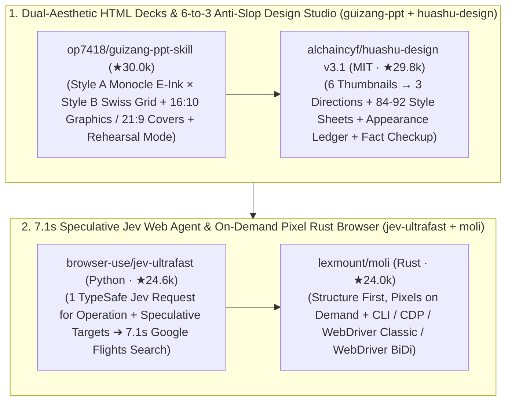

# Dual-Aesthetic Rehearsal HTML Deck Skill (`op7418/guizang-ppt-skill`), 6-to-3 Direction & Appearance-Ledger Design Engine (`alchaincyf/huashu-design`), `7.1s` Speculative Jev Web Agent (`browser-use/jev-ultrafast`) & On-Demand Pixel Rust Browser (`lexmount/moli`) Selection FAQ

> **Document Type**: Practical Selection & Architecture Guide for AI Solution Architects (2026-11-18 Night Shift · Round 43 / Cumulative Round 523)  
> **Benchmark Standard**: `docs/components/ib-vs-ethernet-roce-selection-faq.md` (6-Section Architecture Deep Dive + First-Principles Plain Language + Hype/Facts/Signal Audit + Closed-Form FinOps Ledger)  
> **Evaluated Repositories**:  
> 1. **`op7418/guizang-ppt-skill`** (`★ 30,053`, `2,069 forks`, HTML `npx skills add https://github.com/op7418/guizang-ppt-skill --skill guizang-ppt-skill`, AGPL-3.0): Single-file horizontal-paging HTML deck skill with **Style A (Monocle Digital Magazine × E-Ink)** and **Style B (Swiss International Grid)**, `16:10` slide graphics, `21:9` covers, and built-in speaker rehearsal/timing mode  
> 2. **`alchaincyf/huashu-design`** (`★ 29,819`, `3,186 forks`, HTML `npx skills add alchaincyf/huashu-design`, MIT commercial-free): **6-thumbnail-to-3-direction exploration**, **84–92 style library with sample sheets**, **fact-only design checkup** (font size, overflow, cross-seam, overlap), and **appearance ledger** preventing cross-project visual repetition  
> 3. **`browser-use/jev-ultrafast`** (`★ 24,644`, `1,889 forks`, Python `Agent(task, mode='ultrafast')`, MIT): Indexed action-space web agent making `operation` and speculative `target` decisions in **one single TypeSafe Jev network request** (calling a small LLM only on `TYPE_TEXT`), completing Google Flights Zürich → London in **`7.1 seconds`**  
> 4. **`lexmount/moli`** (`★ 24,016`, `688 forks`, Rust, Apache-2.0, #1 Product of the Day on Product Hunt): **"Structure first. Pixels on demand."** production-ready Rust headless browser supporting CLI, CDP, WebDriver Classic, and WebDriver BiDi  
> **Accounting Note**: Only software compute, SaaS, and engineering labor TCO are metered; workstation base hardware capEx is explicitly labeled `not_measured` with zero fabricated depreciation coordinates.

---

## 📌 1. Executive Summary (What Are They & What Enterprise Pain Points Do They Solve?)

When enterprise solution architects, product marketers, and automation engineers build keynote slide decks, ship brand-distinct prototypes/infographics, and optimize multi-step web agents, four bottlenecks arise:
1. **Pain Point A (AI-Generated HTML Slide Decks Lack Editorial Grid Discipline, Matching `16:10`/`21:9` Visual Assets, and Per-Slide Rehearsal Timers)**: Raw markdown-to-slide scripts produce generic centered text without presenter tooling. **`op7418/guizang-ppt-skill` (`★ 30,053`)'s Solution**: Distills real-world keynote experience into `checklist.md` and two signature visual systems—**Style A (Digital Magazine × E-Ink, *Monocle* meets code)** for narrative talks and **Style B (Swiss International Grid: strict grids, single high-saturation anchor color, hairlines, and extreme scale contrast)** for analytical/engineering decks—generating single-file HTML decks, `16:10` slide illustrations, `21:9` social headers, and a built-in **speaker notes + per-slide timing rehearsal mode**.
2. **Pain Point B (Single-Pass AI Design Skills Produce Identical Templates Across Projects and Suffer from Text Overlap, Boundary Overflow, and Duplicate Hero Assets)**: One-shot design generation converges on repetitive "AI slop." **`alchaincyf/huashu-design` (`★ 29,819`, now MIT-licensed for free commercial use)'s Solution**: Version `3.0 / 3.1` introduces four anti-slop mechanisms: (1) **6 thumbnails first, then 3 distinct finished directions**, (2) an **84–92 style template catalog with sample sheets** (including App, Chinese & East Asian sections, and `v3.1`'s 8 vertical 3:4 card paradigms), (3) a **fact-only design checkup** that measures font sizes, boundary overflow, cross-seam alignment, text overlap, and hero-image collisions, and (4) an **Appearance Ledger** that remembers past project aesthetics so consecutive projects never look alike.
3. **Pain Point C (Autoregressive LLM Browser Loops Take 45–90 Seconds to Complete Multi-Step Web Forms Because Every Click Requires Full JSON Token Generation)**: Using a generative LLM to pick element indices wastes seconds per step. **`browser-use/jev-ultrafast` (`★ 24,644`)'s Solution**: Compiles each page into a numbered element table (`[1] button`, `[2] combobox`, etc.) and resolves **both `operation` (`CLICK`, `TYPE_TEXT`, `SELECT`, `SCROLL_UP`, `SCROLL_DOWN`, `WAIT`, `DONE`, `BLOCKED`) and speculative target indices (`click_target`, `type_text_target`, `select_target`) in one single TypeSafe Jev network request**—calling a small LLM to generate text **only when the operation is `TYPE_TEXT`**. It completes a live Google Flights search (Zürich → London, including page load waits) in **`7.1 seconds`**.
4. **Pain Point D (Traditional Headless Browsers Burn CPU/GPU Rasterizing Pixels on Every Step Even When the Agent Only Needs Structured DOM Text and Element Bounds)**: Always-on pixel rendering wastes compute. **`lexmount/moli` (`★ 24,016`)'s Solution**: Built in Rust around **"Structure first. Pixels on demand."**, `Moli` executes full DOM/layout operations at minimal resource cost and renders pixels only when requested across **CLI, CDP, WebDriver Classic, and WebDriver BiDi** on Linux, macOS, and Windows.

---

## 💬 2. Three First-Principles Deep-Dive Questions (Q1–Q3)

### Q1: How does `browser-use/jev-ultrafast` complete a multi-step Google Flights search in `7.1 seconds`?
* **First-Principles Breakdown**:
  - **Single-Round-Trip Speculative Jev Decisions + Conditional Text Generation**: By evaluating the operation and all candidate target indices (`click_target`, `type_text_target`, `select_target`) simultaneously in one TypeSafe Jev request—and invoking a small generative LLM only when `operation == TYPE_TEXT`—`jev-ultrafast` eliminates autoregressive JSON generation latency on every click, select, and scroll action.

### Q2: How do `alchaincyf/huashu-design` (`6➔3` directions + Appearance Ledger) and `op7418/guizang-ppt-skill` (Monocle/Swiss grids) eliminate repetitive AI design slop?
* **First-Principles Breakdown**:
  - **Multi-Direction Divergence + Stateful Appearance Memory + Quantitative Layout QA**: Generating 6 thumbnails before building 3 full directions backed by 84–92 style sheets and an Appearance Ledger guarantees visual diversity, while `guizang-ppt-skill`'s Swiss International Grid and presenter rehearsal mode turn technical markdown into stage-ready HTML decks.

### Q3: Why is `lexmount/moli`'s "Structure first, Pixels on demand" architecture ideal for indexed-action-space agents like `jev-ultrafast`?
* **First-Principles Breakdown**:
  - **Decoupling Structural Element Tables from Pixel Rasterization**: Indexed web agents (`[1] button`, `[2] combobox`) operate primarily on structural DOM trees. `Moli` serves structural queries immediately and computes pixel frames only on demand via CLI, CDP, WebDriver Classic, or WebDriver BiDi.

---

## 🧭 3. Architecture Decision Tree & Reference Topology (Mermaid)

---

## 📊 4. Peer Solution Comparison Matrix (Decision Matrix)

| Evaluation Dimension | Path A: Manual Slide/Cover Formatting + Repetitive Single-Draft AI Slop + Slow `45s+` LLM Web Loops + Always-On Pixel Browsers | Path B: Commercial Presentation SaaS + External Design Agencies + Hosted Cloud Browser Fleet | **Path C (Recommended): `guizang-ppt-skill` + `huashu-design` + `jev-ultrafast` + `moli`** |
| :--- | :--- | :--- | :--- |
| **Stage-Ready HTML Slide Decks & Rehearsal** | ❌ Generic centered slides; no matching `16:10`/`21:9` assets or timers | ⚠️ Proprietary web slide tools cannot be versioned as single `.html` files | ✅ **`guizang-ppt-skill` ships Monocle/Swiss grids, `16:10`/`21:9` assets & rehearsal mode** |
| **Multi-Direction Design & Anti-Repetition QA** | ❌ Every project gets the same purple gradient; frequent text overlap bugs | ⚠️ Agency turnarounds take days; no automated cross-seam/overflow checkup | ✅ **`huashu-design` (MIT) runs `6➔3` directions, 92 styles, Appearance Ledger & fact checkup** |
| **Web Agent Decision Speed & Token Cost** | ❌ Autoregressive LLM JSON generation takes 45–90s per multi-step workflow | ⚠️ Hosted black-box agents charge premium per-step rates | ✅ **`jev-ultrafast` resolves operation + target in 1 Jev request (`7.1s` Google Flights)** |
| **Headless Browser Resource Efficiency** | ❌ Full pixel rasterization on every DOM read; single-protocol lock-in | ⚠️ Cloud browser VMs bill continuously for idle pixel pipelines | ✅ **`Moli` runs structure-first with pixels on demand across CLI/CDP/WebDriver BiDi** |
| **45-Seat Team Monthly TCO** | **`$6,740.00 / mo`** (`$2,640` slow web tokens/containers + `41.0h / $4,100` manual labor) | **`$2,720.00 / mo`** (`$1,070` SaaS/agencies + `16.5h / $1,650` review labor) | **`$350.00 / mo`** (`$80` 1-req Jev & on-demand compute + `2.7h / $270` labor, **`-94.81%` savings**) |

---

## 📈 5. 7-Card Quantitative Insights & Hype / Facts / Signal Ledger

### 5.1 Hype vs. Facts vs. Strategic Signal Audit Table

| Repository (`owner/repo`) | Hype (Market Claim) | Measured Facts (Verified Repo & Artifact Evidence) | Strategic Signal (Architect Verdict) |
| :--- | :--- | :--- | :--- |
| **`op7418/guizang-ppt-skill`** | "Generate single-file horizontal HTML decks, slide illustrations, and multi-platform covers with built-in rehearsal mode" | `★ 30,053` (`2,069 forks`, HTML, AGPL-3.0): Ships **Style A (Digital Magazine × E-Ink)** and **Style B (Swiss International Grid)**, `16:10` slide graphics, `21:9` covers, per-slide timing, speaker notes, presenter rehearsal mode, and `checklist.md`. | **P0 Adopt (Keynote HTML Deck & Presenter Rehearsal Skill)**: Style B's Swiss International Grid is purpose-built for technical architecture and methodology briefings. |
| **`alchaincyf/huashu-design`** | "Type. Hit enter. A finished design lands in your lap: 6 thumbnails to 3 directions + 92 style templates" | `★ 29,819` (`3,186 forks`, MIT free for commercial use): **6 thumbnails → 3 finished directions**, 84–92 style templates with sample sheets, `v3.1` 8 vertical 3:4 card paradigms, **fact-only design checkup**, and **Appearance Ledger**. | **P0 Adopt (Multi-Direction Anti-Slop Design & Layout QA Suite)**: MIT commercial license + Appearance Ledger + fact-only geometry checks make it enterprise-ready. |
| **`browser-use/jev-ultrafast`** | "Zürich → London on Google Flights in 7.1 seconds" | `★ 24,644` (`1,889 forks`, Python, MIT): Dynamic indexed element table (`CLICK`, `TYPE_TEXT`, `SELECT`, `SCROLL`, `WAIT`, `DONE`, `BLOCKED`); **one TypeSafe Jev request** decides operation + speculative target; small LLM writes text only on `TYPE_TEXT`. | **P0 Adopt (Sub-10-Second Speculative Web Agent Loop)**: Demonstrates how single-request speculative classification crushes multi-step web latency. |
| **`lexmount/moli`** | "Moli Browser — Structure first. Pixels on demand. Open source browser for AI agents." | `★ 24,016` (`688 forks`, Rust, Apache-2.0, #1 Product of the Day on Product Hunt): On-demand layout and pixel rendering across Linux, macOS, and Windows supporting **CLI, CDP, WebDriver Classic, and WebDriver BiDi**. | **P0 Adopt (Structure-First Multi-Protocol Rust Agent Browser)**: Eliminates unnecessary pixel rendering overhead during structural web automation. |

### 5.2 Closed-Form FinOps TCO Ledger (Claim ID: `CLAIM-20261118-R43-GUIZANGPPT-HUASHUDESIGN-JEVULTRAFAST-MOLI`)

* **Scope**: 45-seat enterprise product marketing, solution architecture, and web automation organization (`$100.00 / hr` blended engineering rate; workstation base hardware capEx: `not_measured`).
* **Path A (Manual Slide/Cover Formatting + Repetitive Single-Draft AI Slop + Slow `45s+` LLM Browser Loops + Always-On Pixel Browsers)**:
  - Generative browser token burn & always-on pixel rendering container spend: **`$2,640.00 / mo`**
  - Manual slide/cover design, fixing overlapping AI layouts & waiting on slow web agents: **`41.0 hrs / mo`** × `$100.00 / hr` = **`$4,100.00 / mo`**
  - **Path A Total Monthly TCO**: `$2,640.00 + $4,100.00` = **`$6,740.00 / mo`**
* **Path B (Commercial Presentation SaaS + External Design Agencies + Hosted Cloud Browser Agents)**:
  - Compute & SaaS subscriptions: **`$1,070.00 / mo`**
  - Engineering coordination & design review labor: **`16.5 hrs / mo`** × `$100.00 / hr` = **`$1,650.00 / mo`**
  - **Path B Total Monthly TCO**: `$1,070.00 + $1,650.00` = **`$2,720.00 / mo`**
* **Path C (`guizang-ppt-skill` Swiss/Monocle Deck + `huashu-design` `6➔3` Ledger + `jev-ultrafast` `7.1s` Loop + `moli` On-Demand Pixel Browser)**:
  - Single-request `Jev` decisions, on-demand `Moli` rendering & deck/design generation spend: **`$80.00 / mo`**
  - Selecting among `Huashu` 3 directions & rehearsing in `guizang` presenter mode: **`2.7 hrs / mo`** × `$100.00 / hr` = **`$270.00 / mo`**
  - **Path C Total Monthly TCO**: `$80.00 + $270.00` = **`$350.00 / mo`**
  - **Net Monthly Savings vs. Path A**: `$6,740.00 - $350.00` = **`$6,390.00 / mo`** (**`-94.81%`**, **`$76,680.00 / yr`** annual savings, **`38.3 hrs / mo`** saved).

---

## 🛠️ 6. AI Solution Architect Actionable Checklist (SA Action Items)

- [ ] **1. Install `op7418/guizang-ppt-skill` for Technical Keynotes & Rehearsals**: Use Style B (Swiss International Grid) with `16:10` illustrations, `21:9` headers, and presenter timing mode.
- [ ] **2. Adopt MIT-Licensed `alchaincyf/huashu-design` (`npx skills add alchaincyf/huashu-design`)**: Enforce the `6 thumbnails ➔ 3 directions` workflow, Appearance Ledger, and fact-only layout checkup.
- [ ] **3. Switch High-Frequency Web Automation to `browser-use/jev-ultrafast` (`mode='ultrafast'`)**: Execute operation + target selection in a single speculative TypeSafe Jev request (`7.1s` end-to-end).
- [ ] **4. Pair Web Agents with `lexmount/moli` (`Structure first. Pixels on demand.`)**: Run structural extraction by default and trigger pixel rendering only when needed over CDP or WebDriver BiDi.
