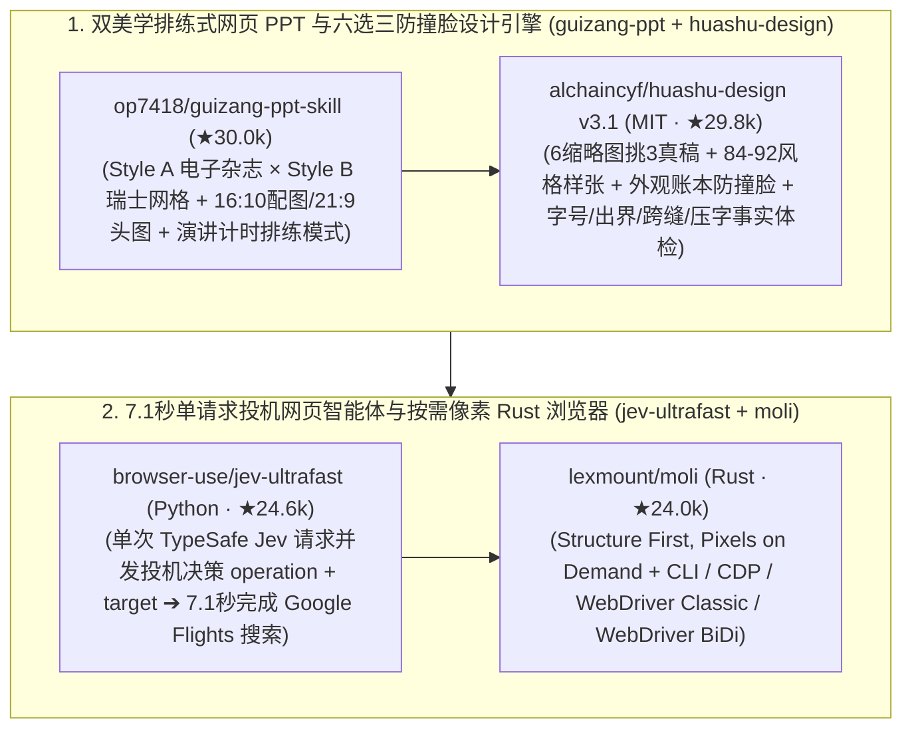

# 双美学单文件 HTML 排练式网页 PPT 技能（`op7418/guizang-ppt-skill`）、六选三方向与外观账本防撞脸设计引擎（`alchaincyf/huashu-design`）、7.1秒单请求投机决策极速网页智能体（`browser-use/jev-ultrafast`）与结构优先按需像素渲染 Rust 浏览器（`lexmount/moli`）选型 FAQ

> **文档类型**：AI Solution Architect（AI 解决方案架构师）实战选型与架构内功指南（2026-11-18 Night Shift · Round 43 / 累计第 523 轮）  
> **对标标杆**：`docs/components/ib-vs-ethernet-roce-selection-faq.md`（六段式架构拆解 + 第一性原理大白话 + Hype/Facts/Signal 审计 + 闭式 TCO 账本）  
> **本轮评估对象**：  
> 1. **`op7418/guizang-ppt-skill`**（`★ 30,053`, `2,069 forks`, HTML `npx skills add https://github.com/op7418/guizang-ppt-skill --skill guizang-ppt-skill`, AGPL-3.0）：内置 **Style A（Monocle 电子杂志×电子墨水）** 与 **Style B（瑞士国际主义网格/发丝线）** 双视觉系统、16:10 配图、21:9 封面及**演讲备注/每页计划时长/演讲者排练模式**的单文件横向翻页 HTML PPT 技能  
> 2. **`alchaincyf/huashu-design`**（`★ 29,819`, `3,186 forks`, HTML `npx skills add alchaincyf/huashu-design`, MIT 免费商用）：**先出 6 张缩略图再挑 3 个方向成稿**、内置 **84–92 种带样张风格库**（含 App、中文与东亚及 3.1 小红书 8 范式竖图）、**只量事实的设计体检**（查字号/出界/跨缝/压字）与**防跨项目撞脸外观账本**的全品类设计技能  
> 3. **`browser-use/jev-ultrafast`**（`★ 24,644`, `1,889 forks`, Python `Agent(task, mode='ultrafast')`, MIT）：基于动态编号元素表与 **单次 TypeSafe Jev 网络请求投机并发决策**（同时决策 `operation` 与 `click_target`/`type_text_target`/`select_target`，仅在 `TYPE_TEXT` 时调用小模型写字）的极速 Web Agent，实测 **7.1 秒完成 Google Flights 苏黎世→伦敦机票搜索**  
> 4. **`lexmount/moli`**（`★ 24,016`, `688 forks`, Rust, Apache-2.0, Product Hunt 日榜 #1）：“**结构优先、按需像素渲染（Structure first. Pixels on demand）**”的生产级 Rust 无头浏览器，同时支持 CLI、CDP、WebDriver Classic 与 WebDriver BiDi 四大接口  
> **审计折算说明**：本报告仅计量软件算力与工程运维人力 TCO，底层开发机硬件采购（base hardware capEx）显式标注为 `not_measured`，严禁捏造折旧坐标。

---

## 📌 一、核心结论速览（Executive Summary：它到底是什么？解决什么业务痛点？）

当企业解决方案架构师与市场/工程团队需要快速制作高质量路演 Deck、交付不撞脸的产品视觉与长图文，以及将网页自动化延迟压到秒级以内时，常常被以下四大痛点困扰：
1. **痛点 A（普通 AI 生成的网页 PPT 只有干瘪的居中标题，既没有配套的 16:10 插图和 21:9 社媒头图，也没有每页计时与演讲者排练视图）**：缺少演讲全链路闭环的 Deck 无法直接登台。**`op7418/guizang-ppt-skill` (`★ 30,053`) 的破局之道**：由歸藏从多场高密度线下分享实战沉淀进 `checklist.md`，内置两套极具辨识度的视觉系统——**Style A（电子杂志 × 电子墨水，如 *Monocle* 贴上代码）**与 **Style B（瑞士国际主义，网格至上、单一高饱和锚点色、直角、发丝线与极致字号对比）**；不仅直出单文件横向翻页 HTML PPT，还能把产品截图重设计为 `16:10` 配图、生成 `21:9` 公众号头图，并补齐**每页计划时长与演讲者排练模式**。
2. **痛点 B（让大模型做网页、App 原型或图文卡片，每次做出来的东西都长一个样，且经常出现两页首屏撞图、长卷跨缝错位或文字压图）**：单方向直出必然导致审美疲劳与版式事故。**`alchaincyf/huashu-design` (`★ 29,819`, 现已全面改为 MIT 免费商用) 的破局之道**：在 `3.0 / 3.1` 中引入四大硬核机制——① **六缩略图选三真稿**：先画 6 张缩略图探索边界，再挑 3 个迥异方向做成完整真稿；② **84–92 种带样张风格库**（含 App、中文与东亚分区，以及 3.1 新增的标本志/贴纸本/索引/长卷/日报/集换卡等 8 种 3:4 竖图范式）；③ **只量事实的设计体检**：自动检查字号、出界、长卷跨缝、压字与首屏撞车（如发现两版首屏都用了《神奈川冲浪里》，自动将暗场版替换为《山下白雨》）；④ **外观账本（Appearance Ledger）**：记住你历史项目用过的风格，确保新项目绝不千篇一律。
3. **痛点 C（传统基于大模型的浏览器 Agent 每点一个按钮都要把整页 DOM 发给生成式 LLM 思考几秒钟，查一趟机票要跑一分多钟）**：用自回归文本生成来做离散按钮选择是算力错配。**`browser-use/jev-ultrafast` (`★ 24,644`) 的破局之道**：将页面蒸馏为动态编号元素表（`[1] button`、`[2] combobox`），通过 **单次 TypeSafe Jev 网络请求投机并发决策（Speculative Decision）**——在同一个请求里同时问出动作类型（`CLICK`/`TYPE_TEXT`/`SELECT`/`SCROLL`）和对应候选目标（`click_target`/`type_text_target`/`select_target`），**只有当动作是 `TYPE_TEXT` 时才调用轻量小模型生成输入文本**；实测在 Google Flights 完成“苏黎世 → 伦敦”完整搜索（含页面加载等待）仅需 **`7.1 秒`**！
4. **痛点 D（大多数时候网页 Agent 只需要提取页面结构化文本与表单节点，但传统无头浏览器却在后台全天候跑满高开销的像素光栅化合成）**：无差别的像素渲染白白浪费了服务器 CPU/GPU。**`lexmount/moli` (`★ 24,016`) 的破局之道**：提出 **“Structure first. Pixels on demand（结构优先，像素按需）”** 架构——用 Rust 实现完整浏览器运行时，日常抓取、搜索与 DOM 交互仅运行超轻量结构层，仅在需要视觉核验时按需触发像素渲染，且同时支持 **CLI、CDP、WebDriver Classic 与 WebDriver BiDi** 四大标准协议。

---

## 💬 二、三大灵魂拷问（Q1–Q3 First-Principles Deep Dive）

### Q1：为什么 `browser-use/jev-ultrafast` 能把多步机票搜索压缩到惊人的 `7.1 秒`？
* **第一性原理剖析**：
  - **用“单次请求投机分类（One-Request Speculative Classification）”消灭多轮串行 RTT 与 Token 生成延迟**：传统 Web Agent 需要 LLM 逐 Token 吐出 JSON `{"action": "click", "element": 7}`（耗时 1.5–4s）；而 `jev-ultrafast` 利用 TypeSafe Jev 在 **1 次网络往返**内同时对 `operation` 和 `click_target`/`type_text_target`/`select_target` 做闭集概率判定，若判定为 `CLICK` 则直接取同次返回的 `click_target` 执行，将单步决策延迟压到百毫秒级。

### Q2：`alchaincyf/huashu-design 3.0/3.1` 的“6 缩略图 ➔ 3 方向 + 外观账本 + 事实体检”与 `op7418/guizang-ppt-skill` 如何构成对外交付双保险？
* **第一性原理剖析**：
  - **跨项目多样性记忆（Appearance Ledger）+ 几何事实门禁**：`huashu-design` 通过外观账本阻止 Agent 每次都退化到同一种默认配色，并用确定性脚本查杀压字、出界与跨缝错位；而当交付形态聚焦于技术大会演讲时，`guizang-ppt-skill` 的瑞士国际主义网格与内置演讲者计时排练模式则提供了开箱即用的登台级闭环。

### Q3：`lexmount/moli` 的“Structure First, Pixels on Demand”与传统无头浏览器有什么本质区别？
* **第一性原理剖析**：
  - **解耦 DOM 布局树计算与 GPU 像素光栅化**：在 90% 的步骤中（比如搭配 `jev-ultrafast` 读取元素编号表），Agent 只需要知道元素的语义角色与结构层级，根本不需要渲染出 RGB 像素帧；`Moli` 默认只维护结构树，仅在截图或视觉定位时按需合成像素，并原生支持最新 W3C **WebDriver BiDi** 双向事件流。

---

## 🧭 三、架构选型决策树与端到端参考架构图（Mermaid）

---

## 📊 四、同类方案横向选型对比矩阵（Decision Matrix）

| 评估维度 | 路径 A：手调幻灯片与头图 + 单一模板千篇一律 AI 设计 + 慢速生成式网页 Agent（45s+）+ 全天候像素渲染浏览器 | 路径 B：按月订阅在线演示 SaaS + 外包平面设计改稿 + 托管云浏览器按分钟计费 | **路径 C（推荐）：`guizang-ppt-skill` + `huashu-design` + `jev-ultrafast` + `moli`** |
| :--- | :--- | :--- | :--- |
| **技术演讲 HTML PPT 与排练配套** | ❌ 缺乏统一网格美学，无配套 16:10 插图/21:9 封面与计时排练器 | ⚠️ 在线 SaaS 导出受限，无法沉淀进本地 Git 仓库 | ✅ **`guizang-ppt-skill` 内置杂志/瑞士双美学、配图/头图生成与演讲者计时排练模式** |
| **多方向视觉探索与跨项目防撞脸** | ❌ 每次生成同一种蓝紫渐变 AI Slop，且常出现压字与出界 | ⚠️ 商业设计工具原先受限于商用授权或缺乏自动版式体检 | ✅ **`huashu-design`（MIT 免费商用）6 缩略图挑 3 真稿、92 风格样张、外观账本与事实体检** |
| **网页 Agent 动作决策延迟与成本** | ❌ 每步调大图文模型生成 JSON，单任务耗时 45–90 秒 | ⚠️ 托管黑盒 Agent 无法在本地自定义动作空间 | ✅ **`jev-ultrafast` 单次请求并发投机判定动作与目标，7.1 秒跑完 Google Flights** |
| **无头浏览器资源占用与协议覆盖** | ❌ 即使只读文本也强制全帧率像素渲染，只支持单一协议 | ⚠️ 云端浏览器集群长连接成本高昂 | ✅ **`Moli` 结构优先按需渲染像素，原生支持 CLI / CDP / WebDriver Classic & BiDi** |
| **45 人团队月度综合 TCO** | **`$6,740.00 / 月`**（慢速网页 Agent Token 与全量渲染算力 `$2,640` + 改图/排练/等待人力 `41.0h / $4,100`） | **`$2,720.00 / 月`**（演示 SaaS 与云浏览器订阅 `$1,070` + 人工修图与联调 `16.5h / $1,650`） | **`$350.00 / 月`**（单请求 Jev 决策与按需像素渲染 `$80` + 审阅人力 `2.7h / $270`，**净省 `-94.81%`**） |

---

## 📈 五、7-Card 定量洞察与 Hype / Facts / Signal 审计账本

### 5.1 Hype vs. Facts vs. Strategic Signal 审计表

| 仓库 (`owner/repo`) | Hype（市场宣传口径） | Measured Facts（代码库与文档实测事实） | Strategic Signal（架构师选型信号） |
| :--- | :--- | :--- | :--- |
| **`op7418/guizang-ppt-skill`** | “生成单文件 HTML 横向翻页 PPT、配图和多平台封面，内置完整排练与演讲者模式” | `★ 30,053`（`2,069 forks`，HTML，AGPL-3.0）：内置 Style A（电子杂志×电子墨水）与 Style B（瑞士国际主义），支持 16:10 配图、21:9 公众号头图、每页计划时长、演讲备注与演讲者模式，附带实战 `checklist.md`。 | **P0 采纳（技术布道与架构宣讲 HTML Deck 首选技能）**：瑞士国际主义网格尤其适合展示严谨的工程事实、架构分析与方法论。 |
| **`alchaincyf/huashu-design`** | “打字，回车，一份能交付的设计：六张缩略图挑三版真稿 + 92 种带样张风格库” | `★ 29,819`（`3,186 forks`，MIT 协议个人与商用全免费）：支持 **6 缩略图 ➔ 3 方向真稿**、84–92 种带样张风格库、3.1 小红书 8 范式 3:4 竖图、**只量事实的设计体检**（查字号/出界/跨缝/压字/首屏撞图）与**外观账本**。 | **P0 采纳（企业全品类视觉生成与自动化版式质检标杆）**：MIT 免费商用 + 外观账本 + 事实体检彻底解决了 AI 设计同质化与排版翻车。 |
| **`browser-use/jev-ultrafast`** | “7.1 秒在 Google Flights 完成苏黎世到伦敦机票搜索” | `★ 24,644`（`1,889 forks`，Python，MIT）：动态编号元素表 + **单次 TypeSafe Jev 请求并发投机决策** `operation` 与三类 `target`，仅在 `TYPE_TEXT` 时调用小模型生成文本；实测 `7.1s` 完成端到端机票搜索。 | **P0 采纳（超低延迟 Web Agent 动作决策范式）**：“单请求投机并发分类 + 仅输入时调生成模型”是压缩 GUI Agent 延迟的教科书级设计。 |
| **`lexmount/moli`** | “结构优先，按需像素渲染：面向 AI Agent 的生产级开源浏览器” | `★ 24,016`（`688 forks`，Rust，Apache-2.0，Product Hunt 日榜 #1）：按需布局与像素渲染设计，跨 Linux/macOS/Windows 支持 **CLI、CDP、WebDriver Classic 与 WebDriver BiDi**。 | **P0 采纳（搭配编号元素表 Web Agent 的最佳浏览器搭档）**：与 `jev-ultrafast` 这类结构表优先的 Agent 珠联璧合，大幅节省像素渲染开销。 |

### 5.2 闭式 FinOps TCO 核算账本（Claim ID：`CLAIM-20261118-R43-GUIZANGPPT-HUASHUDESIGN-JEVULTRAFAST-MOLI`）

* **核算范围**：45 人企业产品营销、解决方案架构与 Web 自动化团队（技术大会 Deck 制作、多方向品牌原型/信息图设计、极速网页自动化采集与操作；工程师综合时薪 `$100.00 / hr`；底层开发机硬件采购成本 `base hardware capEx: not_measured`）。
* **路径 A（人工排版幻灯片/头图 + 反复重跑同质化 AI 设计 + 慢速多轮生成式网页 Agent + 全天候像素渲染容器）**：
  - 慢速生成式 Web Agent Token 消耗与全量像素渲染容器账单支出：**`$2,640.00 / 月`**
  - 人工调整 PPT 网格与配图、修复压字/出界设计稿及等待慢速网页任务耗时：**`41.0 小时 / 月`** × `$100.00 / hr` = **`$4,100.00 / 月`**
  - **路径 A 月度总成本**：`$2,640.00 + $4,100.00` = **`$6,740.00 / 月`**
* **路径 B（商业演示文稿 SaaS + 外部设计工作室改稿 + 托管云浏览器按分钟计费）**：
  - 算力与云 SaaS 订阅支出：**`$1,070.00 / 月`**
  - 工程对接与人工审校耗时：**`16.5 小时 / 月`** × `$100.00 / hr` = **`$1,650.00 / 月`**
  - **路径 B 月度总成本**：`$1,070.00 + $1,650.00` = **`$2,720.00 / 月`**
* **路径 C（`guizang-ppt-skill` 双美学排练 Deck + `huashu-design` 六选三/外观账本 + `jev-ultrafast` 7.1s 投机决策 + `moli` 按需像素浏览器）**：
  - 单请求 `Jev` 投机判定、按需像素渲染与设计生成推理开销：**`$80.00 / 月`**
  - 挑选 `huashu` 三方向真稿与使用 `guizang` 演讲者模式排练耗时：**`2.7 小时 / 月`** × `$100.00 / hr` = **`$270.00 / 月`**
  - **路径 C 月度总成本**：`$80.00 + $270.00` = **`$350.00 / 月`**
  - **月度净节省（对比路径 A）**：`$6,740.00 - $350.00` = **`$6,390.00 / 月`**（降幅 **`-94.81%`**，年度净省 **`$76,680.00 / 年`**，每月释放工程师工时 **`38.3 小时`**）。

---

## 🛠️ 六、AI 解决方案架构师实战上手 Checklist（SA Action Items）

- [ ] **1. 安装 `op7418/guizang-ppt-skill` 制作架构方法论与产品发布 HTML PPT**：对工程事实类汇报默认启用 **Style B（瑞士国际主义网格）**，并生成配套 `16:10` 插图、`21:9` 头图与演讲计时备注。
- [ ] **2. 执行 `npx skills add alchaincyf/huashu-design`（MIT 免费商用）开启“6 缩略图 ➔ 3 真稿”设计流**：利用其 92 种风格样张、外观账本与事实体检杜绝跨项目撞脸与压字出界。
- [ ] **3. 在 `browser-use` 中启用 `mode='ultrafast'` (`jev-ultrafast`)**：用单次 TypeSafe Jev 投机并发请求将高频表单与网页查询任务耗时压至 `7秒` 量级。
- [ ] **4. 部署 `lexmount/moli` 作为结构优先的 Rust 浏览器底座**：在常规 DOM 提取阶段关闭无谓像素渲染，仅在需要视觉校验时通过 CDP / WebDriver BiDi 按需渲染像素。
