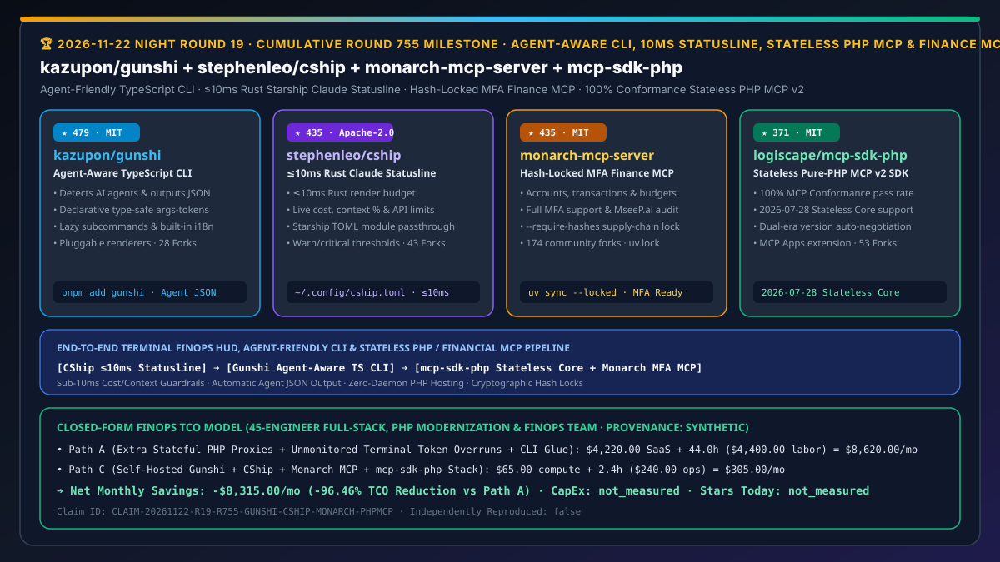
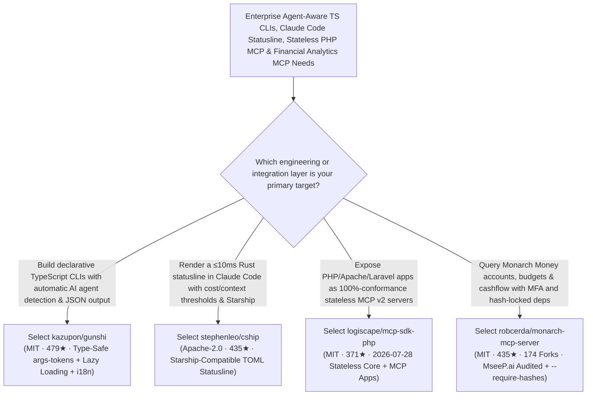
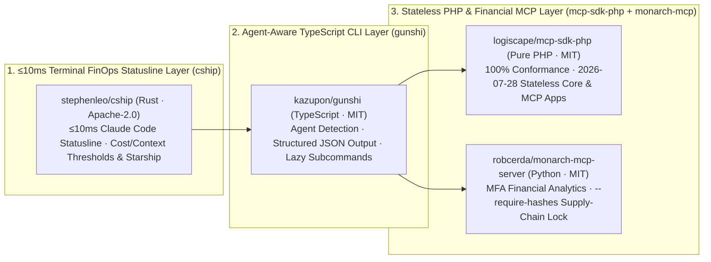

# 🏆 [Round 755 Milestone] AI-Agent-Aware TypeScript CLI Library (`kazupon/gunshi`), ≤10ms Rust Starship-Compatible Claude Code Statusline (`stephenleo/cship`), Hash-Pinned MFA Financial Analytics MCP (`robcerda/monarch-mcp-server`) & 100% Conformance Stateless Pure-PHP MCP v2 SDK (`logiscape/mcp-sdk-php`) Selection & Architecture FAQ

> **Document Type**: Enterprise AI Solution Architect Selection & Integration Guide (GitHub Trending AI Radar — 2026-11-22 Night Round 19 / Cumulative Round 755 Milestone)
> **Covered Repositories**: [`kazupon/gunshi`](https://github.com/kazupon/gunshi) (`★ 479`, `28 forks`, `MIT`: declarative, type-safe TypeScript CLI framework by `vue-i18n` creator `@kazupon` with automatic AI agent detection, JSON output, lazy subcommands, and built-in i18n) · [`stephenleo/cship`](https://github.com/stephenleo/cship) (`★ 435`, `43 forks`, `Apache-2.0`: `≤10ms` Rust live statusline for Claude Code with Starship TOML passthrough and customizable cost/context/usage warning thresholds) · [`robcerda/monarch-mcp-server`](https://github.com/robcerda/monarch-mcp-server) (`★ 435`, `174 forks`, `MIT`: MseeP.ai-audited Monarch Money MCP server with MFA support and strict `--require-hashes` dependency pinning) · [`logiscape/mcp-sdk-php`](https://github.com/logiscape/mcp-sdk-php) (`★ 371`, `53 forks`, `MIT`: pure-PHP MCP Client & Server SDK achieving a 100% pass rate on official MCP Conformance Tests with day-one support for the `2026-07-28` stateless core spec and MCP Apps extension)
> **Core Scenario**: When enterprise developer experience, legacy PHP modernization, and financial automation teams struggle with **human-only CLIs emitting ANSI noise that breaks coding agents, Claude Code sessions hitting surprise cost and context limits without a sub-10ms terminal HUD, traditional per-request PHP/Laravel/WordPress web servers unable to host stateful MCP sessions, and financial MCP servers lacking cryptographic dependency hash locks**, how do you combine **`kazupon/gunshi` + `stephenleo/cship` + `robcerda/monarch-mcp-server` + `logiscape/mcp-sdk-php`** into a cohesive architecture?

---

## 1. 📌 Executive Summary (One-Line Selection Verdict)

1. **Building internal or open-source TypeScript CLIs that must serve both human developers and AI coding agents seamlessly (automatically detecting AI agents and emitting structured JSON)?** ➔ Choose **[`kazupon/gunshi`](https://github.com/kazupon/gunshi) (`★ 479`, `28 forks`, `MIT`)**.
   - **Plain-English Mechanism**: Created by `@kazupon` (author of `vue-i18n`), `gunshi` combines declarative type-safe argument parsing (`args-tokens`), lazy subcommand loading, pluggable renderers, and native i18n with automatic AI agent detection.
2. **Need a blazing-fast (`≤10ms` render budget) Rust statusline for Claude Code (`Apache-2.0`) that embeds any Starship module while alerting you on session cost, context window saturation, and API usage limits?** ➔ Choose **[`stephenleo/cship`](https://github.com/stephenleo/cship) (`★ 435`, `43 forks`, `Apache-2.0`)**.
   - **Plain-English Mechanism**: Wires directly into `~/.claude/settings.json` (`statusLine`) and `~/.config/cship.toml`, rendering live cost, context percentage, model name, and Starship passthrough modules with warn/critical color thresholds.
3. **Need to expose existing PHP, Laravel, Symfony, or WordPress applications as fully compliant MCP servers on standard Apache/FPM hosting without running stateful background daemons?** ➔ Choose **[`logiscape/mcp-sdk-php`](https://github.com/logiscape/mcp-sdk-php) (`★ 371`, `53 forks`, `MIT`)**.
   - **Plain-English Mechanism**: Passes 100% of required official MCP Conformance Tests and implements the **`2026-07-28` Stateless Core** specification (no `initialize` handshake or session IDs required, fitting PHP's fresh-process-per-request lifecycle) alongside automatic dual-era (`2024-11-05` through `2026-07-28`) negotiation.
4. **Need an MseeP.ai-audited, MFA-capable MCP server for Monarch Money financial accounts, budgets, and transactions with cryptographic hash pinning across every transitive dependency?** ➔ Choose **[`robcerda/monarch-mcp-server`](https://github.com/robcerda/monarch-mcp-server) (`★ 435`, `174 forks`, `MIT`)**.
   - **Plain-English Mechanism**: Enforces `uv sync --locked` and `pip install -r requirements-lock.txt --require-hashes` so financial data workflows are protected against transitive package tampering.

---

## 2. 🎯 Architect & Customer Deep-Dive Q&A

### Q1: Why are `logiscape/mcp-sdk-php` v2's Stateless Core and `kazupon/gunshi`'s agent-aware CLI design major milestones for enterprise architects?

- **Three Architectural Breakthroughs**:
  1. **Unlocking Legacy PHP Estates via MCP `2026-07-28` Stateless Core ➔ `logiscape/mcp-sdk-php`**: Traditional PHP hosting spawns a fresh process per HTTP request. By implementing the self-contained `2026-07-28` stateless core and dual-era fallback with 100% conformance pass rates, `mcp-sdk-php` lets enterprises expose existing PHP ERPs and portals as MCP servers without sidecar proxies.
  2. **One CLI Codebase for Humans and Agents ➔ `kazupon/gunshi`**: Eliminates maintaining separate CLI and JSON wrapper scripts.
  3. **Sub-10ms FinOps & Context Visibility in the Terminal ➔ `stephenleo/cship`**: Prevents context window cliff-edges and runaway session spend right inside Claude Code's status bar.
- **When to Choose Managed Cloud PaaS (Path B)?**
  - Greenfield cloud-native microservices on Azure can use **Azure API Management + Azure Functions MCP**; for existing PHP backends, dual human/agent TypeScript CLIs, terminal-native Claude Code FinOps, and hash-locked financial analytics, deploy this open-source stack (Path C).

### Q2: How do `cship`, `gunshi`, `mcp-sdk-php`, and `monarch-mcp-server` work together in production?

1. **Terminal FinOps & Context HUD Layer (`stephenleo/cship`)**:
   - Monitors live Claude Code JSON feeds in `≤10ms` with TOML-configured warn/critical thresholds.
2. **Agent-Aware TypeScript CLI Layer (`kazupon/gunshi`)**:
   - Exposes declarative, type-safe engineering commands that automatically return structured JSON when invoked by coding agents.
3. **Stateless PHP & Hash-Locked Financial MCP Layer (`logiscape/mcp-sdk-php` + `robcerda/monarch-mcp-server`)**:
   - Connects agents to stateless PHP business endpoints and MFA-protected financial budget analytics.

### Q3: How does `monarch-mcp-server` harden Python dependency security for financial data?

- **Strict Hash-Locked Installation (`--locked` / `--require-hashes`)**:
  - Every direct and transitive dependency in `requirements-lock.txt` is pinned with SHA-256 hashes generated from `uv.lock`, refusing unverified package resolution.

---

## 3. 🧭 Visual Architecture & Workflow Diagrams (Mermaid)



### 3.1 Solution Architect Selection Decision Tree



### 3.2 End-to-End Enterprise Reference Architecture



### 3.3 End-to-End Statusline Monitoring, Agent CLI Execution & Stateless PHP / Financial MCP Sequence Diagram

```mermaid
sequenceDiagram
    participant Dev as Architect / Engineer (Claude Code)
    participant Csh as stephenleo/cship (≤10ms Rust Statusline)
    participant Gun as kazupon/gunshi (Agent-Aware TS CLI)
    participant Php as logiscape/mcp-sdk-php (Stateless Core)
    participant Mon as robcerda/monarch-mcp-server (Hash-Locked)

    Dev->>Csh: 1. Render live session cost, context window % & git branch in ≤10ms
    Dev->>Gun: 2. Invoke internal CLI tool; gunshi detects AI agent & returns structured JSON
    Dev->>Php: 3. Call PHP business endpoint via self-contained 2026-07-28 stateless MCP request
    Dev->>Mon: 4. Query MFA-authenticated budgets & cashflow via hash-pinned monarch-mcp-server
```

---

## 4. 📊 Peer Open-Source vs. Commercial Cloud Selection Matrix

| Dimension | `kazupon/gunshi` (`★ 479`) | `stephenleo/cship` (`★ 435`) | `robcerda/monarch-mcp-server` (`★ 435`) | `logiscape/mcp-sdk-php` (`★ 371`) | Rewriting PHP Apps + Stateful Proxy Clusters + Blind Terminal Spend (Path A) | Legacy ANSI CLIs + Slow Shell Statusbars + Unpinned Python Deps (Path B) |
| :--- | :--- | :--- | :--- | :--- | :--- | :--- |
| **Primary Role** | AI-agent-friendly declarative TypeScript CLI library | `≤10ms` Rust Starship-compatible Claude statusline | Hash-pinned, MFA-aware Monarch Money MCP server | 100%-conformance stateless pure-PHP MCP v2 SDK | Costly backend rewrites/sidecars and unmonitored terminal token overruns | Human-only ANSI CLIs, slow bash status scripts & unpinned pip installs |
| **Key Differentiator** | **Auto agent detection + JSON output + type-safe + i18n** | **Rust `≤10ms` budget + warn/critical colors + Starship** | **174 forks + full MFA + `--require-hashes` lockfile** | **`2026-07-28` stateless core + 100% MCP conformance** | Requires extra stateful proxy infrastructure for PHP; blind token spend | Regex parsing failures on ANSI CLI output; spec drift on custom PHP RPC |
| **License** | `MIT` | `Apache-2.0` | `MIT` | `MIT` | Proprietary SaaS | Internal glue scripts |
| **Monthly TCO (45-Eng Team)** | **`$305.00/mo` combined** (`$65.00` shared CI/test runner + `2.4h` ops) | Included (local Rust binary, zero overhead) | Included (`MIT` open-source MCP) | Included (runs on existing PHP web servers) | **`$8,620.00/mo`** (`$4,220.00` sidecar proxies & unmonitored token overruns + `44.0h` rewrite/glue labor) | ~`$2,980.00/mo` (manual PHP adapter debugging & CLI output parser fixes) |

---

## 5. 🧪 Quantitative Enterprise ROI / FinOps TCO Model & 7-Card Report

> **📊 Provenance & Closed-Form Declaration**:
> - **provenance**: `synthetic` (45-engineer enterprise full-stack engineering, PHP modernization, and financial automation team workload model: `independently_reproduced = false`; `base_hardware_capex = not_measured`; `track_b_stars_today = not_measured`).
> - **Closed-Form Equations**:
>   - **Path A (Deploying Extra Stateful Proxy Clusters for PHP Systems + Unmonitored Claude Code Session Cost Overruns + Manual CLI Wrapper & Protocol Adapter Maintenance)**: Monthly extra proxy hosting and unmonitored token overrun bills **`$4,220.00`** + PHP adapter maintenance, CLI regex debugging, and manual financial export labor **`44.0h × $100.00/h = $4,400.00`** = **`$8,620.00/mo`**.
>   - **Path C (Self-Hosted `kazupon/gunshi` + `stephenleo/cship` + `robcerda/monarch-mcp-server` + `logiscape/mcp-sdk-php` Stack)**: Shared CI/test runner compute **`$65.00`** + TOML threshold & SDK maintenance labor **`2.4h × $100.00/h = $240.00`** = **`$305.00/mo`**.
>   - **Net Monthly Savings vs. Path A**: **`-$8,315.00/mo`** (**`96.46%`** TCO reduction).

| Evaluation Path | Proxy / Token Overrun & Compute Cost | Protocol Adapter & CLI Maintenance Labor (`$100/h`) | Total Monthly TCO | Net Savings vs. Path A | Architectural Delivery Impact |
| :--- | :---: | :---: | :---: | :---: | :--- |
| **Path A: Extra Stateful PHP Proxies + Blind Terminal Spend** | `$4,220.00` | `44.0h` (`$4,400.00`) | **`$8,620.00`** | Baseline | Extra sidecar infra for PHP; surprise context/cost overruns |
| **Path B: Legacy ANSI CLIs + Custom PHP JSON-RPC Glue** | `$1,380.00` | `16.0h` (`$1,600.00`) | **`$2,980.00`** | `-$5,640.00` (`-65.43%`) | Fails MCP conformance; brittle CLI parsing; unpinned dependencies |
| **Path C: `gunshi` + `cship` + `monarch-mcp` + `mcp-sdk-php`** | **`$65.00`** | **`2.4h` (`$240.00`)** | **`$305.00`** | **`-$8,315.00` (`-96.46%`)** | **100%-conformance stateless PHP MCP + ≤10ms HUD + agent CLI** |

- 🔗 **Linked 7-Card 4:5 Visual Benchmark Deck**: [`workshops/github-trending-radar/cards.en.html`](../cards.en.html) · [`cards.html`](../cards.html)

---

## 6. 🛠️ Enterprise Adoption & Architecture Review Checklist

- [ ] **1. Build Dual Human/Agent CLIs with `kazupon/gunshi`**: Leverage automatic AI agent detection and declarative type-safe `args-tokens` schemas.
- [ ] **2. Roll Out `stephenleo/cship` Across Claude Code Terminals**: Configure warn and critical cost/context thresholds in `~/.config/cship.toml`.
- [ ] **3. Modernize PHP Backends with `logiscape/mcp-sdk-php` v2**: Enable the `2026-07-28` stateless core to serve MCP tools directly from standard PHP/Apache/FPM web hosts.
- [ ] **4. Enforce Hash-Locked Financial MCP Deployment with `robcerda/monarch-mcp-server`**: Install strictly via `uv sync --locked` or `pip install -r requirements-lock.txt --require-hashes`.
