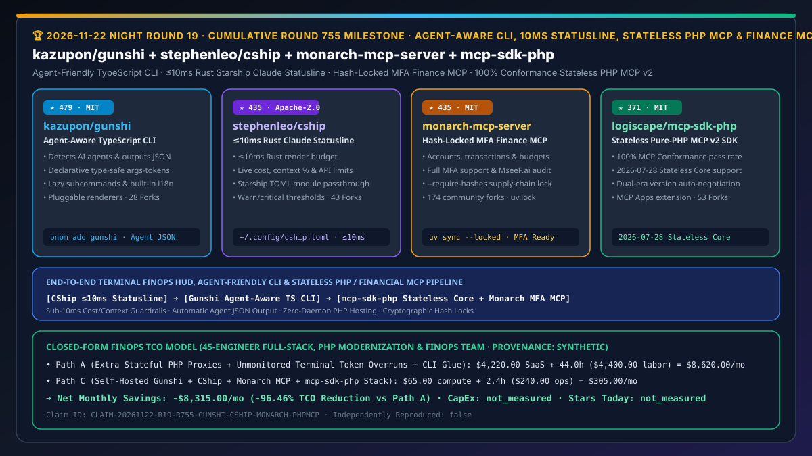
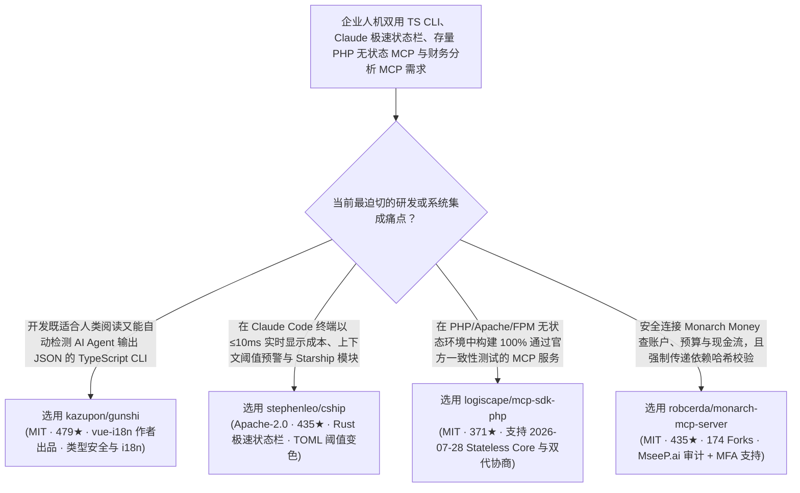
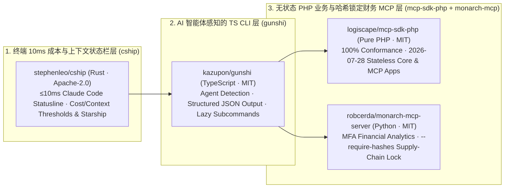
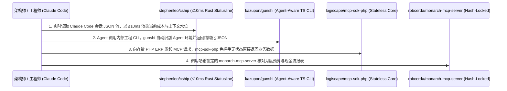

# 🏆【第 755 轮里程碑】AI 智能体感知的 TypeScript CLI 框架（`kazupon/gunshi`）、10ms 极速 Rust Starship 风格 Claude 状态栏（`stephenleo/cship`）、哈希锁定的 MFA 财务预算分析 MCP（`robcerda/monarch-mcp-server`）与 100% 通过一致性测试的无状态纯 PHP MCP v2 SDK（`logiscape/mcp-sdk-php`）选型与集成架构 FAQ

> **文档类型**：企业 AI 解决方案架构师（AI Solution Architect）选型决策指南（GitHub Trending AI 雷达 2026-11-22 Night Round 19 / 累计第 755 轮里程碑）
> **覆盖项目**：[`kazupon/gunshi`](https://github.com/kazupon/gunshi)（`★ 479`、`28 forks`、`MIT`，`vue-i18n` 作者 `@kazupon` 打造的 AI 智能体友好型 TypeScript 命令行库，自动检测 AI Agent 调用并输出结构化 JSON，支持声明式类型安全参数解析与多语言国际化）· [`stephenleo/cship`](https://github.com/stephenleo/cship)（`★ 435`、`43 forks`、`Apache-2.0`，`≤10ms` 渲染预算的 Rust 编写 Claude Code 实时状态栏，兼容 Starship TOML 配置与透传模块，实时告警会话成本、上下文窗口与 API 限额阈值）· [`robcerda/monarch-mcp-server`](https://github.com/robcerda/monarch-mcp-server)（`★ 435`、`174 forks`、`MIT`，经 MseeP.ai 安全评估、采用 `--require-hashes` 锁死传递依赖并支持完整 MFA 的 Monarch Money 账户/交易/预算分析 MCP）· [`logiscape/mcp-sdk-php`](https://github.com/logiscape/mcp-sdk-php)（`★ 371`、`53 forks`、`MIT`，100% 通过官方 MCP Conformance 测试的纯 PHP MCP v2 SDK，首发支持 `2026-07-28` 无状态核心协议与双代自动协商）
> **核心场景**：当企业研发效能、存量 PHP 业务系统改造与财务自动化团队面临**“传统人类 CLI 工具输出彩色 ANSI 字符导致编码 Agent 解析频频出错、开发者跑 Claude Code 时看不见实时成本与上下文水位突然撞墙限流、企业大量存量 PHP/Laravel/WordPress 系统受限于每请求新建进程模型无法运行有状态长连接 MCP Server、以及财务分析 MCP 依赖链缺乏严格哈希校验”**四大痛点时，如何组合**`kazupon/gunshi` + `stephenleo/cship` + `robcerda/monarch-mcp-server` + `logiscape/mcp-sdk-php`** 构建人机双友好 CLI 与无状态企业 MCP 底座？

---

## 一、📌 核心结论速览（选型一句话结论）

1. **想用 TypeScript 开发一套“既让人类工程师用着顺手，又能自动识别 AI Agent 调用并直接吐出干净 JSON”的现代企业级 CLI 工具** ➔ 选 **[`kazupon/gunshi`](https://github.com/kazupon/gunshi)（`★ 479`，`28 forks`，`MIT`）**。
   - **通俗原理**：由 Vue 核心团队成员、`vue-i18n` 作者 `@kazupon` 出品。它通过声明式类型安全配置（基于 `args-tokens`）、按需懒加载子命令、可插拔渲染器与原生多语言支持，在检测到 AI Agent 环境时自动切换为机器可读 JSON 输出。
2. **想在 Claude Code 终端底部挂载一个渲染耗时 `≤10ms`、与 Starship 完美融合的 Rust 状态栏，实时盯住当前会话美元开销、上下文窗口百分比与 API 限额并在超标前变色预警** ➔ 选 **[`stephenleo/cship`](https://github.com/stephenleo/cship)（`★ 435`，`43 forks`，`Apache-2.0`）**。
   - **通俗原理**：一行命令自动写入 `~/.config/cship.toml` 与 `~/.claude/settings.json` 的 `statusLine` 字段，不仅支持自定义成本/上下文告警（Warn）与危险（Critical）颜色阈值，还能直接内嵌任意原生 Starship 模块（如 `git_branch`、语言版本）。
3. **想让存量 PHP / Laravel / WordPress / Apache 业务系统无需改造常驻内存守护进程，就能以“每 HTTP 请求独立无状态进程”的方式 100% 合规接入最新 MCP 生态** ➔ 选 **[`logiscape/mcp-sdk-php`](https://github.com/logiscape/mcp-sdk-php)（`★ 371`，`53 forks`，`MIT`）**。
   - **通俗原理**：100% 通过官方 MCP Conformance 测试套件，v2 版本原生实现 **`2026-07-28` Stateless Core（无状态核心规范）**——无需 `initialize` 握手与 Session ID，单次请求完全自包含，并内置从 `2024-11-05` 到 `2026-07-28` 的双代协议自动探测与降级协商。
4. **想让 Claude 安全连接 Monarch Money 平台进行多账户现金流、预算执行与交易分类分析，同时要求所有 Python 传递依赖 100% 强制 SHA256 哈希锁死（`--require-hashes`）并支持多因素认证（MFA）** ➔ 选 **[`robcerda/monarch-mcp-server`](https://github.com/robcerda/monarch-mcp-server)（`★ 435`，`174 forks`，`MIT`）**。
   - **通俗原理**：通过 MseeP.ai 安全评估，采用 `uv sync --locked` 与 `requirements-lock.txt --require-hashes` 防范供应链投毒。

---

## 二、🎯 客户与架构师灵魂拷问 Q&A（深度架构拆解）

### Q1：为什么 `logiscape/mcp-sdk-php` 的“无状态核心（Stateless Core）”与 `kazupon/gunshi` 的“AI 感知 CLI”对企业架构师至关重要？

- **三大工程架构价值**：
  1. **拯救全球海量存量 PHP/FPM 系统的 AI 化改造 ➔ `logiscape/mcp-sdk-php`**：早期 MCP 协议强依赖长连接会话状态，与 PHP 经典的“请求即进程、响应即销毁”模型天然冲突；`mcp-sdk-php v2` 率先落地 `2026-07-28` 无状态核心与 MCP Apps 扩展，让传统 PHP ERP/电商后台零架构大改即可暴露标准 MCP 工具。
  2. **一套 CLI 同时服务人类与智能体 ➔ `kazupon/gunshi`**：避免为人类写一套 CLI、再为 Agent 写一套 Wrapper；`gunshi` 原生支持 Agent 探测与 JSON 输出。
  3. **把 Token 成本失控拦截在终端毫秒级状态栏 ➔ `stephenleo/cship`**：在开发者敲下一轮指令前，用 `≤10ms` Rust 状态栏直观展示当前上下文占比与费用告警色。
- **何时直接用云厂商托管方案（Path B）？**
  - 若企业全部新建云原生微服务，可使用 **Azure API Management + Azure Functions MCP**；若需要改造存量 PHP 业务资产、构建人机两用 TypeScript CLI、实时监控 Claude Code 终端成本及进行哈希锁定的财务分析，则采用本轮开源栈（Path C）。

### Q2：典型企业级“终端状态栏护栏 (`cship`) + 人机双模 CLI (`gunshi`) + 无状态 PHP 业务网关 (`mcp-sdk-php`) + 哈希锁定财务 MCP (`monarch-mcp`)”架构怎么搭？

1. **开发者终端实时可观测层（`stephenleo/cship`）**：
   - 在 `~/.claude/settings.json` 挂载 `cship`，实时监控上下文水位、模型名称与单会话成本阈值。
2. **人机通用 TypeScript CLI 工具层（`kazupon/gunshi`）**：
   - 使用 `gunshi` 构建内部研发与部署命令行，Agent 调用时自动输出强类型 JSON。
3. **存量 PHP 业务与安全财务 MCP 服务层（`logiscape/mcp-sdk-php` + `robcerda/monarch-mcp-server`）**：
   - 存量 PHP 业务系统通过 `mcp-sdk-php` 暴露无状态 HTTP MCP 接口；财务预算数据通过哈希锁定的 `monarch-mcp-server` 接入。

### Q3：如何确保金融财务类 MCP Server 不被第三方 PyPI 包更新投毒？

- **严格执行 `monarch-mcp-server` 的 `--locked` / `--require-hashes` 供应链门禁**：
  - 拒绝未锁定的动态版本解析，强制核验每一个传递依赖包的加密哈希值。

---

## 三、🧭 直观可视化图解（Mermaid 决策树 + 集成架构 + 时序图）

### 3.1 架构师选型决策树

### 3.2 企业端到端生产集成参考架构图

### 3.3 `cship` 状态监控、`gunshi` CLI 执行与 `mcp-sdk-php` / `monarch-mcp` 调用时序图

---

## 四、📊 同类开源与商业云服务横向选型决策矩阵

| 对比维度 | `kazupon/gunshi` (`★ 479`) | `stephenleo/cship` (`★ 435`) | `robcerda/monarch-mcp-server` (`★ 435`) | `logiscape/mcp-sdk-php` (`★ 371`) | 推倒重写存量 PHP 为云原生 + 商业 CLI 遥测 SaaS + 无状态栏盲跑 (Path A) | 传统 Commander.js 文本 CLI + 慢速 Shell 脚本状态栏 + 未锁定依赖 (Path B) |
| :--- | :--- | :--- | :--- | :--- | :--- | :--- |
| **核心能力定位** | AI Agent 感知的声明式 TypeScript CLI 库 | `≤10ms` Rust Starship 兼容 Claude 状态栏 | 哈希锁定与 MFA 支持的 Monarch 财务 MCP | 100% 一致性通过的纯 PHP 无状态 MCP SDK | 耗资巨大的异构语言重写工程与缺乏终端实时成本预警的云端账单 | 输出混杂 ANSI 颜色码的传统 CLI 与无哈希锁定的脚本 |
| **核心技术突破** | **自动检测 AI Agent 切换 JSON + 类型安全 + 原生 i18n** | **Rust `≤10ms` 预算 + 成本/上下文告警色 + 内嵌 Starship** | **174 Forks 验证 + 完整 MFA + 全量传递依赖哈希锁死** | **首发支持 `2026-07-28` 无状态核心 + 100% 官方一致性通过** | 为接入 MCP 被迫额外部署 Node/Python 代理层；终端不知不觉超支 | Agent 解析传统 CLI 报错率高；Shell 状态栏卡顿拖慢交互 |
| **开源协议** | `MIT` | `Apache-2.0` | `MIT` | `MIT` | 闭源商业 SaaS | 内部零散脚本 |
| **月度 TCO（45 人团队）** | **组合仅 `$305.00/月`**（`$65.00` 共享构建与测试容器 + `2.4h` 维护） | 同左（本地 Rust 二进制零开销） | 同左（`MIT` 免费开源） | 同左（直接复用现有 PHP 主机零新增服务器） | **`$8,620.00/月`**（`$4,220.00` 额外网关集群与未预警超支 Token + `44.0h` 跨语言重写维护） | 约 `$2,980.00/月`（大量人工维护 PHP 转接胶水与修补 CLI 解析工时） |

---

## 五、🧪 应用落地定量收益/TCO 对比与 7-Card 报告

> **📊 数据来源与闭式核算声明（Provenance & Closed-Form Schema）**：
> - **provenance**: `synthetic`（基于 45 人企业全栈研发、存量 PHP 系统现代化与财务数据自动化团队月度工作负载模型：`independently_reproduced = false`；硬件采购基线 `base_hardware_capex = not_measured`；Track B 单日增量 `track_b_stars_today = not_measured`）。
> - **核算公式**：
>   - **Path A（为存量 PHP 系统额外部署有状态中间层网关 + 终端无实时成本/上下文阈值预警导致的 Claude Code 超支账单 + 工程师维护传统 CLI 文本解析正则与跨语言转接人工）**：月度超支 Token 与额外网关托管账单 **`$4,220.00`** + 维护 PHP 协议转接服务、修补 CLI 输出解析报错与手工导出财务数据人工 **`44.0h × $100.00/h = $4,400.00`** = **`$8,620.00/月`**。
>   - **Path C（自建 `kazupon/gunshi` + `stephenleo/cship` + `robcerda/monarch-mcp-server` + `logiscape/mcp-sdk-php` 开源栈）**：共享 CI 与轻量运行容器开销 **`$65.00`** + 状态栏阈值配置与 SDK 升级人工 **`2.4h × $100.00/h = $240.00`** = **`$305.00/月`**。
>   - **净节省（Net Savings vs Path A）**：**`-$8,315.00/月`**（成本降低 **`96.46%`**）。

| 评估方案 | 网关/超支 Token 与算力成本 | 协议转接与 CLI 解析维护人工（`$100/h`） | 月度总 TCO | 相对 Path A 净节省 | 关键架构交付指标 |
| :--- | :---: | :---: | :---: | :---: | :--- |
| **Path A：额外部署有状态网关 + 无终端成本状态栏** | `$4,220.00` | `44.0h` (`$4,400.00`) | **`$8,620.00`** | Baseline | 存量 PHP 需额外部署转接层；终端缺少实时成本/上下文预警 |
| **Path B：传统 ANSI CLI + Shell 状态栏 + 手写 JSON-RPC** | `$1,380.00` | `16.0h` (`$1,600.00`) | **`$2,980.00`** | `-$5,640.00` (`-65.43%`) | 手写 PHP MCP 难以通过官方一致性测试；缺少依赖哈希锁死 |
| **Path C：`gunshi` + `cship` + `monarch-mcp` + `mcp-sdk-php`** | **`$65.00`** | **`2.4h` (`$240.00`)** | **`$305.00`** | **`-$8,315.00` (`-96.46%`)** | **100% 官方一致性无状态 PHP MCP + 10ms 状态栏 + Agent 感知 CLI** |

- 🔗 **关联 7-Card 4:5 视觉评测报告**：[`workshops/github-trending-radar/cards.html`](../cards.html) · [`cards.en.html`](../cards.en.html)

---

## 六、🛠️ 企业引入与架构评审 Checklist

- [ ] **1. 使用 `kazupon/gunshi` 升级内部 TypeScript 工程 CLI**：开启 AI Agent 自动识别与结构化 JSON 输出模式。
- [ ] **2. 为全体 Claude Code 开发者配置 `stephenleo/cship`**：在 `~/.config/cship.toml` 中设定单次会话成本与上下文窗口 Warn/Critical 变色阈值。
- [ ] **3. 存量 PHP 系统直接引入 `logiscape/mcp-sdk-php v2`**：利用 `2026-07-28` Stateless Core 规范在原生 PHP/Apache/FPM 环境中暴露标准 MCP 服务。
- [ ] **4. 财务分析接入 `robcerda/monarch-mcp-server`**：使用 `uv sync --locked` 或 `--require-hashes` 确保零供应链篡改风险。
