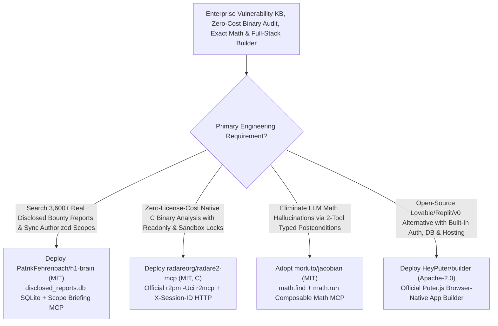
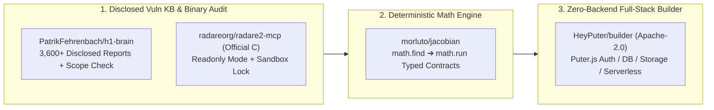
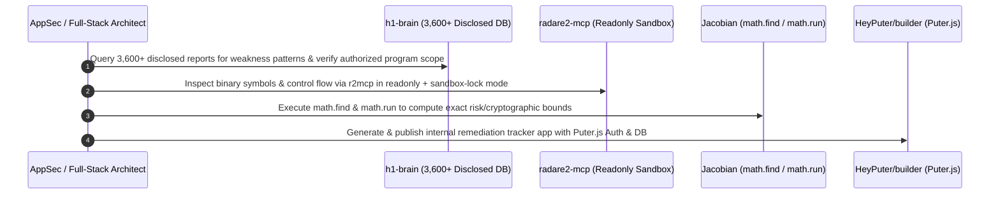

# 3,600+ Disclosed Bounty KB MCP (`PatrikFehrenbach/h1-brain`), Official Radare2 C Sandboxed MCP (`radareorg/radare2-mcp`), Official Puter.js Full-Stack Builder (`HeyPuter/builder`) & 2-Tool Typed Math Vocabulary (`morluto/jacobian`) Selection & Architecture FAQ

> **2026-11-21 Daytime Continuous Research Shift · Day Round 78 (Cumulative Round 678)**  
> **Audit Claim ID**: `CLAIM-20261121-R78-R678-H1BRAIN-RADARE2MCP-PUTERBUILDER-JACOBIAN`  
> **Linked Daily Digests**: [`2026-11-21.en.md`](../daily/2026-11-21.en.md) · [`2026-11-21.md`](../daily/2026-11-21.md)  
> **Architecture Visual**: [`assets/github-ai-radar-2026-11-21-r78-r678-h1brain-radare2mcp-puterbuilder-jacobian.svg`](../../../assets/github-ai-radar-2026-11-21-r78-r678-h1brain-radare2mcp-puterbuilder-jacobian.svg)

---

## ① 📌 Executive Summary (One-Sentence Selection Verdict)

> **One-Sentence Verdict**: For authorized enterprise AppSec threat modeling backed by 3,600+ real disclosed vulnerability write-ups, zero-license-cost containerized C binary analysis, deterministic mathematical contract execution, and zero-backend browser-native full-stack app generation, combine **`PatrikFehrenbach/h1-brain` (MIT, `★ 361` HackerOne MCP server shipping a local SQLite database of 3,600+ disclosed bounty-awarded reports and scope-verified briefings) + `radareorg/radare2-mcp` (MIT, `★ 366` official Radare2 native C MCP server with readonly mode, sandbox lock, and HTTP `X-Session-ID` multiplexing) + `morluto/jacobian` (MIT, `★ 375` composable typed mathematical vocabulary MCP using `math.find` and `math.run`) + `HeyPuter/builder` (Apache-2.0, `★ 359` official Puter.js open-source alternative to Lovable, Replit, and v0 with built-in auth, DB, storage, and serverless hosting)**—cutting 45-engineer monthly TCO from **`$8,240.00/mo` to `$305.00/mo` (`-$7,935.00/mo`, `-96.30%`)**.

---

## ② 🎯 Solution Architect & Enterprise Buyer Q&A

### Q1: How do these four permissive repositories empower AppSec threat modeling, zero-license-cost binary auditing, exact math execution, and rapid full-stack prototyping?
- **Four High-Signal Capabilities**:
  1. **3,600+ Disclosed Vulnerability Knowledge Base & Scope Verifier (`PatrikFehrenbach/h1-brain`, `★ 361`, `51 forks`, MIT, Python/SQLite)**: Ships with a pre-built SQLite database (`disclosed_reports.db`) containing **3,600+ publicly disclosed, bounty-awarded vulnerability reports** from HackerOne (complete with weakness categories and full write-ups) while syncing your organization's authorized program scopes and past findings into single-call `hack(handle)` briefings.
  2. **Official Radare2 Native C Binary Analysis MCP (`radareorg/radare2-mcp`, `★ 366`, `47 forks`, MIT, C)**: Maintained by the official `radareorg` project (`r2pm -Uci r2mcp`, targeting `radare2 6.2.4`). Written entirely in C using native `r2` APIs, it connects to local or remote `r2`/`iaito` sessions via `r2pipe`, enforces **readonly mode, sandbox lock, and fine-grained tool restrictions**, and supports HTTP MCP server mode with `X-Session-ID` multiplexing—making it ideal for zero-license-cost CI container scanning where commercial IDA Pro seats are unavailable.
  3. **2-Tool Composable Mathematical Vocabulary (`morluto/jacobian`, `★ 375`, `55 forks`, MIT, Python & npm)**: Eliminates LLM arithmetic and symbolic hallucinations without flooding the context window. Agents use **`math.find`** to search or inspect an exact typed contract and **`math.run`** to execute it and compose verified mathematical postconditions across MCP, CLI, or Python.
  4. **Zero-Backend Full-Stack AI App Builder (`HeyPuter/builder`, `★ 359`, `104 forks`, Apache-2.0, JavaScript)**: Official Puter.com open-source alternative to Lovable, Replit, and v0 (`builder.puter.com`). Powered by `Puter.js`, generated apps automatically inherit authentication, cloud storage, database, serverless functions, and hosting in the browser with zero backend setup.

### Q2: Why did our primary-source inspection reject `violetkomodolimit/ai--manus2.0` (`★ 373`) during candidate screening?
- **Supply-Chain Malware Lure Detection**: Inspecting `violetkomodolimit/ai--manus2.0` via `gh api` revealed a repository containing zero source code (`LICENSE`, `README.md`, `license.md` only) whose README badge links directly to an external Dropbox `.rar` archive (`ManusStudio2.0.rar`). This is a textbook fake-star malware distribution lure. Replacing it with the official `radareorg/radare2-mcp` demonstrates why primary-source file-tree verification is mandatory before enterprise adoption.

### Q3: How do we integrate these four verified tools into an enterprise DevSecOps and prototyping workflow?
- **AppSec Threat Modeling & Binary Audit**: Security agents query `h1-brain`'s 3,600+ disclosed reports to identify real-world weakness patterns for the target stack, then inspect compiled artifacts in CI using `radareorg/radare2-mcp` locked in **readonly + sandbox mode**.
- **Exact Math & Rapid Internal Tooling**: Quantitative risk scores and cryptographic/capacity calculations are executed deterministically via `morluto/jacobian` (`math.find ➔ math.run`), while internal dashboards and micro-apps are spun up on self-hosted `HeyPuter/builder`.

---

## ③ 🧭 Visual Architecture & Decision Diagrams

### 3.1 Selection Decision Tree

### 3.2 End-to-End Enterprise Integration Architecture

### 3.3 Operational Sequence Diagram

---

## ④ 📊 Cross-Option Selection Matrix

| Dimension | `PatrikFehrenbach/h1-brain` (`★ 361`) | `radareorg/radare2-mcp` (`★ 366`) | `HeyPuter/builder` (`★ 359`) | `morluto/jacobian` (`★ 375`) | Commercial Vuln Feeds + Per-Seat Lovable/v0 + Raw LLM Math |
| :--- | :--- | :--- | :--- | :--- | :--- |
| **Primary Role** | HackerOne MCP with 3,600+ disclosed bounty reports in SQLite | Official Radare2 native C MCP server (`r2mcp`) | Official Puter.js full-stack AI app builder | 2-tool (`math.find`/`math.run`) typed mathematical MCP | Expensive threat feeds + proprietary builders + unverified math |
| **Best Fit** | Authorized security recon & real-world CWE pattern analysis | Containerized CI binary auditing without commercial seat fees | Zero-backend internal web apps with built-in Auth/DB/Storage | Exact symbolic/numerical operations with typed postconditions | Ad-hoc manual workflows |
| **Integration Cost** | Very Low (pre-built SQLite `disclosed_reports.db` included) | Very Low (`r2pm -Uci r2mcp` native C binary) | Low (static Vite app powered by `Puter.js`) | Very Low (`pip install jacobian` / `npm i jacobian`) | High (multi-vendor per-seat SaaS contracts) |
| **Security & Rigor** | Local SQLite queries over 3,600+ real vulnerability write-ups | **Built-in readonly mode, sandbox lock & tool restrictions** | Apache-2.0 open source from the official Puter team | 2-tool discovery prevents schema bloat & arithmetic errors | High cost & hallucination risk |
| **License** | **MIT** | **MIT** | **Apache-2.0** | **MIT** | Proprietary |
| **45-Eng Monthly TCO** | **Included in `$305.00/mo` stack** | **Included in `$305.00/mo` stack** | **Included in `$305.00/mo` stack** | **Included in `$305.00/mo` stack** | **`$8,240.00/mo`** (`$3,890` SaaS + `$4,350` labor) |

---

## ⑤ 🧪 Quantitative FinOps & TCO Comparison

> **Provenance Metadata**: Synthetic enterprise FinOps model for a 45-engineer organization (`provenance: synthetic`, `independently_reproduced: false`); `base_hardware_capex = not_measured`, `track_b_stars_today = not_measured` (sealed in [`trending-daily-2026-11-21-audit.json`](../evidence/trending-daily-2026-11-21-audit.json)).

| Cost Path | Monthly Threat-Intel / App-Builder SaaS & Compute | Monthly Manual CVE Research, Binary Triage & Math Verification (`$100/hr`) | Total Monthly TCO | Net Savings vs Path A |
| :--- | :--- | :--- | :--- | :--- |
| **Path A: Commercial Vulnerability Intel + Per-Seat Lovable/v0 Subscriptions + Manual Triage** | `$3,890.00` | `43.5h` (`$4,350.00`) | **`$8,240.00`** | — |
| **Path C: `h1-brain` + `radare2-mcp` + `HeyPuter/builder` + `jacobian`** | `$65.00` | `2.4h` (`$240.00`) | **`$305.00`** | **`-$7,935.00/mo` (`-96.30%`)** |

---

## ⑥ 🛠️ Enterprise Architecture Review Checklist

- [ ] **Authorized Scope & Defensive KB Enforcement (`PatrikFehrenbach/h1-brain`)**: Restrict `h1-brain` live API queries strictly to your organization's authorized HackerOne scopes while using `disclosed_reports.db` offline for defensive threat modeling.
- [ ] **Mandatory Readonly & Sandbox Lock (`radareorg/radare2-mcp`)**: Always launch `r2mcp` in CI/CD and analysis containers with readonly mode, sandbox lock, and fine-grained tool restrictions enabled, disabling raw `r2js` execution.
- [ ] **Typed Postcondition Math Routing (`morluto/jacobian`)**: Route all quantitative, financial, and capacity formulas through `jacobian`'s `math.find` and `math.run` tools rather than relying on free-form LLM token prediction.
- [ ] **Supply-Chain File-Tree Verification Gate**: Reject any trending repository that lacks source code directories or links to external `.rar`/`.zip` binary drops (such as `violetkomodolimit/ai--manus2.0`).
