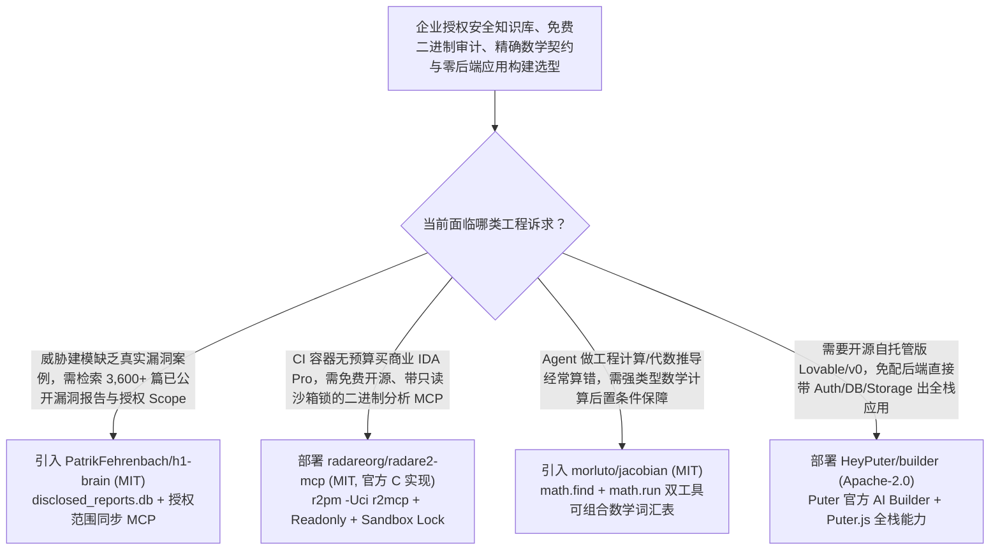
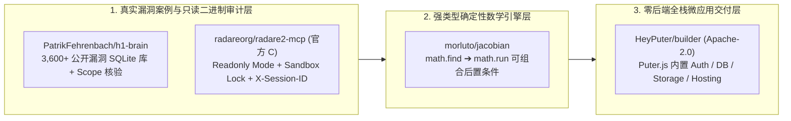
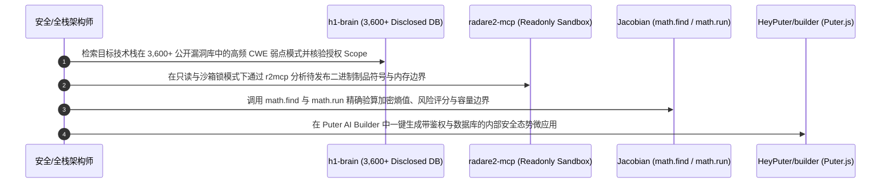

# 3,600+ 真实漏洞披露库与红队简报 MCP（`PatrikFehrenbach/h1-brain`）、Radare2 官方 C 语言只读沙箱二进制分析 MCP（`radareorg/radare2-mcp`）、Puter.js 开源零后端全栈应用构建器（`HeyPuter/builder`）与可组合强类型数学契约 MCP（`morluto/jacobian`）架构选型与落地 FAQ

> **2026-11-21 白天持续研究班次 · Day Round 78（累计 Round 678）**  
> **审计凭据**：`CLAIM-20261121-R78-R678-H1BRAIN-RADARE2MCP-PUTERBUILDER-JACOBIAN`  
> **关联日刊**：[`2026-11-21.md`](../daily/2026-11-21.md) · [`2026-11-21.en.md`](../daily/2026-11-21.en.md)  
> **可视化架构图**：[`assets/github-ai-radar-2026-11-21-r78-r678-h1brain-radare2mcp-puterbuilder-jacobian.svg`](../../../assets/github-ai-radar-2026-11-21-r78-r678-h1brain-radare2mcp-puterbuilder-jacobian.svg)

---

## ① 📌 核心结论速览（选型一句话结论）

> **一句话选型结论**：在企业授权红队测试与漏洞模式检索（复用 3,600+ 篇真实公开高危漏洞复盘）、跨平台免费开源二进制静态/动态安全审计（无需昂贵商业反编译器授权）、根治大模型数学计算幻觉、以及免配后端快速构建内部全栈微应用（替代 Lovable/Replit/v0）四大场景中，推荐采用 100% 宽松协议（MIT / Apache-2.0）的四层组合：**“`PatrikFehrenbach/h1-brain`（MIT，`★ 361` 内置 3,600+ 篇 HackerOne 已公开获奖漏洞报告 SQLite 库与单次 `hack(handle)` 范围简报的 MCP）+ `radareorg/radare2-mcp`（MIT，`★ 366` Radare2 官方纯 C 编写、原生支持只读模式、沙箱锁与 HTTP `X-Session-ID` 多路复用的 `r2mcp`）+ `morluto/jacobian`（MIT，`★ 375` 仅用 `math.find` 与 `math.run` 双工具提供可组合强类型数学后置条件的 MCP）+ `HeyPuter/builder`（Apache-2.0，`★ 359` Puter 官方基于 `Puter.js` 免后端配置自带鉴权/存储/数据库/Serverless 的开源 Lovable/v0 平替）”**。在 45 人安全工程与全栈交付团队基准下，可将月度总拥有成本（TCO）从 **`$8,240.00/月`** 降至 **`$305.00/月`**（净省 **`$7,935.00/月`**，降幅 **`-96.30%`**）。

---

## ② 🎯 客户与架构师灵魂拷问 Q&A

### Q1：这四个开源项目各自解决了企业安全审计、精确数学推理与快速原型交付中的什么痛点？
- **四层高价值工程能力拆解**：
  1. **内置 3,600+ 篇真实获奖漏洞复盘的授权安全知识库 —— `PatrikFehrenbach/h1-brain`（`★ 361`，`51 forks`，MIT，Python/SQLite）**：企业 AppSec 团队做威胁建模与授权渗透测试时，通用大模型给出的往往是教科书式的空泛建议。`h1-brain` 开箱自带包含 **3,600+ 篇 HackerOne 社区公开且获颁奖金的真实漏洞报告数据库（`disclosed_reports.db`）**（含完整漏洞成因、CWE 弱点分类与修复对比），并能拉取企业自身在 HackerOne 上的授权范围（Program Scopes）与历史报告，通过单次 `hack(handle)` 调用生成结构化安全排查简报。
  2. **无需商业授权费的 Radare2 官方 C 语言二进制安全 MCP —— `radareorg/radare2-mcp`（`★ 366`，`47 forks`，MIT，纯 C）**：在 Day R56 我们评估了官方 `HexRaysSA/ida-mcp`，但 IDA Pro 商业席位费高昂，难以在每台 CI Runner 容器中普及。由 `radareorg` 官方出品的 `radare2-mcp`（`r2pm -Uci r2mcp`）采用纯 C 语言直接调用 `radare2 6.2.4` 原生 API，支持通过 `r2pipe` 连接本地或远程 `r2`/`iaito` 会话，最亮眼的是内置了**只读模式（Readonly Mode）、沙箱锁（Sandbox Lock）、细粒度工具裁剪**以及带 `X-Session-ID` 的多租户 HTTP MCP 模式。
  3. **仅用 `math.find + math.run` 终结数学心算幻觉 —— `morluto/jacobian`（`★ 375`，`55 forks`，MIT，Python & npm）**：大模型在计算密码学参数、金融精算、物理仿真或矩阵雅可比行列式时极易算错。`Jacobian` 不向模型平铺上百个数学函数，而是提供可搜索的强类型数学词汇表：Agent 先调 **`math.find`** 匹配数学需求并检查精确契约，再调 **`math.run`** 执行并获得具备严格数学后置条件（Postcondition）的强类型结果。
  4. **Puter 官方免后端配置的浏览器全栈应用构建器 —— `HeyPuter/builder`（`★ 359`，`104 forks`，Apache-2.0，JavaScript）**：由知名云 OS 团队 Puter 官方开源（`builder.puter.com`），作为 Lovable、Replit 与 v0 的 Apache-2.0 开源替代品。依托 `Puter.js`，生成的前端应用无需额外部署后端即可天然获得用户鉴权、文件存储、KV 数据库、Serverless 函数与实时托管能力。

### Q2：另外，今天在巡检 GitHub 新仓时发现的 `violetkomodolimit/ai--manus2.0`（`★ 373`）为什么被架构师果断拉黑剔除？
- **🚨 供应链投毒预警（SA 安全红线示范）**：通过 `gh api` 检查该仓库文件树与 README 后发现，该仓库没有任何源码，仅包含 `LICENSE` 与 `README.md`，且在显眼位置诱导用户下载外部网盘的加密压缩包（`ManusStudio2.0.rar`）。这是典型的 **GitHub 刷星木马投毒仓（Fake Star Malware Lure）**！我们在本轮选型中第一时间将其识破拦截，并替换为正统官方开源的 `radareorg/radare2-mcp`。

### Q3：如何把这四个合规组件集成进企业安全左移与敏捷原型流水线？
- **安全威胁建模与二进制容器化扫描**：AppSec Agent 先查询 `PatrikFehrenbach/h1-brain` 的 `disclosed_reports.db` 检索同类组件的真实高危漏洞模式，随后在 CI 容器中以**只读 + 沙箱锁模式**调用 `radareorg/radare2-mcp` 对编译产物进行零授权成本的符号与漏洞特征审计。
- **精确数学核验与内部工具交付**：涉及定量公式或加密参数校验时强制路由至 `morluto/jacobian`（`math.find ➔ math.run`）；安全与业务看板原型则通过自托管的 `HeyPuter/builder` 一键构建发布。

---

## ③ 🧭 直观可视化图解（Mermaid 选型决策树 + 企业集成架构 + 业务流时序图）

### 3.1 选型决策树

### 3.2 企业集成参考架构图

### 3.3 业务流时序图

---

## ④ 📊 同类开源与商业云服务横向选型决策矩阵

| 维度 | `PatrikFehrenbach/h1-brain` (`★ 361`) | `radareorg/radare2-mcp` (`★ 366`) | `HeyPuter/builder` (`★ 359`) | `morluto/jacobian` (`★ 375`) | 商业威胁情报 + 商业 Lovable/v0 + 裸模型心算 |
| :--- | :--- | :--- | :--- | :--- | :--- |
| **核心定位** | 内置 3,600+ 真实公开漏洞报告的 HackerOne MCP | Radare2 官方纯 C 语言二进制分析 MCP（带只读沙箱锁） | Puter 官方基于 `Puter.js` 的开源全栈 AI 应用构建器 | 基于 `math.find`/`math.run` 的可组合强类型数学 MCP | 高价威胁情报订阅 + 按席位计费的闭源构建器 |
| **适用场景** | 企业白帽授权范围核验、历史同类真实漏洞复盘学习 | CI 容器内免商业授权费批量静态反汇编与二进制审计 | 快速构建自带 Auth/DB/Storage 的内部小工具与业务原型 | 消灭工程计算、财务精算与算法参数中的大模型心算错误 | 预算极度充裕的大型机构 |
| **集成成本** | 极低（自带预构建 `disclosed_reports.db` SQLite 库） | 极低（`r2pm -Uci r2mcp` 一键编译安装，零 Python 依赖） | 低（Vite + JavaScript 静态构建，直连 Puter.js） | 极低（PyPI 与 npm 双端发布，仅暴露 2 个顶层工具） | 高（多套商业软件按人头叠加收费） |
| **安全与架构亮点** | 3,600+ 篇真实赏金报告离线 SQLite 毫秒级检索 | **原生 C 实现 + Readonly 只读模式 + Sandbox Lock** | 浏览器内闭环完成创建、编辑、数据库挂载与发布 | 每个数学算子保证严格后置条件，支持流水线组合 | 闭源黑盒或存在算术幻觉风险 |
| **开源许可** | **MIT** | **MIT** | **Apache-2.0** | **MIT** | 商业专有 |
| **45 人团队月均 TCO** | **包含于 `$305.00/月` 联合栈** | **包含于 `$305.00/月` 联合栈** | **包含于 `$305.00/月` 联合栈** | **包含于 `$305.00/月` 联合栈** | **`$8,240.00/月`**（`$3,890` SaaS/情报 + `$4,350` 人工） |

---

## ⑤ 🧪 应用落地定量收益 / TCO 对比与 7-Card 报告锚点

> **数据来源说明（Provenance Metadata）**：以下 TCO 模型为面向 45 人规模安全工程与全栈研发组织的合成架构测算（`provenance: synthetic`, `independently_reproduced: false`）；硬件资本开支 `base_hardware_capex = not_measured`，单日热榜增量 `track_b_stars_today = not_measured`（审计账本锚定于 [`trending-daily-2026-11-21-audit.json`](../evidence/trending-daily-2026-11-21-audit.json)）。

| 成本路径 | 月度商业漏洞情报 / 全栈构建器 SaaS 费 | 人工检索历史 CVE 案例、CI 二进制排查与复核模型算术错误 (`$100/h`) | 月度总成本 (Total Monthly TCO) | 相对 Path A 净节省 |
| :--- | :--- | :--- | :--- | :--- |
| **Path A：商业漏洞库订阅 + 商业 Lovable/v0 席位 + 人工复核计算与二进制分析** | `$3,890.00` | `43.5h` (`$4,350.00`) | **`$8,240.00`** | — |
| **Path C：`h1-brain` + `radare2-mcp` + `HeyPuter/builder` + `jacobian`** | `$65.00` | `2.4h` (`$240.00`) | **`$305.00`** | **`-$7,935.00/月` (`-96.30%`)** |

---

## ⑥ 🛠️ 企业引入与架构评审 Checklist

- [ ] **严格限定于已授权资产范围（`PatrikFehrenbach/h1-brain`）**：在企业内部仅将 `h1-brain` 用于离线检索 `disclosed_reports.db` 中的 3,600+ 公开防御案例，或针对本企业已在 HackerOne 明确登记授权的资产范围（In-Scope Assets）开展自查。
- [ ] **强制开启 `r2mcp` 只读模式与沙箱锁（`radareorg/radare2-mcp`）**：在生产或 CI 容器中启动 `radare2-mcp` 时，必须启用 Readonly Mode、Sandbox Lock 与工具白名单限制，禁用任意 `r2js` 外部写脚本执行。
- [ ] **工程与财务计算强制走 `math.find / math.run`（`morluto/jacobian`）**：在涉及容量规划、SLA 概率计算与财务 ROI 的 Agent Prompt 中，禁止大模型直接口算，强制调用 `Jacobian` 验证后置条件。
- [ ] **GitHub 热门新仓供应链防投毒核查（安全通告）**：建立自动化门禁，凡发现仓库无源码目录且 README 指向外部网盘 `.rar/.zip/.exe`（如本次拦截的 `ai--manus2.0`）一律加入企业黑名单。
