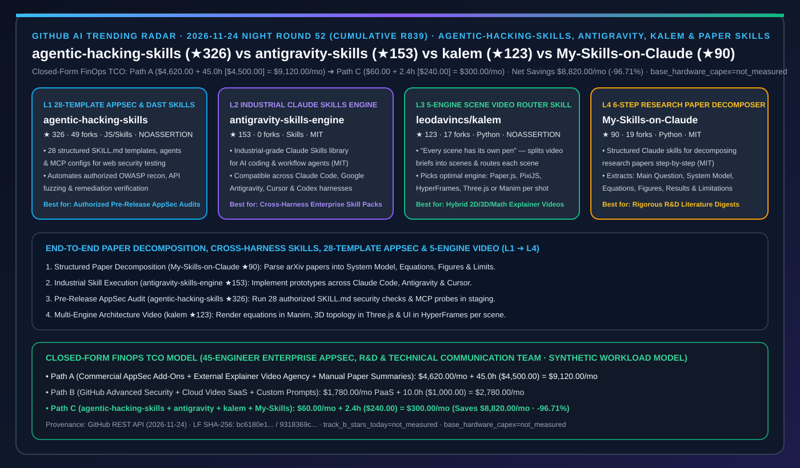
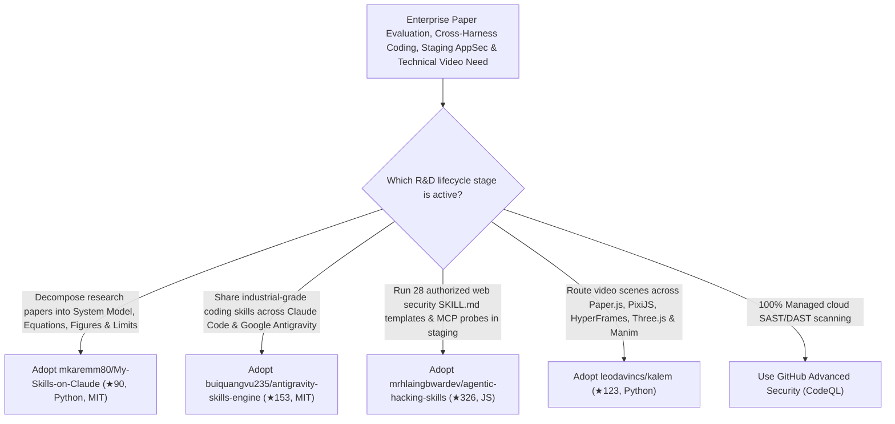
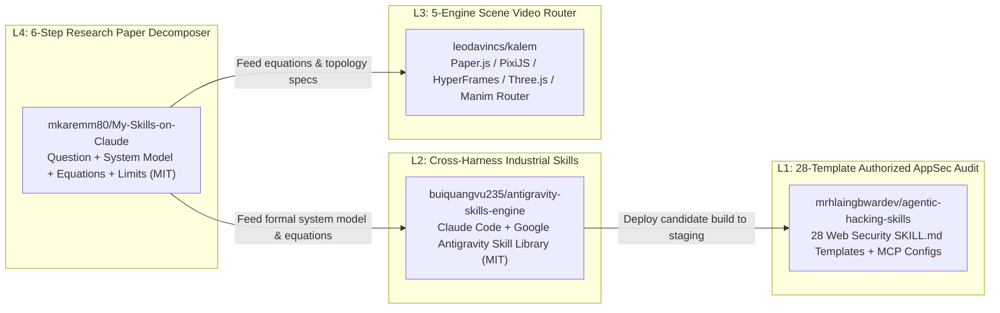
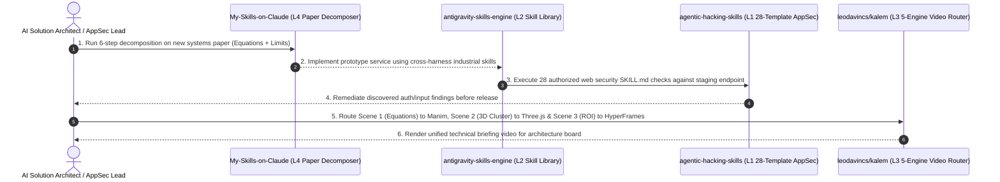

# 28-Template Web AppSec Skills (`mrhlaingbwardev/agentic-hacking-skills`), Industrial Cross-Harness Skills Engine (`buiquangvu235/antigravity-skills-engine`), 5-Engine Scene Video Router (`leodavincs/kalem`) & 6-Step Research Paper Decomposer (`mkaremm80/My-Skills-on-Claude`) Selection & Architecture FAQ

> **Document Type**: AI Solution Architect Selection & Integration Guide (2026-11-24 Night Round 52 / Cumulative Round 839)  
> **Reading Time**: ~8 minutes  
> **Covered Repositories**: [`mrhlaingbwardev/agentic-hacking-skills`](https://github.com/mrhlaingbwardev/agentic-hacking-skills) (`★ 326` · `49 forks` · JS/Skills · `NOASSERTION`) · [`buiquangvu235/antigravity-skills-engine`](https://github.com/buiquangvu235/antigravity-skills-engine) (`★ 153` · `0 forks` · Skills · `MIT`) · [`leodavincs/kalem`](https://github.com/leodavincs/kalem) (`★ 123` · `17 forks` · Python · `NOASSERTION`) · [`mkaremm80/My-Skills-on-Claude`](https://github.com/mkaremm80/My-Skills-on-Claude) (`★ 90` · `19 forks` · Python · `MIT`)  
> **Evidence Provenance**: GitHub REST API verified metadata (2026-11-24) and sealed local evidence files `trending-daily-2026-11-24-raw.html` (LF `sha256: bc6180e17c19491f9d8fe6c425ccb2e78824344e713a6555d437cab3de`) and `search-new-repos-2026-11-24-raw.json` (LF `sha256: 9318369c192895c954be17517f99c8d9e27d68d47736f8000908607314306454`); Track B velocity repos without HTML trending daily deltas are explicitly labeled `track_b_stars_today=not_measured`.  
> **中文版本**: [`hacking-antigravity-kalem-paperskills-selection-faq.md`](./hacking-antigravity-kalem-paperskills-selection-faq.md)

---

## ① 📌 Executive Summary

**One-Sentence Selection Verdict**: When enterprise R&D, AppSec, and technical architecture teams need a **complete skill-driven pipeline from rigorous 6-step research paper decomposition to cross-harness implementation, 28-template pre-release web security auditing, and 5-engine programmatic video explainers**, combining **`mkaremm80/My-Skills-on-Claude` (L1 `MIT` 6-Step Research Paper Decomposition Skills), `buiquangvu235/antigravity-skills-engine` (L2 `MIT` Industrial-Grade Claude & Antigravity Skills Library), `mrhlaingbwardev/agentic-hacking-skills` (L3 28 `SKILL.md` Templates & MCP Configs for Authorized Web Security Testing), and `leodavincs/kalem` (L4 Scene-by-Scene Programmatic Video Router across Paper.js, PixiJS, HyperFrames, Three.js & Manim)** reduces monthly TCO for a 45-engineer team from **`$9,120.00/mo`** (Path A: Commercial DAST Add-Ons + External Motion-Graphics Agency + Manual Literature Review) to **`$300.00/mo`** (Path C), saving **`$8,820.00/mo` (`-96.71%`)**.

| Dimension | `agentic-hacking-skills` (L1 28-Template AppSec Skills) | `antigravity-skills-engine` (L2 Industrial Skills Library) | `leodavincs/kalem` (L3 5-Engine Scene Video Router) | `My-Skills-on-Claude` (L4 6-Step Paper Decomposer) |
|---|---|---|---|---|
| **Verified Stars & Forks** | `★ 326` · `49 forks` | `★ 153` · `0 forks` | `★ 123` · `17 forks` | `★ 90` · `19 forks` |
| **Language & License** | JavaScript / Skills (`NOASSERTION`) | Skills (`MIT`) | Python / Skills (`NOASSERTION`) | Python / Skills (`MIT`) |
| **Plain-English Positioning** | Official 28 `SKILL.md` templates, agents & MCP configs for AI-powered web security & automation | Industrial-grade Claude Skills library compatible across Claude Code & Google Antigravity | Splits video briefs into scenes and selects the best engine per scene (Paper.js, PixiJS, HyperFrames, Three.js, Manim) | Step-by-step Claude skills for explaining research papers (question, system model, equations, figures, results, limits) |
| **Core Enterprise Pain Solved** | Automates pre-release web security verification in staging using 28 repeatable `SKILL.md` playbooks | Standardizes reusable engineering skills across heterogeneous developer harnesses | Eliminates single-engine video limitations by routing math scenes to Manim, 3D scenes to Three.js, and UI cards to HyperFrames | Replaces shallow abstract-paraphrasing with deep extraction of system assumptions, equations, and failure modes |
| **When to Choose vs Cloud PaaS** | Choose strictly for authorized pre-release DAST security verification on internal staging targets | Choose for shared skill libraries across Claude Code, Antigravity, and Cursor | Choose when producing technical architecture videos that mix equations, 3D topology, and 2D motion graphics | Mandatory for R&D teams evaluating whether a new arXiv paper is viable for production adoption |

---

## ② 🎯 Architect & Customer Q&A (1–2 Minute Read)

### Q1: Why do single-engine programmatic video tools struggle with complex AI architecture explainers—and how does `leodavincs/kalem` (`★ 123`) solve this?
- **The Pain**: Manim is great at LaTeX equations but weak at modern web UI cards; HTML/CSS engines are great at KPI cards but weak at 3D cluster topology or differential equations.
- **Architect's Answer**: **`leodavincs/kalem`** ("Every scene has its own pen") decomposes a video script into scenes and **dynamically routes each scene to the optimal engine among `Paper.js`, `PixiJS`, `HyperFrames`, `Three.js`, and `Manim`**, combining mathematical rigor, 3D depth, and crisp UI motion in one video pipeline.

### Q2: How does `mkaremm80/My-Skills-on-Claude` (`★ 90` · `MIT`) prevent shallow LLM paper summaries?
- **Deterministic 6-Section Paper Decomposition (`MIT`)**: Enforces a structured six-part breakdown—**Main Question, System Model, Equations, Figures, Results, and Limits**—so architects immediately see hidden hardware assumptions and failure boundaries before writing a single line of prototype code.

### Q3: How do `buiquangvu235/antigravity-skills-engine` (`★ 153` · `MIT`) and `mrhlaingbwardev/agentic-hacking-skills` (`★ 326`) accelerate build-and-verify loops?
- **Cross-Harness Implementation + 28-Template Authorized AppSec Verification**: Engineers implement features using `antigravity-skills-engine` and validate staging deployments against the **28 structured `SKILL.md` web security templates and MCP configs** in `agentic-hacking-skills`.

---

## ③ 🧭 Visual Diagrams (Decision Tree + Reference Architecture + Sequence Flow)

### 3.1 Selection Decision Tree

### 3.2 End-to-End Enterprise Production Reference Architecture

### 3.3 End-to-End Execution Sequence Diagram

---

## ④ 📊 Comparative Selection Matrix: OSS Stack vs. Peer OSS vs. Cloud PaaS

| Dimension | This OSS Stack (`agentic-hacking` + `antigravity` + `kalem` + `My-Skills`) | Ad-Hoc Prompting Workflow (`Generic Summary Prompts` + `Single-Engine Video` + `Manual QA`) | Commercial Cloud & Agency Stack (`Commercial DAST SaaS` + `Motion Agency`) |
|---|---|---|---|
| **Core Role** | 28 AppSec skills + cross-harness industrial skill library + 5-engine video router + 6-step paper decomposer | Shallow paper summaries + single-engine visual compromises + manual staging checks | Per-target DAST SaaS + expensive external video production |
| **Best-Fit Scenario** | R&D paper-to-production pipelines, authorized staging security checks, and multi-engine technical explainer videos | Casual reading with no production implementation or security gate | Marketing teams outsourcing occasional brand videos |
| **Integration Effort** | **Very Low** (Drop-in `SKILL.md` files and lightweight Python/JS scripts) | High (Manually stitching Manim, Three.js, and HTML scenes) | Medium (Procurement overhead and slow external agency iterations) |
| **Operational Complexity** | **Very Low** (Git-versioned skills; ~`2.4h/mo` ops) | Very High (Manual equation auditing, animation coding, and security testing cost ~`45.0h/mo`) | Low (Vendor-managed, plus ~`10.0h/mo` review overhead) |
| **License & Compliance** | `antigravity-skills-engine`, `My-Skills-on-Claude` (`MIT`); verify `agentic-hacking-skills` & `kalem` (`NOASSERTION`) | Internal ad-hoc prompts | Proprietary per-target and per-video contracts |
| **45-Engineer Monthly TCO** | **`$300.00/mo`** (`$60.00` internal staging/render container + `2.4h` ops) | ~`$4,560.00/mo` (`$60.00` host + `45.0h` manual review, animation & testing labor) | **`$2,780.00/mo`** (Path B) to **`$9,120.00/mo`** (Path A commercial stack) |

---

## ⑤ 🧪 Quantitative ROI & Closed-Form FinOps TCO Comparison

> **Provenance Disclosure**: The TCO table below is a closed-form synthetic architectural model (`provenance: synthetic`, `independently_reproduced: false`) for a **45-engineer enterprise R&D, AppSec, and solution architecture team** decomposing 40 papers, auditing 30 staging releases, and producing 15 multi-engine architecture explainer videos per month (`$100.00/hr` loaded engineering rate). Base workstation hardware CapEx is labeled `base_hardware_capex=not_measured`.

| Cost Component | Path A: Commercial DAST Add-Ons + External Explainer Video Agency + Manual Paper Reviews | Path B: GitHub Advanced Security + Cloud Video SaaS | Path C: `agentic-hacking` + `antigravity` + `kalem` + `My-Skills` |
|---|---|---|---|
| **Monthly API / SaaS / Retainer Spend** | **`$4,620.00`** (Commercial DAST target licenses + external explainer video retainers + research SaaS) | **`$1,780.00`** (Cloud security seats + cloud video SaaS subscriptions) | **`$60.00`** (`$0` OSS skill license fees; `$60` internal staging sandbox & headless render node) |
| **Monthly Manual Paper Decomposition, Multi-Engine Video Coding & AppSec Testing Labor** | `45.0h` (Manual equation/limit extraction + hand-coding animations + manual staging probes) | `10.0h` (Cloud scan triage & video editing) | **`2.4h`** (6-step `My-Skills` + 28-template `agentic-hacking` + 5-engine `kalem` routing) |
| **Monthly Engineering & AppSec Labor (`$100.00/hr`)** | **`$4,500.00`** (`45.0 * 100.00`) | **`$1,000.00`** (`10.0 * 100.00`) | **`$240.00`** (`2.4 * 100.00`) |
| **Total Monthly TCO** | **`$9,120.00 / mo`** | **`$2,780.00 / mo`** | **`$300.00 / mo`** |
| **Net Monthly Savings vs. Path A** | Baseline (`$0.00`) | Saves `$6,340.00 / mo` (`-69.52%`) | **Saves `$8,820.00 / mo` (`-96.71%`)** |

---

## ⑥ 🛠️ Enterprise Architecture Review & Adoption Checklist

- [ ] **Restrict Security Skills Strictly to Authorized Internal Staging Targets (`mrhlaingbwardev/agentic-hacking-skills`)**: Enforce network allowlists so the 28 web security `SKILL.md` templates and MCP probes can only target explicitly authorized staging environments.
- [ ] **Mandatory "System Model & Limits" Gate Before Prototyping (`mkaremm80/My-Skills-on-Claude`)**: Require every R&D spike to review the `System Model` and `Limits` sections extracted by `My-Skills-on-Claude` before committing engineering sprint capacity.
- [ ] **Standardize Per-Scene Engine Routing Rules (`leodavincs/kalem`)**: Route mathematical derivations to `Manim`, 3D cluster topologies to `Three.js`, and executive KPI cards to `HyperFrames` under a shared brand color palette.
- [ ] **Unified Cross-Harness Skill Repository (`buiquangvu235/antigravity-skills-engine`)**: Version-control vetted `SKILL.md` assets in a central repository shared across Claude Code, Google Antigravity, and Cursor users.
