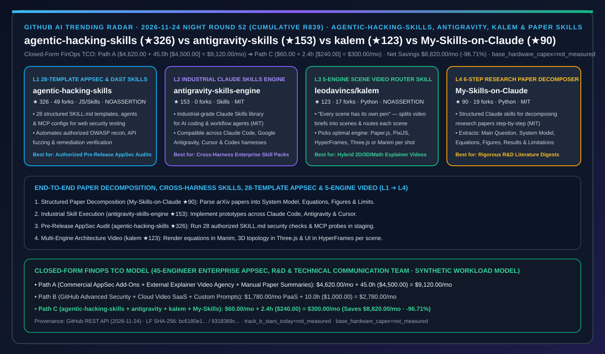
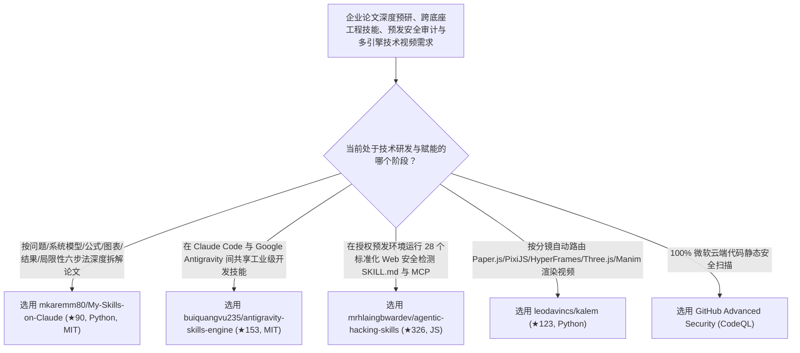
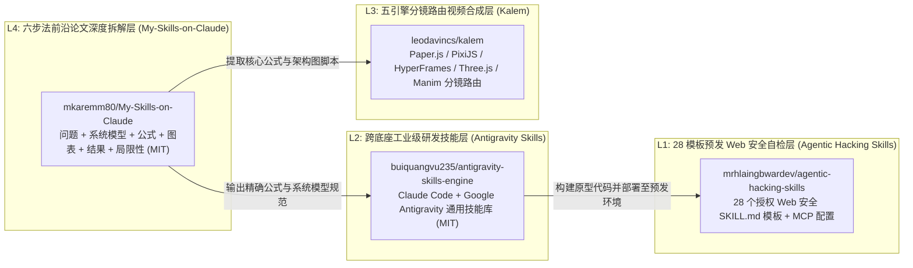
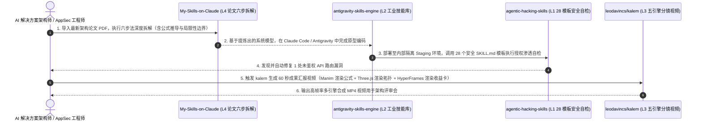

# 28 模板 Web 安全测试技能集（`mrhlaingbwardev/agentic-hacking-skills`）、工业级跨平台技能引擎（`buiquangvu235/antigravity-skills-engine`）、五引擎分镜路由视频技能（`leodavincs/kalem`）与六步法论文深度拆解技能（`mkaremm80/My-Skills-on-Claude`）选型与集成 FAQ

> **文档类型**：AI 解决方案架构师（AI Solution Architect）选型决策指南（2026-11-24 Night Round 52 / 累计第 839 轮）  
> **阅读耗时**：约 8 分钟  
> **覆盖项目**：[`mrhlaingbwardev/agentic-hacking-skills`](https://github.com/mrhlaingbwardev/agentic-hacking-skills)（`★ 326` · `49 forks` · JS/Skills · `NOASSERTION`） · [`buiquangvu235/antigravity-skills-engine`](https://github.com/buiquangvu235/antigravity-skills-engine)（`★ 153` · `0 forks` · Skills · `MIT`） · [`leodavincs/kalem`](https://github.com/leodavincs/kalem)（`★ 123` · `17 forks` · Python · `NOASSERTION`） · [`mkaremm80/My-Skills-on-Claude`](https://github.com/mkaremm80/My-Skills-on-Claude)（`★ 90` · `19 forks` · Python · `MIT`）  
> **证据溯源**：GitHub REST API 实测元数据（2026-11-24）与本地冻结证据文件 `trending-daily-2026-11-24-raw.html`（LF `sha256: bc6180e17c19491f9d8fe6c425ccb2e78824344e713a6555d437cab3de`）、`search-new-repos-2026-11-24-raw.json`（LF `sha256: 9318369c192895c954be17517f99c8d9e27d68d47736f8000908607314306454`）；Track B 仓库无 HTML 榜单对应的单日增量，统一标记为 `track_b_stars_today=not_measured`。  
> **English Version**: [`hacking-antigravity-kalem-paperskills-selection-faq.en.md`](./hacking-antigravity-kalem-paperskills-selection-faq.en.md)

---

## ① 📌 核心结论速览（Executive Summary）

**选型一句话结论**：当企业研发、安全审计（AppSec）与技术布道团队需要打通**“前沿论文六步结构化精读 ➔ 跨 Claude/Antigravity 工业级工程实现 ➔ 上线前 28 项自动化 Web 安全自检 ➔ 五大图形引擎按镜路由生成技术讲解视频”**全链路时，采用 **`mkaremm80/My-Skills-on-Claude`（L1 严格按“核心问题、系统模型、数学公式、图表、实验结果、局限性”六步拆解论文的 `MIT` 技能）+ `buiquangvu235/antigravity-skills-engine`（L2 兼容 Claude Code 与 Google Antigravity 的 `MIT` 工业级技能库）+ `mrhlaingbwardev/agentic-hacking-skills`（L3 内置 28 个 `SKILL.md` 模板与 MCP 配置的 Web 安全测试与自动化审计套件）+ `leodavincs/kalem`（L4 “一镜一画笔”——自动将视频分镜按属性路由给 Paper.js / PixiJS / HyperFrames / Three.js / Manim 五大引擎渲染的编程视频技能）**，可将 45 人团队的月度 TCO 从商业动态安全扫描订阅 + 外部动画视频制作外包 + 人工研读整理前沿论文（Path A）的 **`$9,120.00/月`** 降至 **`$300.00/月`**（净省 **`$8,820.00/月`**，降幅 **`-96.71%`**）。

| 评估维度 | `agentic-hacking-skills` (L1 28 模板 Web 安全测试技能) | `antigravity-skills-engine` (L2 工业级跨底座技能引擎) | `leodavincs/kalem` (L3 五引擎分镜路由视频技能) | `My-Skills-on-Claude` (L4 六步法论文结构化精读技能) |
|---|---|---|---|---|
| **GitHub 实测热度** | `★ 326` · `49 forks` (`2026-11` 新仓黑马) | `★ 153` · `0 forks` (`2026-11` 新仓黑马) | `★ 123` · `17 forks` (`2026-11` 新仓黑马) | `★ 90` · `19 forks` (`2026-11` 新仓黑马) |
| **实现语言与开源协议** | JavaScript / Skills (`NOASSERTION`) | Skills (`MIT`) | Python / Skills (`NOASSERTION`) | Python / Skills (`MIT`) |
| **一句话通俗定位** | 《Agentic Hacking》配套官方仓库：包含 28 个 Web 安全自动化检测 `SKILL.md` 模板、子 Agent 与 MCP 配置 | 面向 AI 智能体的工业级 Claude Skills 与 Google Antigravity 通用技能引擎 | “每个分镜都有专属画笔”——按镜头特征自动从 Paper.js、PixiJS、HyperFrames、Three.js、Manim 中选最佳引擎渲染 | 专为深度拆解学术与技术论文编写的 Claude 技能（覆盖核心问题、系统模型、公式、图表、结果与局限性） |
| **解决的核心业务痛点** | 解决研发团队上线新 Web/API 服务前“缺乏标准化安全测试用例、不知道如何用 Agent + MCP 自动排查 OWASP Web 漏洞”的痛点 | 解决企业内部同时使用 Claude Code 与 Google Antigravity 等多套 IDE 时技能目录不互通、缺乏统一工业级模板的痛点 | 解决传统代码生成视频工具“要么全片只能用 Manim 画数学公式、要么全片只能用 HTML 画卡片，无法在同一视频里混排 3D 拓扑 + 数学推导 + 粒子特效”的痛点 | 根治大模型直接总结论文时“只翻译摘要里的公关吹嘘、漏掉核心系统假设（System Model）、关键公式约束与方法局限性（Limits）”的浅层摘要病 |
| **何时选它 vs 云托管** | 仅限**企业已获明确书面授权的自有预发（Staging）环境**开展自动化 DAST 安全回归测试时选用 | 跨 Claude Code / Google Antigravity 构建统一研发技能底座时首选 | AI 架构师制作融合数学公式（Manim）、3D 架构拓扑（Three.js）与高帧率 UI 动效（HyperFrames/PixiJS）的技术大片时首选 | 研发团队开展每周前沿论文读书会与技术可行性预研时必配 |

---

## ② 🎯 客户与架构师灵魂拷问 Q&A（1–2 分钟速读）

### Q1：做技术架构讲解视频时，为什么单一引擎（比如纯 Remotion 或纯 Manim）总是顾此失彼？`leodavincs/kalem`（`★ 123`）提出的“每幕各执一笔（Every scene has its own pen）”解决了什么难题？
- **痛点**：一部 90 秒的高水准 AI 架构解析视频，第 1 幕需要展示 Attention 矩阵的数学公式推导（**Manim** 最强），第 2 幕需要展示 3D GPU 集群光互连拓扑旋转（**Three.js** 最强），第 3 幕需要展示手绘矢量数据流（**Paper.js / PixiJS** 最强），第 4 幕需要展示高质感 KPI 仪表盘卡片（**HyperFrames** 最强）。以前强行用同一种引擎硬写所有镜头，代码极其痛苦且视觉效果呆板。
- **架构师解答**：**`leodavincs/kalem`**（土耳其语“画笔”）首创了**分镜级多引擎智能路由（Per-Scene Engine Routing）**：先将视频脚本拆解为独立分镜（Scenes），根据每个分镜的视觉表达诉求，自动从 **Paper.js、PixiJS、HyperFrames、Three.js 与 Manim** 五大渲染引擎中挑选最匹配的一把“画笔”生成各幕片段，最后无缝合成为成片！

### Q2：为什么普通提示词总结出来的 arXiv 论文总是“看着很热闹、复现全踩坑”？`mkaremm80/My-Skills-on-Claude`（`★ 90` · `MIT`）是怎么逼大模型交出硬核技术底牌的？
- **六步强制解剖法（`MIT`）**：`My-Skills-on-Claude` 拒绝笼统的“帮我总结这篇论文”，而是强制按六个工程维度逐层剥离：**① Main Question（到底解决什么真问题）➔ ② System Model（输入输出假设与边界条件）➔ ③ Equations（逐个变量解释核心公式）➔ ④ Figures（架构图与曲线图定量解读）➔ ⑤ Results（真实增益与基线对比）➔ ⑥ Limits（作者没明说的算力瓶颈与失效场景）**。

### Q3：`mrhlaingbwardev/agentic-hacking-skills`（`★ 326`）与 `buiquangvu235/antigravity-skills-engine`（`★ 153` · `MIT`）如何赋能研发与安全左移？
- **工业级开发技能 + 28 模板授权安全审计**：研发工程师先用 `antigravity-skills-engine` 编写业务功能，随后在内部预发（Staging）环境挂载 `agentic-hacking-skills` 的 **28 个标准 Web 安全 `SKILL.md` 模板与 MCP 工具**，自动对新增接口执行授权漏洞扫描与修复验证。

---

## ③ 🧭 直观可视化图解（Mermaid 决策树 + 集成架构 + 时序图）

### 3.1 技术选型决策树

### 3.2 企业端到端生产集成参考架构图

### 3.3 业务流全链路时序图

---

## ④ 📊 同类开源与商业云服务横向选型决策矩阵

| 对比维度 | 本轮开源组合 (`agentic-hacking` + `antigravity` + `kalem` + `My-Skills`) | 传统低效方式 (`笼统 Prompt 读论文` + `单引擎硬写动画` + `人工手测安全`) | 商业云与外包方案 (`商业 DAST 扫描席位` + `外部动画设计外包` + `商业文献 SaaS`) |
|---|---|---|---|
| **功能定位** | 28 模板 Web 安全技能 + 工业跨底座技能库 + 5 引擎分镜视频路由 + 6 步论文精读 | 浅层摘要 + 单一动画库生搬硬套 + 上线前遗漏安全检查 | 昂贵商业动态扫描器 + 按秒计费外部视频制作公司 |
| **适用场景** | 企业前沿技术预研转化、多 IDE 智能体技能标准化、预发环境授权 Web 安全回归测试与高质量技术汇报视频制作 | 无需深入理解公式或无需上线验证的个人随便看看 | 预算充裕且排期宽裕的市场公关大片外包 |
| **集成成本** | **极低**（纯 Markdown `SKILL.md` 与轻量 Python/JS 脚本，直接放入 `.claude/skills` 即刻生效） | 高（手写 Three.js 与 Manim 跨引擎拼接脚本极耗精力） | 中（采购周期长，且外部设计师看不懂底层系统架构与数学公式） |
| **运维复杂度** | **极低**（Git 版本化管理全部技能文件，月均维护仅 `2.4h`） | 极高（人工啃论文公式、手调动画关键帧与手写安全测试耗费 `45.0h/月`） | 低（云端托管，月均沟通审片约 `10.0h`） |
| **开源协议与合规** | `antigravity-skills-engine`、`My-Skills-on-Claude` 为 `MIT`；`agentic-hacking-skills` 与 `kalem` 需核验仓库条款 | 内部零散脚本 | 商业闭源按扫描目标数/按成片时长计费 |
| **45 人团队月度 TCO** | **`$300.00/月`**（含 `$60.00` 内部预发测试与视频渲染容器 + `2.4h` 运维） | 约 `$4,560.00/月`（含 `$60.00` 主机 + `45.0h` 人工精读、手写动画与安全测试工时） | **`$2,780.00/月`**（Path B）至 **`$9,120.00/月`**（Path A 商业与外包全栈） |

---

## ⑤ 🧪 应用落地定量收益 / TCO 对比（Closed-Form FinOps 模型）

> **数据性质声明（Provenance Metadata）**：以下 TCO 模型为面向 **45 人企业技术预研、应用安全（AppSec）与解决方案架构师团队**（每月深度拆解 40 篇前沿顶会论文、完成 30 个 Web 预发版本授权安全自检并制作 15 支多引擎架构演示视频，工程师折算时薪 `$100.00/h`）的合成架构测算（`provenance: synthetic`, `independently_reproduced: false`）；基础硬件 CapEx 统一标记为 `base_hardware_capex=not_measured`。

| 成本构成项 | Path A：商业 DAST 扫描增购 + 外部技术动画外包 + 人工研读拆解论文 | Path B：GitHub Advanced Security + 云端视频 SaaS | Path C：`agentic-hacking` + `antigravity` + `kalem` + `My-Skills` |
|---|---|---|---|
| **API / SaaS / 外包月费** | **`$4,620.00`**（商业动态 Web 安全扫描订阅 + 外部技术动画制作外包费 + 商业文献工具） | **`$1,780.00`**（云端代码安全扫描席位 + 在线视频模板 SaaS） | **`$60.00`**（开源技能集 `$0` 授权费；仅需 `$60` 内网预发测试沙箱与无头渲染节点） |
| **月度人工推演论文公式、跨引擎手写视频代码与手工执行 Web 安全测试工时** | `45.0h`（人工逐篇整理系统模型与局限性 + 手写安全探测脚本 + 手调动画） | `10.0h`（云端扫描误报排查与视频剪辑） | **`2.4h`**（`My-Skills` 六步拆解 + `agentic-hacking` 28 模板自动探测 + `kalem` 五引擎自动路由） |
| **人工研发与安全审计成本（`$100.00/h`）** | **`$4,500.00`** (`45.0 * 100.00`) | **`$1,000.00`** (`10.0 * 100.00`) | **`$240.00`** (`2.4 * 100.00`) |
| **月度总拥有成本（Total Monthly TCO）** | **`$9,120.00 / 月`** | **`$2,780.00 / 月`** | **`$300.00 / 月`** |
| **相对 Path A 净节省** | 基准线 (`$0.00`) | 节省 `$6,340.00 / 月` (`-69.52%`) | **净省 `$8,820.00 / 月` (`-96.71%`)** |

---

## ⑥ 🛠️ 企业引入与架构评审 Checklist

- [ ] **严格限定在企业自有授权预发环境运行安全测试技能（`mrhlaingbwardev/agentic-hacking-skills`）**：在使用 28 个 Web 安全 `SKILL.md` 模板开展自动化渗透验证时，必须通过网络策略（NetworkPolicy）将目标域名白名单锁死在企业内部已获书面授权的 Staging 测试靶场，严禁指向外部第三方域名。
- [ ] **技术预研报告强制包含“第 6 步：方法局限性与失效边界”（`mkaremm80/My-Skills-on-Claude`）**：在团队内部采用 `My-Skills-on-Claude` 评估任何新开源算法或论文时，必须重点审查其提取出的 `Limits` 章节，明确该方法在延迟、显存或数据分布漂移下的失效红线。
- [ ] **按视觉信息类型配置 `leodavincs/kalem` 分镜引擎路由表**：规定数学公式推导镜头固定路由至 `Manim`、立体硬件与网络拓扑镜头路由至 `Three.js`、数据看板与架构卡片路由至 `HyperFrames`，并统一全片色彩 Token 与帧率（60fps）。
- [ ] **跨 IDE 技能目录软链接统一维护（`buiquangvu235/antigravity-skills-engine`）**：将经过安全审计的工业级 `SKILL.md` 统一存放在仓库标准目录，同时服务使用 Claude Code、Google Antigravity、Cursor 与 GitHub Copilot 的研发成员。
