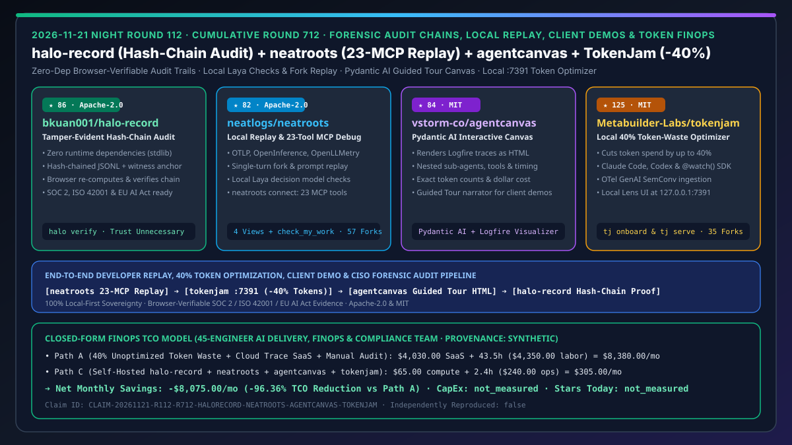
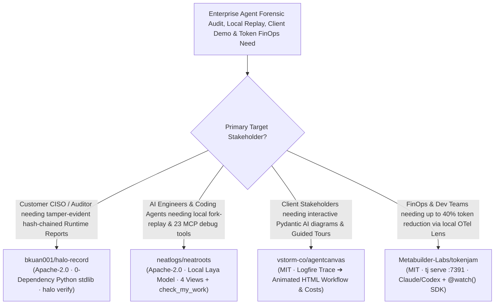
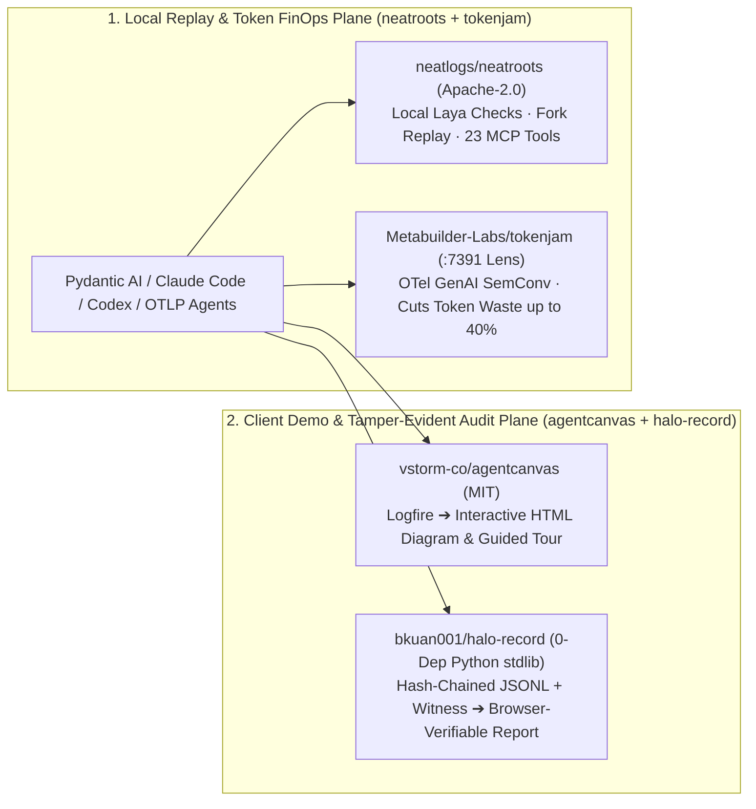
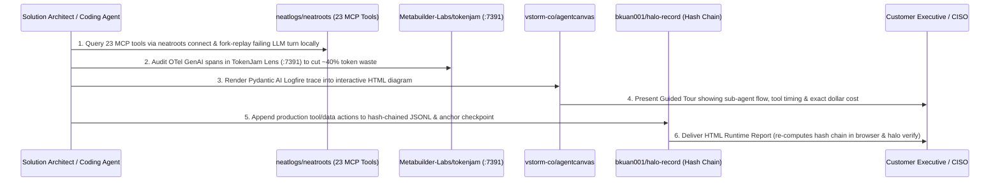

# Tamper-Evident Hash-Chained Audit Trails (`bkuan001/halo-record`), Local-First Replay & 23-Tool MCP Debugger (`neatlogs/neatroots`), Pydantic AI Client-Demo Canvas (`vstorm-co/agentcanvas`) & 40% Token-Waste Optimizer (`Metabuilder-Labs/tokenjam`) Selection & Architecture FAQ

> **Document Type**: Enterprise AI Solution Architect Selection & Integration Guide (GitHub Trending AI Radar — 2026-11-21 Night Round 112 / Cumulative Round 712)
> **Covered Repositories**: [`bkuan001/halo-record`](https://github.com/bkuan001/halo-record) (`★ 86`, `9 forks`, `Apache-2.0` — dependency-free Python `stdlib` hash-chained Runtime Records & browser-verifiable HTML Runtime Reports for SOC 2, ISO 42001 & EU AI Act audits) · [`neatlogs/neatroots`](https://github.com/neatlogs/neatroots) (`★ 82`, `57 forks`, `Apache-2.0` — local-first agent run inspector, single-turn fork replayer, local `Laya` decision-model checker & 23-tool MCP server via `neatroots connect`) · [`vstorm-co/agentcanvas`](https://github.com/vstorm-co/agentcanvas) (`★ 84`, `9 forks`, `MIT` — interactive animated HTML diagram & Guided Tour generator for Pydantic AI workflows from Logfire traces) · [`Metabuilder-Labs/tokenjam`](https://github.com/Metabuilder-Labs/tokenjam) (`★ 125`, `35 forks`, `MIT` — 100% local OTel GenAI SemConv token efficiency analyzer & `:7391` Lens dashboard cutting token waste by up to 40%)
> **Core Scenario**: How enterprise AI Solution Architects equip four critical stakeholder personas: **handing customer CISOs cryptographically verifiable, zero-dependency hash-chained audit reports (`halo-record`)**, **showing executive buyers an interactive Guided Tour of Pydantic AI sub-agents and exact dollar costs (`agentcanvas`)**, **giving developers and coding agents 23 MCP tools plus single-step fork replay (`neatroots`)**, and **slashing agent token waste by up to 40% locally (`tokenjam`)**.

---

## 1. 📌 Executive Summary (One-Line Selection Verdict)

1. **Need tamper-evident, dependency-free audit trails (`SOC 2`, `ISO 42001`, `EU AI Act`) that a customer's security team can independently verify in their own browser or via `halo verify`** ➔ Choose **[`bkuan001/halo-record`](https://github.com/bkuan001/halo-record) (`★ 86`, `Apache-2.0`)**.
   - **Plain-English Mechanism**: Built using **only the Python standard library (zero runtime dependencies, zero network calls unless anchoring to an opt-in witness checkpoint)**. Every tool call, model call, data access, and approval becomes an append-only, hash-chained **Runtime Record** (`JSONL`). The **Runtime Report** renders that chain as a self-contained HTML page that re-computes the cryptographic hash chain directly inside the reader's browser (or offline via `halo verify`).
2. **Need a local-first workbench to inspect, check (with a local `Laya` decision model), and fork/replay single LLM turns while exposing 23 MCP debugging tools to Claude Code, Codex, and Cursor** ➔ Choose **[`neatlogs/neatroots`](https://github.com/neatlogs/neatroots) (`★ 82`, `57 forks`, `Apache-2.0`)**.
   - **Plain-English Mechanism**: Ingests spans from Neatlogs SDKs or any OTLP HTTP/gRPC exporter (`OpenInference`, `OpenLLMetry`, `GenAI`, `Vercel AI SDK`). It evaluates every span for loops, repeated tool calls, error streaks, and leaked keys using code rules plus the local **Laya** decision model; displays runs four ways (`Overview`, `Trace`, `Timeline`, `Conversation`); lets you edit a single message/prompt to fork and replay a run; and wires **23 MCP tools** (`neatroots connect`) plus an opt-in `check_my_work` nudge into your coding agent.
3. **Need to turn Pydantic AI traces logged to Logfire into an animated, interactive HTML workflow diagram with a built-in Guided Tour for client demos and architecture reviews** ➔ Choose **[`vstorm-co/agentcanvas`](https://github.com/vstorm-co/agentcanvas) (`★ 84`, `MIT`)**.
   - **Plain-English Mechanism**: Business stakeholders rarely understand raw span trees. `agentcanvas` reads Pydantic AI traces from Logfire and renders an interactive block diagram showing every model call, reasoning trace, tool input/output/timing, nested sub-agent, token count, and exact dollar cost—complete with an automated or manual **Guided Tour** narrator for live client meetings.
4. **Need a 100% local token-efficiency analyzer (`http://127.0.0.1:7391/` Lens dashboard) that reads OTel GenAI telemetry and coding-agent history to cut token spend by up to 40%** ➔ Choose **[`Metabuilder-Labs/tokenjam`](https://github.com/Metabuilder-Labs/tokenjam) (`★ 125`, `35 forks`, `MIT`)**.
   - **Plain-English Mechanism**: One command (`npx tokenjam onboard` or `pipx install tokenjam && tj onboard`) backfills Claude Code / Codex history, wires a zero-token status line, and ingests custom agent telemetry via `@watch()` or **OpenTelemetry GenAI Semantic Conventions**. Running `tj serve` launches the local **TokenJam Lens** dashboard on `:7391`, pinpointing overspend by category and proposing concrete fixes that reduce token usage by up to **40%**.

---

## 2. 🎯 Architect & Customer Deep-Dive Q&A

### Q1: Why do standard server logs fail customer security reviews (`ISO 42001` / `SOC 2`), executive POC demos, and local agent debugging?

- **Four Last-Mile Gaps & Purpose-Built Solutions**:
  1. **Unverifiable Operator Logs vs Cryptographic Hash Chains (`bkuan001/halo-record`)**: A PDF or database export from your own cloud proves nothing to a skeptical enterprise CISO because the operator could have edited the rows. `halo-record` produces an append-only hash chain anchored to external witness checkpoints, rendered as a browser-verifiable HTML report (`halo verify`).
  2. **Opaque Trace Logs in Client Meetings vs Interactive Guided Tours (`vstorm-co/agentcanvas`)**: Showing JSON spans in a sales/architecture meeting loses the room. `agentcanvas` turns Pydantic AI Logfire traces into a visual, step-by-step narrated diagram with exact per-node costs.
  3. **Full-Pipeline Re-Execution vs Single-Turn Fork Replay + 23 MCP Tools (`neatlogs/neatroots`)**: Re-running a 15-step agent just to test a prompt tweak at step 12 wastes time and tokens. `neatroots` forks and replays individual LLM calls locally and gives Claude Code/Cursor 23 MCP tools to inspect and fix broken runs autonomously.
  4. **Silent 40% Token Bleed (`Metabuilder-Labs/tokenjam`)**: `tokenjam` analyzes OTel GenAI spans and Claude Code/Codex logs locally on `:7391` to eliminate prompt bloat, cache misses, and model over-provisioning.
- **When to Choose Managed Cloud Services (Path B)**:
  - If your team operates strictly internal workflows on a single cloud (e.g., Azure Monitor + Microsoft Purview) with no external customer cryptographic verification requirements, cloud-native logging suffices.

### Q2: How do we wire an end-to-end developer, FinOps, client-demo & CISO-audit pipeline with all four tools?

1. **Local Build, Fork-Replay & 23-Tool MCP Self-Correction (`neatlogs/neatroots`)**:
   - Stream local OTLP / OpenInference / OpenLLMetry spans into `neatroots`, run `neatroots connect` so coding agents can query 23 MCP debugging tools, and use single-turn replay plus the local `Laya` decision model to eliminate loops and key leaks before commit.
2. **Continuous 40% Token-Waste Optimization (`Metabuilder-Labs/tokenjam`)**:
   - Run `tj onboard` and `tj serve` (`:7391`) across developer workstations (Claude Code, Codex) and staging agents (`@watch()` / OTLP GenAI SemConv) to audit and remediate token overspend.
3. **Executive & Client POC Architecture Visualization (`vstorm-co/agentcanvas`)**:
   - Export Pydantic AI runs from Logfire into `agentcanvas` to generate self-contained interactive HTML workflow diagrams with Guided Tours for architecture sign-off.
4. **Tamper-Evident Customer Compliance Delivery (`bkuan001/halo-record`)**:
   - Record production tool calls, data reads, and approvals into `halo-record`'s zero-dependency hash chain, anchor periodic checkpoints to an external witness, and deliver self-verifying HTML Runtime Reports for SOC 2, ISO 42001, and EU AI Act assessments.

### Q3: What are the boundaries and trade-offs of this stack?

- **Key Strengths**:
  - **100% Local-First & Permissively Licensed (`Apache-2.0` & `MIT`)**: Zero mandatory cloud accounts or vendor lock-in.
  - **Zero Supply-Chain Risk on the Audit Path**: `halo-record` uses only the Python standard library with zero third-party runtime dependencies.
- **Scope Notes**:
  - `agentcanvas` is specialized for Pydantic AI / Logfire trace schemas, whereas `neatroots`, `tokenjam`, and `halo-record` are framework-agnostic.

---

## 3. 🧭 Visual Architecture & Decision Diagrams

### 3.1 Solution Architect Selection Decision Tree

### 3.2 End-to-End Enterprise Reference Architecture

### 3.3 Local MCP Debugging, 40% Token Trimming, Client Guided Tour & Cryptographic Audit Sequence

---

## 4. 📊 Peer Open-Source vs Commercial Cloud Selection Matrix

| Dimension | `bkuan001/halo-record` (`★ 86`) | `neatlogs/neatroots` (`★ 82`) | `vstorm-co/agentcanvas` (`★ 84`) | `Metabuilder-Labs/tokenjam` (`★ 125`) | Commercial GRC + Trace SaaS + Unoptimized Tokens (Path A) | Single-Cloud Monitor + Purview (Path B) |
| :--- | :--- | :--- | :--- | :--- | :--- | :--- |
| **Core Role** | Zero-dep hash-chained audit trail & HTML verifier | Local 4-view debugger, fork replayer & 23-MCP server | Pydantic AI / Logfire interactive HTML canvas | 100% local OTel GenAI token-waste optimizer (-40%) | Commercial compliance SaaS + cloud APM seats + 40% token bleed | Azure Monitor + Microsoft Purview |
| **Architectural Edge** | **0 dependencies + witness checkpoints + browser hash check** | **`neatroots connect` (23 MCP tools) + local `Laya` model** | **Guided Tour narration built for client POC demos** | **Local `:7391` Lens + Claude/Codex backfill + `@watch()`** | Operator-mutable cloud logs require customer trust; high token waste | Cloud lock-in; no single-turn fork replay or Guided Tour HTML |
| **License** | `Apache-2.0` | `Apache-2.0` | `MIT` | `MIT` | Proprietary SaaS | Proprietary Cloud PaaS |
| **Monthly TCO (45-Eng Team)** | **`$305.00/mo` combined** (`$65.00` compute + `2.4h` ops) | Included in `$305.00/mo` stack | Included in `$305.00/mo` stack | **Cuts token bills by up to 40%** | **`$8,380.00/mo`** (`$4,030.00` waste/SaaS + `43.5h` labor) | `~$2,660.00/mo` (log ingestion + compliance seats) |

---

## 5. 🧪 Quantitative ROI / FinOps TCO Model & 7-Card Report

> **📊 Provenance & Closed-Form Audit Declaration**:
> - **Provenance**: `synthetic` (45-engineer enterprise AI solution delivery, FinOps & security compliance workload model; `independently_reproduced = false`; `base_hardware_capex = not_measured`; `track_b_stars_today = not_measured`).
> - **Closed-Form Equations**:
>   - **Path A (Unoptimized 40% Agent Token Waste + Commercial Cloud Trace Debugger Seats + Manual SOC 2 / ISO 42001 Evidence Packaging & Custom Client POC Diagramming)**: Monthly excess token & SaaS spend **`$4,030.00`** + manual audit evidence, diagramming & debugging labor **`43.5h × $100.00/h = $4,350.00`** = **`$8,380.00/mo`**.
>   - **Path C (Self-Hosted `bkuan001/halo-record` + `neatlogs/neatroots` + `vstorm-co/agentcanvas` + `Metabuilder-Labs/tokenjam`)**: Shared storage & witness checkpoint compute **`$65.00`** + automated report & rule maintenance **`2.4h × $100.00/h = $240.00`** = **`$305.00/mo`**.
>   - **Net Savings vs Path A**: **`-$8,075.00/mo`** (**`96.36%`** cost reduction).

| Architecture Option | API / SaaS / Compute | Engineering & Audit Labor (`$100/h`) | Total Monthly TCO | Net Savings vs Path A | Key Architectural Outcome |
| :--- | :---: | :---: | :---: | :---: | :--- |
| **Path A: 40% Token Waste + Cloud Trace SaaS + Manual Audit** | `$4,030.00` | `43.5h` (`$4,350.00`) | **`$8,380.00`** | Baseline | Unverifiable plain logs; severe unoptimized token overspend |
| **Path B: Single-Cloud Monitor + Manual Compliance Exports** | `$1,460.00` | `12.0h` (`$1,200.00`) | **`$2,660.00`** | `-$5,720.00` (`-68.26%`) | Lacks 23-tool MCP local fork-replay, Guided Tour HTML & hash chain |
| **Path C: `halo-record` + `neatroots` + `agentcanvas` + `tokenjam`** | **`$65.00`** | **`2.4h` (`$240.00`)** | **`$305.00`** | **`-$8,075.00` (`-96.36%`)** | **0-dep hash-chain proof + 23-MCP replay + Guided Tour + -40% tokens** |

- 🔗 **7-Card 4:5 Visual Report**: [`workshops/github-trending-radar/cards.en.html`](../cards.en.html) · [`cards.html`](../cards.html)

---

## 6. 🛠️ Enterprise Adoption & Architecture Review Checklist

- [ ] **1. Embed `bkuan001/halo-record` for Tamper-Evident Customer Audits**: Log every production tool call, data read, and approval into `halo-record` (zero dependencies), anchor periodic checkpoints to an external witness, and provide customers with self-verifying HTML Runtime Reports (`halo verify`) for SOC 2, ISO 42001, and EU AI Act reviews.
- [ ] **2. Connect Coding Agents to `neatlogs/neatroots` (`23 MCP Tools`)**: Run `neatroots` locally over OTLP, execute `neatroots connect` for Claude Code/Codex/Cursor, and use single-turn fork replay plus the local `Laya` model to fix loops and leaked secrets.
- [ ] **3. Eliminate Up to 40% Token Waste with `Metabuilder-Labs/tokenjam`**: Run `npx tokenjam onboard` and `tj serve` (`http://127.0.0.1:7391/`) to audit Claude Code, Codex, and `@watch()` / OTLP GenAI SemConv agents.
- [ ] **4. Generate Client-Ready Architecture Demos with `vstorm-co/agentcanvas`**: Convert Pydantic AI Logfire traces into interactive HTML workflow diagrams with Guided Tours showing nested sub-agents, tool timing, and exact dollar cost.
