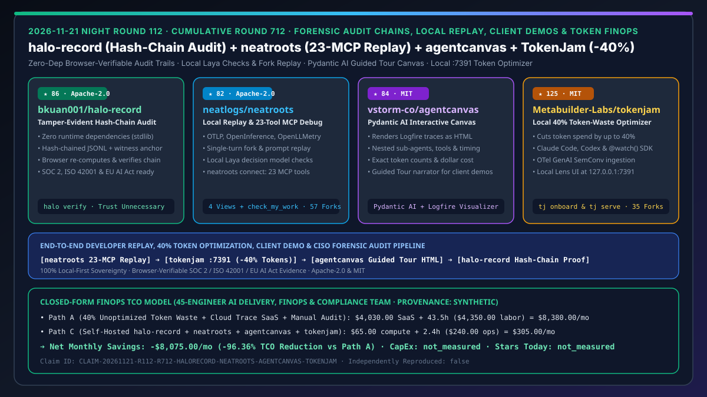
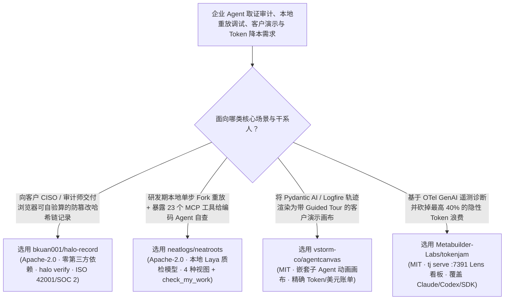
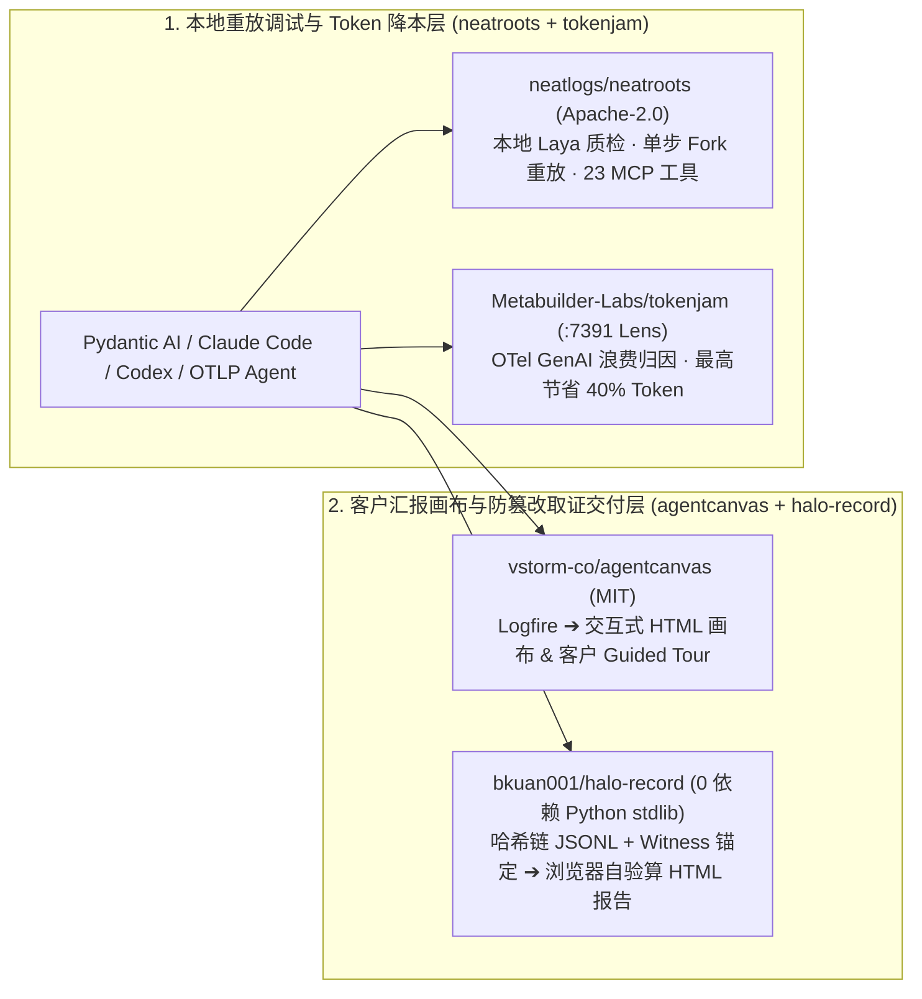
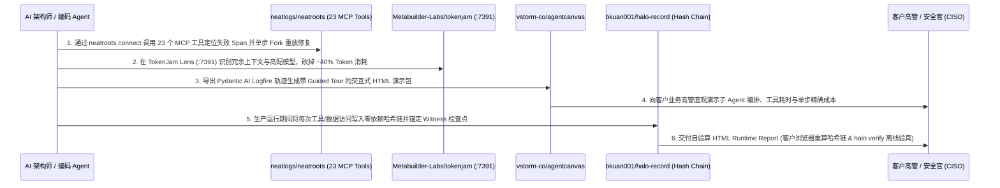

# 零依赖哈希链防篡改审计报告（`bkuan001/halo-record`）、23 工具本地重放与自检工作台（`neatlogs/neatroots`）、Pydantic AI 客户演示动态画布（`vstorm-co/agentcanvas`）与立省 40% Token 浪费诊断仪（`Metabuilder-Labs/tokenjam`）选型与集成架构 FAQ

> **文档类型**：企业 AI 解决方案架构师（AI Solution Architect）选型决策指南（GitHub Trending AI 雷达 2026-11-21 Night Round 112 / 累计第 712 轮）
> **覆盖项目**：[`bkuan001/halo-record`](https://github.com/bkuan001/halo-record)（`★ 86`、`9 forks`、`Apache-2.0`，纯 Python 标准库零依赖、支持 `halo verify` 离线校验与浏览器端重算哈希链的 ISO 42001 / SOC 2 / EU AI Act 防篡改审计记录器）· [`neatlogs/neatroots`](https://github.com/neatlogs/neatroots)（`★ 82`、`57 forks`、`Apache-2.0`，支持单步 Fork 重放、本地 `Laya` 决策模型质检并通过 `neatroots connect` 向编码 Agent 暴露 23 个 MCP 工具的本地调试台）· [`vstorm-co/agentcanvas`](https://github.com/vstorm-co/agentcanvas)（`★ 84`、`9 forks`、`MIT`，将 Pydantic AI 的 Logfire 追踪一键渲染为含嵌套子 Agent、精确成本与客户 Guided Tour 导览的交互式 HTML 架构画布）· [`Metabuilder-Labs/tokenjam`](https://github.com/Metabuilder-Labs/tokenjam)（`★ 125`、`35 forks`、`MIT`，遵循 OTel GenAI 语义约定、支持 Claude Code/Codex 历史回填与 `:7391` Lens 看板并最高降低 40% Token 消耗的本地优化器）
> **核心场景**：当企业解决方案架构师（SA）在向客户交付 Agent 系统时面临四大实战难题——**客户安全团队在 SOC 2 / ISO 42001 尽调中要求提供“不可篡改且客户可独立验算”的 Agent 操作证据链（`halo-record`）**、**向业务决策者汇报时对方看不懂枯燥的 JSON 日志而需要直观的动态执行画布与导览（`agentcanvas`）**、**研发期复现多步工具死循环需要单步修改 Prompt 重放并让编码 Agent 调 23 个 MCP 工具自查（`neatroots`）**，以及**生产/研发 Agent 存在高达 40% 的隐性冗余 Token 浪费（`tokenjam`）**时，如何用这四个轻量本地优先工具实现全闭环？

---

## 一、📌 核心结论速览（选型一句话结论）

1. **客户安全团队在 SOC 2、ISO 42001 或 EU AI Act 审查时问“你们的 Agent 到底动了我们哪些数据？怎么证明日志没被你们事后删改？”** ➔ 选 **[`bkuan001/halo-record`](https://github.com/bkuan001/halo-record)（`★ 86`，`Apache-2.0`）**。
   - **通俗原理**：仅使用 Python 标准库（**零第三方运行时依赖**，`pip install halo-record`），把每次模型调用、工具执行、数据读取与审批写入追加式**密码学哈希链（Hash-chained Runtime Records）**，并可锚定至外部 Witness 检查点。最惊艳的是它能生成一份单文件 **HTML Runtime Report**：客户安全官用浏览器打开链接时，页面会在客户浏览器本地重新计算整条哈希链并校验签名（也可离线运行 `halo verify` 校验 JSONL），让“口头承诺不作恶”变成“数学上无法篡改”。
2. **想在本地开发机器上实时捕获、分叉重放（Fork & Replay）Agent 的任意一步调用，并通过 23 个 MCP 工具让 Claude Code / Codex / Cursor 自己查错修 Bug** ➔ 选 **[`neatlogs/neatroots`](https://github.com/neatlogs/neatroots)（`★ 82`，`57 forks`，`Apache-2.0`）**。
   - **通俗原理**：兼容 OpenInference、OpenLLMetry、OTel GenAI 与 Vercel AI SDK 的本地工作台。它用四种视图（`Overview` 聊天流、`Trace` 树、`Timeline` 时序、`Conversation` 多轮对话）展示运行过程，内置代码规则与本地轻量决策模型（`Laya`）自动抓出死循环、密钥泄露与连续报错；支持**直接修改某一步的 User Message 或 System Prompt 单步重放（无需重跑整个 Agent）**，且执行 `neatroots connect` 即可向编码 Agent 注入 **23 个 MCP 工具**（及 `check_my_work` 自检钩子）。
3. **基于 Pydantic AI + Logfire 开发了多智能体工作流，需要在客户 POC 演示会上把枯燥的后台 Trace 变成带有自动讲解导览（Guided Tour）的高颜值交互式 HTML 架构图** ➔ 选 **[`vstorm-co/agentcanvas`](https://github.com/vstorm-co/agentcanvas)（`★ 84`，`MIT`）**。
   - **通俗原理**：业务客户看不懂 OpenTelemetry Span 列表。`agentcanvas` 直接读取 Pydantic AI 发送至 Logfire 的追踪数据，自动渲染成带动画的交互式节点画布：点击任意节点即可查看模型推理过程、可调用的工具集、嵌套子 Agent（Nested Sub-agents）、输入输出耗时、精确 Token 数与美元成本，并自带专为客户汇报设计的 **Guided Tour（自动/手动分步解说导览）**。
4. **想把 Claude Code、Codex 以及自研 SDK/API Agent 的冗余 Token 浪费砍掉最高 40%，且所有分析 100% 运行在本地机器（`:7391` Lens 看板）** ➔ 选 **[`Metabuilder-Labs/tokenjam`](https://github.com/Metabuilder-Labs/tokenjam)（`★ 125`，`35 forks`，`MIT`）**。
   - **通俗原理**：一行命令 `npx tokenjam onboard`（或 `pipx install tokenjam && tj onboard`）即可自动回填 Claude Code / Codex 历史会话、挂载零 Token 开销的状态栏，并通过 `@watch()` 装饰器或标准 **OTel GenAI SemConv** 接收自研 Agent 遥测。启动 `tj serve`（`http://127.0.0.1:7391/`）后，**TokenJam Lens** 会按浪费类别（提示词膨胀、缓存未命中、无效重试、模型高配）精准定位超支根源并给出修复建议。

---

## 二、🎯 客户与架构师灵魂拷问 Q&A（深度架构拆解）

### Q1：我们已经有后台 OTel Collector 和 Prometheus 了，为什么还需要 `tokenjam`、`neatroots`、`agentcanvas` 和 `halo-record` 这四个工具？

- **面向四个不同核心干系人（Stakeholders）的最后一公里交付物**：
  1. **面向 FinOps 与开发者钱包 ➔ `Metabuilder-Labs/tokenjam`**：Prometheus 只会告诉你“今天花了 $300”，不会告诉你“其中 $120 是因为 Claude Code 某次会话未命中 Prompt Cache 且系统提示词重复携带了无效 Schema”。`tokenjam` 专门诊断并砍掉这 40% 的隐性浪费。
  2. **面向正在调 Bug 的 AI 工程师与编码 Agent ➔ `neatlogs/neatroots`**：查出第 8 步工具调用参数写错后，传统日志只能看不能改；`neatroots` 支持就地修改第 8 步 Prompt 分叉重放（Fork Replay），并通过 23 个 MCP 工具让 Claude Code 自己读取失败 Run 并生成修复补丁。
  3. **面向购买系统的企业业务高管（POC 汇报）➔ `vstorm-co/agentcanvas`**：将 Pydantic AI 的真实运行轨迹转化为带 Guided Tour 讲解的动态架构流图，让客户一眼看清子 Agent 协作与单次调用成本。
  4. **面向客户 CISO 与外部第三方审计师（ISO 42001 / SOC 2）➔ `bkuan001/halo-record`**：普通数据库日志管理员随时可以 `UPDATE` 篡改；`halo-record` 输出零依赖、带外部 Witness 检查点的哈希链 HTML 报告，客户在自己浏览器里就能独立验真。
- **何时直接用云厂商托管方案（Path B）？**
  - 若团队完全在单一商业云（如 Azure AI Foundry Tracing + Microsoft Purview Audit）内部运行且无需向外部客户交付离线自验算 HTML 哈希链或本地 23 工具 MCP 重放，可直接使用云端原生审计。

### Q2：典型企业级“本地重放自检 (`neatroots`) + 40% Token 降本 (`tokenjam`) + 客户 POC 动态导览 (`agentcanvas`) + 防篡改哈希链交付 (`halo-record`)”架构怎么搭？

1. **研发期单步重放与 23-MCP 编码自愈层（`neatlogs/neatroots`）**：
   - 工程师本地启动 `neatroots` 接收 OTLP / OpenInference / OpenLLMetry 追踪，开启本地 `Laya` 决策模型自动巡检死循环与密钥泄露；执行 `neatroots connect` 让 Claude Code / Cursor 直接调用 23 个 MCP 工具读取报错 Span 并执行单步 Fork 重放验证。
2. **全链路 Token 浪费诊断与 FinOps 优化层（`Metabuilder-Labs/tokenjam`）**：
   - 运行 `tj onboard` 与 `tj serve`（`:7391`），同时监控编码 Agent（Claude Code / Codex）与业务 Agent（`@watch()` / OTLP GenAI SemConv），按天审计超支分类并落地高达 40% 的 Token 削减方案。
3. **客户 POC 与高管架构演示层（`vstorm-co/agentcanvas`）**：
   - 将 Pydantic AI 核心工作流的 Logfire 追踪导入 `agentcanvas`，生成包含工具耗时、子 Agent 拓扑与精确美元账单的交互式 Guided Tour 画布，嵌入方案汇报材料。
4. **生产环境不可篡改取证与客户自验算交付层（`bkuan001/halo-record`）**：
   - 在生产 Agent 关键动作（工具调用、敏感数据访问、人工批准）处嵌入零依赖的 `halo-record`，定期将哈希链锚定至外部 Witness，并在应对客户安全审查（SOC 2 / ISO 42001 / EU AI Act）时一键导出可由客户浏览器本地验算的 Runtime Report。

### Q3：这套组合的适用边界是什么？

- **核心优势**：
  - **100% 本地优先（Local-First）与零云端强制锁定**：四个工具均可在本地笔记本或私有内网离线运行，全部采用 `Apache-2.0` 或 `MIT` 开源协议。
  - **极简依赖**：尤其是 `halo-record` 仅依赖 Python 标准库（0 第三方包），安全供应链审计成本为零。
- **适用边界**：
  - `agentcanvas` 原生针对 Pydantic AI / Logfire 轨迹格式设计，其他框架建议通过 OTLP 转换或优先使用 `neatroots` 的四种通用视图。

---

## 三、🧭 直观可视化图解（Mermaid 决策树 + 集成架构 + 时序图）

### 3.1 架构师选型决策树

### 3.2 企业端到端生产集成参考架构图

### 3.3 研发重放修复、Token 浪费裁剪、客户动态导览与哈希链取证验算时序图

---

## 四、📊 同类开源与商业云服务横向选型决策矩阵

| 对比维度 | `bkuan001/halo-record` (`★ 86`) | `neatlogs/neatroots` (`★ 82`) | `vstorm-co/agentcanvas` (`★ 84`) | `Metabuilder-Labs/tokenjam` (`★ 125`) | 商业合规审计云 + 商业 APM SaaS + 未优化 Token 账单 (Path A) | 单一云原生监控与合规中心 (Path B) |
| :--- | :--- | :--- | :--- | :--- | :--- | :--- |
| **核心能力定位** | 零依赖密码学哈希链与浏览器自验算审计报告 | 本地 4 视图调试、单步重放与 23-MCP 工具台 | Pydantic AI / Logfire 交互式客户演示画布 | OTel GenAI 本地 Token 浪费诊断仪（省 40%） | 商业 GRC 审计软件 + 商业云端 Trace 席位 + 冗余 Token 消耗 | Azure Monitor + Microsoft Purview |
| **独特架构优势** | **0 第三方依赖 + 外部 Witness + 客户浏览器本地重算哈希** | **`neatroots connect` 暴露 23 个 MCP 工具 + 本地 `Laya` 质检** | **内置 Guided Tour 自动导览，专为客户 POC 会议设计** | **100% 本地 `:7391` 看板，自动回填 Claude/Codex 历史** | 普通云日志由运营方单方控制，缺乏零信任防篡改哈希链 | 绑定单一公有云，缺乏本地单步 Fork 重放与客户导览画布 |
| **开源协议** | `Apache-2.0` | `Apache-2.0` | `MIT` | `MIT` | 闭源商业 SaaS | 闭源云服务 |
| **月度 TCO（45 人团队）** | **组合仅 `$305.00/月`**（含共享构建算力与 2.4h 运维） | 同左（`$65.00` 算力 + `$240.00` 人工） | 同左（静态 HTML 导出零服务器成本） | **直接砍掉最高 40% 模型 Token 浪费** | **`$8,380.00/月`**（`$4,030.00` 冗余 Token/SaaS + `43.5h` 人工） | 约 `$2,660.00/月`（按日志摄取量与合规席位计费） |

---

## 五、🧪 应用落地定量收益/TCO 对比与 7-Card 报告

> **📊 数据来源与闭式核算声明（Provenance & Closed-Form Schema）**：
> - **provenance**: `synthetic`（基于 45 人企业 AI 解决方案交付、合规审计与研发团队工作负载模型：`independently_reproduced = false`；硬件采购基线 `base_hardware_capex = not_measured`；Track B 单日增量 `track_b_stars_today = not_measured`）。
> - **核算公式**：
>   - **Path A（未优化的 40% 研发与生产冗余 Token 消耗 + 商业云端可观测性席位 + 手工整理 SOC 2 / ISO 42001 安全问卷证据与手工绘制客户 POC 架构演示图）**：月度冗余 Token 与 SaaS 账单 **`$4,030.00`** + 审计取证、手工画图与重放排障人工 **`43.5h × $100.00/h = $4,350.00`** = **`$8,380.00/月`**。
>   - **Path C（自建 `bkuan001/halo-record` + `neatlogs/neatroots` + `vstorm-co/agentcanvas` + `Metabuilder-Labs/tokenjam` 开源组合）**：轻量存储与 Witness 锚定算力 **`$65.00`** + 自动化报表导出与规则维护 **`2.4h × $100.00/h = $240.00`** = **`$305.00/月`**。
>   - **净节省（Net Savings vs Path A）**：**`-$8,075.00/月`**（成本降低 **`96.36%`**）。

| 评估方案 | API / SaaS / 算力成本 | 研发与审计人工（`$100/h`） | 月度总 TCO | 相对 Path A 净节省 | 关键架构交付指标 |
| :--- | :---: | :---: | :---: | :---: | :--- |
| **Path A：40% 隐性 Token 浪费 + 商业 Trace SaaS + 手工合规取证** | `$4,030.00` | `43.5h` (`$4,350.00`) | **`$8,380.00`** | Baseline | 客户不采信无签名纯文本日志；Token 超支严重 |
| **Path B：云厂商原生监控 + 手工导出合规报告** | `$1,460.00` | `12.0h` (`$1,200.00`) | **`$2,660.00`** | `-$5,720.00` (`-68.26%`) | 缺乏 23 工具 MCP 本地重放、Guided Tour 画布与哈希链自验算 |
| **Path C：`halo-record` + `neatroots` + `agentcanvas` + `tokenjam`** | **`$65.00`** | **`2.4h` (`$240.00`)** | **`$305.00`** | **`-$8,075.00` (`-96.36%`)** | **零依赖哈希链取证 + 23-MCP 本地重放 + 客户导览画布 + 省 40% Token** |

- 🔗 **关联 7-Card 4:5 视觉评测报告**：[`workshops/github-trending-radar/cards.html`](../cards.html) · [`cards.en.html`](../cards.en.html)

---

## 六、🛠️ 企业引入与架构评审 Checklist

- [ ] **1. 嵌入 `bkuan001/halo-record` 建立零信任防篡改审计链**：在生产 Agent 中安装零依赖的 `halo-record`，记录所有工具调用、数据读取与审批动作，配置定期外部 Witness 检查点锚定，并向客户安全团队交付支持浏览器重算哈希与 `halo verify` 的 Runtime Report。
- [ ] **2. 在研发机配置 `neatlogs/neatroots` 开启单步重放与 23-MCP 联调**：将本地 OTLP 导出器指向 `neatroots`，运行 `neatroots connect` 把 23 个诊断/重放 MCP 工具挂载给 Claude Code、Codex 与 Cursor，并启用本地 `Laya` 决策模型自动拦截死循环与密钥泄露。
- [ ] **3. 运行 `Metabuilder-Labs/tokenjam` 砍掉冗余 Token 开销**：执行 `npx tokenjam onboard` 与 `tj serve`（`http://127.0.0.1:7391/`），回填编码 Agent 历史并为自研 Agent 添加 `@watch()`，每周根据 Lens 看板消除最高 40% 的无效 Token 消耗。
- [ ] **4. 用 `vstorm-co/agentcanvas` 制作客户 POC 交互式演示包**：在客户方案评审前，将 Pydantic AI 的 Logfire 轨迹导出为带 Guided Tour 的交互式 HTML 画布，清晰透明地展示子 Agent 协作路径与单次请求精确美元成本。
