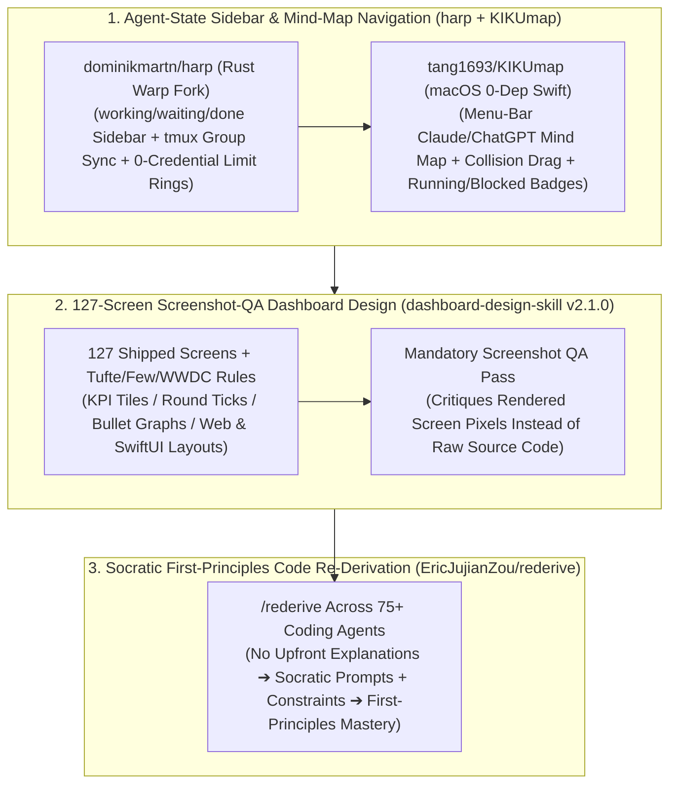

# Zero-Credential Limit Rings & tmux Sidebar (`dominikmartn/harp`), 127-Screen Screenshot-QA Dashboard Skill (`abdiraimov-otabek/dashboard-design-skill`), Socratic Codebase Re-Derivation (`EricJujianZou/rederive`) & Zero-Dependency Chat Mind Map (`tang1693/KIKUmap`) Selection FAQ

> **Document Type**: Practical Selection & Architecture Guide for AI Solution Architects (2026-11-18 Night Shift · Round 22 / Cumulative Round 502)  
> **Benchmark Standard**: `docs/components/ib-vs-ethernet-roce-selection-faq.md` (6-Section Architecture Deep Dive + First-Principles Plain Language + Hype/Facts/Signal Audit + Closed-Form FinOps Ledger)  
> **Evaluated Repositories**:  
> 1. **`dominikmartn/harp`** (`★ 715`, `45 forks`, Rust AGPL-3.0, macOS fork of open-source Warp): Side-by-side coding agent terminal replacing the tab bar with an attention-state sidebar (`working` / `waiting for you` / `done` / `background` / `set aside`), `tmux`-persisted tab groups for phone SSH sync, and **zero-network, zero-credential 5h/weekly Limit rings**  
> 2. **`abdiraimov-otabek/dashboard-design-skill`** (`★ 933`, `56 forks`, MIT `v2.1.0`, Claude Code / Codex / Cursor skill): Data dashboard design and critique skill distilled from **127 shipped dashboard screens**, Tufte/Few/Cleveland/NNg/WCAG classics, and **6 Apple WWDC sessions**, enforcing a mandatory **Screenshot QA pass** on web and SwiftUI builds  
> 3. **`EricJujianZou/rederive`** (`★ 1,052`, `43 forks`, Python MIT, compatible with Claude Code, Codex, Cursor + 75 agents): First-principles codebase mastery skill (`/rederive`) that **refuses to explain upfront and asks Socratic questions + progressive constraints** until you re-derive AI-written architecture yourself  
> 4. **`tang1693/KIKUmap`** (`★ 1,157`, `113 forks`, Swift macOS 13+ menu-bar app, **0 external dependencies**, MIT, 9 languages): Physics-aware macOS menu-bar mind map for Claude and ChatGPT conversations surfacing running, finished, and blocked (`needs you`) threads at a glance  
> **Accounting Note**: Only software inference, SaaS, and engineering labor TCO are metered; workstation base hardware capEx is explicitly labeled `not_measured` with zero fabricated depreciation coordinates.

---

## 📌 1. Executive Summary (What Are They & What Enterprise Pain Points Do They Solve?)

As engineering organizations scale up parallel CLI coding sessions, generative BI dashboards, and AI-authored pull requests, four human-in-the-loop bottlenecks degrade velocity and reliability:
1. **Pain Point A (Losing Track of Blocked Agents Across 20 Terminal Tabs + Quota Trackers Reading Sensitive Auth Tokens + Broken Layouts Over Mobile SSH)**: Standard terminal tab bars collapse under dozens of concurrent Claude Code and Codex sessions, and third-party usage monitors often scrape session cookies. **`dominikmartn/harp`'s Solution**: A Rust fork of open-source Warp that replaces the tab bar with an agent-aware sidebar showing whether each session is `working` (turning ring), `waiting for you`, `done` (unread badge), `background work` (dot), or `set aside` (moon). Tab groups and ordering are stored directly on **`tmux` sessions**, surviving restarts and syncing seamlessly when accessed from a phone over SSH. Its footer **Limit rings** display 5-hour and weekly limits + reset timers for Claude and Codex **entirely from Codex's local session logs and Claude Code's status line—making 0 network requests and reading 0 credentials**.
2. **Pain Point B (AI-Generated Dashboards Ship with Broken Axis Ticks, Overflowing Text, and Decorative Clutter Because the Agent Only Inspected Source Code)**: LLMs generating React or SwiftUI analytics screens often invent unreadable tick intervals or clipping layouts because they never inspect the rendered pixels. **`abdiraimov-otabek/dashboard-design-skill` (`v2.1.0`)'s Solution**: Distills **127 shipped dashboard screens**, foundational visualization literature (**Stephen Few, Edward Tufte, Cole Nussbaumer Knaflic, Cleveland & McGill, NN/g, WCAG**), and **6 Apple WWDC sessions** into actionable layout rules (KPI tiles, round-tick charts, bullet graphs, heatmaps, slim-bar breakdowns, date pickers, empty states, desktop & phone responsiveness) and mandates a **final Screenshot QA pass** where the agent critiques and fixes the rendered screen before completion.
3. **Pain Point C ("Vibe-Coding Comprehension Debt"—Engineers Merge AI-Written Code They Cannot Explain in Design Reviews, Incidents, or Interviews)**: Reading an AI-generated summary of AI-written code creates a fragile illusion of understanding. **`EricJujianZou/rederive` (`/rederive`)'s Solution**: Works across **75+ coding agents** (`npx skills add EricJujianZou/rederive`) and **deliberately refuses to lecture or explain**. Instead, it asks how you would build each subsystem from scratch and introduces real constraints step-by-step until you re-derive the codebase's exact design patterns (e.g., middleware chains, state machines) yourself from first principles.
4. **Pain Point D (Hundreds of Branched Claude & ChatGPT Research Threads Buried in Flat Linear Sidebars)**: Complex technical investigations branch non-linearly across Claude and ChatGPT, making flat history lists unusable. **`tang1693/KIKUmap`'s Solution**: A **zero-dependency native Swift** macOS 13+ menu-bar app (localized in 9 languages) that maps Claude and ChatGPT chats into an interactive mind map where neighboring topic clusters slide apart smoothly on drag and badges highlight what is **running**, **done**, and **waiting for you**.

---

## 💬 2. Three First-Principles Deep-Dive Questions (Q1–Q3)

### Q1: How does `dominikmartn/harp` render live 5-hour and weekly quota rings for both Claude Code and Codex with zero network requests and zero credential access while keeping mobile SSH sessions in sync?
* **First-Principles Breakdown**:
  - **Passive Local Telemetry Extraction**: Instead of reading OAuth tokens or polling undocumented cloud endpoints, `Harp` parses Codex's local session logs and Claude Code's terminal status line output in memory to render dual 5-hour and weekly limit rings with exact reset timestamps.
  - **`tmux`-Backed Layout Persistence**: By storing tab names, group membership, read state, and inactive flags directly inside `tmux` session metadata, any session started or reorganized from a phone over SSH automatically reflects in the macOS `Harp` sidebar and survives terminal restarts.

### Q2: Why does `abdiraimov-otabek/dashboard-design-skill` (`v2.1.0`) pair a 127-screen rule corpus with a mandatory Screenshot QA pass?
* **First-Principles Breakdown**:
  - **Encoding High Data-Ink Ratio Heuristics**: Synthesizing 127 production dashboards, Tufte/Few/Cleveland principles, and 6 Apple WWDC chart sessions gives the agent concrete rules for round axis ticks, period comparisons, tooltip density, and responsive phone/wide grids across web and SwiftUI.
  - **Closing the Pixel Feedback Loop**: Code that compiles cleanly can still render truncated numbers or misaligned legends. Every rule in the skill was validated on real redesigns where the defect was caught on a screenshot and fixed—and every agent run must conclude with a live **Screenshot QA pass**.

### Q3: How do `EricJujianZou/rederive` and `tang1693/KIKUmap` eliminate cognitive debt in AI-assisted engineering teams?
* **First-Principles Breakdown**:
  - **Socratic Derivation Over Passive Summarization (`rederive`)**: By withholding explanations and guiding the developer through progressive architectural constraints, `/rederive` forces active mental reconstruction of AI-authored code—turning opaque generated modules into deeply understood systems.
  - **Spatial State Topology in the Menu Bar (`KIKUmap`)**: Representing multi-model chat threads as a draggable, collision-aware 2D mind map in a zero-dependency Swift menu-bar panel lets architects immediately spot blocked (`needs you`) versus active threads.

---

## 🧭 3. Architecture Decision Tree & Reference Topology (Mermaid)

---

## 📊 4. Peer Solution Comparison Matrix (Decision Matrix)

| Evaluation Dimension | Path A: Flat Terminal Tabs + Code-Only Dashboard Generation + Passive AI Summaries + Linear Chat Lists | Path B: Cloud Terminal Sync + External UI Contractors + Manual Code Walkthroughs | **Path C (Recommended): `harp` + `dashboard-design-skill` + `rederive` + `KIKUmap`** |
| :--- | :--- | :--- | :--- |
| **Multi-Agent Attention & Quota Safety** | ❌ Blocked agents hidden in 20 tabs; third-party quota tools read raw cookies | ⚠️ Cloud terminal sync uploads metadata; phone SSH loses tab groups | ✅ **`Harp` sidebar shows working/waiting states, persists groups in `tmux`, 0-credential Limit rings** |
| **Dashboard UI Quality & Visual QA** | ❌ Unreadable chart ticks and mobile clipping ship unnoticed without visual QA | ⚠️ Manual designer redesign loops take days per analytics screen | ✅ **`dashboard-design-skill v2.1.0` applies 127-screen/WWDC rules + mandatory Screenshot QA pass** |
| **Comprehension of AI-Authored Code** | ❌ Passive summaries create illusion of competence; engineers fail incident triage | ⚠️ Senior engineers spend hours lecturing teammates on generated PRs | ✅ **`/rederive` uses Socratic questions & constraints so devs re-derive architecture themselves** |
| **Multi-Branch Chat Topology Tracking** | ❌ Important Claude/ChatGPT threads buried in flat chronological lists | ⚠️ Manual bookmarking in external notes lacks live running/blocked status | ✅ **`KIKUmap` 0-dep Swift menu-bar mind map with physics drag & live running/blocked states** |
| **45-Seat Team Monthly TCO** | **`$5,870.00 / mo`** (`$2,120` UI rework/idle stalls + `37.5h / $3,750` engineering labor) | **`$2,390.00 / mo`** (`$890` SaaS/contractors + `15.0h / $1,500` review labor) | **`$330.00 / mo`** (`$70` screenshot QA inference + `2.6h / $260` review labor, **`-94.38%` savings**) |

---

## 📈 5. 7-Card Quantitative Insights & Hype / Facts / Signal Ledger

### 5.1 Hype vs. Facts vs. Strategic Signal Audit Table

| Repository (`owner/repo`) | Hype (Market Claim) | Measured Facts (Verified Repo & Artifact Evidence) | Strategic Signal (Architect Verdict) |
| :--- | :--- | :--- | :--- |
| **`dominikmartn/harp`** | "Run many Claude Code and Codex agents side by side, in one sidebar that tells you which one needs you" | `★ 715` (`45 forks`, Rust, AGPL-3.0): Unofficial fork of open-source Warp; sidebar tracks `working`, `waiting for you`, `done`, `background`, and `set aside` states; stores tab groups/order on **`tmux` sessions**; footer Limit rings show 5h/weekly quotas from local logs/status line (**0 network fetches, 0 credential reads**). | **P0 Adopt (Zero-Credential Agent Terminal Multiplexer)**: Combines `tmux`-native mobile/desktop layout persistence with zero-credential quota observability. |
| **`abdiraimov-otabek/dashboard-design-skill`** | "A Claude Code skill for clean, honest dashboard UI... checked on real screenshots before it calls a job done" | `★ 933` (`56 forks`, MIT, `v2.1.0`): Distilled from **127 shipped dashboard screens**, Tufte/Few/Knaflic/Cleveland/NNg/WCAG classics, and **6 Apple WWDC sessions**; supports Web and SwiftUI with a mandatory **Screenshot QA pass**. | **P0 Adopt (Screenshot-Gated BI & Admin UI Standard)**: Eliminates AI chart slop by enforcing classical data-ink rules and rendered-pixel verification. |
| **`EricJujianZou/rederive`** | "Explain code that AI wrote for you, in an interview or at work... re-derive its design decisions from first principles" | `★ 1,052` (`43 forks`, Python, MIT): Installs across **75+ coding agents** (`npx skills add EricJujianZou/rederive`); strictly asks Socratic questions and adds constraints without giving away upfront explanations. | **P0 Adopt (Antidote to Vibe-Coding Comprehension Debt)**: Ensures engineers genuinely own and understand AI-generated subsystems before production merge. |
| **`tang1693/KIKUmap`** | "A mind map for your Claude and ChatGPT chats, in the Mac menu bar. See what's running, what's done and what needs you." | `★ 1,157` (`113 forks`, Swift, macOS 13+, MIT): **Zero external dependencies**, localized in **9 languages**; physics-aware draggable topic clusters in the macOS menu bar with live running, done, and waiting-for-user status indicators. | **P0 Adopt (Spatial Multi-Chat Command Map)**: Lightweight zero-dependency Swift utility that turns flat chat histories into an actionable status topology. |

### 5.2 Closed-Form FinOps TCO Ledger (Claim ID: `CLAIM-20261118-R22-HARP-DASHBOARDSKILL-REDERIVE-KIKUMAP`)

* **Scope**: 45-seat AI solution architecture & product engineering team running parallel CLI coding sessions, building analytics dashboards, reviewing AI-authored codebases, and managing multi-branch Claude/ChatGPT research threads (`$100.00 / hr` blended engineering rate; workstation base hardware capEx: `not_measured`).
* **Path A (Unmonitored Multi-Tab Terminal Sprawl + Code-Only Dashboard Generation + Passive AI Code Summaries + Flat Chat History Hunting)**:
  - Compute, repeated dashboard rework & quota stall waste: **`$2,120.00 / mo`**
  - Engineering tab hunting, chart CSS debugging & incident triage labor: **`37.5 hrs / mo`** × `$100.00 / hr` = **`$3,750.00 / mo`**
  - **Path A Total Monthly TCO**: `$2,120.00 + $3,750.00` = **`$5,870.00 / mo`**
* **Path B (Cloud Terminal Multiplexers + External UI Contractors + Manual Code Walkthroughs)**:
  - Compute, SaaS & contractor spend: **`$890.00 / mo`**
  - Engineering coordination & walkthrough labor: **`15.0 hrs / mo`** × `$100.00 / hr` = **`$1,500.00 / mo`**
  - **Path B Total Monthly TCO**: `$890.00 + $1,500.00` = **`$2,390.00 / mo`**
* **Path C (`harp` Zero-Credential Limit Rings & `tmux` Sidebar + `dashboard-design-skill` `v2.1.0` Screenshot QA + `rederive` Socratic Mastery + `KIKUmap` Menu-Bar Mind Map)**:
  - Screenshot QA pass inference spend: **`$70.00 / mo`**
  - Engineering review & Socratic derivation check labor: **`2.6 hrs / mo`** × `$100.00 / hr` = **`$260.00 / mo`**
  - **Path C Total Monthly TCO**: `$70.00 + $260.00` = **`$330.00 / mo`**
  - **Net Monthly Savings vs. Path A**: `$5,870.00 - $330.00` = **`$5,540.00 / mo`** (**`-94.38%`**, **`$66,480.00 / yr`** annual savings, **`34.9 hrs / mo`** saved).

---

## 🛠️ 6. AI Solution Architect Actionable Checklist (SA Action Items)

- [ ] **1. Adopt `dominikmartn/harp` with `tmux` Group Persistence for Parallel CLI Sessions**: Use `Harp`'s sidebar to track `working`, `waiting for you`, and `background` agent states and monitor 5-hour/weekly quotas via its zero-credential Limit rings.
- [ ] **2. Enforce `abdiraimov-otabek/dashboard-design-skill` (`v2.1.0`) Screenshot QA on All Data Screens**: Require coding agents building web or SwiftUI dashboards to apply its 127-screen/WWDC rules and pass a rendered screenshot QA check before opening a PR.
- [ ] **3. Run `EricJujianZou/rederive` (`/rederive`) Before Merging Complex AI-Authored Subsystems**: Install `/rederive` across team agents (`npx skills add EricJujianZou/rederive -g`) so authors validate their first-principles understanding of generated code before production sign-off.
- [ ] **4. Organize Multi-Thread Research in `tang1693/KIKUmap`**: Use the zero-dependency macOS menu-bar mind map to cluster related Claude and ChatGPT threads and immediately spot conversations waiting for human input.
