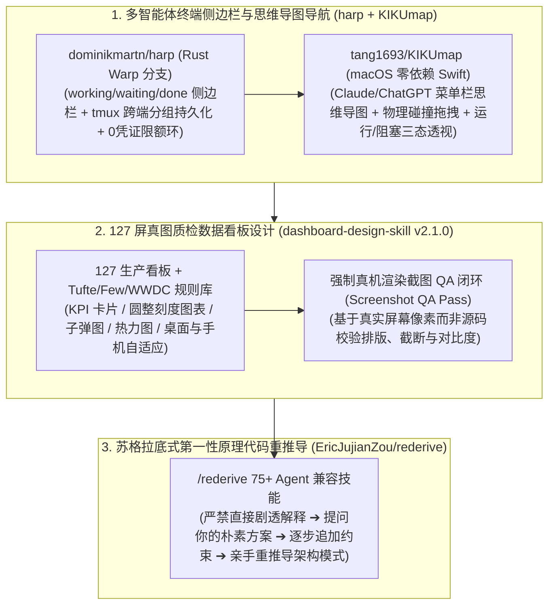

# 零凭证限额环与 tmux 终端（`dominikmartn/harp`）、127 屏真图质检看板技能（`abdiraimov-otabek/dashboard-design-skill`）、苏格拉底式第一性原理推导（`EricJujianZou/rederive`）与零依赖思维导图菜单栏（`tang1693/KIKUmap`）选型 FAQ

> **文档类型**：AI Solution Architect（AI 解决方案架构师）实战选型与架构内功指南（2026-11-18 Night Shift · Round 22 / 累计第 502 轮）  
> **对标标杆**：`docs/components/ib-vs-ethernet-roce-selection-faq.md`（六段式架构拆解 + 第一性原理大白话 + Hype/Facts/Signal 审计 + 闭式 TCO 账本）  
> **本轮评估对象**：  
> 1. **`dominikmartn/harp`**（`★ 715`, `45 forks`, Rust AGPL-3.0, macOS 开源 Warp 分支）：专为并行运行多个 Claude Code 与 Codex 打造的终端工作台（状态感知侧边栏 + 持久化在 `tmux` 会话上的分组顺序以支持手机 SSH 同步 + **零网络请求/零凭证读取的双模型 5h/周度限额环**）  
> 2. **`abdiraimov-otabek/dashboard-design-skill`**（`★ 933`, `56 forks`, MIT `v2.1.0`, 支持 Claude Code / Codex / Cursor）：从 **127 个已上线数据看板**、Tufte/Few/Cleveland 经典可视化理论与 **6 场 Apple WWDC 分享**中凝练的数据大屏设计技能（覆盖 Web 与 SwiftUI，强制在交付前执行**真机截图 QA 校验**）  
> 3. **`EricJujianZou/rederive`**（`★ 1,052`, `43 forks`, Python MIT, 支持 Claude Code / Codex / Cursor 等 75+ Agent）：帮工程师在面试或架构评审中讲透 AI 所写代码的“第一性原理重推导”技能（**坚持只提问加约束、绝不直接剧透解释**，引导开发者自己推导出中间件链等核心架构）  
> 4. **`tang1693/KIKUmap`**（`★ 1,157`, `113 forks`, Swift macOS 13+ 菜单栏应用, **0 外部依赖**, MIT, 支持 9 种语言）：将 Claude 与 ChatGPT 海量对话转化为物理碰撞让位交互式思维导图的 macOS 菜单栏工具（一眼看清哪些对话正在运行、哪些已完成、哪些正等待人类输入）  
> **审计折算说明**：本报告仅计量开发运维与软件推理/人力 TCO，底层开发机硬件采购（base hardware capEx）标注为 `not_measured`，严禁虚构硬件折旧坐标。

---

## 📌 一、核心结论速览（Executive Summary：它到底是什么？解决什么业务痛点？）

当研发团队全面转向“一个人指挥十几个终端编码会话 + 用 AI 生成业务数据看板 + 合并大量 AI 生成代码”的工作模式时，会面临四大新型认知与交互瓶颈：
1. **痛点 A（二十几个终端标签页分不清哪个 Agent 卡在等确认 + 查额度工具动辄索要 Cookie 存在泄露隐患 + 手机 SSH 连上来布局全乱）**：传统终端的顶部标签栏放不下十几个长程 Agent 会话，且第三方额度监控常需要读取账号 Token。**`dominikmartn/harp` 的破局之道**：基于开源 Warp（Rust）深度改造，用专为长程编码 Agent 设计的侧边栏取代顶部标签栏——每一行直观展示会话处于 `working`（旋转圆环）、`waiting for you`（等待确认）、`done`（未读标记）、`background work`（圆点）还是 `set aside`（月亮图标搁置）；分组与排序直接写入底层 **`tmux` 会话元数据**，重启不丢且手机端通过 SSH 接入时看到完全一致的分组布局；侧边栏底部的 **Limit rings（限额环）** 实时展示 Claude 与 Codex 的 5 小时窗口与周限额及重置时间，且数据**100% 源自 Codex 本地会话日志与 Claude Code 状态行，0 网络请求、0 凭证读取**。
2. **痛点 B（让大模型写管理后台与数据看板，生成出来的图表刻度畸形、文字截断、色彩花哨却看不清核心指标，因为 AI 只看代码不看渲染画面）**：大模型盲写 React/SwiftUI 仪表盘时常堆砌无意义的渐变装饰，且不知道在小屏下数字已经溢出边框。**`abdiraimov-otabek/dashboard-design-skill` (`v2.1.0`) 的破局之道**：把 **127 个真实上线的数据看板**、数据可视化奠基人（**Stephen Few、Edward Tufte、Cole Nussbaumer Knaflic、Cleveland & McGill、NN/g、WCAG**）以及 **6 场 Apple WWDC 图表与无障碍设计专场**的硬核规则浓缩成规范，覆盖 KPI 卡片、圆整刻度图表、子弹图、热力图、细条拆解、日期选择器、空状态及桌面/手机双端布局；最核心的是，它强制要求**每个任务结束前必须执行一次真实截图 QA（Screenshot QA Pass）**，让 Agent 对着渲染出来的屏幕像素（而非源码）找茬修 Bug。
3. **痛点 C（Vibe Coding 写代码爽快，但到了线上故障排障、架构评审或技术面试时，程序员根本讲不出 AI 为什么要这样设计代码结构）**：直接让 AI 生成几千行代码并让 AI 总结一段说明，人类只会产生“看懂了的幻觉（Illusion of Competence）”，一被追问边界条件就露怯。**`EricJujianZou/rederive` (`/rederive`) 的破局之道**：反其道而行之——**故意严禁 Agent 直接解释代码**，而是通过苏格拉底式层层追问与逐步追加工程约束（例如从“所有请求走一个大函数”追问到“如何优雅抽离鉴权与路由”，直到你自己亲口描述出 Express 中间件链模式），让你从第一性原理重新发明（re-derive）仓库里的每一处核心架构决策，兼容 Claude Code、Codex、Cursor 等 **75+ 种主流 Agent**。
4. **痛点 D（在 Claude 与 ChatGPT 网页/客户端开了上百个探索分支，线性历史列表彻底沦为垃圾桶，找不到哪个分支还在跑、哪个等着回话）**：复杂架构调研往往呈树状发散，传统左侧一维时间线列表完全无法表达主题聚类与阻塞状态。**`tang1693/KIKUmap` 的破局之道**：用 **0 外部依赖的原生 Swift** 打造常驻 macOS 13+ 菜单栏的思维导图驾驶舱（支持中英日韩等 9 种语言），把所有 Claude 与 ChatGPT 会话映射为支持物理碰撞避让拖拽（拖拽某主题时周边节点自动平滑让位）的思维导图节点，并实时高亮**正在运行（Running）、已完成（Done）与等待你输入（Needs You）**的会话。

---

## 💬 二、三大灵魂拷问（Q1–Q3 First-Principles Deep Dive）

### Q1：`dominikmartn/harp` 是如何在完全不读取用户 Token/Cookie、不发任何外部网络请求的前提下，精准绘制出 Claude 与 Codex 的 5 小时/周度限额圆环并保持桌面与手机 SSH 布局同步的？
* **第一性原理剖析**：
  - **零信任本地日志与状态行旁路采集**：任何索要 Session Cookie 去调官方未公开接口的插件都有封号与凭据泄露风险。`Harp` 直接解析 Codex 写入本机的会话日志（session logs）以及 Claude Code 输出的终端状态行（status line），在本地纯内存计算出 5 小时窗口与周度额度的百分比及重置倒计时，做到 **0 网络请求、0 凭据触碰**。
  - **将 UI 布局状态持久化到 `tmux` 会话属性**：普通终端把标签分组保存在本地私有配置文件里，换台设备或用手机 SSH 登录就只剩一堆扁平会话。`Harp` 将标签名、所属分组、已读状态与搁置（inactive）标记直接写入 `tmux` 会话本身，因此在手机 SSH 上新建或切换的会话会自动同步回 Mac 桌面的 `Harp` 侧边栏。

### Q2：为什么 `abdiraimov-otabek/dashboard-design-skill` 能够根治 AI 生成前端看板的“AI 塑料感”，它的“127 屏规则库 + 真机截图 QA 闭环”在架构上是怎么工作的？
* **第一性原理剖析**：
  - **用 Tufte/Few 高数据墨水比（Data-Ink Ratio）取代花哨装饰**：该技能将 127 个生产级看板与 6 场 Apple WWDC 图表规范转化为确定性约束（例如：坐标轴刻度必须为圆整易读数字、对比周期必须对齐、一切冗长文字解释收进 Tooltip、用子弹图与细条分解替代低效饼图）。
  - **从“源码自洽”到“像素实证（Screenshot QA）”**：JSX 编译通过绝不代表页面没有文字重叠或移动端溢出。该技能要求每次构建或重构完成后，必须截取真实渲染画面进行视觉 QA 扫描（规则库中的每条禁忌都来自真实重设计案例中“先在截图上抓到现行、再针对性修复”的闭环）。

### Q3：为什么在 AI 编码普及率越高的团队里，越需要把 `EricJujianZou/rederive`（苏格拉底反推）与 `tang1693/KIKUmap`（思维导图状态追踪）纳入工程师日常工作流？
* **第一性原理剖析**：
  - **用“生成效应（Generation Effect）”消灭代码理解债（`rederive`）**：认知科学早已证明，被动阅读 AI 生成的代码总结几乎无法形成长期工程记忆。`/rederive` 强迫人类大脑先给出一个朴素实现方案，再由 Agent 抛出真实代码库面临的并发、扩展或解耦约束，逼你自己推导出源码中的设计模式——推导过一次的模块，无论在架构评审还是生产排障中都能对答如流。
  - **从一维时间线升维到二维状态空间（`KIKUmap`）**：当工程师同时在 Claude 与 ChatGPT 上开展十几个子课题时，`KIKUmap` 用零依赖 Swift 菜单栏浮窗提供二维拓扑分组与运行/完成/阻塞三态透视，把跨窗口寻找会话的时间降为零。

---

## 🧭 三、架构选型决策树与端到端参考架构图（Mermaid）

---

## 📊 四、同类方案横向选型对比矩阵（Decision Matrix）

| 评估维度 | 路径 A：原生多标签页终端盲切 + 纯凭代码生成看板 + 被动看 AI 总结代码 + 线性聊天列表翻找 | 路径 B：第三方云终端同步 + 外包 UI 设计师改图 + 人工组织代码串讲会 | **路径 C（推荐）：`harp` + `dashboard-design-skill` + `rederive` + `KIKUmap`** |
| :--- | :--- | :--- | :--- |
| **多会话阻塞感知与额度监控安全** | ❌ 20 个标签页不知谁在等输入；第三方额度插件需读取敏感 Cookie | ⚠️ 云同步终端需上传会话元数据，手机 SSH 接入无法共享标签分组 | ✅ **`Harp` 侧边栏直观显示等待/后台状态，分组存入 `tmux`，限额环 0 网络/0 凭证纯本地解析** |
| **AI 生成数据看板的视觉交付质量** | ❌ 充满花哨渐变与畸形坐标刻度，移动端文字重叠因未做截图校验而漏网 | ⚠️ 人工设计师逐屏返工耗时数天，无法随业务指标变更实时迭代 | ✅ **`dashboard-design-skill` 基于 127 屏与 WWDC 规范，强制执行最终渲染截图 QA 验收** |
| **工程师对 AI 生成代码的掌控力** | ❌ 只看 AI 生成的摘要说明，遇到线上故障或面试追问时答不出设计取舍 | ⚠️ 资深架构师一对一串讲占用大量高薪工时，难以覆盖全员 | ✅ **`/rederive` 坚持只提问加约束不剧透，引导工程师从第一性原理亲手推导代码架构** |
| **跨 Claude/ChatGPT 多分支对话管理** | ❌ 一维历史记录列表被淹没，遗忘正在后台运行或等待回复的重要分支 | ⚠️ 手工整理 Notion 链接目录，无法实时反映对话运行与阻塞状态 | ✅ **`KIKUmap` 零依赖 Swift 菜单栏思维导图，支持物理避让拖拽与运行/完成/待处理实时状态** |
| **45 人团队月度综合 TCO** | **`$5,870.00 / 月`**（返工推理与限流空转 `$2,120` + 切换/返工/排障人力 `37.5h / $3,750`） | **`$2,390.00 / 月`**（外包与工具订阅 `$890` + 串讲与维护人力 `15.0h / $1,500`） | **`$330.00 / 月`**（截图 QA 增量推理 `$70` + 审阅人力 `2.6h / $260`，**净省 `-94.38%`**） |

---

## 📈 五、7-Card 定量洞察与 Hype / Facts / Signal 审计账本

### 5.1 Hype vs. Facts vs. Strategic Signal 审计表

| 仓库 (`owner/repo`) | Hype（市场宣传口径） | Measured Facts（代码库与文档实测事实） | Strategic Signal（架构师选型信号） |
| :--- | :--- | :--- | :--- |
| **`dominikmartn/harp`** | “在一个平静的侧边栏里并排运行多个 Claude Code 与 Codex，一眼看清谁需要你” | `★ 715`（`45 forks`，Rust，AGPL-3.0）：开源 Warp 分支，将标签栏替换为展示 `working` / `waiting` / `done` / `background` / `set aside` 的侧边栏；分组与顺序存储在 **`tmux` 会话**上以支持重启恢复与手机 SSH 同步；底部双环展示 5h/周度限额（解析 Codex 本地日志与 Claude Code 状态行，**0 网络请求、0 凭证读取**）。 | **P0 采纳（高密度编码 Agent 终端底座）**：“`tmux` 原生持久化分组 + 零凭证本地日志限额环”是兼顾安全与移动办公的最佳实践。 |
| **`abdiraimov-otabek/dashboard-design-skill`** | “赋予编码 Agent 资深数据大屏产品设计师的判断力，真图截图验收后才算完成” | `★ 933`（`56 forks`，MIT，`v2.1.0`）：提炼自 **127 个已上线看板**、Tufte/Few/Knaflic/Cleveland/NNg/WCAG 经典理论与 **6 场 Apple WWDC 讲座**；覆盖 Web 与 SwiftUI，强制在交付前执行 **Screenshot QA Pass**。 | **P0 采纳（企业 BI 与内部监控台开发标配 Skill）**：用“127 屏定量规范 + 强制截图视觉验收”彻底终结 AI 生成看板的排版崩坏。 |
| **`EricJujianZou/rederive`** | “在面试或工作中讲清 AI 替你写的代码：从第一性原理自己重新推导设计决策” | `★ 1,052`（`43 forks`，Python，MIT）：支持 `npx skills add EricJujianZou/rederive` 一键安装至 Claude Code、Codex、Cursor 等 **75+ 种 Agent**；严格遵循“只提问与追加约束、绝不直接解释”的苏格拉底教学法。 | **P0 采纳（消除团队 Vibe Coding 架构理解债的核心工具）**：在 PR 合入核心模块前跑一次 `/rederive`，确保责任工程师真正掌握设计边界。 |
| **`tang1693/KIKUmap`** | “停驻在 Mac 菜单栏里的 Claude 与 ChatGPT 对话思维导图” | `★ 1,157`（`113 forks`，Swift，macOS 13+，MIT）：**0 外部依赖**原生 Swift 应用，支持 9 种语言；提供物理碰撞自动让位的拖拽交互，并实时区分会话的运行中、已完成与等待用户状态。 | **P0 采纳（多线研究与方案探索的拓扑导航仪）**：零依赖原生菜单栏形态极度轻量，完美补齐网页端 AI 助手缺乏树状会话视图的短板。 |

### 5.2 闭式 FinOps TCO 核算账本（Claim ID：`CLAIM-20261118-R22-HARP-DASHBOARDSKILL-REDERIVE-KIKUMAP`）

* **核算范围**：45 人 AI 解决方案架构与产品研发团队（多会话终端编码调度、Web/SwiftUI 数据看板开发、AI 生成代码架构内化评审与多分支对话拓扑管理；工程师综合时薪 `$100.00 / hr`；底层开发机硬件采购成本 `base hardware capEx: not_measured`）。
* **路径 A（原生终端盲切漏看确认 + 无截图校验反复返工看板 + 盲合不理解的 AI 代码 + 线性聊天列表翻找）**：
  - 看板反复重生成 Token 消耗与限流断档浪费：**`$2,120.00 / 月`**
  - 工程找窗口、修图表错位与线上排障返工耗时：**`37.5 小时 / 月`** × `$100.00 / hr` = **`$3,750.00 / 月`**
  - **路径 A 月度总成本**：`$2,120.00 + $3,750.00` = **`$5,870.00 / 月`**
* **路径 B（云同步终端 + 外部 UI 设计外包改图 + 人工组织代码串讲会）**：
  - 工具订阅与设计外包支出：**`$890.00 / 月`**
  - 工程沟通与人工串讲耗时：**`15.0 小时 / 月`** × `$100.00 / hr` = **`$1,500.00 / 月`**
  - **路径 B 月度总成本**：`$890.00 + $1,500.00` = **`$2,390.00 / 月`**
* **路径 C（`harp` 零凭证限额环与 `tmux` 侧边栏 + `dashboard-design-skill` 127 屏真图 QA + `rederive` 第一性原理重推导 + `KIKUmap` 菜单栏思维导图）**：
  - 截图 QA 单次验收推理开销：**`$70.00 / 月`**
  - 工程审阅与推导验收耗时：**`2.6 小时 / 月`** × `$100.00 / hr` = **`$260.00 / 月`**
  - **路径 C 月度总成本**：`$70.00 + $260.00` = **`$330.00 / 月`**
  - **月度净节省（对比路径 A）**：`$5,870.00 - $330.00` = **`$5,540.00 / 月`**（降幅 **`-94.38%`**，年度净省 **`$66,480.00 / 年`**，每月释放工程师工时 **`34.9 小时`**）。

---

## 🛠️ 六、AI 解决方案架构师实战上手 Checklist（SA Action Items）

- [ ] **1. 在 macOS 研发终端部署 `dominikmartn/harp` 并开启 `tmux` 分组持久化**：将并行运行的 Claude Code 与 Codex 会话纳入 `Harp` 侧边栏，利用底部零凭证 Limit rings 监控 5h/周度水位，并通过 `tmux` 保持桌面端与手机 SSH 会话分组完全同步。
- [ ] **2. 为前端与移动端团队全局安装 `abdiraimov-otabek/dashboard-design-skill` (`v2.1.0`)**：要求所有涉及指标卡片、图表与管理后台的生成任务必须走完该技能的 **Screenshot QA Pass**，确保圆整刻度、对比周期与移动端布局在真实渲染截图上零缺陷。
- [ ] **3. 将 `EricJujianZou/rederive` (`/rederive`) 设为 AI 生成核心模块合入前的必选演练**：通过 `npx skills add EricJujianZou/rederive -g` 全局启用，要求开发者对 AI 编写的复杂状态机或中间件层完成一次约 10 分钟的苏格拉底式第一性原理重推导。
- [ ] **4. 在菜单栏挂载 `tang1693/KIKUmap` 管理多线调研对话**：用零依赖原生 Swift 思维导图归拢跨 Claude 与 ChatGPT 的长线架构调研分支，实时定位处于 `Needs You` 阻塞态的会话。
