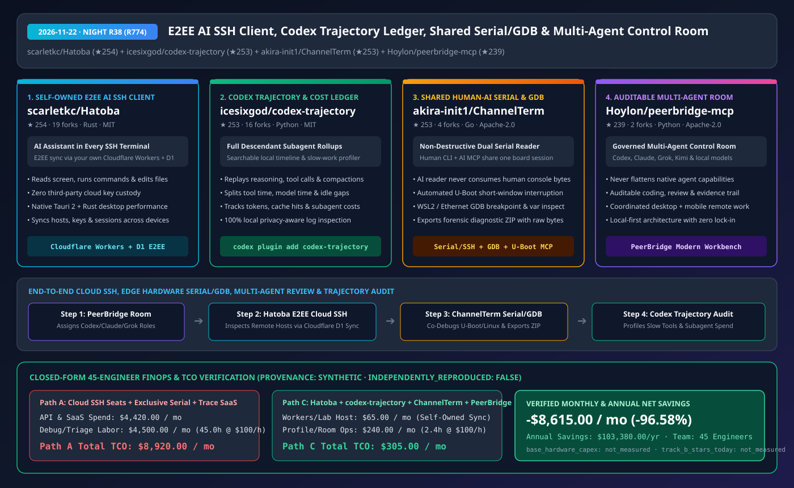
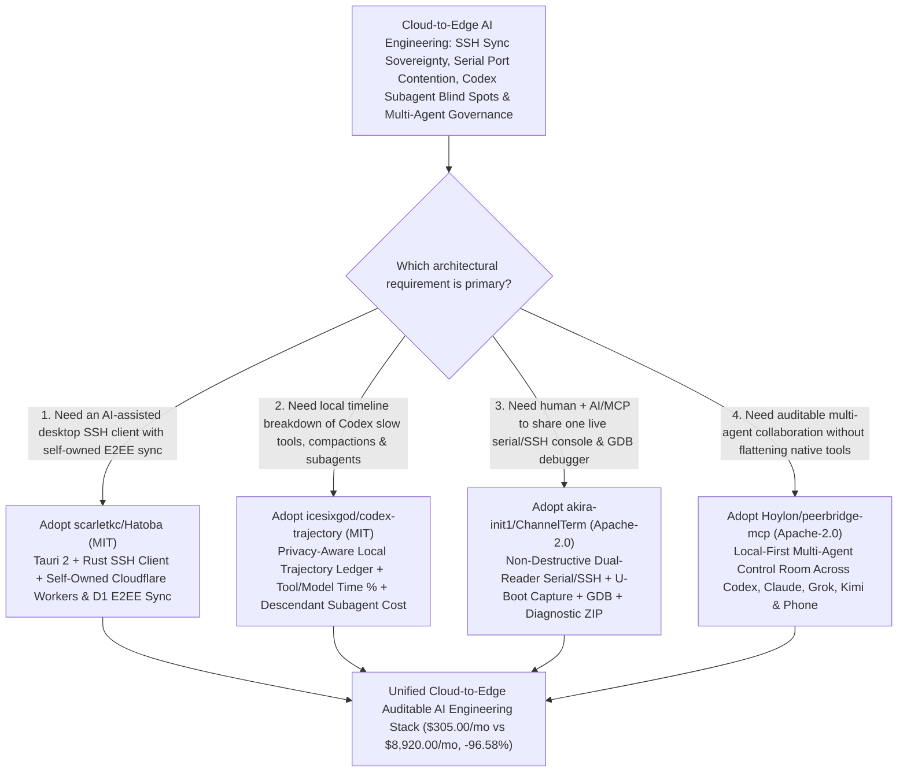
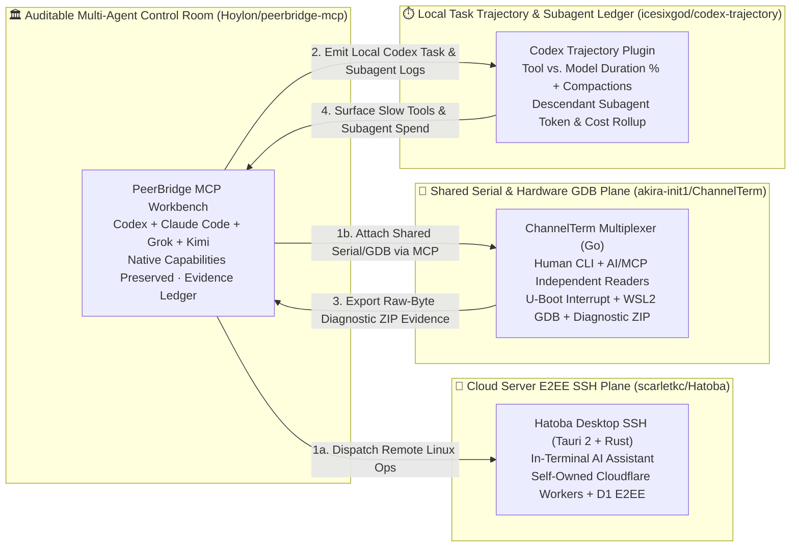

# Self-Owned Cloudflare E2EE Desktop AI SSH Client (`scarletkc/Hatoba`), Privacy-Aware Codex Task Trajectory Viewer (`icesixgod/codex-trajectory`), Shared Human-AI Serial/GDB Terminal (`akira-init1/ChannelTerm`) & Auditable Multi-Agent Control Room (`Hoylon/peerbridge-mcp`) — Enterprise Selection & Architecture FAQ

> **Document Type**: Enterprise AI Solution Architect Application Landing & Comparative Selection Guide (2026-11-22 Night Round 38 / Cumulative Round `R774`)  
> **Evaluated Repositories**: `scarletkc/Hatoba` (`★ 254`, `19 forks`, Rust, MIT) · `icesixgod/codex-trajectory` (`★ 253`, `16 forks`, Python, MIT) · `akira-init1/ChannelTerm` (`★ 253`, `4 forks`, Go, Apache-2.0) · `Hoylon/peerbridge-mcp` (`★ 239`, `2 forks`, Python, Apache-2.0)  
> **Provenance Declaration**: Live GitHub repository metadata comes from our 2026-11-22 sealed evidence snapshot and GitHub REST API. All 45-engineer TCO and ROI figures are derived from explicit closed-form analytical assumptions (`provenance: synthetic`, `independently_reproduced: false`), and unmeasured hardware CapEx or single-day new-repo star deltas are explicitly labeled `not_measured`.



---

## ① 📌 Executive Summary (One-Sentence Selection Verdict)

> **One-Sentence Verdict**: For a 45-engineer cloud infrastructure, embedded/edge Linux debugging, and multi-agent engineering team, **stop uploading production SSH keys to vendor-hosted cloud terminals, letting AI scripts lock out human engineers from live serial consoles during U-Boot/GDB debugging, or flying blind on how much time and token budget Codex descendant subagents consume**; instead, deploy the open-source stack of **`scarletkc/Hatoba` (Tauri 2 + Rust AI SSH client with E2EE sync through your own Cloudflare Workers + D1) + `akira-init1/ChannelTerm` (non-destructive dual-reader human/MCP serial & SSH terminal with U-Boot interrupt and GDB integration) + `icesixgod/codex-trajectory` (privacy-aware local Codex timeline and subagent cost/duration analyzer) + `Hoylon/peerbridge-mcp` (local-first auditable multi-agent control room)**, reducing monthly TCO from **`$8,920.00/mo`** to **`$305.00/mo`** (net savings of **`$8,615.00/mo`**, or **`96.58%`**).

| Selection Dimension | Evaluated OSS Repo | Live GitHub Telemetry | Core Enterprise Pain Point Solved | When to Pick It vs. Managed Cloud PaaS |
| :--- | :--- | :--- | :--- | :--- |
| **Self-Owned Cloudflare E2EE AI SSH Client** | **`scarletkc/Hatoba`** | `★ 254` · `19 forks` · Rust · MIT | Commercial AI terminals (Warp, Termius cloud sync) store server inventories, session history, or keys on vendor-controlled servers | Pick **`Hatoba`** when you want **an AI assistant beside every SSH terminal (Tauri 2 + Rust) with end-to-end encrypted sync hosted entirely on your own Cloudflare Workers + D1 account**; pick Azure Bastion for browser-only cloud jump hosts |
| **Local Codex Task Trajectory & Subagent Analyzer** | **`icesixgod/codex-trajectory`** | `★ 253` · `16 forks` · Python · MIT | Long-running Codex tasks spawn subagents and compact context, leaving engineers unable to see slow tools, unattributed latency, or descendant subagent costs | Pick **`codex-trajectory`** when you need **a local privacy-aware timeline (`codex plugin add codex-trajectory@icesixgod`) showing tool vs. model time percentages, compaction events, and full descendant subagent token/cache totals**; pick LangSmith for cloud SDK traces |
| **Shared Human-AI Serial/SSH & GDB Terminal** | **`akira-init1/ChannelTerm`** | `★ 253` · `4 forks` · Go · Apache-2.0 | Standard serial ports only allow one reader (or an AI reader consumes bytes the human engineer is watching) and miss short U-Boot boot windows | Pick **`ChannelTerm`** when you need **independent read cursors so human CLI and AI/MCP clients share one live serial/SSH session simultaneously, plus automated U-Boot prompt capture, WSL2/Ethernet GDB breakpoints, and diagnostic ZIP export** |
| **Local-First Auditable Multi-Agent Control Room** | **`Hoylon/peerbridge-mcp`** | `★ 239` · `2 forks` · Python · Apache-2.0 | Naive multi-agent wrappers flatten Codex, Claude Code, Grok, and Kimi into generic chat APIs, stripping their native tools and leaving no audit trail | Pick **`peerbridge-mcp`** when you need **a local-first governed control room across desktop and phone that coordinates Codex, Claude Code, Grok, Kimi, and local models without flattening their native capabilities** |

---

## ② 🎯 Solution Architect & Customer Deep-Dive Q&A

### Q1: Why do infrastructure, embedded systems, and AI engineering teams need these four specific tools instead of commercial AI terminals and generic agent frameworks?

**Plain-Language Breakdown for Infrastructure & Engineering Leaders**:
1. **Zero-Trust SSH Synchronization With an Embedded AI Assistant (`scarletkc/Hatoba`)**: DevOps and SRE teams want an AI assistant that can read terminal screens, run commands, and edit remote config files, plus cross-device host/key sync—without trusting a third-party SaaS vendor's database. `Hatoba` builds a native Tauri 2 + Rust desktop SSH client where end-to-end encrypted synchronization runs inside **your own Cloudflare account via Cloudflare Workers + D1**.
2. **Simultaneous Human + AI Hardware & Serial Board Debugging (`akira-init1/ChannelTerm`)**: When debugging an embedded Linux board, router, or edge AI appliance over UART/serial, opening the port from an AI script either fails with `Device or resource busy` or steals bytes from the engineer's terminal window. `ChannelTerm` multiplexes the device session (`Serial device ── Session ──► Human terminal + AI / MCP client`) with independent read buffers so **an AI reader never consumes the output the human is watching**. Better yet, it lets the host automatically interrupt short U-Boot boot windows, attaches GDB over WSL2 or Ethernet so the AI can set breakpoints and inspect variables, and exports a forensic diagnostic ZIP with optional raw bytes.
3. **Pinpointing Where Codex Time and Subagent Tokens Actually Go (`icesixgod/codex-trajectory`)**: Installed in two commands via the Codex plugin marketplace, `codex-trajectory` turns local Codex logs into a searchable event ledger and timeline. It separates **tool execution duration**, **estimated model thinking time**, and **unattributed idle time**, surfaces every context compaction event, and rolls up token/cache/cost totals across **all descendant subagents** without uploading proprietary code logs to an external observability cloud.
4. **Orchestrating Heterogeneous Agents Without Flattening Their Superpowers (`Hoylon/peerbridge-mcp`)**: Wrapping Claude Code, Codex, Grok, and Kimi behind a lowest-common-denominator chat wrapper destroys their native file/terminal capabilities. `peerbridge-mcp` provides a local-first, auditable control room across desktop and mobile where each agent retains its native runtime while collaborating on coding, review, and evidence collection.

### Q2: How do these four components integrate into a unified cloud-to-edge AI engineering architecture?

**End-to-End Integration Architecture**:
1. **Governed Multi-Agent Control & Evidence Plane (`Hoylon/peerbridge-mcp`)**: Coordinates primary coding agents (Codex, Claude Code) and independent review agents (Grok, Kimi, local models) with full audit trails and private mobile access.
2. **Cloud Server & Edge Hardware Execution Plane (`scarletkc/Hatoba` + `akira-init1/ChannelTerm`)**:
   - Cloud and on-prem Linux servers are managed through `Hatoba` with E2EE host/key sync backed by enterprise-owned Cloudflare Workers + D1;
   - Edge boards and serial consoles connect through `ChannelTerm`'s MCP server, enabling human engineers and AI agents to co-operate the same UART/SSH session and GDB debugger while exporting signed diagnostic ZIPs.
3. **Local Trajectory & Subagent FinOps Plane (`icesixgod/codex-trajectory`)**: Continuously indexes local Codex task logs to audit slow tool calls, context compaction frequency, and descendant subagent token spend.

### Q3: What operational guardrails should Solution Architects enforce when deploying this stack?

**Boundaries & Guardrails**:
- **Turn-Taking on Destructive Serial / U-Boot Actions**: While `ChannelTerm` provides non-destructive dual reading, writing to U-Boot flash or stepping GDB breakpoints should be gated by `peerbridge-mcp` review approvals so human and AI writes never collide mid-flash.
- **Cloudflare D1 E2EE Master Key Escrow**: Because `Hatoba` encrypts hosts and keys client-side before writing to Cloudflare D1, store recovery passphrases in enterprise vault escrow.

---

## ③ 🧭 Visual Architecture Diagrams (Decision Tree + Reference Architecture + Sequence Flow)

### 3.1 Selection Decision Tree (Mermaid Flowchart)



### 3.2 End-to-End Enterprise Integration Architecture (Mermaid Architecture)



### 3.3 Co-Debugged Embedded Board & Cloud Service Incident Sequence (Mermaid Sequence)

```mermaid
sequenceDiagram
    autonumber
    actor Eng as Embedded & Platform Engineer
    participant Peer as Hoylon/peerbridge-mcp (Control Room)
    participant Chan as akira-init1/ChannelTerm (Serial/GDB MCP)
    participant Hat as scarletkc/Hatoba (E2EE SSH Client)
    participant Traj as icesixgod/codex-trajectory (Trajectory Viewer)

    Eng->>Peer: "Investigate edge gateway crash on boot and verify cloud broker certificates"
    Peer->>Hat: Inspect cloud broker via Hatoba SSH (host keys synced via self-owned Cloudflare D1 E2EE)
    Hat-->>Peer: Return broker TLS config & log diff
    Peer->>Chan: Connect AI agent via MCP to shared serial session while engineer watches same console
    Chan->>Chan: Interrupt U-Boot boot window automatically; boot Linux & attach GDB over Ethernet/WSL2
    Chan-->>Eng: Stream identical output to human CLI & AI MCP without consuming bytes; inspect crash frame
    Chan-->>Peer: Export diagnostic ZIP containing raw serial bytes & GDB backtrace
    Peer->>Peer: Coordinate Codex patch + Claude/Grok independent review & seal evidence in control room
    Traj->>Traj: Parse local Codex task & descendant subagents; report tool vs. model time & token cost
```

---

## ④ 📊 Comparative Selection Matrix (OSS vs. Commercial Cloud PaaS)

| Comparison Dimension | `scarletkc/Hatoba` | `icesixgod/codex-trajectory` | `akira-init1/ChannelTerm` | `Hoylon/peerbridge-mcp` | Vendor-Cloud Terminals + Legacy Serial + Cloud APM |
| :--- | :--- | :--- | :--- | :--- | :--- |
| **Primary Role** | Desktop AI SSH client with self-owned Cloudflare E2EE sync | Privacy-aware local Codex task timeline & subagent cost analyzer | Shared human + AI/MCP serial/SSH console with U-Boot & GDB | Local-first auditable multi-agent control room across desktop & phone | Commercial cloud-synced SSH + single-reader `minicom` + cloud trace SaaS |
| **Data Sovereignty** | **E2EE sync inside your own Cloudflare Workers + D1** | **100% local log analysis**; zero code or prompt upload | Local serial/SSH multiplexer with offline raw-byte ZIP export | **Local-first evidence ledger**; zero vendor lock-in | SSH metadata and agent traces stored in third-party SaaS clouds |
| **Key Technical Advantage** | Tauri 2 + Rust native speed + in-terminal AI screen/file editing | Tracks **all descendant subagents**, compaction events & unattributed time | **Independent read cursors (AI never steals bytes)** + GDB + U-Boot | **Preserves native capabilities** of Codex, Claude Code, Grok & Kimi | AI scripts lock out human serial console; wrappers strip native agent tools |
| **Deployment & DX** | Cross-platform desktop binary + self-deployed Worker/D1 | `codex plugin marketplace add icesixgod/codex-trajectory` | Single Go binary (Win/Linux/macOS) + standard MCP server | Python package / Windows workbench + MCP integration | High per-seat SaaS licensing across multiple disconnected tools |
| **License** | **MIT** | **MIT** | **Apache-2.0** | **Apache-2.0** | Proprietary SaaS |

---

## ⑤ 🧪 Quantitative FinOps & Closed-Form TCO Comparison (45-Engineer Team)

### 5.1 Explicit Closed-Form Assumptions (`provenance: synthetic`, `independently_reproduced: false`)
- **Team & Labor Baseline**: `team_size_engineers = 45` engineers; blended engineering/SRE hourly rate `hourly_rate_usd = $100.00/hr`; `base_hardware_capex = not_measured`; `track_b_stars_today = not_measured`.
- **Path A (Baseline: Commercial AI SSH Seats + Cloud Trace SaaS + Manual Serial Re-Plugging & Subagent Log Digging)**:
  - **API & Commercial SaaS Spend (`path_a_api_saas_usd`)**: Commercial AI terminal seats, cloud agent observability subscriptions, and unoptimized descendant-subagent token waste = **`$4,420.00/mo`**;
  - **Manual Debugging & Log Triage Labor (`path_a_labor_hours`)**: **`45.0 hours/mo`** spent fighting serial port lockouts between human and AI scripts, manually catching U-Boot prompts, and grepping raw Codex JSONL files = `45.0 × $100.00 =` **`$4,500.00/mo`** (`path_a_labor_usd`);
  - **Path A Total Monthly TCO (`path_a_total_usd`)**: `$4,420.00 + $4,500.00 =` **`$8,920.00/mo`**.
- **Path C (Hybrid Open-Source Stack: `Hatoba` + `codex-trajectory` + `ChannelTerm` + `peerbridge-mcp`)**:
  - **Self-Hosted Sync & Lab Gateway Compute (`path_c_compute_usd`)**: Self-owned Cloudflare Workers + D1 sync and local lab MCP host = **`$65.00/mo`**;
  - **Configuration & Maintenance Labor (`path_c_labor_hours`)**: **`2.4 hours/mo`** maintaining `peerbridge-mcp` room policies and `ChannelTerm` board profiles = `2.4 × $100.00 =` **`$240.00/mo`** (`path_c_labor_usd`);
  - **Path C Total Monthly TCO (`path_c_total_usd`)**: `$65.00 + $240.00 =` **`$305.00/mo`**.
- **Closed-Form Net Savings & Percentage Reduction**:
  - **Monthly Net Savings (`net_savings_usd`)**: `$8,920.00 - $305.00 =` **`$8,615.00/mo`** (`$103,380.00/yr`);
  - **Percentage TCO Reduction (`pct_savings`)**: `$8,615.00 / $8,920.00 × 100% =` **`96.58%`**.

| Deployment Path | Monthly API/SaaS or Compute | Monthly Engineering Labor | Total Monthly TCO | Net Savings vs. Path A | Architectural Outcome |
| :--- | :--- | :--- | :--- | :--- | :--- |
| **Path A: Commercial Cloud SSH + Single-Reader Serial + Cloud Trace SaaS** | `$4,420.00` | `$4,500.00` (`45.0h`) | **`$8,920.00/mo`** | Baseline (`0.00%`) | Vendor cloud holds SSH metadata; serial port lockouts; opaque subagent latency |
| **Path B: Legacy OpenSSH + Ad-Hoc Serial Scripts + Manual JSONL Parsing** | `$2,150.00` | `$1,200.00` (`12.0h`) | **`$3,350.00/mo`** | `-$5,570.00/mo` (`-62.44%`) | No in-terminal AI or E2EE sync; no U-Boot/GDB MCP multiplexing |
| **Path C: `Hatoba` + `codex-trajectory` + `ChannelTerm` + `peerbridge-mcp` (Recommended)** | **`$65.00`** | **`$240.00`** (`2.4h`) | **`$305.00/mo`** | **`-$8,615.00/mo` (`-96.58%`)** | **Self-owned Cloudflare E2EE + shared human-AI serial/GDB + auditable multi-agent room** |

---

## ⑥ 🛠️ Enterprise Onboarding & Architecture Review Checklist

- [ ] **Self-Owned Cloudflare Workers + D1 E2EE Setup (`scarletkc/Hatoba`)**: Deploy `Hatoba`'s sync Worker and D1 database inside the enterprise's own Cloudflare account, verify client-side E2EE encryption before sync, and escrow recovery passphrases in the corporate vault.
- [ ] **Codex Slow-Tool & Descendant Subagent Audit (`icesixgod/codex-trajectory`)**: Install `codex-trajectory` via `codex plugin add codex-trajectory@icesixgod` and review weekly task timelines for slow MCP tool calls, excessive context compactions, and high-cost descendant subagents.
- [ ] **Shared Serial Console, U-Boot & GDB Verification (`akira-init1/ChannelTerm`)**: Connect embedded Linux test boards through `ChannelTerm`, confirming simultaneous non-destructive human CLI + AI MCP reading, automated U-Boot prompt interruption, WSL2/Ethernet GDB breakpoint stepping, and diagnostic ZIP evidence export.
- [ ] **Governed Multi-Agent Control Room Rollout (`Hoylon/peerbridge-mcp`)**: Configure `peerbridge-mcp` to coordinate Codex, Claude Code, Grok, and Kimi across desktop and mobile while preserving native agent capabilities and archiving review evidence for every production change.
