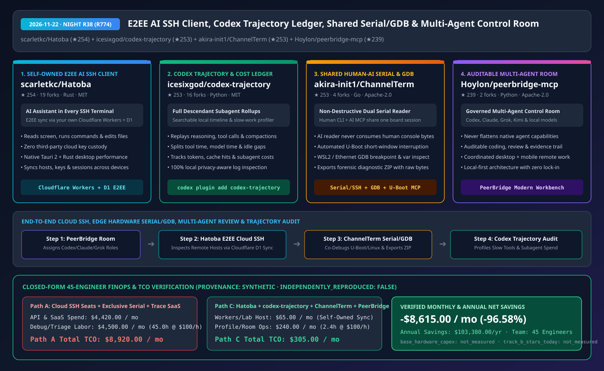
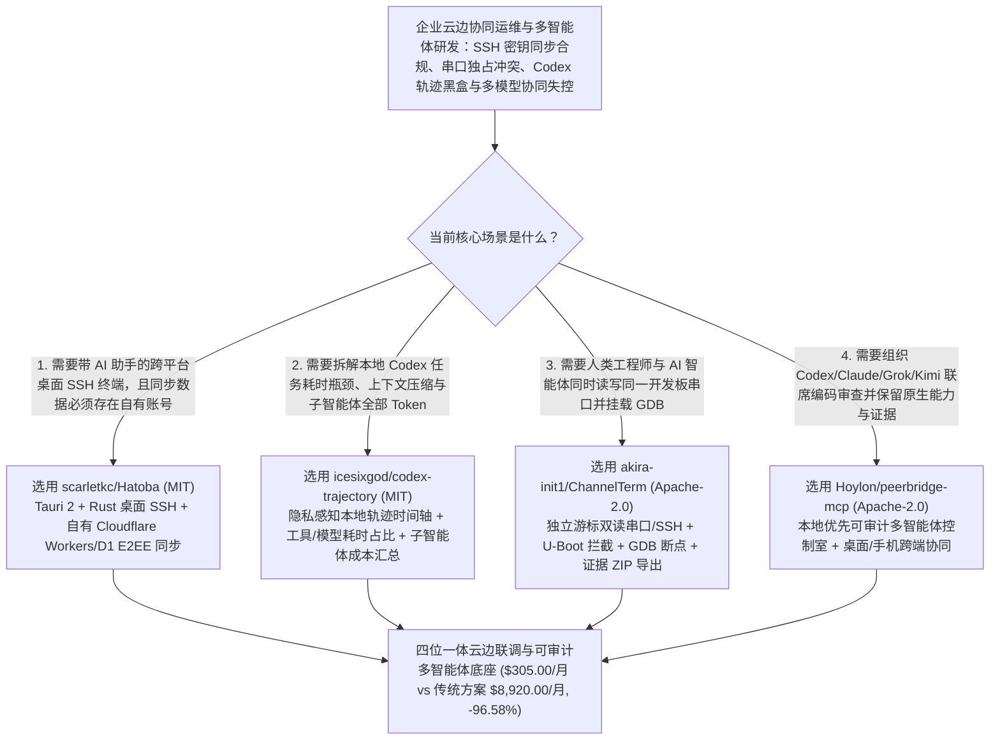
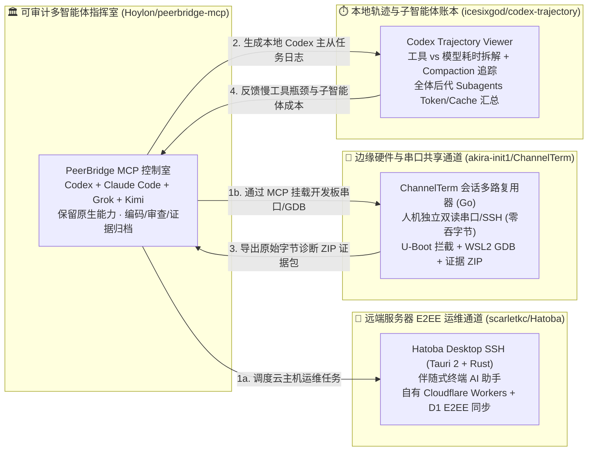
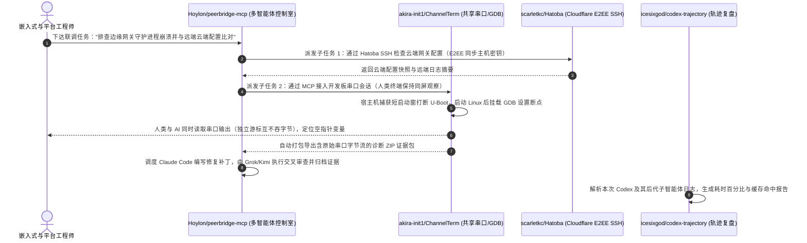

# 自有 Cloudflare 端到端加密同步 AI 桌面 SSH 客户端（`scarletkc/Hatoba`）、Codex 本地任务轨迹与子智能体耗时复盘器（`icesixgod/codex-trajectory`）、人机共享串口/硬件 GDB 调试终端（`akira-init1/ChannelTerm`）与可审计多智能体联合作战指挥室（`Hoylon/peerbridge-mcp`）企业选型与集成架构 FAQ

> **文档类型**：AI 解决方案架构师（AI Solution Architect）企业应用落地与横向选型指南（2026-11-22 Night Round 38 / 累计第 774 轮 `R774`）  
> **评测锚点**：`scarletkc/Hatoba` (`★ 254`, `19 forks`, Rust, MIT) · `icesixgod/codex-trajectory` (`★ 253`, `16 forks`, Python, MIT) · `akira-init1/ChannelTerm` (`★ 253`, `4 forks`, Go, Apache-2.0) · `Hoylon/peerbridge-mcp` (`★ 239`, `2 forks`, Python, Apache-2.0)  
> **Provenance 声明**：本文实时 GitHub 元数据采自 2026-11-22 封存快照与 GitHub REST API；45 人研发与基础设施团队的 TCO 与 ROI 测算均为显式闭式假设推导（`provenance: synthetic`, `independently_reproduced: false`），所有未实测硬件资本开支与新仓单日增量统一标注为 `not_measured`。

---

## ① 📌 核心结论速览（选型一句话结论）

> **一句话选型结论**：在 45 人规模的云原生运维、嵌入式/边缘硬件联调与多智能体研发团队中，**切勿将生产服务器 SSH 私钥交由第三方商业云终端托管、任由 AI 独占抢占串口流导致人类工程师看不见 U-Boot 启动输出、或对 Codex 子智能体究竟把耗时与 Token 花在哪一步毫无感知**；应当采用 **“Hatoba 自有 Cloudflare Workers + D1 端到端加密 AI 桌面 SSH 客户端 + ChannelTerm 人机双读共享串口/GDB 硬件调试终端 + Codex Trajectory 本地隐私感知任务轨迹与子智能体账本 + PeerBridge MCP 可审计多模型联合作战指挥室”** 的四位一体组合，将团队月度综合 TCO 从 **`$8,920.00/月`** 压降至 **`$305.00/月`**（净省 **`$8,615.00/月`**，降幅 **`96.58%`**）。

| 选型维度 | 评测开源方案 | GitHub 实测指标 | 核心解决的企业业务痛点 | 一句话何时选它 vs 云端商业 PaaS |
| :--- | :--- | :--- | :--- | :--- |
| **自有 Cloudflare E2EE 同步 AI SSH 客户端** | **`scarletkc/Hatoba`** | `★ 254` · `19 forks` · Rust · MIT | 商业 AI 终端（如 Warp / Termius 云同步）需将服务器主机配置与密钥托管在厂商云端，存在合规与供应链风险 | 需要 **Tauri 2 + Rust 原生桌面 SSH 伴随式 AI 助手，且通过企业自有 Cloudflare Workers + D1 实现端到端加密（E2EE）跨设备同步** 时首选 `Hatoba`；纯云端托管堡垒机选 Azure Bastion |
| **Codex 本地任务轨迹与子智能体分析器** | **`icesixgod/codex-trajectory`** | `★ 253` · `16 forks` · Python · MIT | Codex 桌面端跑长任务派生多个子智能体时，看不清工具耗时占比、上下文压缩（Compaction）节点与全部后代子智能体 Token 汇总 | 需要 **零外传解析本地 Codex 任务日志，重放推理摘要/工具调用/失败堆栈、拆解模型耗时 vs 工具耗时并汇总全体后代子智能体成本** 时选 `codex-trajectory`；通用云端 APM 选 LangSmith |
| **人机共享串口/SSH 与 GDB 调试终端** | **`akira-init1/ChannelTerm`** | `★ 253` · `4 forks` · Go · Apache-2.0 | 传统串口（UART/Serial）被 AI 脚本打开后人类终端即无法同时读取（或 AI 读走字节导致人类丢包），且抓不住毫秒级 U-Boot 中断窗口 | 需要 **人类 CLI 与 AI/MCP 客户端独立双读同一串口/SSH 会话（互不吞字节）、自动拦截 U-Boot 启动窗、联动 WSL2/以太网 GDB 打断点并导出 ZIP 证据包** 时选 `ChannelTerm` |
| **本地优先可审计多智能体指挥室** | **`Hoylon/peerbridge-mcp`** | `★ 239` · `2 forks` · Python · Apache-2.0 | 混合使用 Codex、Claude Code、Grok、Kimi 与本地模型时，如果强行套用统一包装器会阉割各家原生工具能力且缺乏统一证据审计 | 需要 **在不扁平化阉割各智能体原生能力的前提下，将 Codex/Claude/Grok/Kimi 编组为桌面与手机联动的可审计工程战队（Coding + Review + Evidence）** 时选 `peerbridge-mcp` |

---

## ② 🎯 客户与架构师灵魂拷问 Q&A（直击业务落地痛点）

### Q1：我们既有后端云主机运维，又有边缘网关/嵌入式 Linux 板卡联调，这四个开源项目各自解决了什么商业工具搞不定的真痛点？

**通俗解答（给基础设施负责人与研发总监）**：
1. **SSH 终端既要 AI 副驾，又绝不能把主机列表与密钥交给第三方 SaaS（`scarletkc/Hatoba` 破局）**：SRE 在多台电脑间同步上百台服务器配置时，商业 SSH 客户端要求登录其官方云账号。`Hatoba` 基于 Tauri 2 与 Rust 构建，每个终端旁都配有能读屏、跑命令、改远端文件的 AI 助手，最关键的是它的同步后端直接部署在 **你自己的 Cloudflare 账号（`Cloudflare Workers + D1`）** 上，且全程端到端加密（E2EE）——厂商服务器一行明文都看不到。
2. **嵌入式开发板串口调试时，“人看”和“AI 调”不可兼得（`akira-init1/ChannelTerm` 破局）**：在调试 Linux 开发板或工业网关串口时，操作系统串口设备通常只能被一个进程读取，或者 AI 进程读走的字节在人类屏幕上就消失了。`ChannelTerm` 用 Go 实现了一个精巧的多路复用会话层（`Serial device ── Session ──► Human terminal + AI / MCP client`）：每个客户端拥有独立读取游标，**AI 读取绝不吞掉人类正在观察的控制台输出**；同时人类能在屏幕上实时看到 AI 敲入的命令、在极短的启动窗口由宿主机精准打断 U-Boot 引导、在 Windows 连串口同时通过 WSL2/以太网挂载 GDB 设断点查变量，并在故障复现瞬间一键导出含原始字节流的诊断 ZIP 证据包。
3. **Codex 跑了半小时花了十几美金，却不知道卡在哪个子智能体或哪个慢工具（`icesixgod/codex-trajectory` 破局）**：只需两行命令（`codex plugin marketplace add icesixgod/codex-trajectory` + `codex plugin add codex-trajectory@icesixgod`），即可把本地 Codex 日志转化为可视化时间轴与事件账本，精准展示：工具执行耗时百分比、模型估算思考耗时、未归因空转耗时（Unattributed Time）、上下文压缩（Context Compaction）触发点，以及包含所有派系子智能体（Descendant Subagents）在内的完整 Token 与缓存命中账单。
4. **多模型协同既要保留各自原生看家本领，又要留下可审计证据链（`Hoylon/peerbridge-mcp` 破局）**：普通多智能体框架把 Claude Code 和 Codex 降级成简单的文本问答 API，丢掉了它们原生的 Worktree 与沙箱能力。`peerbridge-mcp` 提供一个本地优先的可审计指挥室（Modern Workbench），让 Codex、Claude Code、Grok、Kimi 与本地模型保留各自原生能力协同完成编码、交叉 Code Review 与证据归档，并支持从手机端远程安全受控介入。

### Q2：如何把这四个组件组合成一套覆盖“云主机 SSH + 边缘硬件串口 + 多智能体联席审查 + 全轨迹复盘”的企业集成架构？

**端到端集成参考架构**：
1. **统一多模型作战指挥与审计层（`Hoylon/peerbridge-mcp`）**：作为顶层任务调度与证据汇集中心，分配主编码模型（如 Claude Code / Codex）与独立审查模型（如 Grok / Kimi）。
2. **远端云主机与边缘硬件双通道执行层（`scarletkc/Hatoba` + `akira-init1/ChannelTerm`）**：
   - 针对云端 Linux 服务器运维，通过 `Hatoba` 建立带 AI 副驾的 SSH 会话，配置经由企业自有 Cloudflare Workers + D1 E2EE 同步；
   - 针对边缘计算盒子、物联网板卡与串口终端，通过 `ChannelTerm` 暴露 MCP 接口供智能体与人类工程师同屏共享串口/SSH 与 GDB 调试器，自动捕获 U-Boot 与内核 Panic 证据 ZIP。
3. **本地任务轨迹与慢操作复盘层（`icesixgod/codex-trajectory`）**：自动解析 Codex 及其子智能体的本地执行日志，定位慢工具调用与上下文压缩损耗，并将性能画像回填至 `peerbridge-mcp` 证据库。

### Q3：这套架构有哪些使用边界需要架构师提前规避？

**安全与运维边界**：
- **`ChannelTerm` 硬件写操作锁**：人机共享同一串口或 GDB 会话时，在刷写固件（Flash）或修改 U-Boot 环境变量关键阶段，应利用会话回合控制避免人类按键与 AI MCP 写入指令在同一毫秒交错。
- **`Hatoba` 自有 Cloudflare 配额与密钥备份**：由于采用零知识端到端加密（E2EE），主加密口令一旦遗失连企业管理员也无法从 Cloudflare D1 恢复，需纳入企业 1Password / Bitwarden 应急托管规范。

---

## ③ 🧭 直观可视化图解（选型决策树 + 集成参考架构 + 业务流时序图）

### 3.1 选型决策树（Mermaid Flowchart）

### 3.2 企业生产集成参考架构图（Mermaid Architecture）

### 3.3 边缘 Linux 板卡 U-Boot/GDB 联调与多智能体审查全链路时序图（Mermaid Sequence Diagram）

---

## ④ 📊 同类开源与商业云服务横向选型决策矩阵

| 对比维度 | `scarletkc/Hatoba` | `icesixgod/codex-trajectory` | `akira-init1/ChannelTerm` | `Hoylon/peerbridge-mcp` | 商业云同步终端 + 传统独占串口 + 云端 APM |
| :--- | :--- | :--- | :--- | :--- | :--- |
| **核心功能定位** | 自有 Cloudflare E2EE 同步的 AI 桌面 SSH 客户端 | 本地 Codex 任务日志时间轴与后代子智能体耗时/成本分析器 | 人机同屏共享串口/SSH 与 GDB 硬件调试多路复用终端 | 保留各模型原生能力的本地优先可审计多智能体控制室 | 第三方云托管 SSH + 单进程串口工具 (`minicom`) + 云端 Trace SaaS |
| **数据主权与隐私边界** | **同步在自有 Cloudflare Workers + D1**，全程端到端加密 | **100% 本地解析日志**，无需将代码与推理过程上传外部 APM | 本地串口/SSH 会话直连，支持导出离线可验证原始字节 ZIP | **本地优先（Local-First）**，完整保留审计证据链与私有远程接入 | 主机密钥与完整 Prompt 轨迹必须上传商业厂商云端 |
| **核心技术突破点** | 兼顾 Tauri 2 轻量跨平台、终端内嵌 AI 与自主可控免费云同步 | 精准统计 **全体后代子智能体 Token**、工具耗时占比与未归因耗时 | **独立读取游标（AI 不吞人类输出）** + U-Boot 拦截 + GDB 联动 | **不扁平化阉割 Codex/Claude 原生能力**，支持桌面与手机协同 | AI 读串口会导致人类终端乱码丢字；包装器阉割原生工具 |
| **安装与接入方式** | 原生桌面安装包 + 一键部署自有 Workers/D1 | `codex plugin marketplace add icesixgod/codex-trajectory` | 单一 Go 二进制支持 Win/Linux/macOS + 标准 MCP 接口 | Python / Windows Alpha 桌面端 + 标准 MCP 控制室接入 | 需采购多种互不兼容的商业工具席位 |
| **开源协议** | **MIT** | **MIT** | **Apache-2.0** | **Apache-2.0** | 闭源商业按席位计费 |

---

## ⑤ 🧪 应用落地定量收益 / 闭式 TCO 对比（45 人云边协同与研发团队）

### 5.1 闭式参数假设（`provenance: synthetic`, `independently_reproduced: false`）
- **团队规模与人力单价**：`team_size_engineers = 45` 人，研发与嵌入式/SRE 工程师折算时薪 `hourly_rate_usd = $100.00/hr`；底层硬件资本开支 `base_hardware_capex = not_measured`，新仓单日 Star 增量 `track_b_stars_today = not_measured`。
- **Path A（基准方案：商业 AI 终端团队版 + 云端 Agent Trace 平台 + 人工反复插拔串口/拷贝日志复盘子智能体）**：
  - **API 与商业 SaaS 订阅费（`path_a_api_saas_usd`）**：45 人商业 AI SSH 终端企业席位、云端 Agent 轨迹监控 SaaS 及因缺少子智能体耗时洞察导致的慢工具冗余 Token 消耗，合计 **`$4,420.00/月`**；
  - **人工联调与日志复盘工时（`path_a_labor_hours`）**：每月因人类与 AI 争抢串口反复重连、手工抓取 U-Boot/GDB 现场及人工翻查 JSONL 排查慢任务耗费 **`45.0 小时`**，折合人工成本 `45.0 × $100.00 =` **`$4,500.00/月`**（`path_a_labor_usd`）；
  - **Path A 月度总成本（`path_a_total_usd`）**：`$4,420.00 + $4,500.00 =` **`$8,920.00/月`**。
- **Path C（开源混合自建方案：`Hatoba` + `codex-trajectory` + `ChannelTerm` + `peerbridge-mcp`）**：
  - **自托管算力与同步资源费（`path_c_compute_usd`）**：`Hatoba` 依托企业自有 Cloudflare Workers + D1（免费/极低成本层），其余组件均本地运行，内网测试网关分摊仅 **`$65.00/月`**；
  - **配置与运维工时（`path_c_labor_hours`）**：每月仅需 **`2.4 小时`** 维护 Cloudflare 同步 Worker 与 MCP 控制室模板，折合人工成本 `2.4 × $100.00 =` **`$240.00/月`**（`path_c_labor_usd`）；
  - **Path C 月度总成本（`path_c_total_usd`）**：`$65.00 + $240.00 =` **`$305.00/月`**。
- **净节省与 ROI 闭式校验**：
  - **月度净节省（`net_savings_usd`）**：`$8,920.00 - $305.00 =` **`$8,615.00/月`**（年化节省 **`$103,380.00/年`**）；
  - **成本降幅百分比（`pct_savings`）**：`$8,615.00 / $8,920.00 × 100% =` **`96.58%`**。

| 方案路径 | 月度 API/SaaS 或算力费 | 月度联调与复盘人工 | 月度综合 TCO 总额 | 相对 Path A 净节省 | 关键架构收益 |
| :--- | :--- | :--- | :--- | :--- | :--- |
| **Path A：商业云 SSH 终端 + 独占串口手动抓包 + 云端 Trace SaaS** | `$4,420.00` | `$4,500.00` (`45.0h`) | **`$8,920.00/月`** | 基准 (`0.00%`) | 密钥托管于第三方云，AI 与人争抢串口，子智能体耗时黑盒 |
| **Path B：传统开源 SSH (` PuTTY/OpenSSH `) + 手写串口转发脚本** | `$2,150.00` | `$1,200.00` (`12.0h`) | **`$3,350.00/月`** | `-$5,570.00/月` (`-62.44%`) | 无终端内嵌 AI 与 E2EE 同步，缺乏 GDB/U-Boot 原生 MCP 证据导出 |
| **Path C：`Hatoba` + `codex-trajectory` + `ChannelTerm` + `peerbridge-mcp`（推荐）** | **`$65.00`** | **`$240.00`** (`2.4h`) | **`$305.00/月`** | **`-$8,615.00/月` (`-96.58%`)** | **自有 Cloudflare E2EE 同步 + 人机同屏共享串口/GDB + 全链路可审计多智能体** |

---

## ⑥ 🛠️ 企业引入与架构评审 Checklist

- [ ] **自有 Cloudflare Workers + D1 E2EE 同步部署（`scarletkc/Hatoba`）**：在企业自有 Cloudflare 账号下初始化 `Hatoba` 的 `workers/sync` 与 D1 数据库，验证跨终端同步的 SSH 主机配置与密钥在 D1 表中均为密文存储，且主加密口令已纳入企业密码保险箱备份。
- [ ] **Codex 任务轨迹与子智能体慢操作巡检（`icesixgod/codex-trajectory`）**：通过 `codex plugin add codex-trajectory@icesixgod` 启用本地轨迹分析器，每周排查耗时占比超 30% 的慢工具调用、高频 Context Compaction 触发点以及异常膨胀的后代子智能体（Descendant Subagents）。
- [ ] **人机共享串口、U-Boot 拦截与 GDB 证据归档联调（`akira-init1/ChannelTerm`）**：在硬件实验室工作站部署 `ChannelTerm`，验证人类终端与 AI MCP 客户端同时连接开发板串口时零丢字节，演练宿主机自动中断 U-Boot 引导、WSL2 GDB 断点调试及一键导出含原始字节的诊断 ZIP。
- [ ] **多智能体不降级编组与审计室上线（`Hoylon/peerbridge-mcp`）**：在 `peerbridge-mcp` 中接入 Claude Code、Codex 与独立审查模型（Grok/Kimi），确认各智能体保留原生工具链能力，且每次代码变更与硬件联调均附带结构化审查记录与证据附件。
