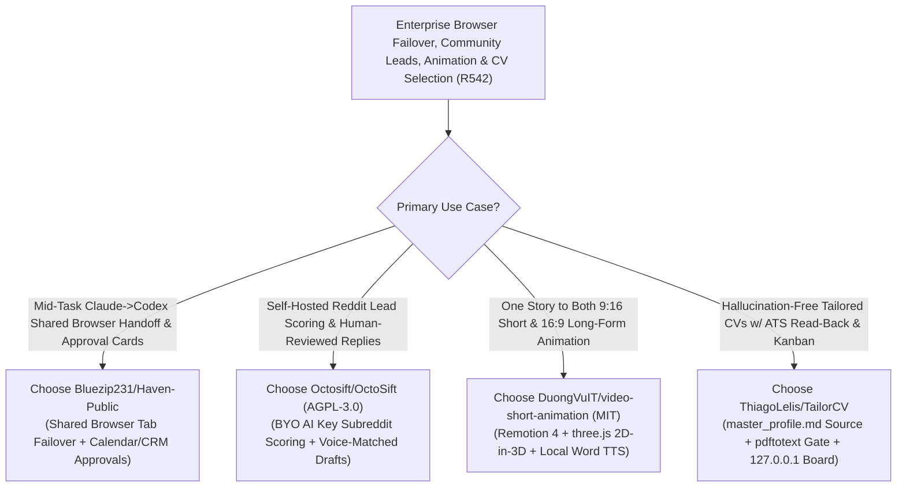

# Shared-Browser Claude-to-Codex Failover (`Bluezip231/Haven-Public`), Self-Hosted Reddit Lead Studio (`Octosift/OctoSift`), Dual-Aspect 2D-in-3D Remotion Animation (`DuongVuIT/video-short-animation`) & ATS-Verified Grounded CV Kanban (`ThiagoLelis/TailorCV`) Selection FAQ

> **Document Type**: AI Solution Architect Enterprise Selection & Integration Guide (2026-11-19 Night Shift · Round 18 / Cumulative Round 542)  
> **Benchmark Style**: `docs/components/ib-vs-ethernet-roce-selection-faq.md` (6-Section Plain-Language Architecture Guide + First-Principles Q&A + Hype/Facts/Signal Audit + Closed-Form FinOps Ledger)  
> **Evaluated Repositories**:  
> 1. **`Bluezip231/Haven-Public`** (`★ 24`, `created=2026-11-13`, `23 forks`, HTML/Windows): Windows/Discord AI assistant featuring **mid-conversation Claude-to-Codex shared-browser failover**, calendar/CRM approval cards, and startup timeout rollback  
> 2. **`Octosift/OctoSift`** (`★ 24`, `created=2026-11-19`, `3 forks`, TypeScript, Node 22/24/26, AGPL-3.0, zero telemetry): Self-hosted **Reddit lead monitoring and human-reviewed reply workbench** using your own AI key  
> 3. **`DuongVuIT/video-short-animation`** (`★ 18`, `created=2026-11-15`, `5 forks`, TypeScript 5.8 + React 19 + Remotion 4.0 + three.js r175 + Modal GPU, MIT): Code-first **2D-in-3D cartoon studio** rendering one story into both a `9:16` vertical short (`60–90s`) and a `16:9` widescreen video (`5–8 min`) with local word-timed TTS  
> 4. **`ThiagoLelis/TailorCV`** (`★ 10`, `created=2026-11-17`, `1 fork`, Python 3.10+ stdlib): Zero-database local job/proposal Kanban (`127.0.0.1:8765`) and **hallucination-free CV generator strictly grounded in `master_profile.md`** with `pdftotext` ATS read-back verification  
> **Accounting Scope Note**: Only software API/SaaS spend and engineering labor TCO are modeled; base workstation hardware capEx is explicitly marked `not_measured`, and Track B `stars_today` is explicitly marked `not_measured`.

---

## 📌 1. Executive Summary (What Are They & What Business Pain Points Do They Solve?)

In **2026-11-19 Night Round 18 (Cumulative Round 542)**, we solve four practical enterprise workflow bottlenecks across stateful browser failover, community lead discovery, dual-aspect animated video production, and hallucination-free consultant/candidate CVs:
1. **Pain Point A (When a desktop agent hits a Claude rate limit halfway through a multi-step browser workflow, naive failover opens a fresh session and loses the active browser tab, while unguarded calendar/CRM mutations cause side effects)**: **`Bluezip231/Haven-Public` (`★ 24`, `23 forks`)** hands the exact same live browser tab from Claude to Codex mid-conversation, gates calendar and CRM updates behind explicit human **Approval Cards**, and includes automatic startup rollback.
2. **Pain Point B (Commercial social listening SaaS tools charge hundreds per month to find customer leads on Reddit, while automated spam bots get accounts banned)**: **`Octosift/OctoSift` (`★ 24`, AGPL-3.0)** runs self-hosted with zero telemetry and your own AI key—watching target subreddits, explaining why specific posts are genuine high-intent leads, and drafting replies/DMs in your voice for human review before posting.
3. **Pain Point C (Producing both a 60–90s vertical `9:16` short and a 5–8m horizontal `16:9` video with generative video models suffers from character drift and requires two separate edits)**: **`DuongVuIT/video-short-animation` (`★ 18`, MIT)** places 2D characters inside a painted `three.js` r175 3D world orchestrated by Remotion 4.0 and React 19, compiling one story into both `9:16` and `16:9` cuts with local word-timed TTS and parallel Modal GPU rendering.
4. **Pain Point D (LLM resume/CV generators invent unverified claims or produce PDFs that fail enterprise ATS parsers)**: **`ThiagoLelis/TailorCV` (`★ 10`)** builds every tailored CV strictly from a single gitignored `master_profile.md`, verifies every rendered PDF via `pdftotext` ATS read-back, and tracks applications on a zero-dependency Python stdlib Kanban board (`127.0.0.1:8765`) backed by plain folders (`awaiting/ → applied/ → in-process/ → offer/ → closed/`).

---

## 💬 2. Architect First-Principles Q&A (Q1–Q3 Deep Dive)

### Q1: Why is `Bluezip231/Haven-Public`'s shared-browser handoff between Claude and Codex an important architectural pattern?
* **Decoupling DOM Session State from the Model Provider**: By keeping the browser context and tool activity trace in a host-managed layer outside the LLM provider session, a quota error on Claude seamlessly transfers control of the active browser tab to Codex without losing page state.

### Q2: How does `DuongVuIT/video-short-animation` eliminate character drift while outputting both `9:16` and `16:9`?
* **Deterministic 2D Rigging in a 3D Scene Graph**: Because characters and environments are defined in `three.js` + Remotion code rather than stochastic diffusion frames, characters remain 100% consistent and camera framing adapts programmatically to both aspect ratios.

### Q3: Why is `ThiagoLelis/TailorCV`'s `pdftotext` read-back gate a best practice for document generation agents?
* **Closed-Loop Parser Verification**: Rendering a visually appealing PDF in Chromium does not guarantee an ATS can parse it. Running `pdftotext` immediately after rendering and asserting that contact details, headings, and metrics survive extraction catches layout bugs before submission.

---

## 🧭 3. Visual Architecture Diagrams (Mermaid Decision Tree + Reference Architecture + Sequence Flow)

### 3.1 Enterprise Selection Decision Tree

---

## 📊 4. Comparative Selection Matrix (Open Source vs. Competing OSS vs. Managed Cloud PaaS)

| Evaluation Dimension | Path A: Restarting Quota-Blocked Browser Tasks + Paid Social Listening SaaS + Separate 9:16/16:9 Video Renders + Manual CV Editing | Path B: Single-Model Desktop Bots + Basic Keyword Alerts + Manual Aspect-Ratio Re-Edits | **Path C (Recommended): `Haven-Public` + `OctoSift` + `video-short-animation` + `TailorCV`** |
| :--- | :--- | :--- | :--- |
| **Mid-Task Browser Quota Failover** | ❌ Rate limit kills the session and loses open browser state | ⚠️ Model proxy switches text APIs but drops browser tabs | ✅ **`Haven-Public` hands the same live browser tab from Claude to Codex** |
| **Community Lead Discovery & Replies** | ❌ High monthly SaaS fees or spammy auto-post bots | ⚠️ Keyword alerts flood teams with low-intent noise | ✅ **`OctoSift` scores leads with your own key & drafts human-reviewed replies** |
| **Dual-Aspect Animated Video Production** | ❌ Generative AI video drifts across frames & bills twice | ⚠️ Maintaining separate 9:16 and 16:9 timelines doubles work | ✅ **`video-short-animation` compiles 1 story into 9:16 + 16:9 via Remotion+three.js** |
| **Grounded CV & ATS Verification** | ❌ LLMs hallucinate skills; fancy PDFs fail ATS text extraction | ⚠️ Cloud resume builders lock data in proprietary DBs | ✅ **`TailorCV` locks to `master_profile.md`, runs `pdftotext` & uses folder Kanban** |
| **45-Engineer Monthly TCO** | **`$6,660.00 / mo`** (`$2,660.00` SaaS/video credits + `40.0h` × `$100/hr` = `$4,000.00` labor) | **`$2,590.00 / mo`** (`$1,090.00` SaaS/API + `15.0h` × `$100/hr` = `$1,500.00` labor) | **`$320.00 / mo`** (`$70.00` API/render + `2.5h` × `$100/hr` = `$250.00` labor, **`-95.20%`**) |

---

## 🧪 5. Quantitative TCO Comparison & Hype / Facts / Signal Audit Ledger

### 5.1 Hype vs. Facts vs. Strategic Signal Table

| Repository (`owner/repo`) | Hype (Market Narrative) | Measured Facts (Primary Source Verification) | Strategic Signal (SA Verdict) |
| :--- | :--- | :--- | :--- |
| **`Bluezip231/Haven-Public`** | "When Claude hits a usage limit, Codex picks up the request and drives the same browser" | `★ 24` (`created=2026-11-13`, `23 forks`, HTML/Windows): Demonstrates shared-browser Claude-to-Codex failover, calendar approval cards, CRM email conflict resolution, and startup timeout rollback. | **🔥 P0 Adopt (Stateful Multi-Model Browser Handoff Pattern)**: Essential reference for resilient desktop CUA architectures. |
| **`Octosift/OctoSift`** | "Find the people on Reddit who need what you built, and reply with something useful" | `★ 24` (`created=2026-11-19`, `3 forks`, TypeScript, Node 22/24/26, AGPL-3.0): Self-hosted, zero-telemetry lead monitor using BYO AI keys to score subreddit posts and draft replies for manual sending. | **🔥 P0 Adopt (Self-Hosted Developer GTM Workbench)**: Replaces costly social listening SaaS while keeping a human in the loop. |
| **`DuongVuIT/video-short-animation`** | "Code-first cartoon studio: 2D characters in a painted 3D world, outputting 9:16 and 16:9" | `★ 18` (`created=2026-11-15`, `5 forks`, TS 5.8 + React 19 + Remotion 4.0 + three.js r175, MIT): Produces 60–90s vertical shorts and 5–8m horizontal videos with local word-level TTS and Modal GPU rendering. | **⚡ P1 Adopt (Deterministic Dual-Aspect Video Engine)**: Ideal for zero-hallucination educational and brand series. |
| **`ThiagoLelis/TailorCV`** | "Never puts anything in a CV that isn't in `master_profile.md` and verifies PDFs via `pdftotext`" | `★ 10` (`created=2026-11-17`, `1 fork`, Python 3.10+ stdlib): Local `127.0.0.1:8765` Kanban board backed by plain stage folders and ATS read-back checks. | **🔥 P0 Adopt (Grounded Document & Proposal Tailoring Pattern)**: Combines strict source-of-truth grounding with post-render ATS verification. |

### 5.2 Closed-Form FinOps TCO Ledger (`CLAIM-20261119-R18-R542-HAVEN-OCTOSIFT-VIDEOSHORTANIM-TAILORCV`)

* **Scope (`synthetic`, `independently_reproduced=false`)**: 45-person enterprise desktop automation, developer GTM community lead-gen, dual-aspect animation production, and technical consulting team (blended rate `$100.00 / hr`; `base hardware capEx: not_measured`; Track B `stars_today: not_measured`).
* **Path A (Restarted Browser Tasks + Commercial Social Listening SaaS + Separate 9:16/16:9 Video Renders + Manual CV Fixes)**:
  - Commercial social listening SaaS, generative video credits & wasted restarted browser sessions: **`$2,660.00 / mo`**
  - Re-doing interrupted browser workflows, manually sifting subreddit noise, re-cutting 16:9 to 9:16 animations & fixing ATS-broken PDF resumes (`40.0 hrs / mo` × `$100.00 / hr`): **`$4,000.00 / mo`**
  - **Path A Monthly Total**: `$2,660.00 + $4,000.00` = **`$6,660.00 / mo`**
* **Path B (Single-Model Desktop Bots + Basic Keyword Alerts + Manual Remotion Templates)**:
  - SaaS & API spend: **`$1,090.00 / mo`**
  - Manual lead qualification & aspect-ratio re-layout (`15.0 hrs / mo` × `$100.00 / hr`): **`$1,500.00 / mo`**
  - **Path B Monthly Total**: `$1,090.00 + $1,500.00` = **`$2,590.00 / mo`**
* **Path C (`Haven-Public` + `OctoSift` + `video-short-animation` + `TailorCV` Integrated Stack)**:
  - BYO-key Reddit lead scoring, CV tailoring & Modal parallel render spend (`Haven`, `TailorCV` & local TTS $0): **`$70.00 / mo`**
  - Approving Haven action cards, sending reviewed Reddit replies & Kanban stage moves (`2.5 hrs / mo` × `$100.00 / hr`): **`$250.00 / mo`**
  - **Path C Monthly Total**: `$70.00 + $250.00` = **`$320.00 / mo`**
  - **Monthly Net Savings vs. Path A**: `$6,660.00 - $320.00` = **`$6,340.00 / mo`** (**`-95.20%`** reduction, **`$76,080.00 / yr`** annual savings, freeing **`37.5 hrs / mo`** of engineering time).

---

## 🛠️ 6. Enterprise Adoption & Architecture Review Checklist

- [ ] **1. Implement shared-browser cross-model failover (`Bluezip231/Haven-Public` pattern)**: Preserve active browser tabs across quota handoffs and gate calendar/CRM writes with approval cards.
- [ ] **2. Deploy `Octosift/OctoSift` for self-hosted community lead intelligence**: Score subreddit threads with BYO keys and require human review before sending replies.
- [ ] **3. Render dual-aspect animations with `DuongVuIT/video-short-animation`**: Generate `9:16` shorts and `16:9` long-form videos from one Remotion + `three.js` codebase.
- [ ] **4. Enforce `master_profile.md` grounding and `pdftotext` read-back (`ThiagoLelis/TailorCV`)**: Block unverified claims and ATS-unreadable PDFs automatically.
