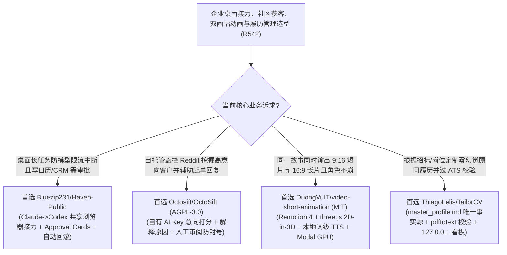
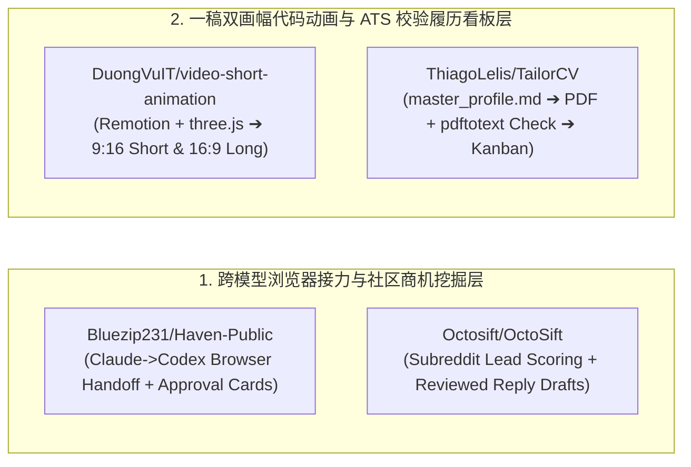
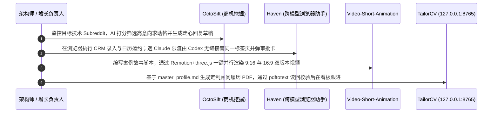

# 跨模型共享浏览器无缝接力与审批助手（`Bluezip231/Haven-Public`）、自托管零遥测 Reddit 商机挖掘台（`Octosift/OctoSift`）、一稿双画幅 2D+3D 代码动画工坊（`DuongVuIT/video-short-animation`）与零幻觉 ATS 回读校验履历看板（`ThiagoLelis/TailorCV`）选型 FAQ

> **文档类型**：AI Solution Architect（AI 解决方案架构师）实战选型与架构内功指南（2026-11-19 Night Shift · Round 18 / 累计第 542 轮）  
> **对标标杆**：`docs/components/ib-vs-ethernet-roce-selection-faq.md`（六段式架构拆解 + 第一性原理大白话 + Hype/Facts/Signal 审计 + 闭式 TCO 账本）  
> **本轮评估对象**：  
> 1. **`Bluezip231/Haven-Public`**（`★ 24`，`created=2026-11-13`，`23 forks`，HTML/Windows）：支持 **Claude 触发限流时自动切换至 Codex 并继续操控同一个浏览器标签页**的 Windows 桌面助手——内置日历变更与 CRM 冲突消解审批卡（Approval Cards）及启动超时自动回滚（Update Rollback）  
> 2. **`Octosift/OctoSift`**（`★ 24`，`created=2026-11-19`，`3 forks`，TypeScript，Node 22/24/26，AGPL-3.0，零遥测）：自托管 **Reddit 社区商机监控与人机协同回复工作台**——用自有 AI Key 对目标 Subreddit 帖子进行意向打分与原因解析，并按用户真实口吻起草回复供人工审阅发送  
> 3. **`DuongVuIT/video-short-animation`**（`★ 18`，`created=2026-11-15`，`5 forks`，TypeScript 5.8 + React 19 + Remotion 4.0 + three.js r175 + Modal GPU，MIT）：**一稿双出（`9:16` 60–90s 竖屏短片 + `16:9` 5–8min 横屏长片）的 2D+3D 代码动画工作室**——将 2D 角色置入手绘风 3D 世界，结合本地词级时间戳 TTS 与 Modal 并行渲染  
> 4. **`ThiagoLelis/TailorCV`**（`★ 10`，`created=2026-11-17`，`1 fork`，Python 3.10+ 标准库零依赖）：严格锚定单一事实源 `master_profile.md` 的**零幻觉定制履历生成器与本地无数据库看板（`127.0.0.1:8765`）**——生成 PDF 后强制调用 `pdftotext` 模拟 ATS 解析自检  
> **审计折算说明**：本报告仅计量软件算力、商业 SaaS 与工程运维人力 TCO，底层研发工作站硬件采购（base hardware capEx）显式标注为 `not_measured`，新仓今日增量显式标注为 `not_measured`，严禁捏造坐标。

---

## 📌 一、核心结论速览（Executive Summary：它到底是什么？解决什么业务痛点？）

在 **2026-11-19 Night Round 18（累计第 542 轮）** 中，我们面向企业架构师解决“浏览器自动化跑到一半遇 Claude 限流被迫从头重来、开发者产品在海外社区找真实痛点客户被昂贵商业监听 SaaS 割韭菜、做一条故事动画要分别重做竖屏短视频与横屏长视频两套工程、以及技术顾问投标履历被 AI 瞎编经历或被 ATS 系统解析乱码”四大痛点：
1. **痛点 A（当桌面 Agent 正在浏览器里执行跨系统 CRM 录入与日历排期，跑到第 8 步时 Claude 突然触发 Usage Limit 限流；普通多模型网关只会切模型重开新会话，导致前面打开的浏览器标签页状态全丢，还得提防 Agent 未经确认乱改日历）**：跨模型故障转移必须“移交同一个活动浏览器上下文 + 写操作强制弹审批卡”。**`Bluezip231/Haven-Public` (`★ 24`, `23 forks`) 的破局之道**：当 Claude 触达额度上限时，**Codex 在对话中途无缝接力并继续驱动同一个已打开的浏览器标签页（Shared-Browser Failover）**；凡涉及写日历、解决 CRM 邮件地址冲突等高危副作用操作，先向用户展示拟执行详情审批卡，获批后才落盘，并内置版本更新超时自动回滚。
2. **痛点 B（ToB 开源项目与开发者工具想在 Reddit 相关技术板块寻找正在求助的真实潜在客户，但商业社交监听 SaaS 动辄几百美元/月，而全自动发帖机器人又因为满嘴广告腔被版主秒封）**：**`Octosift/OctoSift` (`★ 24`, AGPL-3.0, 零遥测) 的破局之道**：100% 自托管、自带 AI Key，持续监控指定 Subreddit，不仅给每个帖子打出商机匹配分，还用大白话解释“为什么这位发帖人是真实潜在客户”，并按你的真实表达风格起草有帮助的回复或 DM，最后交由人类一键审阅后自己发出。
3. **痛点 C（企业制作技术科普或品牌故事动画时，既要发抖音/Shorts/Reels 的 `9:16` 竖屏 60–90 秒短片，又要发 YouTube/B 站的 `16:9` 横屏 5–8 分钟长片；用纯 AI 视频生成模型不仅角色长相每帧都在变，还得做两套完全不同的工程）**：**`DuongVuIT/video-short-animation` (`★ 18`, MIT) 的破局之道**：采用“代码优先（Code-First）”的 **Remotion 4.0 + three.js r175 + React 19** 架构，将 2D 角色放入手绘质感 3D 场景中（角色 100% 一致零崩坏），配合本地词级时间戳 TTS 与合成音乐，**一套故事源码同时编译出 `9:16` 竖屏短片与 `16:9` 横屏长片**，并支持在 Modal GPU 上并行极速渲染。
4. **痛点 D（咨询公司为解决架构师/技术顾问根据不同客户 RFP 招标书定制个人履历（CV）时，最怕大模型无中生有编造没做过的项目，或者生成的花哨 PDF 被甲方的 ATS 简历解析系统读成乱码）**：**`ThiagoLelis/TailorCV` (`★ 10`) 的破局之道**：① **绝对事实边界**：所有生成的定制简历（`.md`/`.pdf`）与客户背景调研（`job_info.md`）100% 只能取材于本地 `.claude/skills/tailor-cv/references/master_profile.md`（若缺量化指标则主动向本人追问，绝不脑补）；② **ATS 读回门禁**：用本地 Chrome/Edge 渲染 PDF 后，自动调用 `pdftotext` 像真实 ATS 一样把文本读回来，一旦发现联系方式或章节标题丢失立即报错拦截；③ **零数据库本地看板**：纯 Python 标准库启动 `127.0.0.1:8765` 看板，直接以本地文件夹（`awaiting/ → applied/ → in-process/ → offer/ → closed/`）作为唯一事实源。

---

## 💬 二、客户与架构师灵魂拷问 Q&A（Q1–Q3 First-Principles Deep Dive）

### Q1：`Bluezip231/Haven-Public` 的“Claude 到 Codex 共享浏览器标签页故障转移”与普通 API 路由层的模型切换有何本质区别？
* **有状态环境句柄移交（Stateful Browser Handle Handoff）**：API 路由层只能转发文本消息，却无法移交本地已登录的浏览器 DOM 状态与进行中的活动轨迹。`Haven` 将浏览器会话句柄与模型后端解耦，使备用模型（Codex）能直接接管原标签页继续完成剩余步骤，并受同一套日历/CRM 审批卡约束。

### Q2：为什么 `DuongVuIT/video-short-animation` 选择“Remotion + three.js 2D-in-3D”而非纯扩散视频大模型来生产系列科普动画？
* **零幻觉角色一致性 + 一稿双画幅摄像机重构图**：在 `three.js` 3D 空间里摆放 2D 角色图层，只需调整虚拟摄像机视场角（FOV）与时间轴编排，就能从同一套场景代码同时导出 `9:16` 竖屏与 `16:9` 横屏，且字幕、口型与本地 TTS 词级时间戳毫秒级对齐。

### Q3：`ThiagoLelis/TailorCV` 的“`master_profile.md` 唯一事实源 + `pdftotext` ATS 逆向读回”对企业投标文件生成有何架构启发？
* **输入防幻觉 + 输出防解析失败双保险**：任何企业投标书或顾问履历生成管线都应强制执行：① 严禁引用事实库之外的案例；② 生成最终 PDF/Docx 后，必须用下游解析器（如 `pdftotext`）反向提取文本校验关键字段完整性，合格后才进入 `awaiting/` 看板。

---

## 🧭 三、直观可视化图解（Mermaid 选型决策树 + 企业集成参考架构 + 业务流时序图）

### 3.1 跨模型接力、社区线索挖掘、一稿双画幅动画与零幻觉履历选型决策树

### 3.2 企业集成参考架构图

### 3.3 端到端业务流时序图

---

## 📊 四、同类开源与商业云服务横向选型决策矩阵（Decision Matrix）

| 评估维度 | 路径 A：模型限流导致浏览器任务重跑 + 商业社交监听 SaaS + 横竖屏两套视频重做 + AI 瞎编简历且 ATS 乱码 | 路径 B：单模型桌面机器人 + 简单关键词提醒 + 手工改 Remotion 画幅模板 | **路径 C（推荐）：`Haven-Public` + `OctoSift` + `video-short-animation` + `TailorCV`** |
| :--- | :--- | :--- | :--- |
| **桌面浏览器长任务抗限流能力** | ❌ Claude 限流即中断报错，已填写的网页表单与状态全丢 | ⚠️ 切模型需重新打开新浏览器窗口重头执行 | ✅ **`Haven-Public` 支持 Claude→Codex 接管同一浏览器标签页并带审批卡** |
| **社区高意向线索挖掘与合规回复** | ❌ 商业 SaaS 月费高昂；或用全自动群发机器人导致账号被封 | ⚠️ 纯关键词匹配噪音极大，需人工逐条点开判断意图 | ✅ **`OctoSift` 自托管自有 Key 评分、解释商机原因并由人工审阅发送** |
| **横竖屏双版本动画视频制作** | ❌ 生成式视频角色闪烁变形，且 9:16 与 16:9 需重复抽卡付费 | ⚠️ 手工维护两套工程文件，字幕与配音难以同步修改 | ✅ **`video-short-animation` 2D-in-3D 一套源码同出 9:16 短片与 16:9 长片** |
| **顾问/求职履历真实性与 ATS 兼容** | ❌ 大模型随意捏造项目经历，花哨排版被 ATS 解析成空白/乱码 | ⚠️ 云端简历工具需上传个人隐私数据且按月订阅收费 | ✅ **`TailorCV` 严格锁定 `master_profile.md`、内置 `pdftotext` 自检与本地看板** |
| **45 人团队月度综合 TCO** | **`$6,660.00 / 月`**（监听 SaaS/抽卡视频/重跑损耗 `$2,660` + 重跑任务/筛帖/改画幅/修简历 `40.0h / $4,000`） | **`$2,590.00 / 月`**（工具订阅与 API `$1,090` + 人工筛选与双画幅调整 `15.0h / $1,500`） | **`$320.00 / 月`**（自有 Key 评分与 Modal 渲染 `$70` + 审批卡确认与回复发送 `2.5h / $250`，**净省 `-95.20%`**） |

---

## 🧪 五、应用落地定量收益/TCO 对比与 Hype / Facts / Signal 审计账本

### 5.1 Hype vs. Facts vs. Strategic Signal 审计表

| 仓库 (`owner/repo`) | Hype（市场宣传口径） | Measured Facts（一手源码与文档实证事实） | Strategic Signal（架构师选型信号） |
| :--- | :--- | :--- | :--- |
| **`Bluezip231/Haven-Public`** | “当 Claude 达到使用上限时，Codex 在对话中途接手并驱动同一个浏览器” | `★ 24`（`created=2026-11-13`，`23 forks`，HTML/Windows）：展示 Claude→Codex 共享浏览器故障转移、日历审批卡、CRM 邮箱冲突消解与更新超时自动回滚。 | **🔥 P0 采纳（极具参考价值的有状态多模型接力范式）**：为企业桌面 Agent 提供了“共享浏览器句柄跨模型切换 + 显式审批卡”的清晰交互蓝本。 |
| **`Octosift/OctoSift`** | “在 Reddit 找到真正需要你产品的人，并用你的声音起草诚实有用的回复” | `★ 24`（`created=2026-11-19`，`3 forks`，TypeScript，Node 22/24/26，AGPL-3.0）：零遥测自托管，使用自有 AI Key 对 Subreddit 帖子评分、解释商机理由并生成待人工审阅的回复/DM。 | **🔥 P0 采纳（开发者产品与开源项目 GTM 获客利器）**：“AI 筛线索写初稿 + 人类最终发送”既省时间又避免社区反感。 |
| **`DuongVuIT/video-short-animation`** | “代码动画工作室：3D 手绘世界里的 2D 角色，一个故事同时出 9:16 与 16:9 两版” | `★ 18`（`created=2026-11-15`，`5 forks`，TS 5.8 + React 19 + Remotion 4.0 + three.js r175 + Modal GPU，MIT）：结合本地词级 TTS 与合成配乐，同源输出 60–90s 竖屏与 5–8min 横屏。 | **⚡ P1 采纳（多平台动画视频确定性双出管线）**：彻底摆脱纯 AI 视频生成模型的角色崩坏与高昂抽卡成本。 |
| **`ThiagoLelis/TailorCV`** | “绝不往简历里塞 `master_profile.md` 之外的词，并用 `pdftotext` 像 ATS 一样读回核验” | `★ 10`（`created=2026-11-17`，`1 fork`，Python 3.10+ 标准库）：仅监听 `127.0.0.1:8765`，以本地五阶段文件夹作为无数据库看板，渲染后执行 ATS 读回门禁。 | **🔥 P0 采纳（零幻觉投标履历与求职管理样板）**：“单一事实源约束 + 渲染后逆向文本读回测试”值得所有文档生成系统借鉴。 |

### 5.2 闭式 FinOps TCO 核算账本（Claim ID：`CLAIM-20261119-R18-R542-HAVEN-OCTOSIFT-VIDEOSHORTANIM-TAILORCV`）

* **核算范围（Synthetic Parametric Model · `independently_reproduced=false`）**：45 人企业桌面办公自动化、开发者社区增长（GTM）、多平台科普动画制作与技术咨询顾问履历管理团队（工程师综合时薪 `$100.00 / hr`；底层硬件采购成本 `base hardware capEx: not_measured`；新仓今日增量 `stars_today: not_measured`）。
* **路径 A（模型限流导致浏览器任务重头跑 + 商业社交监听 SaaS + 横竖屏两套视频重复抽卡 + 人工修补幻觉/乱码履历）**：
  - 商业社交监听 SaaS 订阅、生成式视频抽卡与中断重跑 Token 支出：**`$2,660.00 / 月`**
  - 重跑中断的网页操作、人工刷帖找线索、横屏改竖屏重剪辑与修复 ATS 解析失败 PDF 耗时：**`40.0 小时 / 月`** × `$100.00 / hr` = **`$4,000.00 / 月`**
  - **路径 A 月度总成本**：`$2,660.00 + $4,000.00` = **`$6,660.00 / 月`**
* **路径 B（单模型桌面脚本 + 基础关键词邮件提醒 + 手工维护两套 Remotion 模板）**：
  - 工具订阅与 API 支出：**`$1,090.00 / 月`**
  - 人工甄别线索与调整双画幅布局耗时：**`15.0 小时 / 月`** × `$100.00 / hr` = **`$1,500.00 / 月`**
  - **路径 B 月度总成本**：`$1,090.00 + $1,500.00` = **`$2,590.00 / 月`**
* **路径 C（`Haven-Public` + `OctoSift` + `video-short-animation` + `TailorCV` 组合方案）**：
  - 自有 Key 线索评分、履历定制与 Modal 并行渲染支出（`Haven`、`TailorCV` 看板与本地 TTS 均为 $0）：**`$70.00 / 月`**
  - 点击审批卡确认、审阅发送社区回复与看板拖拽耗时：**`2.5 小时 / 月`** × `$100.00 / hr` = **`$250.00 / 月`**
  - **路径 C 月度总成本**：`$70.00 + $250.00` = **`$320.00 / 月`**
  - **月度净节省（对比路径 A）**：`$6,660.00 - $320.00` = **`$6,340.00 / 月`**（降幅 **`-95.20%`**，年度净省 **`$76,080.00 / 年`**，每月释放高价值工程时间 **`37.5 小时`**）。

---

## 🛠️ 六、企业引入与架构评审 Checklist（SA Action Items）

- [ ] **1. 借鉴 `Bluezip231/Haven-Public` 设计桌面浏览器 Agent 的跨模型热接力**：当主力模型限流时将同一浏览器标签页移交备用模型，并对日历/CRM 写入强制弹审批卡。
- [ ] **2. 自托管部署 `Octosift/OctoSift` 赋能产品 GTM 团队**：用自有 AI Key 筛选高意向社区求助帖，坚持人工审阅后回复。
- [ ] **3. 使用 `DuongVuIT/video-short-animation`（Remotion 4 + three.js）构建双画幅视频管线**：一套代码同时交付 `9:16` 短视频与 `16:9` 长视频。
- [ ] **4. 用 `ThiagoLelis/TailorCV` 规范咨询顾问与工程师履历生成**：以 `master_profile.md` 锁死事实边界，并强制通过 `pdftotext` ATS 读回检验。
