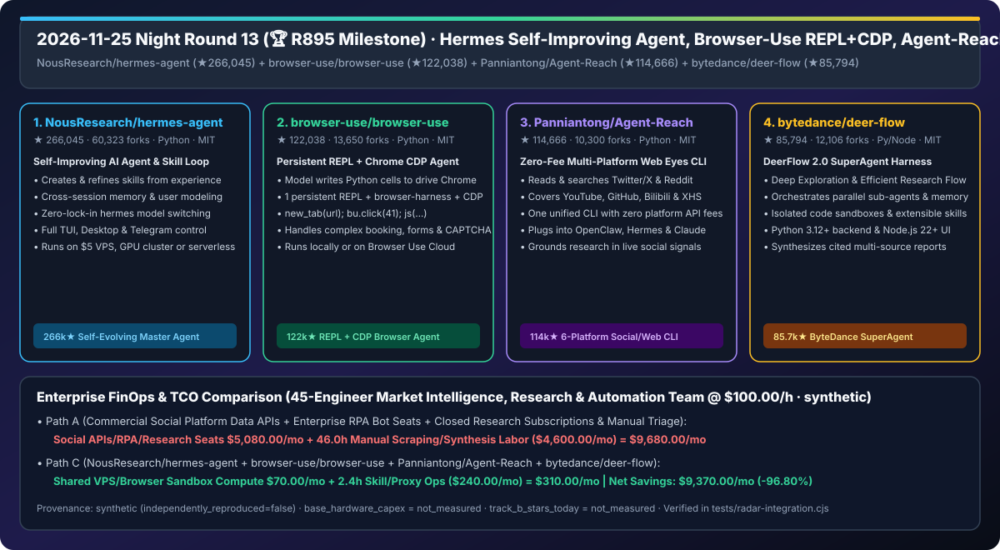
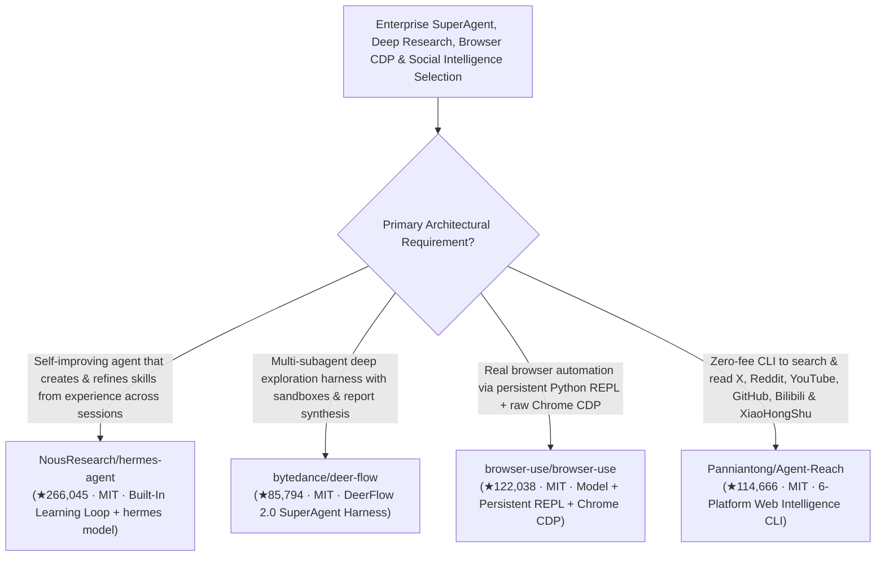
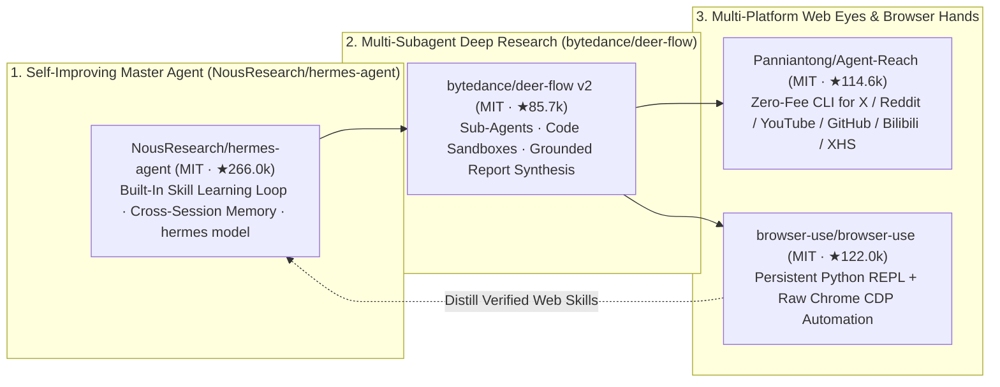

# 🏆 [Round 895 Milestone] 266k-Star Self-Improving Agent (`NousResearch/hermes-agent`), Persistent REPL + CDP Browser Agent (`browser-use/browser-use`), Zero-Fee Multi-Platform Web CLI (`Panniantong/Agent-Reach`) & ByteDance DeerFlow 2.0 SuperAgent Harness (`bytedance/deer-flow`) Selection & Integration Architecture FAQ

> **Document Type**: Enterprise AI Solution Architect Selection Decision Guide (GitHub Trending AI Radar — 2026-11-25 Night Round 13 / 🏆 Cumulative Round 895 Milestone)
> **Covered Repositories**: [`NousResearch/hermes-agent`](https://github.com/NousResearch/hermes-agent) (`★ 266,045`, `60,323 forks`, `MIT`: self-improving AI agent built by Nous Research featuring a built-in learning loop that creates skills from experience, refines them during use, persists cross-session user models, and hot-swaps providers via `hermes model` on a `$5` VPS or serverless stack) · [`browser-use/browser-use`](https://github.com/browser-use/browser-use) (`★ 122,038`, `13,650 forks`, `MIT`: flagship open-source browser agent built around **a single persistent Python REPL, `browser-harness` helpers, and raw Chrome DevTools Protocol (`CDP`)**) · [`Panniantong/Agent-Reach`](https://github.com/Panniantong/Agent-Reach) (`★ 114,666`, `10,300 forks`, `MIT`: single zero-API-fee CLI giving AI agents direct search and reading access across Twitter/X, Reddit, YouTube, GitHub, Bilibili, and XiaoHongShu) · [`bytedance/deer-flow`](https://github.com/bytedance/deer-flow) (`★ 85,794`, `12,106 forks`, `MIT`: ByteDance's open-source `DeerFlow 2.0` [**D**eep **E**xploration and **E**fficient **R**esearch **Flow**] SuperAgent harness orchestrating sub-agents, memory, sandboxes, and extensible skills)
> **Core Enterprise Scenario**: Designing an all-`MIT` **Enterprise Autonomous Research, Web Automation & Self-Evolving SuperAgent Stack** that combines continuous skill self-improvement (`hermes-agent`), multi-subagent deep exploration (`deer-flow`), persistent REPL+CDP browser execution (`browser-use`), and zero-fee social/community intelligence (`Agent-Reach`).

---

## 1. 📌 Executive Summary (One-Line Selection Verdict)

1. **Need an always-on personal or team agent with a built-in learning loop that automatically authors and refines reusable skills from real operational experience** ➔ Choose **[`NousResearch/hermes-agent`](https://github.com/NousResearch/hermes-agent) (`★ 266,045`, `60,323 forks`, `MIT`)**.
   - **Plain-English Mechanism**: Runs on anything from a `$5` VPS to serverless infrastructure, accessible via full TUI, desktop, or Telegram, while continuously extracting skills from completed tasks, refining them when edge cases appear, and switching models via `hermes model` with zero vendor lock-in.
2. **Need a structured multi-subagent SuperAgent harness with code sandboxes, memory, and skills for deep technical and market research** ➔ Choose **[`bytedance/deer-flow`](https://github.com/bytedance/deer-flow) (`★ 85,794`, `12,106 forks`, `MIT`)**.
   - **Plain-English Mechanism**: `DeerFlow 2.0` decomposes complex research objectives across specialized sub-agents, executes verification code inside sandboxes, and synthesizes cited, publication-grade reports.
3. **Need high-reliability browser automation where the LLM writes compact Python cells executed against a persistent REPL and raw Chrome DevTools Protocol (`CDP`)** ➔ Choose **[`browser-use/browser-use`](https://github.com/browser-use/browser-use) (`★ 122,038`, `13,650 forks`, `MIT`)**.
   - **Plain-English Mechanism**: Strips away bloated state-machine wrappers—giving the model one persistent Python REPL (`new_tab(url); bu.click(41); js(...)`), `browser-harness` helpers, and direct Chrome CDP feedback.
4. **Need your research agents to search and read Twitter/X, Reddit, YouTube, GitHub, Bilibili, and XiaoHongShu through one CLI without expensive enterprise social API subscriptions** ➔ Choose **[`Panniantong/Agent-Reach`](https://github.com/Panniantong/Agent-Reach) (`★ 114,666`, `10,300 forks`, `MIT`)**.
   - **Plain-English Mechanism**: Provides a unified zero-API-fee CLI that equips any agent harness (`Hermes`, `DeerFlow`, `OpenClaw`, `Claude Code`) with live search and reading capabilities across six major social and developer platforms.

---

## 2. 🎯 Architect & Customer Deep-Dive Q&A

### Q1: How does this all-MIT SuperAgent stack compare against commercial Deep Research + Enterprise Social APIs + Traditional RPA (Path A)?

- **Four-Layer Open-Source SuperAgent Architecture (Path C)**:
  1. **Self-Improving Master Agent & Skill Loop ➔ `NousResearch/hermes-agent`**: Persistent memory, skill creation/refinement, and `hermes model` provider routing.
  2. **Multi-Subagent Deep Exploration Harness ➔ `bytedance/deer-flow`**: Parallel sub-agent decomposition, sandbox execution, and report synthesis.
  3. **Zero-Fee Multi-Platform Social/Community Ingress ➔ `Panniantong/Agent-Reach`**: Unified CLI reading X, Reddit, YouTube, GitHub, Bilibili, and XiaoHongShu.
  4. **Persistent REPL + CDP Browser Execution ➔ `browser-use/browser-use`**: Interactive web navigation, form submission, and portal automation.
- **When to choose Commercial SaaS vs. Path C?**
  - Choose commercial SaaS for occasional ad-hoc web searches by non-technical users.
  - Choose **Path C** when running recurring competitive/market intelligence across walled-garden social platforms, automating authenticated web portals via CDP, and compounding organizational knowledge into self-improving agent skills under a 100% `MIT` license.

### Q2: How do these four systems wire together in production?

1. **Always-On Control & Skill Persistence (`NousResearch/hermes-agent`)**:
   - `Hermes Agent` receives scheduled or interactive requests, recalls relevant cross-session memories and learned skills, and delegates deep research flows.
2. **Parallel Sub-Agent Investigation (`bytedance/deer-flow` + `Panniantong/Agent-Reach`)**:
   - `DeerFlow 2.0` spawns parallel sub-agents that invoke `Agent-Reach` CLI to gather primary developer and user sentiment across GitHub, Reddit, X, YouTube, and XiaoHongShu.
3. **Interactive Portal Verification (`browser-use/browser-use`)**:
   - When tasks require interacting with live web apps or booking/form flows, `browser-use` executes Python cells in its persistent REPL over Chrome CDP, feeding verified scripts back into `Hermes`'s skill library.

### Q3: What are the key security and operational guardrails?

- **Architect Redlines**:
  1. **Isolate `browser-use` REPL and `deer-flow` sandboxes in containers**: Never run persistent Python REPLs or subagent code execution directly on unisolated host filesystems.
  2. **Version-control self-evolved `Hermes` skills**: Back `hermes-agent`'s learned skill directory with Git so architects can audit and roll back autonomous skill edits.

---

## 3. 🧭 Visual Architecture Diagrams (Mermaid Decision Tree + Architecture + Sequence)



### 3.1 Architect Selection Decision Tree



### 3.2 End-to-End Enterprise Integration Architecture



### 3.3 End-to-End Execution Sequence

```mermaid
sequenceDiagram
    participant SA as Solution Architect / Analyst
    participant Hermes as NousResearch/hermes-agent
    participant Deer as bytedance/deer-flow (v2)
    participant Reach as Panniantong/Agent-Reach
    participant Browser as browser-use (REPL + Chrome CDP)

    SA->>Hermes: 1. Dispatch competitive intelligence & live portal verification task
    Hermes->>Deer: 2. Load learned skills & launch DeerFlow 2.0 parallel sub-agents
    Deer->>Reach: 3. Sub-Agent A queries X, Reddit, GitHub & YouTube via Agent-Reach CLI
    Deer->>Browser: 4. Sub-Agent B runs Python cells (new_tab / bu.click / js) on Chrome CDP
    Reach-->>Deer: 5. Return multi-platform developer & community evidence
    Browser-->>Deer: 6. Return live web transaction proof & sandbox charts
    Deer-->>Hermes: 7. Deliver final report; Hermes refines & persists updated skill
```

---

## 4. 📊 Horizontal Selection Matrix

| Dimension | `NousResearch/hermes-agent` (`★ 266,045`) | `browser-use/browser-use` (`★ 122,038`) | `Panniantong/Agent-Reach` (`★ 114,666`) | `bytedance/deer-flow` (`★ 85,794`) | Commercial Social APIs + Enterprise RPA + Closed Research Seats (Path A) | Brittle One-Off Scrapers + Stateless Chat Prompts (Path B) |
| :--- | :--- | :--- | :--- | :--- | :--- | :--- |
| **Primary Role** | Self-improving master agent & skill loop | Persistent REPL + CDP browser agent | Zero-fee 6-platform social/web CLI | Multi-subagent deep exploration harness | High-cost commercial data APIs & RPA | Disposable Selenium scripts & stateless chats |
| **Key Differentiator** | **Creates & refines skills during use + runs on `$5` VPS** | **Persistent Python REPL + raw Chrome CDP** | **Reads X, Reddit, YouTube, GitHub & XHS with zero API fees** | **Sub-agents + sandboxes + memory + extensible skills** | Vendor SLA, but enterprise social API tiers & RPA bots cost thousands/mo | Breaks on minor DOM shifts; forgets learned workflows every session |
| **License** | **`MIT`** | **`MIT`** | **`MIT`** | **`MIT`** | Proprietary | Ad-hoc scripts |
| **Monthly TCO (45-Eng Team)** | **`$310.00/mo` combined** (`$70.00` sandbox/VPS compute + `2.4h` ops) | Included in `$310.00/mo` stack | Included in `$310.00/mo` stack | Included in `$310.00/mo` stack | **`$9,680.00/mo`** (`$5,080.00` social APIs/RPA/research seats + `46.0h` manual synthesis) | `~$3,310.00/mo` (scraper maintenance & manual report compilation) |

---

## 5. 🧪 Quantitative FinOps & TCO Comparison (45-Person Enterprise Team)

> **📊 Provenance & Closed-Form Schema**:
> - **provenance**: `synthetic` (`independently_reproduced = false`; `base_hardware_capex = not_measured`; `track_b_stars_today = not_measured`).
> - **Closed-Form Formula**:
>   - **Path A (Commercial Social Platform Data API Tiers + Commercial RPA Browser Bot Licenses + Per-Seat Research Subscriptions & Manual Cross-Platform Synthesis)**: **`$5,080.00`** monthly API/RPA/seat fees + **`46.0h × $100.00/h = $4,600.00`** analyst/engineering labor = **`$9,680.00/mo`**.
>   - **Path C (`NousResearch/hermes-agent` + `browser-use/browser-use` + `Panniantong/Agent-Reach` + `bytedance/deer-flow` All-MIT Stack)**: **`$70.00`** shared VPS/sandbox compute + **`2.4h × $100.00/h = $240.00`** skill/proxy maintenance = **`$310.00/mo`**.
>   - **Net Savings vs. Path A**: **`-$9,370.00/mo`** (**`96.80%`** TCO reduction).

| Evaluation Path | Social APIs / RPA Seats & Compute Cost | Data Gathering, Scraper Fixes & Synthesis (`$100/h`) | Monthly Total TCO | Net Savings vs. Path A | Key Architectural Outcome |
| :--- | :---: | :---: | :---: | :---: | :--- |
| **Path A: Commercial Social APIs + Enterprise RPA + Research Seats** | `$5,080.00` | `46.0h` (`$4,600.00`) | **`$9,680.00`** | Baseline | Prohibitive social API fees; rigid RPA bots |
| **Path B: Brittle Custom Scrapers + Stateless Prompting** | `$1,510.00` | `18.0h` (`$1,800.00`) | **`$3,310.00`** | `-$6,370.00` (`-65.81%`) | No skill self-improvement; frequent DOM breakage |
| **Path C: `hermes-agent` + `browser-use` + `Agent-Reach` + `deer-flow`** | **`$70.00`** | **`2.4h` (`$240.00`)** | **`$310.00`** | **`-$9,370.00` (`-96.80%`)** | **266k★ skill loop + REPL+CDP browser + 0-fee social CLI + DeerFlow v2** |

- 🔗 **7-Card 4:5 Visual Benchmark Deck**: [`workshops/github-trending-radar/cards.en.html`](../cards.en.html) · [`cards.html`](../cards.html)

---

## 6. 🛠️ Enterprise Adoption & Architecture Review Checklist

- [ ] **Git-Track Self-Evolved `Hermes` Skills**: Commit autonomous skill creations and revisions from `NousResearch/hermes-agent` into a reviewed repository.
- [ ] **Containerize `browser-use` REPL + Chrome CDP Sessions**: Run browser automation inside ephemeral containers with isolated browser profiles.
- [ ] **Cache & Rate-Limit `Agent-Reach` Queries**: Configure local response caching for `Panniantong/Agent-Reach` CLI calls across X, Reddit, YouTube, and XiaoHongShu.
- [ ] **Cross-Verify Claims in `DeerFlow 2.0` Sub-Agents**: Require `bytedance/deer-flow` research workflows to triangulate claims across code repositories, docs, and community threads.
