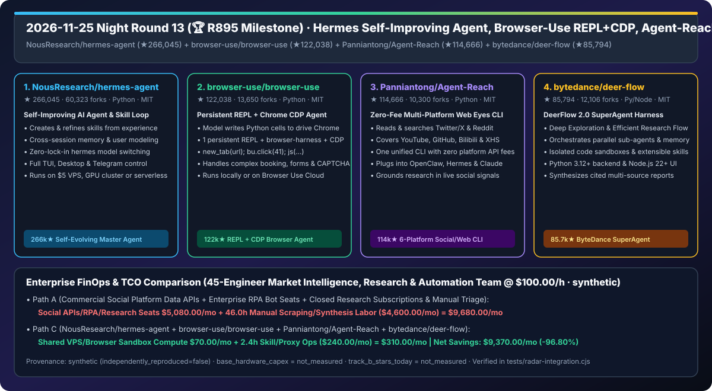
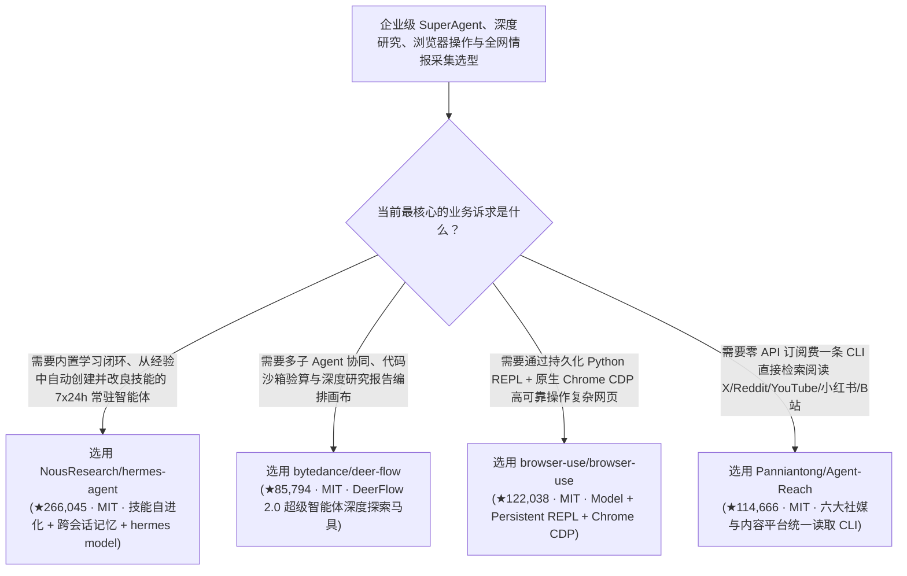
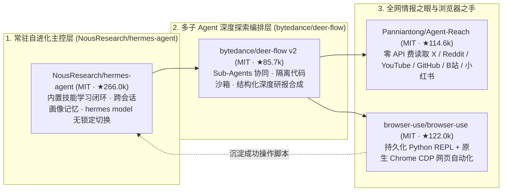
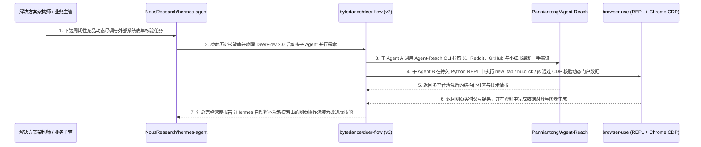

# 🏆【第 895 轮里程碑】26.6 万星经验自进化智能体（`NousResearch/hermes-agent`）、持久化 REPL + CDP 浏览器智能体（`browser-use/browser-use`）、零 API 费全平台互联网触手 CLI（`Panniantong/Agent-Reach`）与字节跳动 DeerFlow 2.0 深度探索超级智能体马具（`bytedance/deer-flow`）选型与集成架构 FAQ

> **文档类型**：企业 AI 解决方案架构师（AI Solution Architect）选型决策指南（GitHub Trending AI 雷达 2026-11-25 Night Round 13 / 🏆 累计第 895 轮里程碑）
> **覆盖项目**：[`NousResearch/hermes-agent`](https://github.com/NousResearch/hermes-agent)（`★ 266,045`、`60,323 forks`、`MIT`：由 Nous Research 打造的 26.6 万星自进化智能体，唯一内置闭环学习回路——从实战经验中自动创建技能、在使用中迭代改良技能、检索历史对话并建立深度用户画像，支持 `$5` VPS/无服务器部署与 `hermes model` 零锁定模型热切）· [`browser-use/browser-use`](https://github.com/browser-use/browser-use)（`★ 122,038`、`13,650 forks`、`MIT`：12.2 万星开源浏览器智能体标杆，最新架构采用**“单一持久化 Python REPL + `browser-harness` 辅助函数 + 原生 Chrome DevTools Protocol (`CDP`)”**极简范式：`new_tab(url); bu.click(41); js(...)`）· [`Panniantong/Agent-Reach`](https://github.com/Panniantong/Agent-Reach)（`★ 114,666`、`10,300 forks`、`MIT`：11.4 万星零 API 订阅费互联网阅读与搜索 CLI，让智能体直接检索并阅读 X/Twitter、Reddit、YouTube、GitHub、Bilibili 与小红书）· [`bytedance/deer-flow`](https://github.com/bytedance/deer-flow)（`★ 85,794`、`12,106 forks`、`MIT`：字节跳动开源的 `DeerFlow 2.0` 深度探索与高效研究超级智能体马具，协同调度子智能体（Sub-Agents）、长期记忆、代码执行沙箱与可扩展技能）
> **核心场景**：当企业构建“7×24 小时自主市场情报调研、竞品动态监控、复杂网页表单自动办理与长周期深度研究报告生成”超级智能体（SuperAgent）时，架构师面临四个核心选型问题：**“如何让智能体不局限于单次任务、而是在每次执行后自动把成功经验沉淀为可进化技能（`hermes-agent`）？需要分派多子 Agent 进沙箱写代码并合成万字深度研报时用什么马具（`deer-flow`）？如何以最低 Token 与最高稳定性操作带登录态/验证码的复杂业务网页（`browser-use` REPL+CDP）？如何免去高昂的社交媒体商业 API 账单直接读取 X/Reddit/YouTube/小红书一手舆情（`Agent-Reach`）？”** 本文给出四大顶流项目的组合架构与云服务选型指南。

---

## 一、📌 核心结论速览（选型一句话结论）

1. **需要一个能常驻在低成本云主机（`$5` VPS 或容器）上、支持通过移动端 IM 随时唤醒、且自带“从实战经验中自动创建和改良技能（Skill Self-Improvement）”闭环的常驻主智能体** ➔ 选 **[`NousResearch/hermes-agent`](https://github.com/NousResearch/hermes-agent)（`★ 266,045`，`60,323 forks`，`MIT`）**。
   - **通俗原理**：绝大多数 Agent 每次新开会话都是“从零开始的实习生”。`Hermes Agent` 内置主动学习环路：每完成一次复杂排障或业务流程，它会主动把步骤提炼为技能文件，下次遇到同类任务直接复用并根据新报错自动修正技能；且支持 `hermes model` 一键在 OpenAI、Anthropic、OpenRouter 与企业私有端点间无缝切换。
2. **需要一套专为“长周期深度探索、子智能体分工、沙箱代码验证与多模态报告合成”设计的企业级 SuperAgent 马具** ➔ 选 **[`bytedance/deer-flow`](https://github.com/bytedance/deer-flow)（`★ 85,794`，`12,106 forks`，`MIT`）**。
   - **通俗原理**：`DeerFlow 2.0`（Deep Exploration and Efficient Research Flow）采用 Python 3.12+ 后端与 Node.js 22+ 现代前端画布，将复杂课题自动拆解给多个并行子智能体（Sub-Agents），配合隔离沙箱、记忆层与可插拔技能体系，一步到位生成带数据图表与引用溯源的深度研究交付物。
3. **需要让 Agent 像真人一样在真实 Chrome 浏览器中完成复杂多步操作（如预约排期、跨系统填报、B2B 门户询价），且追求极简高可靠的 REPL + CDP 架构** ➔ 选 **[`browser-use/browser-use`](https://github.com/browser-use/browser-use)（`★ 122,038`，`13,650 forks`，`MIT`）**。
   - **通俗原理**：告别每一小步都要重新序列化整个冗长状态机的笨重设计。`Browser Use` 将整个浏览器 Agent 浓缩为 **“模型 + 一个持久化 Python REPL + 原生 Chrome CDP”**：模型直接写一小段 Python 单元格代码（如 `new_tab(url); bu.click(41); js(...)`）在持久 REPL 中贴着 Chrome CDP 执行并立即拿到回显，既省 Token 又快。
4. **需要让研究与舆情 Agent 直接读取和搜索 X/Twitter、Reddit、YouTube、GitHub、Bilibili 与小红书的最新帖子与评论，且不想支付每年数万美元的各平台商业 API 订阅费** ➔ 选 **[`Panniantong/Agent-Reach`](https://github.com/Panniantong/Agent-Reach)（`★ 114,666`，`10,300 forks`，`MIT`）**。
   - **通俗原理**：把六大国内外核心技术与社媒内容平台的检索与正文提取封装成单一零 API 费用的命令行工具（CLI），一行命令即可挂载到任何智能体或 OpenClaw/Hermes/DeerFlow 环境里，补齐大模型“看不见围墙花园社媒内容”的短板。

---

## 二、🎯 客户与架构师灵魂拷问 Q&A（深度架构拆解）

### Q1：在企业构建“主动式情报研究与跨系统网页操作 SuperAgent”时，这四个开源项目 vs 商业深度研究/RPA 平台（如 OpenAI Deep Research / Perplexity Enterprise + UiPath）怎么选？

- **四层协同参考架构（Path C）**：
  1. **常驻自进化主控与技能记忆面 ➔ `NousResearch/hermes-agent`**：7×24 小时常驻运行，管理跨会话用户偏好并将成功工作流沉淀为自改良技能。
  2. **多子 Agent 深度探索与沙箱合成面 ➔ `bytedance/deer-flow`**：负责将复杂调研课题拆解给并行子 Agent，在代码沙箱中验算数据并输出结构化研报。
  3. **全网社媒与社区零成本采集面 ➔ `Panniantong/Agent-Reach`**：一行 CLI 打通 X、Reddit、YouTube、GitHub、B站与小红书一手信源。
  4. **真实浏览器交互执行面 ➔ `browser-use/browser-use`**：通过持久 Python REPL + Chrome CDP 执行需要登录、点按与表单提交的动态网页任务。
- **何时选商业 SaaS 方案 vs 自建本轮开源四件套（Path C）？**
  - 若业务人员仅做偶尔的公开网页信息速览，直接使用 **Perplexity Enterprise Pro / M365 Researcher** 最省事。
  - **何时采用本轮开源四件套（Path C）？** 当企业需要**对接内部私有知识库与内网登录态业务系统**、高频抓取分析 X/Reddit/小红书/YouTube 行业情报、并要求智能体把每次排障或操作经验沉淀为企业自有 `SKILL.md` 资产时，全 `MIT` 协议的 Path C 可节省 **96%+** 的商业 API 与 RPA 席位成本。

### Q2：如何把这四个项目集成进企业生产环境？

1. **统一入口与技能自进化中枢（`NousResearch/hermes-agent`）**：
   - 部署 `Hermes Agent` 作为团队常驻主控，接入企业 IM 或桌面端，通过 `hermes model` 对接企业内部 AI 网关。
2. **深度研究子工作流（`bytedance/deer-flow` + `Panniantong/Agent-Reach`）**：
   - 当收到竞品尽调、技术选型或市场與情分析任务时，`Hermes` 唤醒 `DeerFlow 2.0` 多子 Agent 编排流，子 Agent 调用 `Agent-Reach` CLI 并发拉取 GitHub/X/Reddit/YouTube/小红书实证数据并在沙箱中交叉核验。
3. **动态网页表单与系统操作（`browser-use/browser-use`）**：
   - 当需要进入外部供应商门户或未开放 API 的遗留 Web 系统执行查询/录入时，调用 `browser-use` 的持久 Python REPL + Chrome CDP 完成高可靠浏览器交互，并将打通的页面操作脚本回写为 `Hermes` 可复用技能。

### Q3：生产落地的合规与安全红线是什么？

- **架构师避坑红线**：
  1. **浏览器 REPL 与代码沙箱隔离**：`browser-use` 的持久化 Python REPL 与 `deer-flow` 的代码沙箱必须运行在受限容器或微虚拟机（MicroVM）中，禁止挂载宿主机敏感凭证目录。
  2. **外部采集频率与robots/平台合规控制**：在使用 `Panniantong/Agent-Reach` 采集社媒与社区公开内容时，应在企业出口网关配置合理的请求速率限制与缓存层，仅用于内部情报分析而不做未授权商业转售。

---

## 三、🧭 直观可视化图解（Mermaid 决策树 + 集成架构 + 时序图）

### 3.1 架构师选型决策树

### 3.2 企业端到端生产集成参考架构图

### 3.3 全网情报采集、浏览器 REPL 操作、DeerFlow 合成与 Hermes 技能自进化时序图

---

## 四、📊 同类开源与商业云服务横向选型决策矩阵

| 对比维度 | `NousResearch/hermes-agent` (`★ 266,045`) | `browser-use/browser-use` (`★ 122,038`) | `Panniantong/Agent-Reach` (`★ 114,666`) | `bytedance/deer-flow` (`★ 85,794`) | 商业社媒 API + 商业 RPA 席位 + 闭源研究订阅 (Path A) | 脆弱一次性爬虫脚本 + 无技能沉淀单轮对话 (Path B) |
| :--- | :--- | :--- | :--- | :--- | :--- | :--- |
| **核心能力定位** | 内置技能自进化闭环的常驻主智能体 | 持久 Python REPL + Chrome CDP 浏览器 Agent | 零 API 费六大社媒/社区检索阅读 CLI | 字节跳动多子 Agent 深度探索与研究马具 | 高价商业数据 API 与传统 RPA 软件组合 | 每次重写一次性 Selenium 脚本 |
| **差异化杀手锏** | **自动从经验中创建并迭代改良技能 + `$5` VPS 可跑** | **Model + 持久 REPL + CDP 极简高效操作网页** | **免高昂平台 API 费直读 X/Reddit/YouTube/小红书** | **Sub-Agents + 沙箱 + 记忆 + 技能深度研究闭环** | 官方 SLA 保障，但企业级社媒 API 与 RPA 牌照极贵 | 网页微调即崩；每次新会话都要重新摸索相同步骤 |
| **开源协议** | **`MIT`** | **`MIT`** | **`MIT`** | **`MIT`** | 闭源商业授权 | 散装脚本 |
| **月度 TCO（45 人团队）** | **四件套全 `MIT` 合建仅 `$310.00/月`**（`$70.00` 容器/浏览器沙箱算力 + `2.4h` 维护） | 同左（持久 REPL 大幅减少网页交互轮次） | 同左（直接省去高昂社媒商业 API 订阅费） | 同左（私有化无限次生成深度研究报告） | **`$9,680.00/月`**（`$5,080.00` 商业社媒 API/RPA 与研究席位 + `46.0h` 人工采集整理） | 约 `$3,310.00/月`（反复重写失效爬虫与手工汇总报告工时） |

---

## 五、🧪 应用落地定量收益/TCO 对比与 7-Card 报告

> **📊 数据来源与闭式核算声明（Provenance & Closed-Form Schema）**：
> - **provenance**: `synthetic`（基于 45 人企业战略研究、产品市场情报与业务自动化团队月度工作负载模型：`independently_reproduced = false`；硬件采购基线 `base_hardware_capex = not_measured`；Track B 单日增量 `track_b_stars_today = not_measured`）。
> - **核算公式**：
>   - **Path A（采购高价商业社交媒体数据 API 套餐 + 商业 RPA 浏览器自动化按机器人计费席位 + 商业 Deep Research 席位与人工跨平台汇总）**：月度商业社媒 API、RPA 许可与研究订阅费 **`$5,080.00`** + 跨平台手工检索、脚本修复与报告排版人工 **`46.0h × $100.00/h = $4,600.00`** = **`$9,680.00/月`**。
>   - **Path C（自建 `NousResearch/hermes-agent` + `browser-use/browser-use` + `Panniantong/Agent-Reach` + `bytedance/deer-flow` 全 `MIT` 超级智能体底座）**：轻量 VPS 与无头浏览器容器算力分摊 **`$70.00`** + 技能库与代理池日常看护人工 **`2.4h × $100.00/h = $240.00`** = **`$310.00/月`**。
>   - **净节省（Net Savings vs Path A）**：**`-$9,370.00/月`**（成本降低 **`96.80%`**）。

| 评估方案 | 商业社媒 API / RPA 席位与算力成本 | 情报采集、脚本修复与报告合成人工（`$100/h`） | 月度总 TCO | 相对 Path A 净节省 | 核心业务交付收益 |
| :--- | :---: | :---: | :---: | :---: | :--- |
| **Path A：商业社媒 API + 商业 RPA 席位 + 人工跨平台整理** | `$5,080.00` | `46.0h` (`$4,600.00`) | **`$9,680.00`** | Baseline | 商业社媒 API 年费高昂；传统 RPA 对动态网页适应性差 |
| **Path B：手写一次性爬虫 + 单轮对话手工拼凑研报** | `$1,510.00` | `18.0h` (`$1,800.00`) | **`$3,310.00`** | `-$6,370.00` (`-65.81%`) | 无技能自进化能力，每次任务重复踩坑；缺乏多子 Agent 沙箱协同 |
| **Path C：`hermes-agent` + `browser-use` + `Agent-Reach` + `deer-flow`** | **`$70.00`** | **`2.4h` (`$240.00`)** | **`$310.00`** | **`-$9,370.00` (`-96.80%`)** | **26.6万星自进化主控 + REPL+CDP 浏览器 + 零费全网触手 + 深度研究流** |

- 🔗 **关联 7-Card 4:5 视觉评测报告**：[`workshops/github-trending-radar/cards.html`](../cards.html) · [`cards.en.html`](../cards.en.html)

---

## 六、🛠️ 企业引入与架构评审 Checklist

- [ ] **启用 `Hermes Agent` 技能自进化版本控制**：将 `NousResearch/hermes-agent` 自动生成与迭代修改的技能目录纳入 Git 版本管理，便于团队共享与回滚。
- [ ] **在隔离容器内运行 `browser-use` REPL + Chrome CDP**：为每个 `browser-use` 任务分配独立的临时浏览器 Profile，任务结束后自动清理敏感 Cookie。
- [ ] **配置 `Agent-Reach` 采集速率与结果缓存**：在调用 `Panniantong/Agent-Reach` 检索 X/Reddit/YouTube/小红书时开启本地结果缓存，避免同一话题短时间内重复抓取。
- [ ] **使用 `DeerFlow 2.0` 多子 Agent 交叉核验事实**：在生成高管决策报告时，配置 `bytedance/deer-flow` 的子智能体分别从官方公告、代码库（GitHub）与社区反馈（Reddit/X）三路独立取证。
