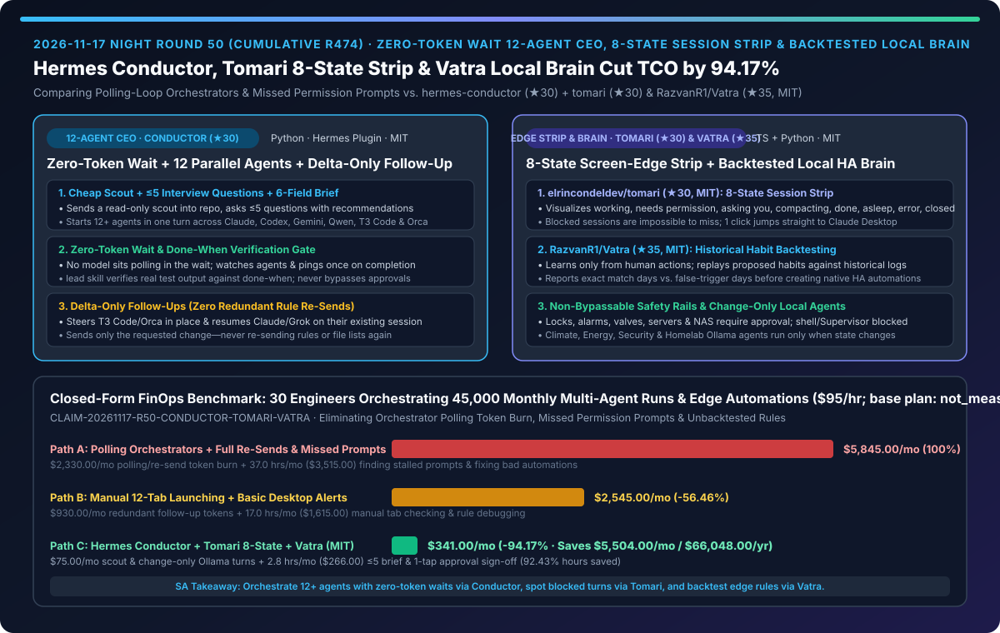
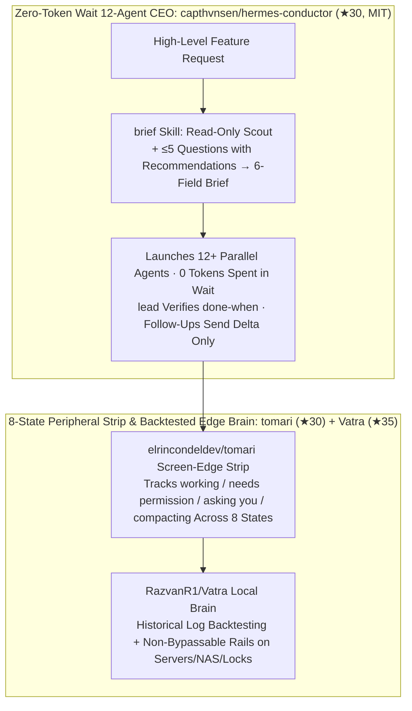

# Zero-Token Wait 12-Agent CEO (`capthvnsen/hermes-conductor`), 8-State Screen-Edge Session Strip (`elrincondeldev/tomari`) & Backtested Local Home/Homelab Brain (`RazvanR1/Vatra`) Selection FAQ

> **Document Type**: Enterprise AI Solution Architect Practical Selection Guide (Standard 6-Section FAQ)  
> **Shift & Round**: 2026-11-17 Night Round 50 (Cumulative Round 474)  
> **Tracked Repositories**:
> - **`capthvnsen/hermes-conductor`** (`★ 30`, Python / Hermes Agent `brief` + `lead` Plugin Orchestrating 12+ Parallel Coding Agents, `MIT`): Sends a cheap read-only scout into the repo, asks at most 5 questions with recommendations, compiles a 6-field brief, and launches **12+ parallel coding agents in a single turn** across Claude Code, Codex, Gemini, Qwen, T3 Code, and Orca—with **zero model tokens spent during the wait, delta-only follow-ups, and zero approval-bypass flags**
> - **`elrincondeldev/tomari`** (`★ 30`, TypeScript / macOS 14+ Screen-Edge 8-State Session Strip for Claude Code, `MIT`) & **`RazvanR1/Vatra`** (`★ 35`, Python `v2.7.1` / Local Brain for Home Assistant with Historical Habit Backtesting & Non-Bypassable Safety Rails, `MIT`): Floating screen-edge strip displaying one animated indicator per Claude Code session across **8 states (`working`, `needs permission`, `asking you`, `compacting`, `done`, `asleep`, `error`, `closed`)** (`tomari`), paired with a 100% local automation brain that **backtests proposed habits on historical logs** before asking for approval and enforces **non-bypassable safety rails** on servers, NAS, locks, and alarms (`Vatra`)  
> **Audit Claim ID**: `CLAIM-20261117-R50-CONDUCTOR-TOMARI-VATRA` (base LLM subscriptions marked `not_measured`)

---

## 📌 1. Executive Summary

1. **Why Engineering Teams Running 10+ Parallel Coding Agents and Edge/Homelab Automations Hit Three Expensive Bottlenecks: Polling-Loop Token Burn, Hidden Permission Stalls, and Unbacktested Automation Rules**:
   - **Bottleneck 1 — Orchestrator Polling Loops & Redundant Follow-Up Context**: Naive multi-agent supervisors keep a frontier model polling in a loop while worker agents run, and re-send the entire system ruleset and file list on every minor follow-up turn.
   - **Bottleneck 2 — Blocked Sessions Hidden Behind Overlapping Windows**: When running 8–12 Claude Code sessions across desktop and terminal tabs, a session blocked on `needs permission` or `asking you` can sit idle for 30 minutes because the developer never noticed it.
   - **Bottleneck 3 — Edge/Homelab AI Automations Without Historical Backtesting or Hard Safety Rails**: Letting an LLM generate smart-space or homelab rules without replaying them against historical event logs first causes false triggers and feedback loops, while weak guardrails risk unauthorized server/NAS power actions or shell execution.
   - **The Solution Architect Stack (`hermes-conductor` MIT + `elrincondeldev/tomari` MIT + `RazvanR1/Vatra` MIT)**: Orchestrate 12+ parallel coding agents through **`capthvnsen/hermes-conductor`** (`MIT`, combining a cheap read-only scout, `≤5` interview questions, zero-token waits, `done-when` verification, and delta-only follow-ups); pin **`elrincondeldev/tomari`** (`npx tomari setup`) to the screen edge for instant 8-state peripheral awareness; and govern physical/homelab environments with **`RazvanR1/Vatra`** (`MIT`, backtesting habits on historical logs before proposing native automations and enforcing non-bypassable approval rails on servers, NAS, locks, and valves).
2. **Closed-Form FinOps Impact (30 Full-Stack, IoT & Platform Engineers Orchestrating 45,000 Monthly Multi-Agent Runs, Multi-Session Workflows & Edge Automations at `$95.00/hr`)**:
   - Migrating from **Path A (Polling-Loop Orchestrator Burn + Full-Context Re-Sends, Missed Permission Prompts & Unbacktested Edge Rules at `$5,845.00/mo`)** to **Path C (`hermes-conductor` + `tomari` + `Vatra` Stack at `$341.00/mo`)** saves **`$5,504.00/mo` (`-94.17%`, or `$66,048.00/yr`)** while cutting stalled-session waiting and automation debugging labor from `37.0 hrs/mo` to `2.8 hrs/mo` (**`92.43%` reduction**).

---

## 💬 2. Core Architectural Q&A (Q1–Q3)

### Q1: How does `capthvnsen/hermes-conductor` orchestrate 12+ parallel coding agents with a zero-token wait and delta-only follow-ups?
- **Plain-Language Definition**: `hermes-conductor` (`MIT`) is **a Hermes Agent plugin (`brief` + `lead` skills) that turns Hermes into the CEO of your coding agents—fanning out 12+ parallel runs across any CLI/ADE while spending zero model tokens during the wait**.
- **Four Core Workflow Guarantees**:
  1. **Cheap Read-Only Scout + `≤5` Questions + 6-Field Brief**: Sends a low-cost read-only scout into the repository, asks one round of at most 5 questions (each with a recommended answer), and builds a 6-field kickoff brief enforcing minimal changes and real verification output;
  2. **12+ Parallel Agents with Zero-Token Wait**: Launches one agent per feature in the same turn (across Claude Code, Codex, Hermes, Grok, Cursor, OpenCode, Gemini, Qwen, Copilot, T3 Code, and Orca, or hierarchical `lead: true` CTO subagents) while **no model sits in the wait**—a lightweight watcher posts a single message when each agent finishes;
  3. **`done-when` Verification & Delta-Only Follow-Ups**: Compares every agent's verification output against `done-when` criteria and sends *only* the requested delta on follow-up turns without repeating rules or file lists;
  4. **Zero Approval-Bypass Flags**: Never injects dangerous permission-bypass flags into child coding agents.

### Q2: How does `elrincondeldev/tomari` eliminate stalled-session blindness across Claude Code Desktop and CLI?
- **8-State Screen-Edge Peripheral Strip (`npx tomari setup`, `MIT`, macOS 14+)**:
  - Wires lifecycle hooks into `~/.claude/settings.json` (after automatic backup) and renders one animated creature per session along the screen edge across **8 states: `working`, `needs permission`, `asking you`, `compacting`, `done`, `asleep`, `error`, and `closed`**;
  - Sessions blocked on `needs permission` or `asking you` stand out immediately, and clicking any indicator opens that exact session in the Claude desktop app.

### Q3: How does `RazvanR1/Vatra` enforce historical backtesting and non-bypassable safety rails on edge and homelab automations?
- **Three Production-Grade Edge AI Mechanisms (`v2.7.1`, `MIT`, 100% Local)**:
  1. **Human-Only Habit Learning + Historical Backtesting**: Learns time and sequence habits strictly from human actions (ignoring automation-triggered events) and **replays every candidate habit against historical logs**—reporting on how many days the rule would have matched your exact action vs. fired unnecessarily—before creating a native, undoable automation (`home_brain_...`);
  2. **Non-Bypassable Safety Rails**: Locks, alarms, valves, gates, boilers, fridges, **servers, and NAS devices** always require explicit approval (`Approve / Always / Reject / Undo`); shell commands, Supervisor calls, system restarts, and out-of-bounds temperatures are blocked outright;
  3. **Change-Triggered Local Ollama Agents**: Climate, Energy, Security, and Server/Homelab agents run on a single local model *only when state changes*, compiling findings into a single evening digest.

---

## 🧭 3. End-to-End Reference Architecture & Decision Tree (Mermaid)

---

## 📊 4. Peer Solution Comparison Matrix (Decision Matrix)

| Evaluation Dimension | Option A: Polling Orchestrators + Hidden Prompts + Unbacktested Rules | Option B: Manual 12-Tab Launching + Generic OS Notifications | **Option C (Recommended): `hermes-conductor` + `tomari` + `RazvanR1/Vatra` (MIT)** |
| :--- | :--- | :--- | :--- |
| **Multi-Agent Wait & Follow-Up Token Efficiency** | ❌ Polling loops burn tokens; follow-ups re-send full rules & file lists | ⚠️ Manual copy-pasting across 12 terminal tabs | ✅ **Zero-token wait + `done-when` check + delta-only follow-ups (no bypass flags)** |
| **Visibility of Blocked (`needs permission` / `asking you`) Sessions** | ❌ Blocked sessions sit unnoticed behind windows for 30+ mins | ⚠️ Ephemeral toast notifications disappear if missed | ✅ **Persistent 8-state screen-edge strip with 1-click jump to Claude Desktop** |
| **Edge/Homelab Automation Validation & Safety** | ❌ Unvalidated rules trigger feedback loops or unsafe server actions | ⚠️ Manual YAML threshold tuning | ✅ **Human-only learning, historical log backtesting & non-bypassable server/NAS rails** |
| **Monthly TCO (30 Engineers / 45,000 Runs)** | **`$5,845.00 / mo`** (`$2,330` polling/re-send burn + `37.0 hrs` stalls/fixes) | **`$2,545.00 / mo`** (`$930` redundant tokens + `17.0 hrs` manual checks) | **`$341.00 / mo`** (**`-94.17%` savings**; `$75` scout/local turns + `2.8 hrs` sign-off) |

---

## 🧮 5. 7-Card Quantitative Insights & Closed-Form FinOps (`CLAIM-20261117-R50-CONDUCTOR-TOMARI-VATRA`)

> **Scope & Boundary Declaration**: Evaluated for a 30-engineer full-stack, IoT, and platform organization executing **45,000 monthly multi-agent feature builds, multi-session desktop workflows, and local edge/homelab automations** at a blended engineering rate of `$95.00/hr` (base LLM subscriptions marked `not_measured`):

$$\text{Total Monthly TCO} = \text{Orchestrator Polling \& Rule Re-Send Token Spend} + (\text{Stalled-Prompt Wait \& Rule Debug Hours} \times \$95.00)$$

| Cost Component | Path A: Polling Loops + Missed Prompts | Path B: Manual Tabs + Generic Alerts | **Path C: `conductor` + `tomari` + `Vatra`** |
| :--- | :---: | :---: | :---: |
| **Monthly Orchestrator Polling & Redundant Follow-Up Spend** | `$2,330.00` | `$930.00` | **`$75.00`** |
| **Monthly Stalled-Session Wait, Tab Triage & Rule Debug Hours** | `37.0 hrs` | `17.0 hrs` | **`2.8 hrs`** (**`92.43%` reduction**) |
| **Monthly Full-Stack & Platform Engineering Labor (`@ $95.00/hr`)** | `$3,515.00` | `$1,615.00` | **`$266.00`** |
| **Total Monthly TCO** | **`$5,845.00`** | **`$2,545.00`** (`-56.46%`) | **`$341.00`** (**`-94.17%`**) |
| **Net Savings vs. Path A (Monthly / Annual)** | Baseline (`$0.00`) | `$3,300.00 / mo` (`$39,600/yr`) | **`$5,504.00 / mo` (`$66,048.00 / yr`)** |

---

## ✅ 6. Solution Architect Action Checklist

- [ ] **Step 1 — Install `capthvnsen/hermes-conductor` (`brief` + `lead` Skills)**: Use the read-only scout and `≤5`-question interview to generate 6-field briefs, fan out 12+ parallel agents with zero-token waits, and send delta-only follow-ups.
- [ ] **Step 2 — Run `npx tomari setup` on macOS Workstations**: Pin active Claude Code sessions to the right-edge 8-state strip so `needs permission` and `asking you` blockers are resolved immediately.
- [ ] **Step 3 — Deploy `RazvanR1/Vatra` for Local Homelab & Smart-Space Automation**: Require every proposed automation to pass historical log backtesting before enabling it as a native `home_brain_...` rule.
- [ ] **Step 4 — Verify Hard-Coded Physical & Infrastructure Safety Rails**: Ensure servers, NAS units, locks, and valves remain gated behind explicit human approval and that shell/Supervisor execution stays blocked.
