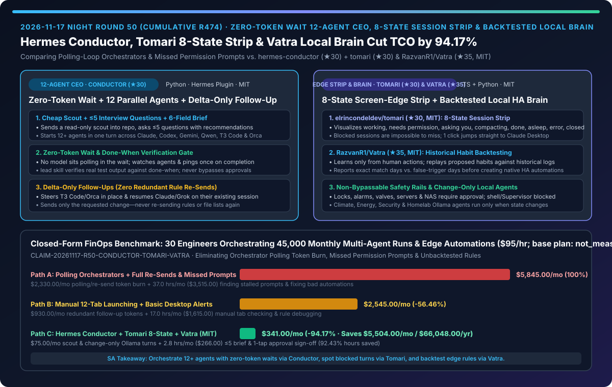
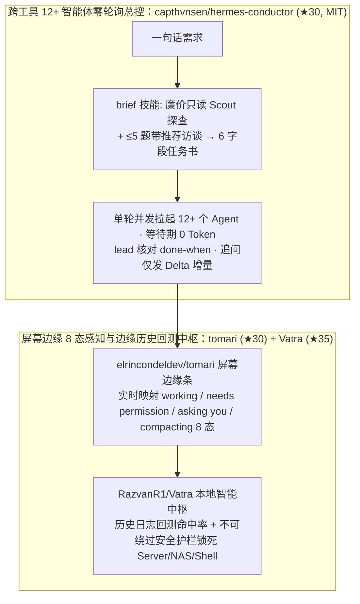

# 零 Token 等待 12 智能体总指挥（`capthvnsen/hermes-conductor`）与屏幕边缘 8 状态会话感知条及历史回测本地智能中枢（`elrincondeldev/tomari` & `RazvanR1/Vatra`）架构选型 FAQ

> **文档类型**：AI Solution Architect（AI 解决方案架构师）实战选型指南（六段式标准 FAQ）  
> **所属轮次**：2026-11-17 Night Round 50（Cumulative Round 474）  
> **追踪目标**：
> - **`capthvnsen/hermes-conductor`**（`★ 30`，Python / Hermes Agent `brief` + `lead` 双技能插件，支持单轮并发调度 12+ 个跨工具 Coding Agent，`MIT`）：先派廉价只读 Scout 探查仓库并提出 `≤5` 个带推荐答案的问题，生成 6 字段任务书后单轮并发拉起 12+ 个 Agent（Claude Code, Codex, Gemini, Qwen, T3 Code, Orca 等），**等待期间 0 Token 消耗、绝不添加跳过审批危险参数、且后续追问只发增量变更不重复发规则与文件列表**
> - **`elrincondeldev/tomari`**（`★ 30`，TypeScript / macOS 屏幕边缘 8 状态 Claude Code 会话精灵条，`MIT`）& **`RazvanR1/Vatra`**（`★ 35`，Python `v2.7.1` / 带历史日志回测与不可绕过安全护栏的 Home Assistant 本地大脑，`MIT`）：将每个 Claude Code 会话映射为屏幕边缘 **`working / needs permission / asking you / compacting / done / asleep / error / closed` 八态动画图标** 并一键唤醒桌面的 `tomari`，配合仅从人类真实操作学习习惯、**先在历史记录上回测命中天数与误触发天数再提议自动化**且硬锁高危设备审批的 `Vatra`  
> **计量审计 ID**：`CLAIM-20261117-R50-CONDUCTOR-TOMARI-VATRA`（底层大模型基础订阅标记为 `not_measured`）

---

## 📌 一、核心结论速览（Executive Summary）

1. **为什么企业研发团队与边缘智能/物联网（IoT/Homelab）架构师在推进“12+ 并行 Coding Agent 协同交付”、“多会话桌面状态监控”与“边缘设备智能自动化”时，常掉进“总控 Agent 轮询子任务时白烧大量等待 Token、追问修改时又把整套规则和文件列表重发一遍”、“后台某个 Claude Code 会话卡在 `needs permission` 半小时没人看见”、以及“AI 乱写边缘自动化规则没有历史回测和硬件安全死锁”三大陷阱？**
   - **陷阱一：轮询式总控（Polling Orchestrator）与全量重发规则的 Token 黑洞**：很多多智能体框架让主控大模型每隔几十秒去轮询子 Agent 状态，且在子 Agent 需要微调时把长达几千字的规则和文件清单重新发一遍。
   - **陷阱二：多会话“卡权限/等回答”隐形停工**：当开发者同时挂着 8–12 个会话，哪一个正在自动压缩（`compacting`）、哪一个正卡在 `needs permission` 或 `asking you` 等待人工点击，藏在层层窗口后面根本看不见。
   - **陷阱三：无历史回测（No Backtesting）与无物理安全护栏的边缘自动化**：直接让大模型生成智能家居或机房服务器自动化规则，不仅会把自动化自身触发的动作误当成人类习惯陷入死循环，还可能在未评估历史误报率的情况下误关服务器/NAS 或越权执行 Shell。
   - **架构师黄金组合（`hermes-conductor` MIT + `elrincondeldev/tomari` MIT + `RazvanR1/Vatra` MIT）**：在跨工具多 Agent 编排层部署 **`capthvnsen/hermes-conductor`**（廉价只读 Scout 探路 + `≤5` 题访谈 + 12 路并发执行 + **等待期间 0 模型驻留 0 Token 消耗** + 追问仅发增量 Delta + 严禁添加跳过权限参数）；在开发者桌面边缘安装 **`elrincondeldev/tomari`**（`npx tomari setup` 在屏幕右侧常驻 8 状态可视感知条，卡权限或提问会话一眼锁定、单击直达）；在边缘与机房/智能空间部署 **`RazvanR1/Vatra`**（仅从人类操作学习、先在历史日志上回测“多少天精准命中 vs 多少天多余触发”、硬封锁 Shell/Supervisor 调用并对门锁/阀门/服务器/NAS 强制人工审批）。
2. **闭式 FinOps 量化收益（30 名全栈、物联网与平台工程师，每月执行 45,000 次多 Agent 协同构建、多会话桌面跟进与边缘智能自动化，综合时薪 `$95.00/hr`）**：
   - 从 **Path A（轮询等待与全量重发烧 Token + 漏看权限弹窗停工与边缘误触发排障，`$5,845.00/月`）** 切换至 **Path C（`hermes-conductor` 零 Token 等待总控 + `tomari` 8 状态边缘条 + `Vatra` 历史回测大脑，`$341.00/月`）**，每月净省 **`$5,504.00/月`（降幅 `-94.17%`，年化节省 `$66,048.00/年`）**，盲等卡死会话、手动切窗口与排查错误自动化工时从 `37.0 小时/月` 降至 `2.8 小时/月`（节省 **`92.43%`**）。

---

## 💬 二、灵魂拷问 Q1–Q3（大白话拆解应用场景与架构本质）

### Q1：`capthvnsen/hermes-conductor` 是如何做到“同时指挥 12 个 Coding Agent、等待期间 0 Token 消耗、且绝不加跳过权限危险标志”的？
- **大白话本质定义**：`hermes-conductor`（`MIT`，通配 Claude Code, Codex, Hermes, Grok, Cursor, OpenCode, Gemini, Qwen, Copilot, T3 Code 与 Orca）是**“先派廉价侦察兵摸底、最多问你 5 个带推荐答案的问题、然后一口气拉起 12 个子 Agent 干活且等待期间不花 1 个 Token 的零轮询总指挥”**。
- **四大核心工程设计**：
  1. **廉价只读 Scout + `≤5` 题精准访谈 + 6 字段 Brief**：`brief` 技能先派低成本只读 Scout 扫描代码库，仅向人类发起一轮（最多 5 题，每题附推荐答案）确认，随后生成含最小改动原则、阻塞停机规则与验证输出要求的 6 字段任务书；
  2. **等待期 0 模型驻留（Zero-Token Wait）**：拉起 12+ 个并行子 Agent（支持 `lead: true` 设一个 CTO Agent 再向下拆分子任务）后，**没有任何大模型在后台轮询干等**——由轻量级本地监控进程盯梢，子任务跑完才向主聊天投递 1 条通知；
  3. **`lead` 验收核对 + 增量追问（Delta-Only Follow-Up）**：`lead` 技能逐一比对每个子 Agent 的真实测试输出与 `done-when` 标准；需要追问微调时，在原会话中**只发送改动增量，绝不重复发送规则和文件列表**；
  4. **严守安全红线**：兼容任意带提示词参数的终端 Agent，但**绝不自动添加任何跳过权限审批（Approval-Bypass）的危险参数**。

### Q2：`elrincondeldev/tomari` 如何彻底消灭“10 个后台会话不知道哪一个正在等我点允许”的焦虑？
- **屏幕边缘 8 状态实时映射 + 一键唤醒（macOS 14+，`npx tomari setup`，`MIT`）**：
  - 自动在 `~/.claude/settings.json` 备份并挂载事件 Hook，在屏幕侧边将每个会话实时渲染为 **8 种状态（`working` 干活中、`needs permission` 等授权、`asking you` 等回答、`compacting` 压缩上下文中、`done` 完成、`asleep` 休眠、`error` 报错、`closed` 关闭）**；
  - 凡是处于 `needs permission` 或 `asking you` 的会话都会醒目提示，鼠标一点立即在 Claude Desktop 或终端中定位到该会话。

### Q3：`RazvanR1/Vatra` 的“历史日志回测（Backtesting）+ 不可绕过安全护栏”对企业边缘与智能空间有何借鉴意义？
- **三大工业级边缘智能设计（`MIT`，100% 本地运行 + 可选本地 Ollama）**：
  1. **只学真人动作 + 提议前强制历史回测（Backtests Before Proposing）**：严格过滤掉自动化触发的事件，只从真人操作学习时间习惯与序列习惯；在向你提议生成原生自动化（`home_brain_...`）前，**先把该规则在历史日志上回放一遍，明确告诉你“过去多少天它会精准做你想做的事、多少天会多此一举”**；
  2. **不可绕过的硬件安全护栏（Non-Bypassable Safety Rails）**：门锁、警报、阀门、锅炉、冰箱、**服务器与 NAS** 永远强制要求人工手机端审批（`Approve / Always / Reject / Undo`）；Shell 命令、Supervisor 调用、重启系统与越界温度被硬编码直接拦截；
  3. **仅在状态变化时触发的 4 大本地 Agent**：气候、能耗、安防与服务器/Homelab 四个本地 Ollama Agent 每隔数小时**仅在状态发生变化时**串行运行并汇总为晚间简报。

---

## 🧭 三、端到端集成参考架构与选型决策树（Mermaid）

---

## 📊 四、同赛道方案横向选型对比矩阵（Decision Matrix）

| 评估维度 | 方案 A：轮询式多 Agent 框架 + 藏在后台的终端 + 盲写边缘规则 | 方案 B：手工开 12 个标签页 + 普通系统弹窗通知 | **方案 C（推荐）：`hermes-conductor` + `tomari` + `RazvanR1/Vatra` (MIT)** |
| :--- | :--- | :--- | :--- |
| **12+ 并行 Agent 等待期与追问期的 Token 效率** | ❌ 主模型轮询干等烧 Token；追问时把几千字规则重发一遍 | ⚠️ 需人工逐个复制粘贴任务书与追问上下文 | ✅ **等待期 0 模型驻留（0 Token），追问仅发增量 Delta，绝不加跳过权限危险参数** |
| **多会话“卡权限 / 等回答 / 压缩中”可视感知** | ❌ 会话卡在 `needs permission` 半小时无人察觉 | ⚠️ 普通一次性系统通知闪过即逝，分不清哪个窗口卡住 | ✅ **`tomari` 屏幕边缘常驻 8 状态动画指示，阻塞会话一眼看穿、单击直达** |
| **边缘/机房自动化规则的历史验证与安全底线** | ❌ 无历史回测直接上线，误关服务器/NAS 或陷入死循环 | ⚠️ 全靠人工手写 YAML 阈值规则，维护繁琐 | ✅ **`Vatra` 只学真人操作、上线前强制历史回测命中/误报天数、硬锁高危设备审批** |
| **月度总拥有成本（TCO，30 人 / 4.5 万次运行）** | **`$5,845.00 / 月`**（含 `$2,330` 轮询/重发 Token + `37.0h` 盲等/排障） | **`$2,545.00 / 月`**（含 `$930` 冗余 Token + `17.0h` 手工巡检） | **`$341.00 / 月`**（**净省 `-94.17%`**，仅 `$75` Scout/本地增量调用与 `2.8h` 审批） |

---

## 🧮 五、7-Card 定量洞察与闭式 FinOps 核算（`CLAIM-20261117-R50-CONDUCTOR-TOMARI-VATRA`）

> **核算范围与边界声明**：面向 30 名全栈、物联网与平台工程师团队，每月执行 **45,000 次多 Agent 协同功能构建、多会话桌面跟进与边缘智能自动化**（综合时薪 `$95.00/hr`；底层大模型基础订阅标记为 `not_measured`）：

$$\text{Total Monthly TCO} = \text{Orchestrator Polling \& Rule Re-Send Token Spend} + (\text{Stalled-Prompt Wait \& Rule Debug Hours} \times \$95.00)$$

| 成本构成项 | Path A：轮询等待 + 全量重发 + 漏看弹窗 | Path B：手工切标签页 + 普通通知 | **Path C：`conductor` + `tomari` + `Vatra`** |
| :--- | :---: | :---: | :---: |
| **月度总控轮询干等与追问重复发送规则 Token 开销** | `$2,330.00` | `$930.00` | **`$75.00`** |
| **月度漏看权限弹窗停工、手工切窗口与修误报工时** | `37.0 hrs` | `17.0 hrs` | **`2.8 hrs`**（直降 **`92.43%`**） |
| **月度全栈与平台工程师人工成本（`@ $95.00/hr`）** | `$3,515.00` | `$1,615.00` | **`$266.00`** |
| **月度总拥有成本（Monthly TCO）** | **`$5,845.00`** | **`$2,545.00`**（`-56.46%`） | **`$341.00`**（**`-94.17%`**） |
| **相对 Path A 净节省（月度 / 年化）** | 基线（`$0.00`） | `$3,300.00 / 月`（`$39,600/年`） | **`$5,504.00 / 月`（`$66,048.00 / 年`）** |

---

## ✅ 六、AI 解决方案架构师实战上手 Checklist（SA Action Checklist）

- [ ] **Step 1 — 在 Hermes Agent 中挂载 `capthvnsen/hermes-conductor`（`brief` + `lead` 技能）**：对多模块任务启用“廉价只读 Scout 探路 → `≤5` 题确认 → 12 路并发零 Token 等待 → `done-when` 验证与增量追问”标准流水线。
- [ ] **Step 2 — 在 macOS 开发机执行 `npx tomari setup` 开启屏幕边缘 8 状态监控**：实时监控所有 Claude Code 会话的 `needs permission`、`asking you` 与 `compacting` 状态，实现零延迟人工响应。
- [ ] **Step 3 — 在智能空间与机房监控环境部署 `RazvanR1/Vatra`**：启用历史日志回测机制，仅批准历史命中率高且误触发极低的原生自动化规则。
- [ ] **Step 4 — 审计并验证不可绕过安全护栏（Non-Bypassable Safety Rails）**：确保所有涉及服务器、NAS、门禁、阀门的操作强制走人工 `Approve / Undo` 链路，并硬阻断 Agent 执行底层 Shell 或系统重启命令。
