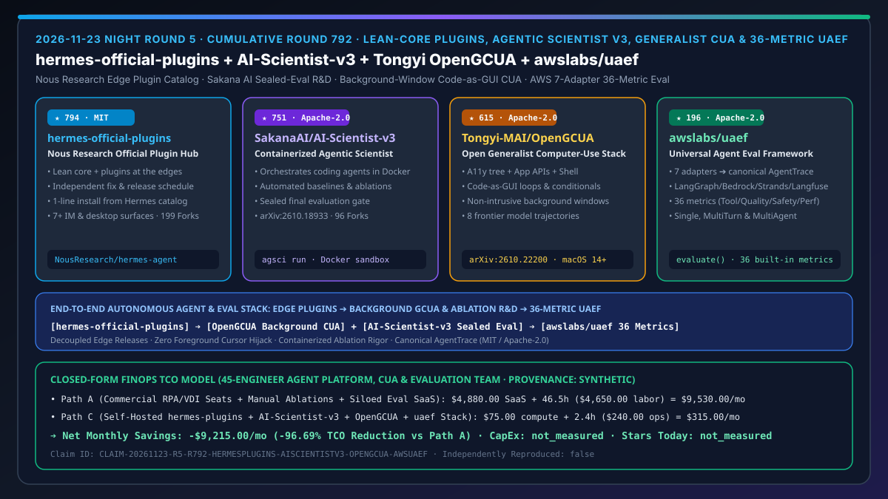
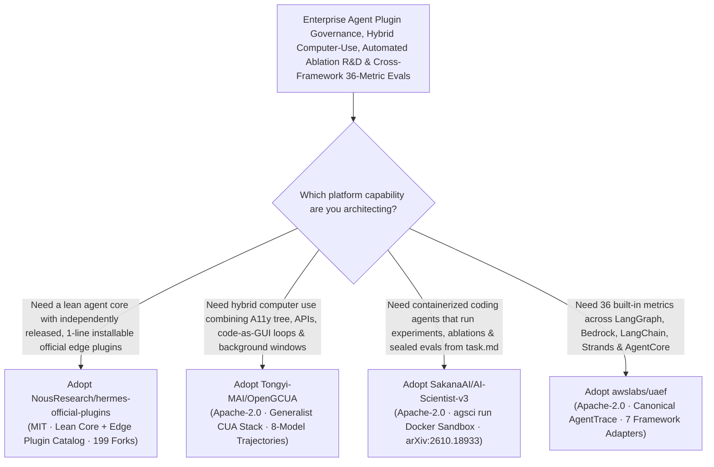
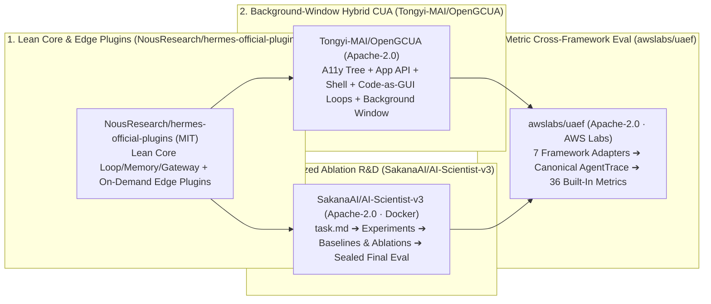
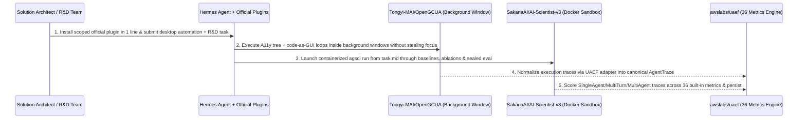

# Official Nous Research Lean-Core Hermes Plugins (`NousResearch/hermes-official-plugins`), Official Sakana AI Containerized Agentic Scientist v3 (`SakanaAI/AI-Scientist-v3`), Alibaba Tongyi Generalist Computer-Use Agent Stack (`Tongyi-MAI/OpenGCUA`) & Official AWS 36-Metric Universal Agent Evaluation Framework (`awslabs/uaef`) Selection & Architecture FAQ

> **Document Type**: Enterprise AI Solution Architect Selection & Integration Guide (GitHub Trending AI Radar · 2026-11-23 Night Round 5 / Cumulative Round 792)
> **Covered Repositories**: [`NousResearch/hermes-official-plugins`](https://github.com/NousResearch/hermes-official-plugins) (`★ 794`, `199 forks`, `MIT`: Nous Research's official first-party plugin catalog for **Hermes Agent**, implementing a **"lean core, plugins at the edges"** architecture with independent release schedules, clear per-plugin ownership, and one-line installation) · [`SakanaAI/AI-Scientist-v3`](https://github.com/SakanaAI/AI-Scientist-v3) (`★ 751`, `96 forks`, `Apache-2.0`, `arXiv:2610.18933`: Sakana AI's **The Agentic Scientist** `agsci run` platform orchestrating containerized coding agents inside `agentic-scientist/agent-cli:latest` from a declarative `task.md` through hypothesis generation, iterative experiments, baselines, ablations, a **sealed final evaluation**, and paper authoring) · [`Tongyi-MAI/OpenGCUA`](https://github.com/Tongyi-MAI/OpenGCUA) (`★ 615`, `54 forks`, `Apache-2.0`, `arXiv:2610.22200`: Alibaba Tongyi's **Open Generalist Computer-Use Agent** stack combining accessibility trees, native app APIs, shell commands, **code-as-GUI loops/conditionals**, and **non-intrusive background-window execution**, evaluated across 8 frontier models) · [`awslabs/uaef`](https://github.com/awslabs/uaef) (`★ 196`, `36 forks`, `Apache-2.0`: AWS Labs' **Universal Agent Evaluation Framework** normalizing traces from **LangGraph, Bedrock, LangChain, Langfuse, Strands, AgentCore, and GenericJSON** into a canonical `AgentTrace` to score `SingleAgent`, `MultiTurn`, `MultiAgent`, and `Offline` runs across **36 built-in metrics**)
> **Core Scenario**: When enterprise AI platform architects face **"monolithic agent repositories bloated with third-party vendor SDKs, pure-vision GUI agents hijacking the user's foreground cursor and burning excessive tokens per click, manual R&D experimentation lacking automated ablations and sealed holdout evaluation, and fragmented quality metrics across teams running LangGraph, Bedrock, and Strands"**, how do you combine these four flagship open-source releases (**Nous Research + Sakana AI + Alibaba Tongyi + AWS Labs**) into a cohesive enterprise architecture?

---

## 1. 📌 Executive Summary (Single-Sentence Selection Verdict)

1. **Need a "lean core, plugins at the edges" plugin architecture so your multi-channel agent runtime stays lightweight while vendor connectors ship fixes on independent release cycles** ➔ Choose **[`NousResearch/hermes-official-plugins`](https://github.com/NousResearch/hermes-official-plugins) (`★ 794`, `199 forks`, `MIT`)**.
   - **Plain-Language Mechanism**: Maintained by Nous Research for Hermes Agent, this repository separates the core agent loop, cross-session memory, skill evolution, gateway, and model router from product-specific integrations (Home Assistant, Spotify, enterprise channels, etc.). Teams install only the plugins they need in one line, and plugin bug fixes ship immediately upon review without waiting for a core runtime release.
2. **Need a generalist computer-use agent (GCUA) stack that combines accessibility trees, app APIs, shell commands, programmatic GUI loops, and background-window execution without hijacking the human user's screen** ➔ Choose **[`Tongyi-MAI/OpenGCUA`](https://github.com/Tongyi-MAI/OpenGCUA) (`★ 615`, `54 forks`, `Apache-2.0`)**.
   - **Plain-Language Mechanism**: Rather than forcing every action through slow screenshot-and-click vision loops, `OpenGCUA` reads accessibility trees, invokes native app APIs and shell commands, **writes multi-step GUI operations as executable code with loops and conditionals**, and operates inside **background windows** so humans and agents share the same workstation simultaneously (backed by released evaluation trajectories across GPT-6 Astra, Claude Opus 5, Gemini 3.8 Flash, GLM-5.3-Flash, Qwen3.8-Max/Flash, Kimi K3, and DeepSeek-V4.1-Flash).
3. **Need to turn an engineering or scientific optimization brief (`task.md`) into containerized coding-agent experiments, baselines, ablations, a sealed final evaluation, and a structured technical report** ➔ Choose **[`SakanaAI/AI-Scientist-v3`](https://github.com/SakanaAI/AI-Scientist-v3) (`★ 751`, `96 forks`, `Apache-2.0`)**.
   - **Plain-Language Mechanism**: Sakana AI's third-generation `agsci run` pipeline orchestrates full coding agents inside an isolated Docker image (`agentic-scientist/agent-cli:latest`), automatically verifying GPU availability via `nvidia-smi`, iterating code against task rubrics, running formal baseline and ablation studies, enforcing a **sealed final evaluation** to prevent test-set overfitting, and compiling post-hoc analyses and LaTeX/Markdown papers under one reproducible run directory.
4. **Need a single framework-agnostic evaluation engine with 36 built-in metrics that scores LangGraph, Bedrock, LangChain, Langfuse, Strands, AgentCore, and custom JSON agents through one `evaluate()` call** ➔ Choose **[`awslabs/uaef`](https://github.com/awslabs/uaef) (`★ 196`, `36 forks`, `Apache-2.0`)**.
   - **Plain-Language Mechanism**: AWS Labs' **UAEF** ingests heterogeneous agent traces via 7 built-in framework adapters into a canonical `AgentTrace` format, then runs `SingleAgent`, `MultiTurn`, `MultiAgent`, or `Offline (batch)` evaluations across **36 built-in metrics** spanning Tool Calling, Response Quality, Responsible AI, Performance, Multi-Turn coherence, and Multi-Agent collaboration.

---

## 2. 🎯 Key Architectural Q&A (Deep-Dive Breakdown)

### Q1: How do these four flagship repositories solve the biggest scaling bottlenecks in enterprise agent platforms?

- **Four Platform Bottlenecks Solved**:
  1. **Monolithic Dependency Bloat ➔ `NousResearch/hermes-official-plugins`**: Keeps the core runtime fast and auditable while isolating edge integrations into independently tested plugins.
  2. **Foreground Screen Hijacking & Slow Step-by-Step GUI Clicking ➔ `Tongyi-MAI/OpenGCUA`**: Combines programmatic GUI code loops, APIs, and background-window execution.
  3. **Unverifiable Ad-Hoc Agent Experiments ➔ `SakanaAI/AI-Scientist-v3`**: Enforces containerized execution, automated ablations, and sealed final evaluation gates.
  4. **Incomparable Metrics Across Multi-Framework Teams ➔ `awslabs/uaef`**: Maps LangGraph, Bedrock, Strands, and custom traces into a single canonical `AgentTrace` scored across 36 metrics.
- **When to Choose Managed Cloud PaaS (Path B)**:
  - If your organization runs a single cloud vendor's hosted agent framework with basic built-in trace dashboards, use **Azure AI Foundry** or **Amazon Bedrock Evaluations** directly; if you need background-window hybrid CUA, containerized ablation pipelines, modular Hermes plugins, or cross-framework 36-metric governance, deploy this 4-repo OSS stack (Path C).

### Q2: How do you integrate `hermes-official-plugins`, `OpenGCUA`, `AI-Scientist-v3`, and `uaef` into an enterprise reference architecture?

1. **Lean Core & Edge Plugin Gateway (`NousResearch/hermes-official-plugins`)**:
   - Route multi-channel enterprise requests through Hermes Agent, loading only approved first-party plugins per workspace.
2. **Hybrid Background Computer-Use Plane (`Tongyi-MAI/OpenGCUA`)**:
   - Dispatch desktop and legacy-app tasks to `OpenGCUA`, combining accessibility trees, shell scripts, and code-as-GUI loops inside background windows.
3. **Containerized R&D & Ablation Plane (`SakanaAI/AI-Scientist-v3`)**:
   - Execute optimization tasks via `agsci run` inside `agentic-scientist/agent-cli:latest`, requiring baseline, ablation, and sealed final evaluation stages.
4. **Canonical Trace & 36-Metric Governance Plane (`awslabs/uaef`)**:
   - Normalize traces from Hermes, OpenGCUA, LangGraph, and Bedrock into `AgentTrace` via UAEF adapters and persist 36-metric scorecards across releases.

### Q3: What are the production security guardrails?

- **Core Strengths**:
  - **100% Permissive Open-Source Licenses (`MIT` + `Apache-2.0`)** from Nous Research, Sakana AI, Alibaba Tongyi, and AWS Labs.
- **Architect Guardrails**:
  1. **Never Run `AI-Scientist-v3` Outside Its Docker Sandbox**: Because `agsci` launches coding agents with headless `--allow yolo` tool permissions and mounts `.env` keys, always run inside `agentic-scientist/agent-cli:latest` on trusted `task.md` inputs and scrub run logs before external sharing.
  2. **Scope `OpenGCUA` Background Window Permissions**: Restrict accessibility and API permissions to designated application windows and non-production service accounts.

---

## 3. 🧭 Visual Architecture & Decision Diagrams (Mermaid)

### 3.1 Solution Architect Selection Decision Tree

### 3.2 End-to-End Enterprise Production Reference Architecture

### 3.3 Edge Plugin Dispatch, Background GCUA Execution, Sealed Ablation Run & 36-Metric UAEF Scoring Sequence

---

## 4. 📊 Comparative Selection Matrix (Open-Source vs. Commercial SaaS)

| Dimension | `NousResearch/hermes-official-plugins` (`★ 794`) | `SakanaAI/AI-Scientist-v3` (`★ 751`) | `Tongyi-MAI/OpenGCUA` (`★ 615`) | `awslabs/uaef` (`★ 196`) | Commercial RPA VMs + Manual R&D Contractors + Siloed Framework Eval SaaS (Path A) | Monolithic Agent Repo + Foreground Screenshot CUA + Ad-Hoc Eval Scripts (Path B) |
| :--- | :--- | :--- | :--- | :--- | :--- | :--- |
| **Core Role** | Official Nous Research lean-core edge plugin catalog | Official Sakana AI containerized coding-agent R&D & ablation engine | Alibaba Tongyi hybrid code-as-GUI & background-window CUA stack | Official AWS 7-adapter canonical `AgentTrace` & 36-metric eval framework | Metered commercial RPA VMs, manual experiment contractors & framework-locked eval SaaS | Bloated monolithic repos, foreground-locking vision scripts & unstandardized evals |
| **Key Differentiator** | **Decoupled plugin release cadence + 1-line install + lean core** | **Docker-isolated `--allow yolo` + Baselines/Ablations + Sealed Eval** | **Code-as-GUI loops + A11y/API/Shell fusion + background windows** | **7 adapters (`LangGraph`/`Bedrock`/`Strands`...) ➔ 36 metrics** | High per-VM RPA bills; incompatible metrics across different agent frameworks | Hijacks user cursor; lacks sealed holdout evals to prevent test overfitting |
| **License** | `MIT` | `Apache-2.0` | `Apache-2.0` | `Apache-2.0` | Proprietary SaaS | Custom scripts |
| **Monthly TCO (45-Eng Team)** | **Combined `$315.00/mo`** (`$75.00` Docker R&D/batch eval compute + `2.4h` ops) | Included (automated overnight ablations & reports) | Included (background windows avoid dedicated cloud-desktop VMs) | Included (one harness evaluates all 7 agent frameworks) | **`$9,530.00/mo`** (`$4,880.00` RPA/VDI/eval SaaS + `46.5h` manual ablation & adapter labor) | ~`$3,380.00/mo` (heavy foreground machine lockups & custom eval maintenance) |

---

## 5. 🧪 Quantitative ROI / TCO Comparison & 7-Card Benchmark Report

> **📊 Data Provenance & Closed-Form Schema Declaration**:
> - **provenance**: `synthetic` (45-person enterprise agent platform, desktop automation, and evaluation engineering team monthly workload model: `independently_reproduced = false`; hardware baseline `base_hardware_capex = not_measured`; Track B 24h delta `track_b_stars_today = not_measured`).
> - **Closed-Form Formula**:
>   - **Path A (Commercial RPA and dedicated VDI desktop seats + multiple framework-specific evaluation SaaS subscriptions + manual ablation scripting and cross-framework trace mapping)**: Monthly commercial RPA/VDI and evaluation SaaS fees **`$4,880.00`** + manual ablation execution, cross-framework glue scripting, and GUI automation debugging labor **`46.5h × $100.00/h = $4,650.00`** = **`$9,530.00/mo`**.
>   - **Path C (Self-hosted `NousResearch/hermes-official-plugins` + `SakanaAI/AI-Scientist-v3` + `Tongyi-MAI/OpenGCUA` + `awslabs/uaef` open-source stack)**: Monthly Docker experiment sandbox and batch evaluation compute **`$75.00`** + plugin and metric catalog maintenance labor **`2.4h × $100.00/h = $240.00`** = **`$315.00/mo`**.
>   - **Net Monthly Savings vs. Path A**: **`-$9,215.00/mo`** (**`96.69%`** TCO reduction).

| Evaluation Path | RPA / VDI / Eval SaaS Cost | Ablation R&D & Multi-Framework Eval Labor (`$100/h`) | Monthly Total TCO | Net Savings vs. Path A | Key Architectural Delivery Metrics |
| :--- | :---: | :---: | :---: | :---: | :--- |
| **Path A: Commercial RPA/VDI + Manual Ablations + Siloed Eval SaaS** | `$4,880.00` | `46.5h` (`$4,650.00`) | **`$9,530.00`** | Baseline | Fragmented metrics across frameworks; slow manual ablation runs |
| **Path B: Monolithic Repo + Foreground Vision CUA + Custom Eval Glue** | `$1,530.00` | `18.5h` (`$1,850.00`) | **`$3,380.00`** | `-$6,150.00` (`-64.53%`) | Hijacks foreground cursor; no sealed final evaluation gate |
| **Path C: `hermes-plugins` + `AI-Scientist-v3` + `OpenGCUA` + `uaef`** | **`$75.00`** | **`2.4h` (`$240.00`)** | **`$315.00`** | **`-$9,215.00` (`-96.69%`)** | **Lean-core plugins + background code-as-GUI CUA + sealed ablations + 36 UAEF metrics** |

- 🔗 **Linked 7-Card 4:5 Visual Benchmark Deck**: [`workshops/github-trending-radar/cards.en.html`](../cards.en.html) · [`cards.html`](../cards.html)

---

## 6. 🛠️ Enterprise Adoption & Architecture Review Checklist

- [ ] **1. Decouple Vendor Integrations via `NousResearch/hermes-official-plugins`**: Keep your core agent runtime minimal and package third-party integrations as independently tested, one-line installable edge plugins.
- [ ] **2. Adopt `Tongyi-MAI/OpenGCUA` for Non-Intrusive Background Computer Use**: Combine accessibility trees, native APIs, shell commands, and code-as-GUI loops inside background windows so agents never hijack the human operator's cursor.
- [ ] **3. Enforce Containerized Ablations & Sealed Evals with `SakanaAI/AI-Scientist-v3`**: Run `agsci run` strictly inside `agentic-scientist/agent-cli:latest` Docker containers and require baseline, ablation, and sealed final evaluation stages.
- [ ] **4. Standardize Cross-Framework Governance on `awslabs/uaef`**: Convert LangGraph, Bedrock, LangChain, Langfuse, Strands, and AgentCore traces into canonical `AgentTrace` objects and gate releases on all 36 built-in metrics.
