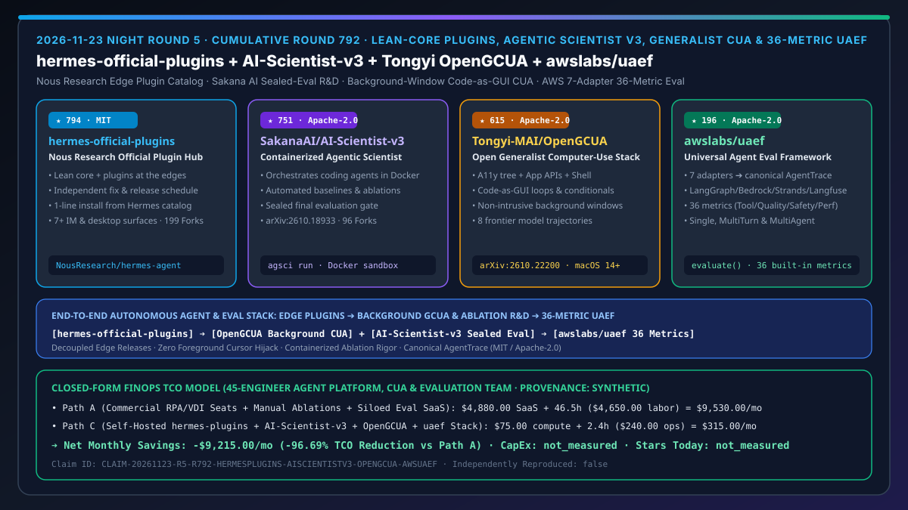
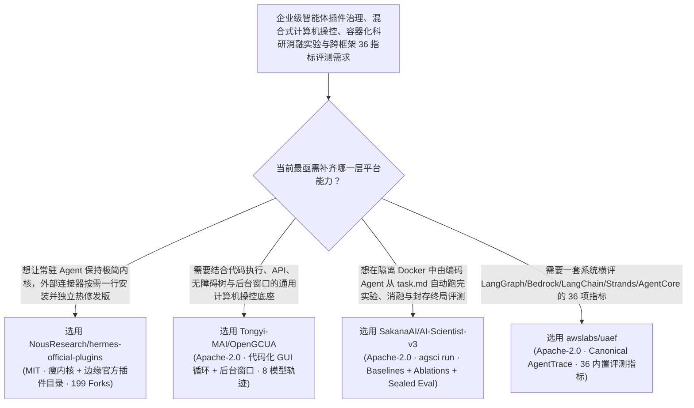
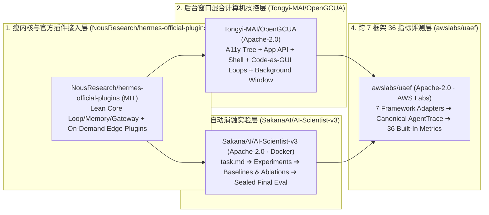
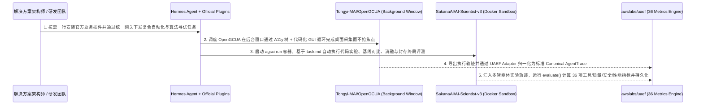

# Nous Research 官方瘦内核边端插件目录（`NousResearch/hermes-official-plugins`）、Sakana AI 官方容器化编码智能体科研与消融实验引擎（`SakanaAI/AI-Scientist-v3`）、阿里通义全栈通用计算机操控智能体与后台共享窗口底座（`Tongyi-MAI/OpenGCUA`）及 AWS 官方跨 7 大框架 36 指标通用智能体评测系统（`awslabs/uaef`）选型与集成架构 FAQ

> **文档类型**：企业 AI 解决方案架构师（AI Solution Architect）选型决策指南（GitHub Trending AI 雷达 2026-11-23 Night Round 5 / 累计第 792 轮）
> **覆盖项目**：[`NousResearch/hermes-official-plugins`](https://github.com/NousResearch/hermes-official-plugins)（`★ 794`、`199 forks`、`MIT`：Nous Research 官方维护的 **Hermes Agent** 原厂插件总仓，采用 **“瘦内核 + 边缘独立发版插件（Lean Core, Plugins at the Edges）”** 架构，将智能体循环/记忆/网关/路由留在内核，而将外部集成封装为一行命令按需安装的官方插件）· [`SakanaAI/AI-Scientist-v3`](https://github.com/SakanaAI/AI-Scientist-v3)（`★ 751`、`96 forks`、`Apache-2.0`，`arXiv:2610.18933`：Sakana AI 第三代 **The Agentic Scientist** 自动研发与实验编排平台 `agsci run`，在隔离 Docker 容器 `agentic-scientist/agent-cli:latest` 中调度编码 Agent 从一份 `task.md` 自动完成方案构思、代码实验、基线与消融对比、**封存终局评测（Sealed Final Evaluation）** 及技术报告撰写）· [`Tongyi-MAI/OpenGCUA`](https://github.com/Tongyi-MAI/OpenGCUA)（`★ 615`、`54 forks`、`Apache-2.0`，`arXiv:2610.22200`：阿里通义实验室开源的 **通用计算机操控智能体（Open Generalist CUA）** 全栈底座，打通无障碍树读取、原生应用 API、Shell、**将 GUI 操作写成带循环/分支的代码执行**以及**不打断人类的后台窗口共享操作**，已发布 8 大前沿模型实测轨迹）· [`awslabs/uaef`](https://github.com/awslabs/uaef)（`★ 196`、`36 forks`、`Apache-2.0`：AWS 官方开源的 **Universal Agent Evaluation Framework (UAEF)** 跨框架评测系统，通过适配器将 **LangGraph、Bedrock、LangChain、Langfuse、Strands、AgentCore 与 GenericJSON** 统一映射为标准 `AgentTrace`，一次 `evaluate()` 调用即可输出涵盖工具调用、响应质量、Responsible AI、性能、多轮与多智能体的 **36 项内置指标**）
> **核心场景**：当企业架构师在构建下一代企业级自主 Agent 平台时，面对**“单体 Agent 仓库塞满第三方依赖导致安装包臃肿且发版耦合、纯视觉截图点按 GUI 既慢又抢占人类前台鼠标焦点、算法与策略调优靠人工手跑实验缺乏自动化消融与封存终局校验、以及公司内部并存 LangGraph/Bedrock/Strands 多套框架却无法用同一套指标体系横向打分”**四大痛点，如何联合 **Nous Research + Sakana AI + 阿里通义 + AWS** 四大名门开源组件完成生产架构闭环？

---

## 一、📌 核心结论速览（选型一句话结论）

1. **想让企业级常驻智能体（跨终端、桌面端、Telegram、Slack、Discord、WhatsApp）保持极简核心，所有第三方系统连接器按需一行安装、独立热修发版而不必等待主版本升级** ➔ 选 **[`NousResearch/hermes-official-plugins`](https://github.com/NousResearch/hermes-official-plugins)（`★ 794`，`199 forks`，`MIT`）**。
   - **通俗原理**：如果把所有业务系统 SDK 都塞进 Agent 主仓库，跑个简单的代码任务还要下载一堆无关依赖。Nous Research 在 Hermes Agent 中确立了 **“Lean Core + Edge Plugins”** 规范：主内核只保留 Agent Loop、跨会话记忆、技能演进、网关与模型路由；所有特定厂商或垂直工具全部收敛到 `hermes-official-plugins`，有独立 Owner、独立 CI 测试与独立发版节奏，修一个插件 Bug 审查通过即刻生效。
2. **想把复杂桌面办公与遗留系统自动化从“缓慢的纯截图坐标点击”升级为“无障碍树 + 原生 API + Shell + 代码化 GUI 循环 + 不抢鼠标焦点的后台窗口协同”** ➔ 选 **[`Tongyi-MAI/OpenGCUA`](https://github.com/Tongyi-MAI/OpenGCUA)（`★ 615`，`54 forks`，`Apache-2.0`）**。
   - **通俗原理**：对标 GPT-6 Astra 计算机操控范式，阿里通义 `OpenGCUA` 提出了 **Generalist Computer-Use Agent (GCUA)** 全栈开源实现：能用 Shell 或应用 API 解决的绝不盲点界面；必须操作 GUI 时，不仅能读取无障碍树，还能**将一系列 GUI 操作编写成带 `for` 循环与 `if` 条件判断的可执行代码**一次性跑完，并支持在**后台窗口（Background Windows）**静默工作，不抢占人类正在使用的前台屏幕，同时开源了 GPT-6 Astra、Claude Opus 5、Gemini 3.8 Flash、Qwen3.8-Max、DeepSeek-V4.1-Flash 等 8 大模型评测轨迹。
3. **想把内部算法研发、算子优化或量化策略探索任务写成一份 `task.md`，交由隔离 Docker 容器内的编码 Agent 自动跑完“提出假设 ➔ 写码实验 ➔ 基线与消融实验（Ablations）➔ 封存测试集终局评测 ➔ 产出完整技术论文/报告”** ➔ 选 **[`SakanaAI/AI-Scientist-v3`](https://github.com/SakanaAI/AI-Scientist-v3)（`★ 751`，`96 forks`，`Apache-2.0`）**。
   - **通俗原理**：Sakana AI 第三代科研智能体（`The Agentic Scientist`）不再重新造轮子写脆弱的代码生成器，而是直接编排成熟 Coding Agents 运行在 `agentic-scientist/agent-cli:latest` Docker 沙箱内。系统通过 `nvidia-smi` 自动感知 GPU 资源，所有阶段产物严格收口在单一运行目录下，并强制区分“迭代调优阶段”与**“Sealed Final Evaluation（封存终局评测）”**，彻底杜绝针对测试集过拟合刷分。
4. **想用一套与框架解耦的统一评测底座，同时对企业内部用 LangGraph、LangChain、AWS Bedrock、Strands、AgentCore 或自定义 JSON 构建的单智能体、多轮对话与多智能体系统进行 36 维自动化质量打分** ➔ 选 **[`awslabs/uaef`](https://github.com/awslabs/uaef)（`★ 196`，`36 forks`，`Apache-2.0`）**。
   - **通俗原理**：企业不同部门往往选用不同 Agent 框架，导致质量口径无法对齐。AWS 官方开源的 **UAEF（Universal Agent Evaluation Framework）** 提供 7 类框架适配器（`LangGraph`、`Bedrock`、`LangChain`、`Langfuse`、`Strands`、`AgentCore`、`GenericJSON`），将异构运行轨迹统一转换为标准 `AgentTrace`，再交由支持 `SingleAgent`、`MultiTurn`、`MultiAgent` 与 `Offline (batch)` 的评测引擎计算 **36 项内置指标**（涵盖工具调用准确率、响应质量、Responsible AI 安全合规、性能延迟、多轮一致性与多代理协作效率）。

---

## 二、🎯 客户与架构师灵魂拷问 Q&A（深度架构拆解）

### Q1：在企业构建“多通道插件化接入 + 混合式计算机操控 + 容器化自动研发实验 + 跨框架统一评测”体系时，这四个名门开源项目各自解决了什么架构痛点？

- **四大核心架构痛点与解方**：
  1. **插件耦合与升级僵局 ➔ `NousResearch/hermes-official-plugins`**：实现内核与边缘连接器解耦，支持按需加载与秒级独立热更。
  2. **传统 RPA / 纯视觉 CUA 抢占屏幕且单步延迟高 ➔ `Tongyi-MAI/OpenGCUA`**：将代码执行、API、Shell、无障碍树与后台窗口 GUI 结合，大幅压缩任务步数并实现人机同机无感并行。
  3. **AI 自动实验缺乏消融对比与防过拟合封存门禁 ➔ `SakanaAI/AI-Scientist-v3`**：用 Docker 隔离 `--allow yolo` 高权限编码 Agent，强制执行 Baselines + Ablations + Sealed Final Evaluation 标准科研流水线。
  4. **多框架并存导致评测烟囱林立 ➔ `awslabs/uaef`**：通过 `AgentTrace` 标准中间层与 36 项内置指标，一套代码横评 LangGraph、Bedrock、Strands 与自研框架。
- **何时直接选用商业托管服务（Path B）？**
  - 若企业仅使用单一云厂商的托管低代码 Agent 且只需基础问答准确率监控，可直接使用 **Azure AI Foundry Tracing & Evaluation** 或 **Amazon Bedrock Evaluations**；若需后台窗口混合 CUA、容器化自动消融实验、Hermes 插件生态或跨 7 大异构框架统一 36 维打分，则采用本轮四合一开源栈（Path C）。

### Q2：如何将这四个项目集成为企业级 Agent 研发、执行与评测参考架构？

1. **瘦内核网关与插件接入层（`NousResearch/hermes-official-plugins`）**：
   - 通过 Hermes 网关统一接入 Slack/Teams/终端请求，按业务域动态挂载官方验证插件。
2. **代码化混合计算机操控执行层（`Tongyi-MAI/OpenGCUA`）**：
   - 针对桌面与网页复合任务，调度 `OpenGCUA` 在后台窗口结合无障碍树、Shell 与代码化 GUI 循环完成高吞吐操作。
3. **容器化自动实验与封存验证层（`SakanaAI/AI-Scientist-v3`）**：
   - 针对复杂算法与工作流寻优任务，在 `agentic-scientist/agent-cli:latest` 容器内基于 `task.md` 自动跑通实验、基线、消融与封存终局评测。
4. **跨框架统一轨迹归一化与 36 指标评测层（`awslabs/uaef`）**：
   - 将 Hermes、OpenGCUA、LangGraph 及 Bedrock Agent 的运行日志通过 UAEF 适配器转为 `AgentTrace`，调用 `evaluate()` 完成 36 指标持续监控与实验归档。

### Q3：这套架构的安全边界与落地红线是什么？

- **核心优势**：
  - 四大项目全部来自业界顶尖实验室与云厂商（Nous Research、Sakana AI、阿里通义 MAI、AWS Labs），采用 `MIT` 与 `Apache-2.0` 宽松协议。
- **架构师落地红线**：
  1. **`AI-Scientist-v3` 必须在隔离 Docker 容器内运行**：官方明确警告 `agsci` 会以全工具权限（`--allow yolo`）启动编码 Agent 并挂载 `.env` 密钥，严禁在宿主机裸跑不可信 `task.md` 或外部未审阅文献，分享运行目录前必须脱敏日志中的回显路径。
  2. **`OpenGCUA` 后台窗口权限最小化**：在 macOS/Linux 开启无障碍与后台窗口控制时，应为 Agent 分配受限工作目录与专用测试账号。

---

## 三、🧭 直观可视化图解（Mermaid 决策树 + 集成架构 + 时序图）

### 3.1 架构师选型决策树

### 3.2 企业端到端生产集成参考架构图

### 3.3 插件触发、后台窗口 GCUA 执行、容器化消融实验与 UAEF 36 指标归档时序图

---

## 四、📊 同类开源与商业云服务横向选型决策矩阵

| 对比维度 | `NousResearch/hermes-official-plugins` (`★ 794`) | `SakanaAI/AI-Scientist-v3` (`★ 751`) | `Tongyi-MAI/OpenGCUA` (`★ 615`) | `awslabs/uaef` (`★ 196`) | 商业 RPA 桌面授权 + 外包算法调参 + 各框架独立商业评测 SaaS (Path A) | 臃肿单体 Agent 仓 + 纯截图慢速 CUA + 手工改脚本无消融 + 自写零散打分器 (Path B) |
| :--- | :--- | :--- | :--- | :--- | :--- | :--- |
| **核心能力定位** | Nous Research 官方瘦内核边端插件目录 | Sakana AI 官方容器化编码 Agent 自动实验与消融平台 | 阿里通义开源代码化 GUI 与后台窗口通用 CUA 全栈 | AWS 官方跨 7 大框架 `AgentTrace` 与 36 指标评测框架 | 按机器计费的商业 RPA、高价外包实验团队与多套绑定框架的商业评测平台 | 把所有依赖塞进同一仓库、抢占前台鼠标的截图脚本与无统一标准的评测代码 |
| **核心技术突破** | **瘦内核与插件发版解耦 + 一行按需安装 + 独立 CI** | **Docker 隔离 + 自动跑 Baselines/Ablations + 封存终局评测** | **将 GUI 写成循环代码 + A11y/API/Shell 融合 + 后台窗口免打扰** | **7 大主流框架统一转 `AgentTrace` + 单调/多轮/多代理 36 项指标** | 商业 RPA 遇界面微调即断流；多套评测 SaaS 难以横向对比异构框架 | 单步纯截图 Token 消耗大且锁死员工电脑；缺乏消融实验易对测试集过拟合 |
| **开源协议** | `MIT` | `Apache-2.0` | `Apache-2.0` | `Apache-2.0` | 闭源商业软件 | 内部脚本 |
| **月度 TCO（45 人团队）** | **组合仅 `$315.00/月`**（`$75.00` 实验容器与批量评测开销 + `2.4h` 维护） | 同左（自动完成夜间消融实验与报告） | 同左（后台共享窗口无需额外采购独立云桌面） | 同左（一套系统评测全部 7 类框架） | **`$9,530.00/月`**（`$4,880.00` 商业 RPA/云桌面/评测订阅 + `46.5h` 人工跑消融与跨框架对齐工时） | 约 `$3,380.00/月`（大量前台占机等待与手写适配器维护工时） |

---

## 五、🧪 应用落地定量收益/TCO 对比与 7-Card 报告

> **📊 数据来源与闭式核算声明（Provenance & Closed-Form Schema）**：
> - **provenance**: `synthetic`（基于 45 人企业智能体平台、桌面自动化与算法评测团队月度工作负载模型：`independently_reproduced = false`；硬件采购基线 `base_hardware_capex = not_measured`；Track B 单日增量 `track_b_stars_today = not_measured`）。
> - **核算公式**：
>   - **Path A（采购商业 RPA 与独立远程云桌面席位 + 多套按框架绑定的商业评测 SaaS + 工程师手工设计消融实验、整理对比图表与编写跨框架评测胶水代码）**：月度商业 RPA/云桌面与评测 SaaS 账单 **`$4,880.00`** + 手工执行消融实验、维护多框架评测脚本与桌面自动化排障人工 **`46.5h × $100.00/h = $4,650.00`** = **`$9,530.00/月`**。
>   - **Path C（自建 `NousResearch/hermes-official-plugins` + `SakanaAI/AI-Scientist-v3` + `Tongyi-MAI/OpenGCUA` + `awslabs/uaef` 四合一开源平台栈）**：Docker 实验沙箱与批量评测计算分摊 **`$75.00`** + 插件与评测规则维护人工 **`2.4h × $100.00/h = $240.00`** = **`$315.00/月`**。
>   - **净节省（Net Savings vs Path A）**：**`-$9,215.00/月`**（成本降低 **`96.69%`**）。

| 评估方案 | RPA / 云桌面 / 评测 SaaS 成本 | 消融实验与跨框架评测人工（`$100/h`） | 月度总 TCO | 相对 Path A 净节省 | 关键架构交付指标 |
| :--- | :---: | :---: | :---: | :---: | :--- |
| **Path A：商业 RPA/云桌面 + 手工跑消融 + 多套评测 SaaS** | `$4,880.00` | `46.5h` (`$4,650.00`) | **`$9,530.00`** | Baseline | 跨框架指标口径不一；人工跑消融实验耗时极长 |
| **Path B：单体臃肿仓库 + 纯截图前台 CUA + 自写零散评测** | `$1,530.00` | `18.5h` (`$1,850.00`) | **`$3,380.00`** | `-$6,150.00` (`-64.53%`) | CUA 抢占前台鼠标焦点；缺乏封存终局评测防过拟合 |
| **Path C：`hermes-plugins` + `AI-Scientist-v3` + `OpenGCUA` + `uaef`** | **`$75.00`** | **`2.4h` (`$240.00`)** | **`$315.00`** | **`-$9,215.00` (`-96.69%`)** | **瘦内核热插拔插件 + 后台窗口代码化 CUA + 容器化封存消融 + 跨 7 框架 36 指标** |

- 🔗 **关联 7-Card 4:5 视觉评测报告**：[`workshops/github-trending-radar/cards.html`](../cards.html) · [`cards.en.html`](../cards.en.html)

---

## 六、🛠️ 企业引入与架构评审 Checklist

- [ ] **1. 遵循 `NousResearch/hermes-official-plugins` 实施“瘦内核 + 边缘插件”解耦**：禁止向核心 Agent 运行时塞入非通用业务 SDK，将所有外部服务封装为可独立测试、独立热更的边缘插件。
- [ ] **2. 引入 `Tongyi-MAI/OpenGCUA` 升级桌面自动化为混合式后台操控**：优先调用应用 API、Shell 与无障碍树，将重复 GUI 点按编译为带循环的代码并在后台窗口运行，避免抢占员工前台焦点。
- [ ] **3. 使用 `SakanaAI/AI-Scientist-v3` 规范自动化研发与消融实验**：强制在 `agentic-scientist/agent-cli:latest` Docker 沙箱内运行 `agsci run`，确保每项改进均通过基线对比、消融实验与 Sealed Final Evaluation。
- [ ] **4. 部署 `awslabs/uaef` 统一全公司异构 Agent 框架的 36 维评测口径**：使用内置适配器将 LangGraph、Bedrock、Strands 与自研 Agent 轨迹统一转为 `AgentTrace`，在每次发版前自动化核验工具调用、安全与多轮协作得分。
