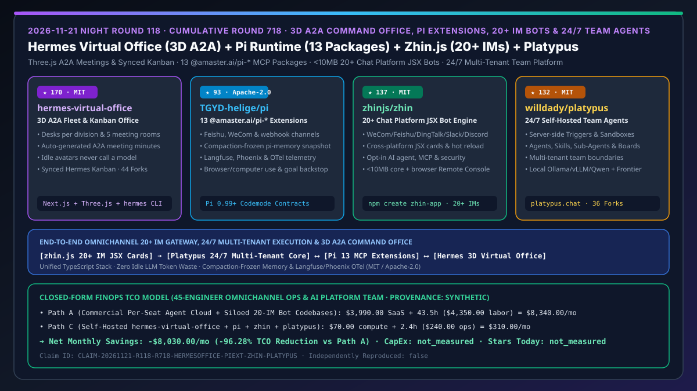
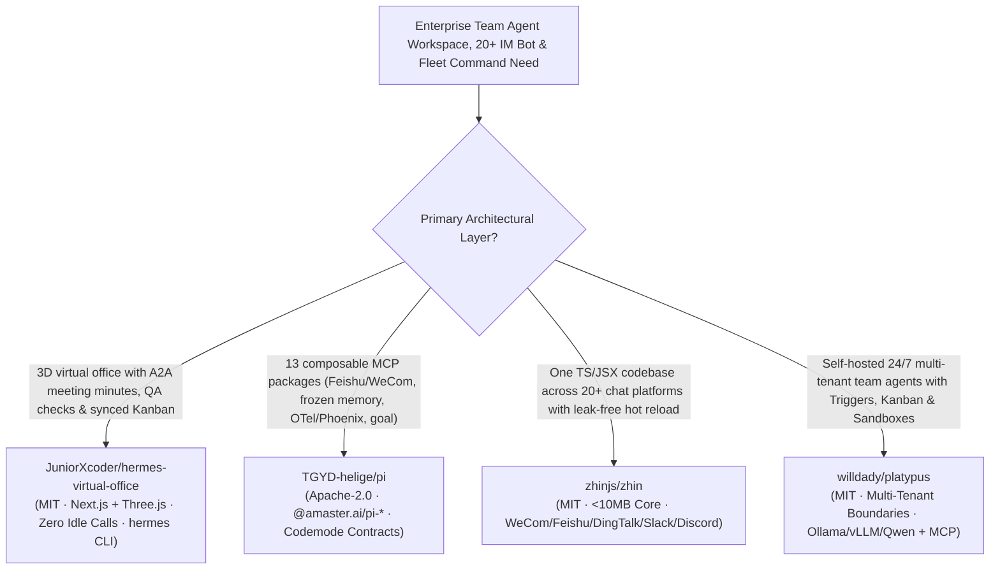
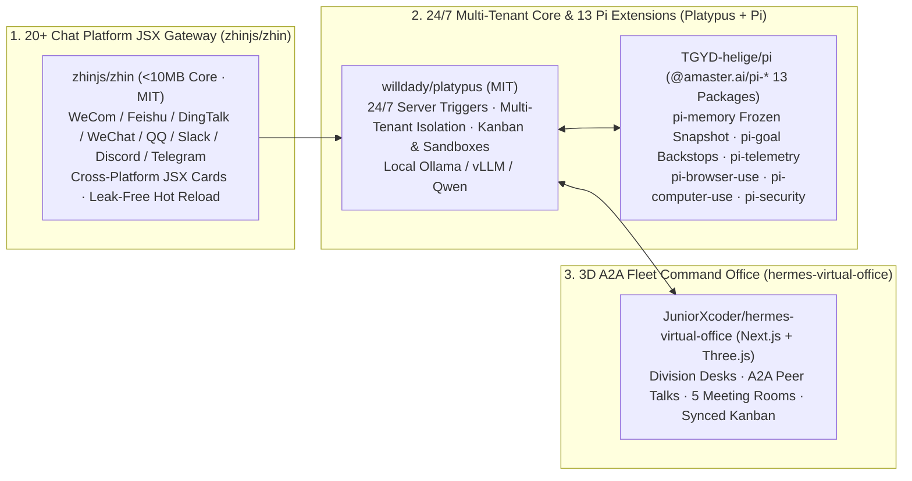
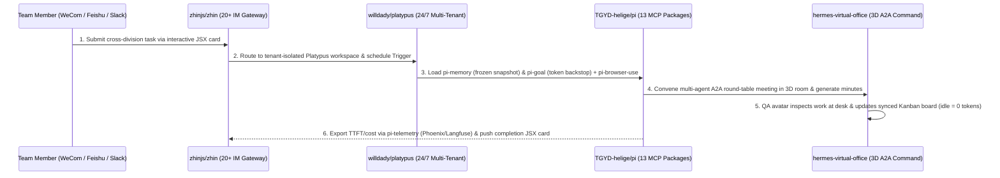

# 3D A2A Fleet Command Office (`JuniorXcoder/hermes-virtual-office`), 13-Package Pi Runtime Extensions (`TGYD-helige/pi`), 20+ Chat Platform JSX Bot Framework (`zhinjs/zhin`) & 24/7 Self-Hosted Multi-Tenant Team Agents (`willdady/platypus`) Selection & Architecture FAQ

> **Document Type**: Enterprise AI Solution Architect Selection & Integration Guide (GitHub Trending AI Radar — 2026-11-21 Night Round 118 / Cumulative Round 718)
> **Covered Repositories**: [`JuniorXcoder/hermes-virtual-office`](https://github.com/JuniorXcoder/hermes-virtual-office) (`★ 170`, `44 forks`, `MIT` — Next.js + Three.js 3D virtual workspace for Hermes Agent fleets with 5 meeting rooms, live A2A transcripts, zero idle token spend & synced Kanban board) · [`TGYD-helige/pi`](https://github.com/TGYD-helige/pi) (`★ 93`, `20 forks`, `Apache-2.0` — 13 composable `@amaster.ai/pi-*` TypeScript extension packages covering Feishu/WeCom channels, Langfuse/Phoenix/OTel telemetry, compaction-frozen memory snapshots, browser/computer use & goal backstops) · [`zhinjs/zhin`](https://github.com/zhinjs/zhin) (`★ 137`, `19 forks`, `MIT` — `<10MB` AI-native TypeScript bot framework running one codebase with cross-platform JSX cards & leak-free hot reload across 20+ chat platforms) · [`willdady/platypus`](https://github.com/willdady/platypus) (`★ 132`, `36 forks`, `MIT` — self-hosted 24/7 multi-tenant team AI agent platform uniting Agents, Skills, Sub-Agents, Kanban Boards, Sandboxes, Triggers & MCP)
> **Core Scenario**: How enterprise AI architects deploy an always-on, omnichannel digital workforce: **connecting 20+ enterprise and consumer chat platforms with one TypeScript/JSX codebase (`zhinjs/zhin`)**, **running multi-tenant 24/7 agents, triggers, and sandboxes against local Ollama/vLLM/Qwen or frontier models (`willdady/platypus`)**, **equipping agents with 13 modular MCP extensions including compaction-proof memory snapshots and OTel telemetry (`TGYD-helige/pi`)**, and **supervising multi-division A2A agent meetings and Kanban deliverables in a live 3D command office (`hermes-virtual-office`)**.

---

## 1. 📌 Executive Summary (One-Line Selection Verdict)

1. **Need a live Next.js + Three.js 3D command center for NousResearch Hermes Agent fleets featuring division desks, 5 A2A round-table meeting rooms with auto-generated minutes, QA desk inspections, zero idle model calls, and a bidirectional Kanban board** ➔ Choose **[`JuniorXcoder/hermes-virtual-office`](https://github.com/JuniorXcoder/hermes-virtual-office) (`★ 170`, `44 forks`, `MIT`)**.
   - **Plain-English Mechanism**: Drives your local Hermes installation directly through the official `hermes` CLI. Agents sit at division desks when working, walk to peers' desks for **A2A protocol** conversations, hold round-table meetings with automated minutes, undergo QA inspections, and relax when idle (**an idle avatar never calls a model**), while keeping a full Kanban board (tasks, approvals, independent verification evidence) synced with Hermes.
2. **Need 13 composable TypeScript extension packages (`@amaster.ai/pi-*`) for the Pi runtime exposing bounded structured contracts for codemode scripts and MCP—spanning Feishu/WeCom channels, Langfuse/Phoenix/OTel telemetry, frozen memory snapshots, and goal backstops** ➔ Choose **[`TGYD-helige/pi`](https://github.com/TGYD-helige/pi) (`★ 93`, `20 forks`, `Apache-2.0`)**.
   - **Plain-English Mechanism**: Provides `pi-shared` and `pi-storage` (JSON & MySQL/Prisma) alongside 11 extensions: `pi-channels` (Feishu/Lark, WeCom, webhooks), `pi-telemetry` (TTFT, token/cost accounting to **Langfuse, Arize Phoenix & OpenTelemetry**), `pi-memory` (`MEMORY.md` + `USER.md` frozen snapshot between compactions), `pi-goal` (autonomous goal loop with iteration/token backstops), `pi-security`, `pi-browser-use` (`chrome-devtools-mcp`), `pi-computer-use`, `pi-task-scheduler`, `pi-web-access`, `pi-attachments`, and `pi-teamwork`.
3. **Need a `<10MB` AI-native TypeScript bot framework (`zhin.js`) that runs one codebase with cross-platform JSX cards, file-based commands, and leak-free hot reload across 20+ chat platforms (`WeCom`, `Feishu`, `DingTalk`, `WeChat`, `QQ`, `Slack`, `Discord`, `Telegram`, `LINE`)** ➔ Choose **[`zhinjs/zhin`](https://github.com/zhinjs/zhin) (`★ 137`, `19 forks`, `MIT`)**.
   - **Plain-English Mechanism**: Bootstraps in 30 seconds via `npm create zhin-app my-bot -- -y --adapter sandbox`. Renders interactive **JSX cards** natively across 20+ messaging platforms, hot-reloads plugins without memory leaks, includes a browser Remote Console, and wires opt-in AI agents with MCP tools and security policies.
4. **Need a self-hosted, multi-tenant team AI platform (`platypus.chat` / `@platypuschat/plugin-sdk`) where agents, on-demand skills, sub-agents, Kanban boards, sandboxes, and scheduled triggers keep working server-side 24/7 on local (`Ollama`, `vLLM`, `Qwen`) or cloud models** ➔ Choose **[`willdady/platypus`](https://github.com/willdady/platypus) (`★ 132`, `36 forks`, `MIT`)**.
   - **Plain-English Mechanism**: Eliminates laptop-bound agent sessions and stitched-together tools by putting **Agents, Skills, Sub-Agents, Kanban Boards, Sandboxes, MCP, Triggers, and Memory** under one self-hosted roof with strict multi-tenant boundaries between teams.

---

## 2. 🎯 Architect & Customer Deep-Dive Q&A

### Q1: How do `hermes-virtual-office`, `TGYD-helige/pi`, `zhinjs/zhin`, and `willdady/platypus` solve the four biggest pain points of scaling an enterprise digital workforce?

- **Four Enterprise Digital Workforce Pillars**:
  1. **Write-Once 20+ IM Omnichannel Reach (`zhinjs/zhin`)**: Enterprises operating across Asia and global markets must support WeCom, Feishu/Lark, DingTalk, WeChat, Slack, Discord, and Telegram simultaneously. `zhin.js` compiles one TypeScript + JSX card codebase across all 20+ platforms in a `<10MB` core.
  2. **Always-On Server-Side Triggers & Multi-Tenant Team Isolation (`willdady/platypus`)**: Laptop CLI agents die when the developer closes their lid. `Platypus` runs 24/7 server-side on your own infrastructure (Ollama, vLLM, Qwen) with scheduled Triggers, Sandboxes, Kanban boards, and multi-tenant isolation.
  3. **Compaction-Proof Memory & Bounded Codemode Extensions (`TGYD-helige/pi`)**: Context compaction often wipes out critical user instructions. `@amaster.ai/pi-memory` freezes `MEMORY.md` + `USER.md` snapshots across compactions, while `pi-goal` enforces token/iteration backstops and `pi-telemetry` exports spans to Langfuse, Arize Phoenix, and OpenTelemetry.
  4. **Human-Readable Fleet Supervision & Zero Idle Spend (`JuniorXcoder/hermes-virtual-office`)**: Visualizes multi-division Hermes Agent fleets, A2A round-table meetings, QA desk checks, and Kanban approvals in 3D while guaranteeing idle agents make zero LLM calls.
- **When to Choose Managed Cloud Services (Path B)**:
  - Organizations standardized exclusively on Microsoft Teams with no need for WeCom/DingTalk/Feishu/Discord adapters or self-hosted Ollama/vLLM models can use **Microsoft 365 Copilot + Copilot Studio**.

### Q2: How do we wire an end-to-end omnichannel team agent architecture combining all four projects?

1. **20+ Platform IM & JSX Card Gateway (`zhinjs/zhin`)**:
   - Deploy `zhin.js` as the unified messaging ingress/egress across Feishu, WeCom, DingTalk, Slack, Discord, Telegram, and WeChat with hot-reloadable plugins and cross-platform JSX approval cards.
2. **24/7 Multi-Tenant Team Execution & Sandbox Core (`willdady/platypus`)**:
   - Route incoming tasks and cron Triggers into `Platypus` workspaces isolated by department, executing Skills and Sub-Agents inside Sandboxes backed by local Ollama/vLLM/Qwen models.
3. **13-Package MCP Extension & Telemetry Plane (`TGYD-helige/pi`)**:
   - Equip runtime agents with `@amaster.ai/pi-*` packages (`pi-memory` frozen snapshots, `pi-goal` token backstops, `pi-browser-use`, `pi-computer-use`, `pi-security`, and `pi-telemetry` exporting to Langfuse/Arize Phoenix/OTel).
4. **3D A2A Fleet Command & Kanban Verification Center (`JuniorXcoder/hermes-virtual-office`)**:
   - Connect `hermes-virtual-office` to the `hermes` CLI to monitor cross-division A2A meetings, automated meeting minutes, QA desk inspections, and Kanban evidence verification.

### Q3: What are the boundaries and trade-offs of this stack?

- **Key Strengths**:
  - **Unified TypeScript Ecosystem (`MIT` & `Apache-2.0`)**: All four projects are written in TypeScript (`5.0+` / `6.0`) with permissive open-source licenses.
  - **Strict Cost Guardrails**: Zero idle model calls in `hermes-virtual-office` plus hard iteration/token backstops in `@amaster.ai/pi-goal`.
- **Operational Scope**:
  - `hermes-virtual-office` uses Three.js WebGL rendering in the browser for interactive fleet visualization; headless CI servers only need the underlying `hermes` CLI, `Platypus`, and `Pi` runtime packages.

---

## 3. 🧭 Visual Architecture & Decision Diagrams

### 3.1 Solution Architect Selection Decision Tree

### 3.2 End-to-End Enterprise Reference Architecture

### 3.3 Omnichannel JSX Trigger, Platypus 24/7 Dispatch, Pi Frozen Memory & 3D A2A Meeting Sequence

---

## 4. 📊 Peer Open-Source vs Commercial Cloud Selection Matrix

| Dimension | `hermes-virtual-office` (`★ 170`) | `TGYD-helige/pi` (`★ 93`) | `zhinjs/zhin` (`★ 137`) | `willdady/platypus` (`★ 132`) | Commercial Per-Seat Agent Cloud + Custom Bots (Path A) | Single-Suite Office Copilot (Path B) |
| :--- | :--- | :--- | :--- | :--- | :--- | :--- |
| **Core Role** | 3D A2A meeting simulator & synced Kanban office | 13 `@amaster.ai/pi-*` runtime & MCP packages | `<10MB` 20+ chat platform JSX bot framework | 24/7 self-hosted multi-tenant team agent platform | Hosted agent workspace SaaS + bespoke IM adapters | M365 Copilot / Feishu Native Assistant |
| **Architectural Edge** | **Live A2A round-table minutes + 0 idle LLM calls** | **Compaction-frozen `pi-memory` + Langfuse/Phoenix OTel** | **1 JSX card codebase across 20+ platforms + hot reload** | **Server-side 24/7 Triggers + local Ollama/vLLM sovereignty** | Separate bot rewrites per IM platform; high per-seat cost | Locked to one office suite; cannot span 20+ external IMs |
| **License** | `MIT` | `Apache-2.0` | `MIT` | `MIT` | Proprietary SaaS | Proprietary Cloud PaaS |
| **Monthly TCO (45-Eng Team)** | **`$310.00/mo` combined** (`$70.00` compute + `2.4h` ops) | Included in `$310.00/mo` stack | Included in `$310.00/mo` stack | Included in `$310.00/mo` stack | **`$8,340.00/mo`** (`$3,990.00` seats + `43.5h` multi-bot ops) | `~$2,700.00/mo` ($30/user/mo seat licensing) |

---

## 5. 🧪 Quantitative ROI / FinOps TCO Model & 7-Card Report

> **📊 Provenance & Closed-Form Audit Declaration**:
> - **Provenance**: `synthetic` (45-engineer enterprise omnichannel operations, internal platform & AI agent fleet workload model; `independently_reproduced = false`; `base_hardware_capex = not_measured`; `track_b_stars_today = not_measured`).
> - **Closed-Form Equations**:
>   - **Path A (Commercial Per-Seat Team Agent SaaS + Separate Custom Bot Codebases for WeCom/Feishu/DingTalk/Slack/Discord/Telegram + Idle Polling Token Waste)**: Monthly seat & token spend **`$3,990.00`** + multi-platform bot maintenance labor **`43.5h × $100.00/h = $4,350.00`** = **`$8,340.00/mo`**.
>   - **Path C (Self-Hosted `JuniorXcoder/hermes-virtual-office` + `TGYD-helige/pi` + `zhinjs/zhin` + `willdady/platypus`)**: Shared container & database compute **`$70.00`** + unified JSX plugin & trigger maintenance **`2.4h × $100.00/h = $240.00`** = **`$310.00/mo`**.
>   - **Net Savings vs Path A**: **`-$8,030.00/mo`** (**`96.28%`** cost reduction).

| Architecture Option | API / SaaS / Compute | Multi-Channel Engineering Labor (`$100/h`) | Total Monthly TCO | Net Savings vs Path A | Key Architectural Outcome |
| :--- | :---: | :---: | :---: | :---: | :--- |
| **Path A: Commercial Team Agent Cloud + Siloed IM Bots** | `$3,990.00` | `43.5h` (`$4,350.00`) | **`$8,340.00`** | Baseline | Duplicated card templates across 20+ IMs; expensive seats |
| **Path B: Single Office Suite Built-In Copilot** | `$1,500.00` | `12.0h` (`$1,200.00`) | **`$2,700.00`** | `-$5,640.00` (`-67.63%`) | Locked to one vendor; no self-hosted 24/7 Ollama/vLLM or 20+ IMs |
| **Path C: `hermes-office` + `pi` + `zhin` + `platypus`** | **`$70.00`** | **`2.4h` (`$240.00`)** | **`$310.00`** | **`-$8,030.00` (`-96.28%`)** | **3D A2A office + 13 Pi extensions + 20+ IM JSX cards + 24/7 Platypus** |

- 🔗 **7-Card 4:5 Visual Report**: [`workshops/github-trending-radar/cards.en.html`](../cards.en.html) · [`cards.html`](../cards.html)

---

## 6. 🛠️ Enterprise Adoption & Architecture Review Checklist

- [ ] **1. Unify 20+ Chat Platforms with `zhinjs/zhin`**: Scaffold your IM gateway with `npm create zhin-app`, author cross-platform JSX cards for approvals and alerts, and enable leak-free hot reload across WeCom, Feishu, DingTalk, Slack, Discord, and Telegram.
- [ ] **2. Deploy `willdady/platypus` for 24/7 Multi-Tenant Team Execution**: Configure multi-tenant workspaces, scheduled/event Triggers, Sandboxes, and Kanban boards backed by local (`Ollama`, `vLLM`, `Qwen`) or frontier models.
- [ ] **3. Wire `@amaster.ai/pi-*` Extensions (`TGYD-helige/pi`)**: Enable `pi-memory` (frozen snapshots between compactions), `pi-goal` (iteration/token backstops), `pi-security`, and `pi-telemetry` (exporting to Langfuse, Arize Phoenix, and OpenTelemetry).
- [ ] **4. Supervise Fleet Collaboration in `JuniorXcoder/hermes-virtual-office`**: Connect the Next.js + Three.js office to your `hermes` CLI to audit A2A round-table meeting minutes, QA inspections, and synced Kanban tasks with zero idle token usage.
