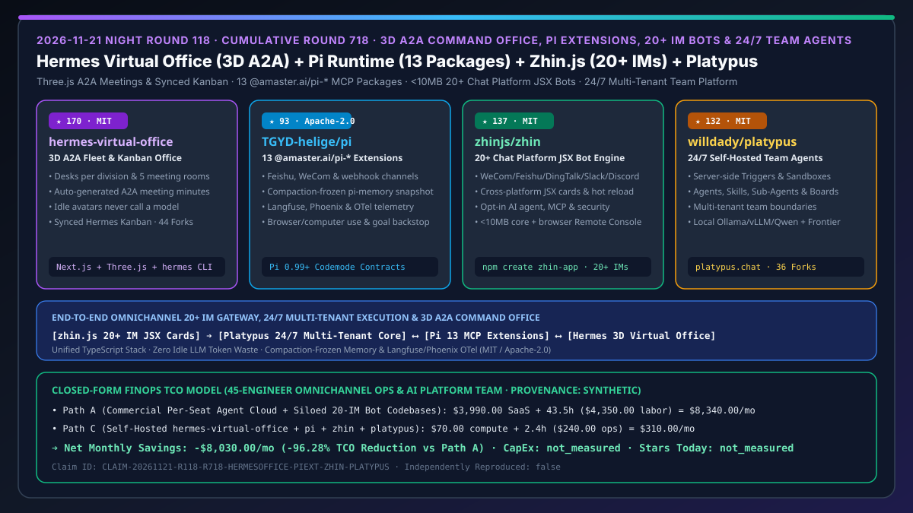
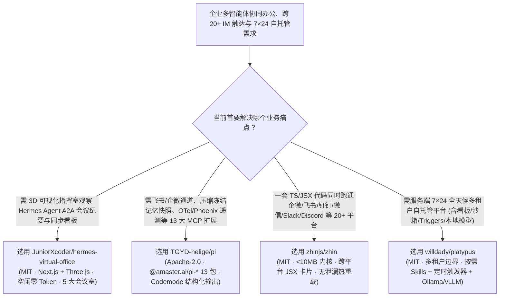
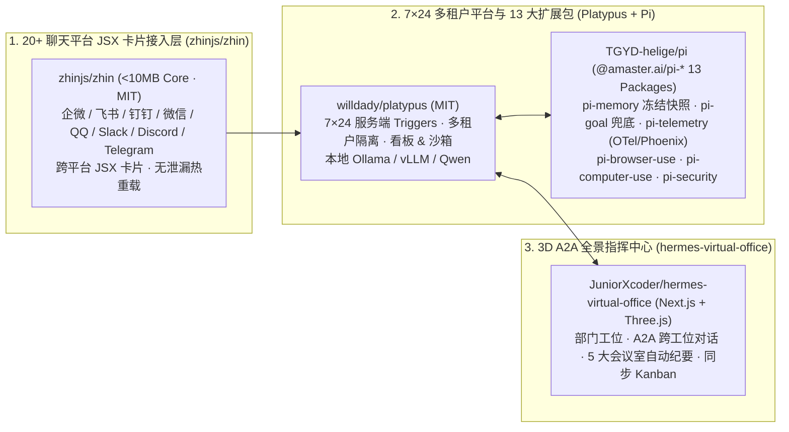
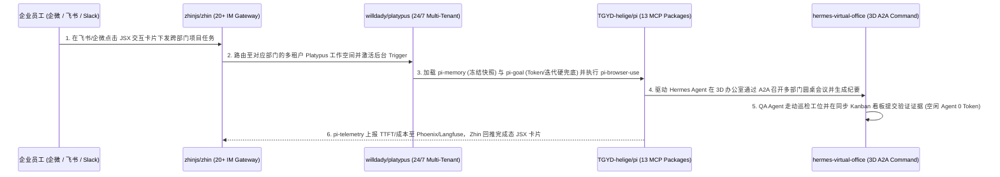

# Hermes 3D 虚拟办公室与 A2A 看板指挥台（`JuniorXcoder/hermes-virtual-office`）、Pi 运行时 13 大飞书/企微/OTel 扩展包（`TGYD-helige/pi`）、跨 20+ 聊天平台 JSX 卡片机器人框架（`zhinjs/zhin`）与 7×24 自托管多租户团队智能体平台（`willdady/platypus`）选型与集成架构 FAQ

> **文档类型**：企业 AI 解决方案架构师（AI Solution Architect）选型决策指南（GitHub Trending AI 雷达 2026-11-21 Night Round 118 / 累计第 718 轮）
> **覆盖项目**：[`JuniorXcoder/hermes-virtual-office`](https://github.com/JuniorXcoder/hermes-virtual-office)（`★ 170`、`44 forks`、`MIT`，基于 Next.js + Three.js + 官方 `hermes` CLI 打造的含 5 大会议室 A2A 实时圆桌纪要、QA 走动巡检、空闲零 Token 消耗与双向同步看板的 3D 虚拟办公室）· [`TGYD-helige/pi`](https://github.com/TGYD-helige/pi)（`★ 93`、`20 forks`、`Apache-2.0`，提供 `@amaster.ai/pi-*` 13 大可插拔扩展包的 Pi 运行时套件，覆盖飞书/企微/钉钉通道、Langfuse/Phoenix/OTel 遥测、压缩冻结快照记忆、Chrome 自动化与安全策略）· [`zhinjs/zhin`](https://github.com/zhinjs/zhin)（`★ 137`、`19 forks`、`MIT`，内核小于 10MB、一套 TypeScript/JSX 卡片代码同时跑通微信/企微/钉钉/飞书/QQ/Slack/Discord/Telegram 等 20+ 平台的 AI 原生机器人框架）· [`willdady/platypus`](https://github.com/willdady/platypus)（`★ 132`、`36 forks`、`MIT`，将 Agent、按需 Skill、子 Agent、看板、沙箱、MCP、定时触发器与多租户边界合二为一的 7×24 自托管团队平台）
> **核心场景**：当企业希望将自主 AI Agent 舰队真正嵌入团队日常办公与国内外全渠道 IM 时，如何解决**多智能体后台黑盒运行看不见协作状态与审批进度（`hermes-virtual-office`）**、**Agent 运行时缺乏标准化的飞书/企微/钉钉接入、防压缩失忆快照与 OTel 成本核算模块（`TGYD-helige/pi`）**、**同一个业务 Agent 需要在企微、飞书、钉钉、微信、Slack、Discord 等 20+ 平台渲染交互式卡片（`zhinjs/zhin`）**，以及**员工关掉笔记本电脑后 Agent 就断联、缺乏服务端 7×24 触发器与部门级多租户隔离（`willdady/platypus`）**这四大痛点？

---

## 一、📌 核心结论速览（选型一句话结论）

1. **团队用 NousResearch Hermes Agent 跑多部门自动化任务，想告别枯燥的终端日志，在一个 Next.js + Three.js 3D 虚拟办公室里直观看到各部门工位状态、A2A 跨工位交谈、5 大会议室自动会议纪要与双向同步 Kanban 看板** ➔ 选 **[`JuniorXcoder/hermes-virtual-office`](https://github.com/JuniorXcoder/hermes-virtual-office)（`★ 170`，`44 forks`，`MIT`）**。
   - **通俗原理**：直接通过官方 `hermes` CLI 驱动（无需魔改后端 API）。在 3D 办公室中：有任务的 Agent 会停止闲逛坐回所属部门工位；跨 Agent 发生 **A2A 协议**协作时，调用方虚拟形象会走到被调方工位旁并实时展示对话记录；多部门在 5 个命名会议室开圆桌会并自动生成会议纪要；QA 审查员会走到开发工位旁做质量核验；**最关键的是空闲（Idle）状态的虚拟形象绝不发起任何大模型调用（零待机 Token 浪费）**，且内置 Kanban 看板与 Hermes 任务、人工审批及独立验证证据 100% 同步。
2. **正在基于 Pi 运行时构建企业级 Agent 应用，需要一套开箱即用、返回强结构化契约（适配 Codemode 脚本）的 13 大官方级 TypeScript 扩展包（含飞书/企微、OTel/Phoenix 遥测、压缩间冻结记忆快照与安全策略）** ➔ 选 **[`TGYD-helige/pi`](https://github.com/TGYD-helige/pi)（`★ 93`，`20 forks`，`Apache-2.0`）**。
   - **通俗原理**：将企业 Agent 最常用的基础设施拆解为 **13 个高内聚 `@amaster.ai/pi-*` 模块**：核心层含 `pi-shared` 与 `pi-storage`（JSON 及 MySQL/Prisma 持久化）；扩展层涵盖 `pi-channels`（原生对接**飞书 Feishu、企业微信 WeCom 与 Webhook**）、`pi-telemetry`（导出 TTFT、Token 与成本至 **Langfuse、Arize Phoenix 与 OpenTelemetry**）、`pi-memory`（将 `MEMORY.md` + `USER.md` 作为在上下文压缩 Compaction 之间保持冻结的系统提示词快照）、`pi-goal`（带迭代次数与 Token 硬兜底的目标驱动循环）、`pi-security`、`pi-browser-use`（基于 `chrome-devtools-mcp`）、`pi-computer-use`、`pi-task-scheduler`、`pi-web-access`、`pi-attachments` 与 `pi-teamwork`。
3. **想用一套 TypeScript 代码和跨平台 JSX 卡片同时跑通微信、企业微信、钉钉、飞书、QQ、Slack、Discord、Telegram、LINE 等 20+ 国内外聊天平台，且支持无内存泄漏热重载与内置 MCP** ➔ 选 **[`zhinjs/zhin`](https://github.com/zhinjs/zhin)（`★ 137`，`19 forks`，`MIT`）**。
   - **通俗原理**：核心体积 **小于 10MB** 的 AI 原生 TypeScript 机器人框架（`npm create zhin-app`）。传统跨平台机器人每换一个 IM 都要重写消息卡片格式；`zhin.js` 首创**跨平台 JSX 卡片渲染**、文件路由命令与**零内存泄漏热重载（Leak-free Hot Reload）**，自带浏览器端远程控制台（Remote Console），并可按需启用内置 AI Agent、MCP 工具与安全策略。
4. **想在企业自有服务器与私有模型（Ollama / vLLM / Qwen）上为整个公司搭建一套 7×24 小时全天候后台运行、带多租户团队隔离、Kanban 看板、沙箱、MCP 与定时触发器（Triggers）的完整自托管平台** ➔ 选 **[`willdady/platypus`](https://github.com/willdady/platypus)（`★ 132`，`36 forks`，`MIT`）**。
   - **通俗原理**：桌面 CLI Agent 在员工合上笔记本后就会停止运行。`Platypus`（含 `@platypuschat/plugin-sdk`）将 **Agents、按需加载的 Skills、Sub-Agents、Kanban 看板、安全沙箱（Sandboxes）、MCP、定时/事件触发器（Triggers）与持久记忆** 整合在一个自托管全栈平台中：支持按 Agent 混配本地 Ollama/vLLM/Qwen 与云端前沿模型，提供严格的部门级多租户隔离（Multi-tenant Boundaries），且 Agent 自身就能通过工具调用创建或修改定时触发器与移动看板卡片。

---

## 二、🎯 客户与架构师灵魂拷问 Q&A（深度架构拆解）

### Q1：在企业落地“多智能体数字员工团队”时，`hermes-virtual-office`、`TGYD-helige/pi`、`zhinjs/zhin` 与 `willdady/platypus` 分别扮演什么架构角色？

- **四层数字员工办公架构**：
  1. **全渠道 IM 触达与 JSX 交互卡片层（`zhinjs/zhin`）**：作为面向员工与外部客户的统一前台，用一套 `<10MB` 的 TypeScript + JSX 卡片代码同时接入企业微信、飞书、钉钉、微信、Slack、Discord 与 Telegram 等 20+ 渠道。
  2. **7×24 全天候多租户执行与触发器中枢（`willdady/platypus`）**：承接需要全天候后台值守的团队任务，在自有算力（Ollama/vLLM/Qwen）上提供部门级多租户隔离、沙箱执行、按需加载 Skills 与自动触发器。
  3. **模块化 MCP 能力插件与防失忆内核层（`TGYD-helige/pi`）**：为智能体提供 `@amaster.ai/pi-memory`（在上下文 Compaction 间冻结核心记忆快照）、`pi-goal`（Token/迭代硬兜底）、`pi-telemetry`（Langfuse/Phoenix/OTel 归因）与 `pi-browser-use` / `pi-computer-use` 等 13 大标准 MCP 扩展包。
  4. **3D 可视化指挥中心与 A2A 圆桌会议台（`JuniorXcoder/hermes-virtual-office`）**：为人类管理者与 PMO 提供 Next.js + Three.js 3D 全景数字指挥室，实时观察各部门 Hermes Agent 的 A2A 跨工位协作、5 大会议室纪要与 Kanban 审批进度（且空闲状态零 Token 消耗）。
- **何时直接用云厂商托管方案（Path B）？**
  - 若企业全员仅使用 Microsoft Teams 单一沟通渠道且只需标准办公助手，直接使用 **Microsoft 365 Copilot + Copilot Studio** 即可。

### Q2：典型企业级“20+ IM JSX 统一接入 (`zhin`) + 7×24 多租户值守 (`platypus`) + 13 模块 Pi 扩展 (`pi`) + 3D A2A 指挥室 (`hermes-virtual-office`)”架构怎么搭？

1. **多平台 IM 网关与 JSX 卡片渲染层（`zhinjs/zhin`）**：
   - 部署 `zhin.js` 连接飞书、企业微信、钉钉、Slack、Discord 等 20+ 平台，利用无泄漏热重载动态更新业务插件，并将审批与报表渲染为跨平台自适应 JSX 卡片。
2. **服务端 7×24 多租户任务编排与沙箱层（`willdady/platypus`）**：
   - 将长周期巡检、研发与运营任务托管在 `Platypus` 服务端，按业务部门划分多租户空间，绑定定时 Triggers、安全沙箱与本地 vLLM/Ollama/Qwen 模型。
3. **13 大可组合 MCP 扩展与遥测治理层（`TGYD-helige/pi`）**：
   - 挂载 `@amaster.ai/pi-*` 扩展包：用 `pi-memory` 冻结 `MEMORY.md`/`USER.md` 防止长对话压缩失忆，用 `pi-goal` 限制最大迭代与 Token 上限，用 `pi-telemetry` 将 TTFT 与成本推送至 Langfuse / Arize Phoenix / OpenTelemetry。
4. **3D 全景 A2A 会议与 Kanban 指挥中心（`JuniorXcoder/hermes-virtual-office`）**：
   - 通过官方 `hermes` CLI 将多部门 Agent 舰队映射至 Three.js 3D 办公室，实时查看 A2A 跨工位对话、5 大会议室自动纪要、QA 走动巡检与 Kanban 审批流。

### Q3：这套架构的适用边界是什么？

- **核心优势**：
  - **100% 宽松开源协议（`MIT` 与 `Apache-2.0`）**，全套 TypeScript 技术栈高度统一，前后端工程师极易二次开发。
  - **彻底杜绝待机空转账单**：`hermes-virtual-office` 严格保证 Idle 虚拟形象零大模型调用，`pi-goal` 提供硬性 Token/迭代熔断。
- **适用边界**：
  - 若仅需后台无界面批处理脚本，无需额外部署 Three.js 3D 虚拟办公室前端。

---

## 三、🧭 直观可视化图解（Mermaid 决策树 + 集成架构 + 时序图）

### 3.1 架构师选型决策树

### 3.2 企业端到端生产集成参考架构图

### 3.3 20+ IM 触发、Platypus 7×24 调度、Pi 冻结记忆与遥测、3D A2A 会议验收时序图

---

## 四、📊 同类开源与商业云服务横向选型决策矩阵

| 对比维度 | `hermes-virtual-office` (`★ 170`) | `TGYD-helige/pi` (`★ 93`) | `zhinjs/zhin` (`★ 137`) | `willdady/platypus` (`★ 132`) | 商业按席位数字员工云 + 多套定制 IM 机器人 (Path A) | 单一办公套件内置助手 (Path B) |
| :--- | :--- | :--- | :--- | :--- | :--- | :--- |
| **核心能力定位** | Next.js + Three.js 3D A2A 会议与看板指挥台 | Pi 运行时 13 大 MCP 扩展包（IM/记忆/OTel/自动化） | `<10MB` 跨 20+ 聊天平台 JSX 卡片机器人框架 | 7×24 自托管多租户 Agent、看板、沙箱与触发器平台 | 商业 Agent 协作 SaaS + 各 IM 渠道外包定制开发 | Microsoft 365 Copilot / 飞书智能伙伴 |
| **核心工程优势** | **真实 A2A 圆桌会议纪要 + 空闲状态 0 模型调用** | **`pi-memory` 防压缩失忆快照 + Codemode 强结构输出** | **一套 JSX 代码通吃国内外 20+ IM + 无泄漏热重载** | **关掉浏览器仍 7×24 后台运行 + 原生支持本地 vLLM/Qwen** | 每多接一个 IM 平台都要重写一套机器人；按席位高额收费 | 绑定单一 IM 生态，无法跨 20+ 平台统一分发或私有化部署 |
| **开源协议** | `MIT` | `Apache-2.0` | `MIT` | `MIT` | 闭源商业 SaaS | 闭源云服务 |
| **月度 TCO（45 人团队）** | **组合仅 `$310.00/月`**（含共享容器算力与 2.4h 运维） | 同左（`$70.00` 算力 + `$240.00` 人工） | 同左（`<10MB` 极低内存开销） | 同左（复用内部 Ollama/vLLM 算力） | **`$8,340.00/月`**（`$3,990.00` 席位费 + `43.5h` 多 IM 维护） | 约 `$2,700.00/月`（按全员每用户 $30/月席位计费） |

---

## 五、🧪 应用落地定量收益/TCO 对比与 7-Card 报告

> **📊 数据来源与闭式核算声明（Provenance & Closed-Form Schema）**：
> - **provenance**: `synthetic`（基于 45 人企业全渠道数字化运营、内部工具平台与 AI 工程团队工作负载模型：`independently_reproduced = false`；硬件采购基线 `base_hardware_capex = not_measured`；Track B 单日增量 `track_b_stars_today = not_measured`）。
> - **核算公式**：
>   - **Path A（商业多租户团队 Agent 协作 SaaS 席位 + 针对企微/飞书/钉钉/微信/Slack/Discord 分别维护多套独立机器人代码 + 空闲轮询导致的无效 Token 消耗）**：月度 SaaS 与冗余 Token 账单 **`$3,990.00`** + 多平台机器人适配与运维人工 **`43.5h × $100.00/h = $4,350.00`** = **`$8,340.00/月`**。
>   - **Path C（自建 `JuniorXcoder/hermes-virtual-office` + `TGYD-helige/pi` + `zhinjs/zhin` + `willdady/platypus` 开源组合）**：共享容器与数据库算力 **`$70.00`** + 统一 JSX 插件与触发器维护 **`2.4h × $100.00/h = $240.00`** = **`$310.00/月`**。
>   - **净节省（Net Savings vs Path A）**：**`-$8,030.00/月`**（成本降低 **`96.28%`**）。

| 评估方案 | API / SaaS / 算力成本 | 多渠道研发与运维人工（`$100/h`） | 月度总 TCO | 相对 Path A 净节省 | 关键架构交付指标 |
| :--- | :---: | :---: | :---: | :---: | :--- |
| **Path A：商业团队 Agent 云 + 多套独立 IM 机器人维护** | `$3,990.00` | `43.5h` (`$4,350.00`) | **`$8,340.00`** | Baseline | 20+ 平台卡片格式割裂；按席位订阅成本高 |
| **Path B：单一商业办公套件内置 AI 助手** | `$1,500.00` | `12.0h` (`$1,200.00`) | **`$2,700.00`** | `-$5,640.00` (`-67.63%`) | 仅限单一办公软件内部，无法触达外部微信/QQ/Telegram/Discord |
| **Path C：`hermes-office` + `pi` + `zhin` + `platypus`** | **`$70.00`** | **`2.4h` (`$240.00`)** | **`$310.00`** | **`-$8,030.00` (`-96.28%`)** | **3D A2A 指挥室 + 13 大 Pi 扩展 + 20+ IM JSX 卡片 + 7×24 自托管** |

- 🔗 **关联 7-Card 4:5 视觉评测报告**：[`workshops/github-trending-radar/cards.html`](../cards.html) · [`cards.en.html`](../cards.en.html)

---

## 六、🛠️ 企业引入与架构评审 Checklist

- [ ] **1. 使用 `zhinjs/zhin` 统一企业内外 20+ 聊天平台接入**：通过 `npm create zhin-app` 建立统一网关，使用跨平台 JSX 卡片编写审批与通知模板，并开启无泄漏热重载与内置 MCP 权限策略。
- [ ] **2. 部署 `willdady/platypus` 实现 7×24 服务端多租户值守**：按部门配置多租户边界（Multi-tenant Boundaries），将本地 Ollama/vLLM/Qwen 与云端模型按任务难度分配给不同 Agent，并通过内置 Triggers 与 Kanban 看板驱动全天候自动化。
- [ ] **3. 引入 `TGYD-helige/pi` 的 13 大 `@amaster.ai/pi-*` 标准扩展包**：启用 `pi-memory`（`MEMORY.md` + `USER.md` 压缩间冻结快照）、`pi-goal`（迭代与 Token 硬兜底）、`pi-security` 以及 `pi-telemetry`（对接 Langfuse / Arize Phoenix / OpenTelemetry）。
- [ ] **4. 启动 `JuniorXcoder/hermes-virtual-office` 构建 3D A2A 可视化指挥台**：连接本地 `hermes` CLI，通过 5 大会议室圆桌纪要、跨工位 A2A 对话与双向同步 Kanban 看板实时监管多部门智能体舰队（确认 Idle 状态零模型调用）。
