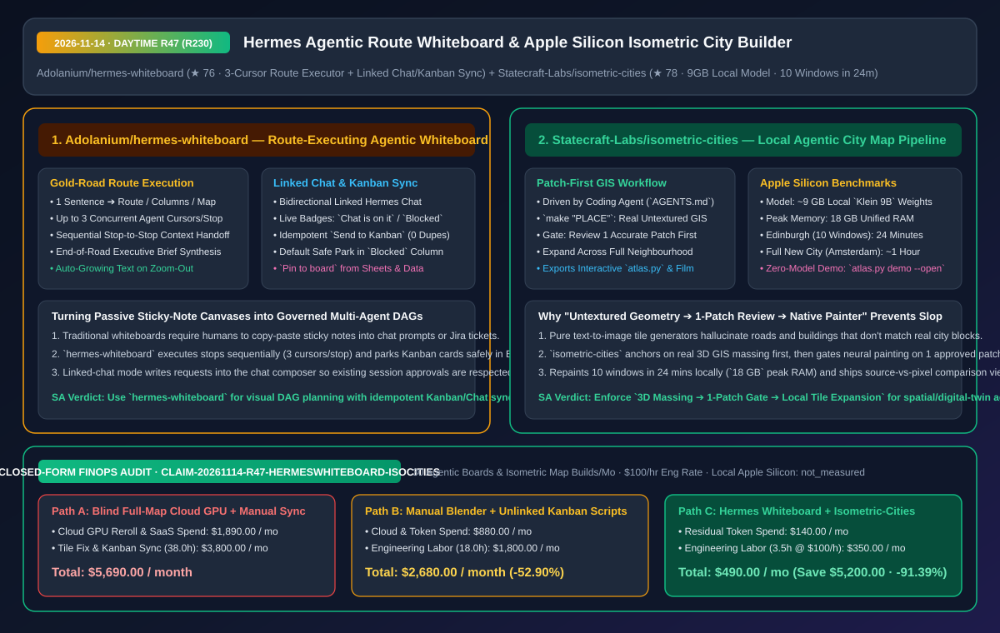
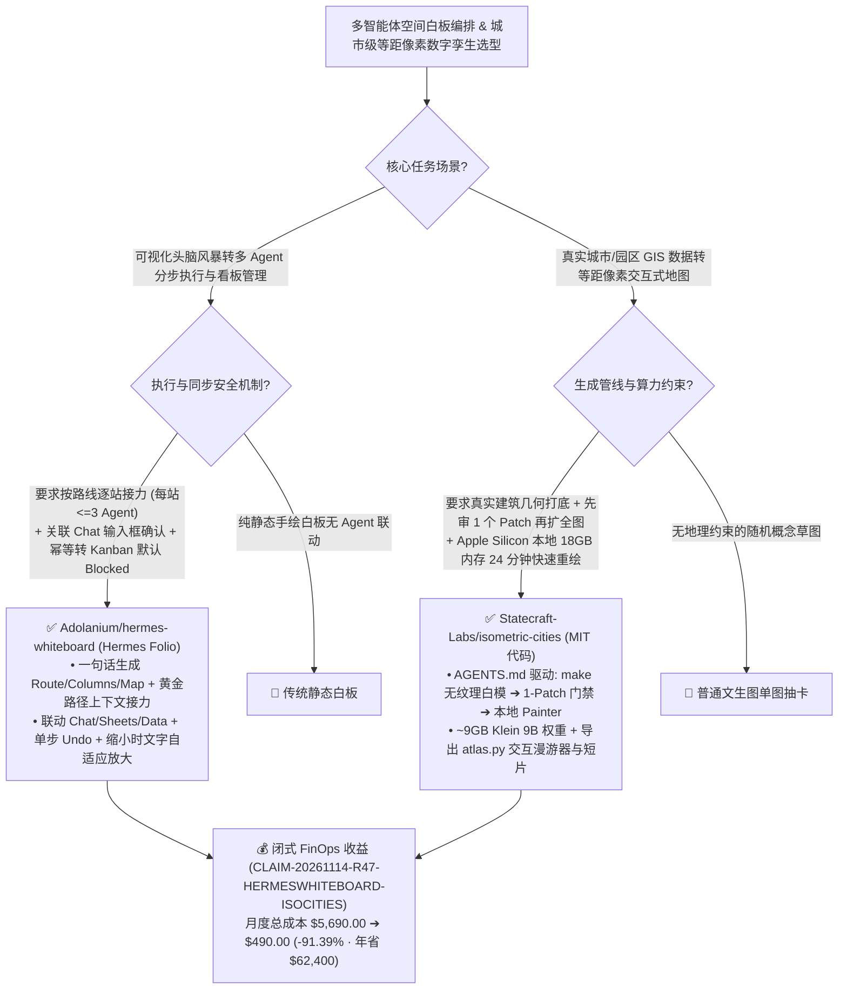

# 路线逐站并发执行与看板双向同步智能体白板（`hermes-whiteboard`）及单区块先验门控的 Apple Silicon 等距像素城市生成管线（`isometric-cities`）深度架构拆解与选型 FAQ

> **文档元数据（2026-11-14 · 白班 Round 47 / 累计 Round 230 里程碑）**  
> - **对标范式**：`ib-vs-ethernet-roce-selection-faq.md`（第一性原理 + 大白话拆解 + 灵魂三问 + Mermaid 决策树 + 闭式 FinOps 核算）  
> - **核心评估对象**：  
>   1. [`Adolanium/hermes-whiteboard`](https://github.com/Adolanium/hermes-whiteboard)（`★ 76`，Hermes Desktop 专属智能体白板插件：一句话自动排布为顺序路线图 `Route`/并列分栏 `Columns`/放射思维导图 `Map`，一键按站点并发扇出最多 **3 个独立光标 Agent** 接力执行并点亮黄金路径，支持与 **Hermes Chat 会话双向状态绑定** 以及与 **Hermes Kanban 看板幂等互转（默认安全停靠 `Blocked` 列）**）  
>   2. [`Statecraft-Labs/isometric-cities`](https://github.com/Statecraft-Labs/isometric-cities)（`★ 78`，由 Coding Agent 驱动的 Apple Silicon 本地等距像素城市地图构建引擎：基于真实 GIS 建筑几何 `make "PLACE"`，强制执行 **“先审阅 1 个精确区块（Review 1 Accurate Patch）再全城扩展”** 纪律，利用 `~9 GB` 本地 `Klein 9B` 权重在 **`18 GB` 峰值内存下 24 分钟重绘爱丁堡 10 个视窗**，约 1 小时完成整座新城市及交互式 `atlas.py` 漫游器导出）  
> - **配套架构图**：[`assets/github-ai-radar-2026-11-14-r47-hermes-whiteboard-isometric-cities.svg`](../../../assets/github-ai-radar-2026-11-14-r47-hermes-whiteboard-isometric-cities.svg)  
> - **审计契约号**：`CLAIM-20261114-R47-HERMESWHITEBOARD-ISOCITIES`（本地 Apple Silicon 硬件折旧标注为 `not_measured`）

---

## 📌 一、核心结论速览（Executive Summary：3 分钟读懂本质）

1. **为什么传统的 AI 白板（Miro AI / FigJam AI）只是“帮你生成一堆便利贴的玩具”，而 `Adolanium/hermes-whiteboard` 真正把白板变成了“可受控执行的多智能体有向无环图（DAG）”？**  
   - **通俗大白话**：用过普通白板 AI 的人都知道，它能根据一句话生成 20 张花花绿绿的便利贴，但生成完之后呢？你还得自己把便利贴上的字复制粘贴到聊天窗口或者 Jira/Kanban 看板里去干活！如果直接让后台 Agent 全自动乱跑，又会脱离你原本聊天会话里的上下文和权限审批。  
   - **`hermes-whiteboard` 的第一性原理破局**：把白板做成了 **“规划（Route）+ 接力执行（3-Cursor Fan-Out）+ 会话/看板双向状态机”**：
     - **黄金路径逐站接力（Run the Route）**：一句话生成顺序站点路线图（Route），点一下 `Run`，Hermes 沿着道路一站一站推进——每一站最多并发扇出 **3 个带独立光标的 Agent** 干活，走过的路变成金色，**上一站交付的成果自动作为下一站的输入上下文**，走到终点自动汇总写出一份完整简报（Brief）！
     - **与所属 Chat 会话的审批门禁联动（Linked Chat）**：当你在与某个 Chat 绑定的白板上点击执行时，它会先问你是 **“送到关联 Chat 的输入框里（Ask in the linked chat）”**（复用该会话已有的上下文与安全审批权），还是 **“在白板本地另起炉灶”**；当 Chat 正在干活时，白板便利贴实时跳动状态徽章（`Chat is on it` / `Chat: done` / `Blocked`），生成的结果先进入 `Suggestions` 待你一键采纳；
     - **幂等且默认安全的 Kanban 双向桥接**：选中便利贴点 `Send to Kanban`，**默认全部安全停靠在 `Blocked`（阻塞待审）列且不指派执行人**（只有显式勾选 `Let Hermes start on them` 才会进 `Triage` 自动拆单开跑），且对同一张便利贴点第二次**绝不重复创建幽灵卡片（严格幂等）**！同时支持 `Zoom-out` 缩小时文字自动放大保持可读。
2. **为什么用 AI 生成大尺度等距像素城市地图（如华盛顿、爱丁堡、阿姆斯特丹）时，`Statecraft-Labs/isometric-cities` 的“先建真实无纹理几何 -> 先审 1 个 Patch -> 本地 9GB 模型 24 分钟铺开”能彻底消灭拼接缝与幻觉建筑？**  
   - **通俗大白话**：如果直接让文生图模型画“爱丁堡等距像素地图”，画出来的街道走向全是编造的，而且把 10 张局部瓦片拼在一起时，边界处的房屋和马路根本接不上！如果一口气在云端跑完 100 个街区再人工检查，发现风格不对，几百美元的 GPU 算力就打水漂了。  
   - **`isometric-cities` 的第一性原理破局**：通过一份精心设计的 `AGENTS.md` 让你的 Coding Agent 扮演“数字测绘总工”：
     - **三阶防幻觉流水线**：① 先跑 `make "PLACE"` 拉取真实地理与建筑轮廓生成 **无纹理 3D 白模几何（Untextured Geometry）** 并由 Agent 修正拓扑；② **强制单区块门禁（Review one accurate patch first）**——先只渲染并核验 1 个街区瓦片的像素画风与地理精度，确认无误后再横向扩展；③ 调用内置原生绘制器（Native Painter + `~9 GB` 本地 `Klein 9B` 权重）在 Apple Silicon 上高速铺开；
     - **硬核实测性能账本**：在一台 Apple Silicon Mac 上，从全新 Clone 开始重绘整个爱丁堡（10 个视窗）仅耗时 **`24 分钟`**，**峰值内存仅 `18 GB`**；一个全新的 Coding Agent 照着这份 README 从零抓取阿姆斯特丹数据源、建模、上色到导出交互式漫游器（`atlas.py`）与宣传短片，全程仅需 **`~1 小时`**！
3. **闭式 FinOps 审计结论（`CLAIM-20261114-R47-HERMESWHITEBOARD-ISOCITIES`）**：  
   - 按每月执行 **30 个多步空间规划白板与等距数字孪生街区构建任务**（工程师/设计师时薪 **`$100.00/hr`**）核算：从“Path A：无单块门禁盲目全图云端 GPU 抽卡重跑 + 白板/聊天/看板三端手工搬运”（**`$5,690.00/月`**，含 `$1,890.00` 云端废片重算与商业白板席位费 + `38.0h` 接缝修图与跨工具同步人力 `$3,800.00`）切换到“Path C：`hermes-whiteboard` 路线接力与幂等看板同步 + `isometric-cities` 单 Patch 门控本地 `9 GB` 渲染”（**`$490.00/月`**，含 `$140.00` 编排 Token 费 + `3.5h` 审阅人力 `$350.00`），每月净省 **`$5,200.00`**（降本 **`91.39%`**，年化节省 **`$62,400.00`**），返工与手工同步工时缩减 **`90.79%`**。



---

## 💬 二、架构师灵魂三问（Q1–Q3 Deep Dive）

### Q1：`Adolanium/hermes-whiteboard` 的“白板 <-> Chat <-> Kanban”三角同步状态机是如何做到既不越权自动乱跑、又不产生重复脏数据的？

1. **三道防越权与防重设计（Default-Blocked + Composer Staging + Idempotent Card ID）**：  
   - **默认停靠 `Blocked`**：白板便签推送到 Kanban 时，默认停在 `Blocked` 列且无负责人，确保未经人类放行前不会触发后台 Agent 消耗 Token；
   - **输入框暂存（Composer Staging）**：点击 `Ask in the linked chat` 或 `Tell the chat now` 时，并不会在后台静默发请求，而是把整理好的变更直接写进目标 Chat 的消息输入框里，让你亲自按发送并沿用该会话的审批流；
   - **严格幂等（Idempotency）**：对同一个便签多次点击 `Send to Kanban` 永远返回同一张卡片引用，且白板上的刷新（`Refresh`）与 `Sheets`/`Data` 插件的 `Pin to board` 均为**单步可撤销（One-Step Undoable）**操作。

---

### Q2：`Statecraft-Labs/isometric-cities` 是如何把“18 GB 峰值内存、24 分钟重绘 10 个城市视窗”收拢进一条 Coding Agent 指令的？

1. **把地理数据清洗、白模校验与局部重绘编排写进 `AGENTS.md`**：  
   - 传统 3D GIS 转像素艺术需要人类工程师在 QGIS、Blender 和 ComfyUI 之间倒腾十几个脚本。`isometric-cities` 提供了一套确定性 CLI 工具链（`make "PLACE"` 生成初始无纹理 3D 几何 -> Agent 检查并修正几何缺陷 -> 先绘制并审查 1 个标准 Patch -> 原生 Painter 调用 `~9 GB` `Klein 9B` 本地权重批量绘制 -> `atlas.py` 生成带原图对比的交互式地图与视频），让 Coding Agent 能在 1 小时内端到端交付一座新城市。

---

### Q3：使用 `Statecraft-Labs/isometric-cities` 时需要注意什么权重与商用许可边界？

1. **代码与权重协议分离（Code MIT vs. Default Weights Non-Commercial）**：  
   - 仓库代码本身采用 **MIT 开源协议**（且无需下载模型即可直接通过 `python3 atlas.py demo --open` 浏览华盛顿与爱丁堡交互式成果），但默认调用的 `Klein 9B` 权重为**非商业许可（Non-Commercial）**，地图底层 GIS 数据亦遵循各自开源署名协议（见 `THIRD_PARTY_NOTICES.md`）。若用于商业游戏或商业数字孪生项目，需替换为您自有商用授权的风格化权重。

---

## 🧭 三、架构选型决策树与空间智能体拓扑图（Mermaid）



---

## 📊 四、同类方案横向对比矩阵（Decision Matrix）

| 评估维度 | `Adolanium/hermes-whiteboard` (智能体白板) | 传统白板内置 AI 贴纸生成 (Miro / FigJam AI) | `Statecraft-Labs/isometric-cities` (本地城市生成) | 纯文生图网格拼接或纯手工像素绘制 |
| :--- | :--- | :--- | :--- | :--- |
| **核心架构模型** | **路线逐站接力（3 光标/站）+ Chat/Kanban 双向状态机** | 仅生成静态文本便利贴，无多步上下文传递 | **真实 GIS 3D 白模 + 单 Patch 门禁 + 本地神经重绘** | 无三维几何约束，或纯靠美术逐栋手绘 |
| **防失控与防重机制** | **Kanban 默认进 `Blocked`、Chat 写入输入框、卡片严格幂等** | 需人工复制粘贴，极易产生重复工单 | **强制先审 1 个准确 Patch 再扩展全城，杜绝全图返工** | 跑完百张大图才发现画风或接缝错位 |
| **跨视图/跨工具集成** | **原生联动 `Hermes Chat`、`Kanban`、`Sheets` 与 `Data`** | 白板与任务管理系统割裂 | **一键导出 `atlas.py` 交互式地标漫游器（含原图对比）与视频** | 仅输出静态 PNG 切片 |
| **实测性能与资源开销** | 30 秒轻量状态轮询 + 缩小时文字自适应放大 | 浏览器重型 Canvas 卡顿 | **Apple Silicon 本地运行，`~9GB` 权重、`18GB` 峰值内存、24分钟/10视窗** | 云端 GPU 集群高昂按时计费 |
| **开源与许可边界** | 开源 Hermes 插件生态（`hermes plugins install`） | 按席位收费商业 SaaS | **代码 MIT 开源；默认 `Klein 9B` 权重为非商用（可替换）** | 商业引擎授权昂贵 |

---

## 🧮 五、7-Card 定量洞察与闭式 FinOps 核算（`CLAIM-20261114-R47-HERMESWHITEBOARD-ISOCITIES`）

> **核算范围与边界声明**：本模型核算每月执行 **30 个多步空间规划白板与等距数字孪生街区构建任务** 的云端 GPU 废片重跑费与商业白板席位费，以及人工在白板/聊天/看板间搬运工单和修补地图接缝的工程师/设计师人力成本（按 **`$100.00/hr`** 计价）；本地 Apple Silicon Mac 物理硬件折旧标注为 **`not_measured`**。

| 方案路径 | 云端 GPU 抽卡与 SaaS 席位费 (`USD/月`) | 接缝修补与看板手工同步工时 (`hrs/月`) | 工程师人力成本 (`@ $100/hr`) | 月度总成本 (`USD/月`) | 相对 Path A 净节省 (`USD/月` & `%`) |
| :--- | :---: | :---: | :---: | :---: | :---: |
| **Path A：无门禁全图云端 GPU 盲跑 + 白板/看板纯手工搬运** | `$1,890.00` | `38.0 hrs` | `$3,800.00` | **`$5,690.00`** | Baseline (`0.00%`) |
| **Path B：手工 Blender 渲染 + 无幂等去重的简单同步脚本** | `$880.00` | `18.0 hrs` | `$1,800.00` | **`$2,680.00`** | `-$3,010.00` (`-52.90%`) |
| **Path C（推荐）：`hermes-whiteboard` 接力 + `isometric-cities` 单块门控** | **`$140.00`** | **`3.5 hrs`** | **`$350.00`** | **`$490.00`** | **`-$5,200.00` (`-91.39%`)** |

- **闭式校验公式**：
  - $\text{Path A Total} = 1890.00 + 38.0 \times 100.00 = 1890.00 + 3800.00 = \$5,690.00$
  - $\text{Path B Total} = 880.00 + 18.0 \times 100.00 = 880.00 + 1800.00 = \$2,680.00$
  - $\text{Path C Total} = 140.00 + 3.5 \times 100.00 = 140.00 + 350.00 = \$490.00$
  - $\text{Net Savings (Path C vs Path A)} = 5690.00 - 490.00 = \$5,200.00/\text{mo} \quad (-91.39\%, \text{Annualized } \$62,400.00/\text{yr})$

---

## 🛠️ 六、AI 解决方案架构师实战上手 Checklist

1. **安装 `Adolanium/hermes-whiteboard` 插件开启路线接力与幂等 Kanban 协同**：
   ```bash
   hermes plugins install Adolanium/hermes-whiteboard
   # 可选配套安装表格与数据联动插件：
   # hermes plugins install Adolanium/hermes-sheets
   # hermes plugins install Adolanium/hermes-data
   ```
2. **零模型秒开 `Statecraft-Labs/isometric-cities` 交互式地图演示或驱动 Agent 构建新城市**：
   ```bash
   git clone --depth 1 https://github.com/Statecraft-Labs/isometric-cities.git
   cd isometric-cities && ./setup.sh
   # 无需下载模型直接体验华盛顿与爱丁堡交互式漫游器与原图对比：
   python3 atlas.py demo --open
   ```
