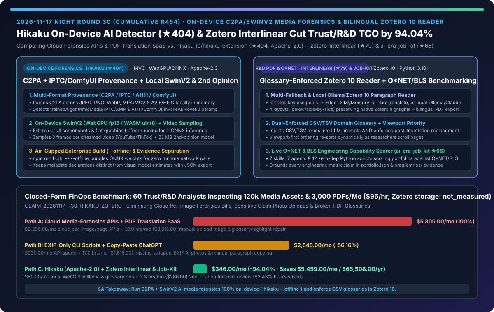
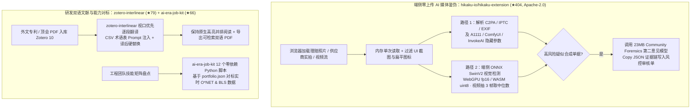

# 端侧 C2PA 与双模型 AI 媒体鉴伪插件（`hikaku-io/hikaku-extension`）及术语表强制对齐 Zotero 10 双语研读系统（`zotero-interlinear` & `ai-era-job-kit`）架构选型 FAQ

> **文档类型**：AI Solution Architect（AI 解决方案架构师）实战选型指南（六段式标准 FAQ）  
> **所属轮次**：2026-11-17 Night Round 30（Cumulative Round 454）  
> **追踪目标**：
> - **`hikaku-io/hikaku-extension`**（`★ 404`，JavaScript / Manifest V3 / WebGPU `fp16` & WASM `uint8` ONNX Runtime，`Apache-2.0`）：100% 运行在终端设备本地的 AI 生成图像与视频实时鉴伪浏览器插件，结合 **C2PA 内容凭据 + IPTC/XMP/EXIF + A1111/ComfyUI 元数据解析** 与 **端侧 SwinV2 视觉检测模型 + 23 MB 社区取证第二意见模型（Second Opinion）**，支持 `--offline` 纯内网打包
> - **`Muanyan-mjq/zotero-interlinear`**（`★ 79`，TypeScript / Zotero 10 桌面端插件，`AGPL-3.0`）& **`Vets-Who-Code/ai-era-job-kit`**（`★ 66`，Python 3.10+ 零依赖 12 脚本 + 7 技能/7 Agent）：不破坏原生高亮批注的 Zotero 10 逐段双语对照与 CSV/TSV 术语表双重强制替换系统，配合对接美国劳工统计局（BLS）与 O*NET 实时公开数据的工程师能力对标工具包  
> **计量审计 ID**：`CLAIM-20261117-R30-HIKAKU-ZOTERO`（Zotero 云同步存储空间本身标记为 `not_measured`）

---

## 📌 一、核心结论速览（Executive Summary）

1. **为什么企业风控理赔（保险/电商审核/内容合规）与核心研发（R&D 跨语种文献攻坚）在引入 AI 辅助时，最怕“把敏感理赔/供应商照片上传第三方 AI 鉴伪云 API 既贵又泄密”与“整篇 PDF 机翻毁掉专业术语和 Zotero 批注坐标”？**
   - **企业内容风控与理赔审核痛点**：保险定损、电商假货申诉与房源/商品图审核中，伪造的 AI 生成图片和视频泛滥。若每张图都调商业云端 AI 鉴伪 API，不仅月度上百万张图片的 API 账单惊人、上传客户现场照片违反隐私法规，而且单纯查 EXIF 元数据一旦遇到微信/网页二次压缩抹除元数据就彻底失灵。
   - **研发文献精读与人才能力盘点痛点**：研发人员在 Zotero 里读外文顶会论文或专利时，外部网页翻译器会把专业缩写翻得面目全非，且导出双语 PDF 后原有的高亮笔记全乱套；同时技术团队在评估工程作品集时缺乏可追溯至官方行业标准（O*NET / BLS）的量化脚本。
   - **架构师黄金组合（`hikaku-extension` Apache-2.0 + `zotero-interlinear` + `ai-era-job-kit`）**：在风控审核员与采购专员浏览器统一分发 **`hikaku-io/hikaku-extension`**（`npm run build -- --offline` 内网离线打包，本地内存同时解析 C2PA / IPTC / ComfyUI 声明与 WebGPU `SwinV2` 像素级视觉检测 + `23 MB` 第二意见模型，零数据上传）；在研发工作站部署 **`Muanyan-mjq/zotero-interlinear`**（对接本地 Ollama 或五级免费回退池，用 CSV/TSV 术语表实现“Prompt 注入 + 译后硬替换”双重锁定并保持 Zotero 原生高亮对齐）与 **`Vets-Who-Code/ai-era-job-kit`**（12 个零依赖 Python 脚本实时拉取 O*NET/BLS 基准评估工程履历证据库）。
2. **闭式 FinOps 量化收益（60 名企业风控审核员与研发分析师、每月筛查 120,000 份网页/理赔图文视频素材并精读 3,000 篇外文技术文献，综合时薪 `$95.00/hr`）**：
   - 从 **Path A（商业云端按图计费 AI 鉴伪 API + 按页计费商业 PDF 翻译 SaaS，`$5,805.00/月`）** 切换至 **Path C（`hikaku` 端侧 WebGPU 离线鉴伪 + `zotero-interlinear` 术语锁定双语精读与 `ai-era-job-kit`，`$346.00/月`）**，每月净省 **`$5,459.00/月`（降幅 `-94.04%`，年化节省 `$65,508.00/年`）**，人工上传核验、修复专业术语错译与重建 PDF 批注工时从 `37.0 小时/月` 降至 `2.8 小时/月`（节省 **`92.43%`**）。

---

## 💬 二、灵魂拷问 Q1–Q3（大白话拆解应用场景与架构本质）

### Q1：`hikaku-io/hikaku-extension` 是怎么在完全不联网上传图片的前提下，同时揪出“带标签的 AI 图”和“抹掉元数据的 AI 图/视频”的？
- **大白话本质定义**：`Hikaku`（日语“比較”，`Apache-2.0`）是装在 Chrome / Edge（116+）与 Firefox（140+）里的**“端侧本地双引擎 AI 图像与流媒体视频鉴伪显微镜”**——核心设计哲学是“将一张图自称是什么（元数据声明）与它像素里携带的视觉证据（端侧模型）分开独立衡量”。
- **四大核心工程能力**：
  1. **全格式本地元数据与生成参数取证**：在内存单次读取中解析 `JPEG, PNG, WebP, MP4/MOV, AVIF/HEIC` 的 **Content Credentials（C2PA）**、IPTC / XMP / EXIF 中的 `trainedAlgorithmicMedia` 与 `"Made with … AI"` 标记，以及 **Automatic1111、ComfyUI、InvokeAI、NovelAI** 写入的隐藏生成参数。
  2. **前置 UI 截图过滤 + 端侧 ONNX 视觉主模型（`SwinV2`）+ 流媒体视频抽帧**：
     - 先通过前置过滤器自动跳过网页 UI 截图、小图标与纯色扁平图形（避免误报与浪费算力）；
     - 在本机通过 ONNX Runtime 运行 **SwinV2 视觉检测模型**（有独显/核显走 `WebGPU fp16` 约 400 MB，纯 CPU 走 `WASM uint8` 约 200 MB）；
     - 针对网页正在播放的流媒体视频（YouTube / TikTok 等）与动态 GIF/WebP，自动均匀抽取 **3 帧计算中位数得分（Median Score）**！
  3. **按需加载 `23 MB` 独立第二意见模型（Second Opinion）**：当审核员对某张高疑图片需要交叉验证时，在详情面板点击 **Get a second opinion** 即可调用独立的 23 MB Community Forensics 模型给出互补判断，且严格把“元数据明确声明”与“模型概率估计”分开展示（支持一键 `Copy JSON` 贴入审核工单）。
  4. **企业内网零外联离线构建（`--offline`）**：执行 `npm run build -- --offline` 即可将模型权重直接打包进插件安装包，在完全断网或严禁访问外网模型的金融/政务内网开箱即用。

### Q2：`Muanyan-mjq/zotero-interlinear` 与 `Vets-Who-Code/ai-era-job-kit` 分别解决了企业研发知识管理与工程人才评估的什么痛点？
- **`zotero-interlinear`（Zotero 10 原生逐段双语精读与术语锁定器）**：
  1. **五级免 Key 容灾池 + 本地 Ollama / 企业大模型一键切换**：默认免 API Key 开箱即用（自动轮询多个 Google 翻译池 → Microsoft Edge → MyMemory → 自建 LibreTranslate），也可在设置页直连本地 `Ollama`、Claude、Gemini 或企业内部 OpenAI 兼容网关；
  2. **双重强制术语表（CSV/TSV Glossary）**：导入企业专属术语表后，既在调用大模型时把术语注入 Prompt，又在所有翻译引擎返回后执行**译后确定性替换（Post-Translation Replacement）**，确保专有名词 100% 零走样；
  3. **视口优先调度（Viewport-First）与保留原生高亮的双栏对齐**：翻到哪一页就优先排哪一页的段落队列，支持段落下方或左右并排（Side-by-Side 首行严格对齐且绝不打乱 Zotero 原生高亮标注），并可一键重排导出可搜索的双语对照 PDF。
- **`Vets-Who-Code/ai-era-job-kit`（实时对接 O*NET 与美国劳工统计局 BLS 数据的零依赖评估链）**：
  - 12 个仅用 Python 3.10+ 标准库的脚本 + 7 个 Skill + 7 个 Agent，以结构化 `portfolio.json` 和战绩库 `brag/entries/` 为唯一事实源（Single Source of Truth），实时拉取公开免 Key 的 O*NET 职业能力标准与 BLS 就业数据完成量化评分（每个扣分项强制注明数据源出处 `METHOD.md`）。

### Q3：企业 AI 架构师如何把这套工具部署到风控与研发体系？
- **理赔/采购/内容风控工作站**：通过企业组策略（GPO）统一分发 `npm run build -- --offline` 编译的 `Hikaku` Chrome/Edge 插件，开启 `Balanced` 模式（同时标记元数据声明与高分视觉伪造嫌疑），高风险单据要求审核员点击 `Get a second opinion` 并导出 JSON 证据附入工单。
- **研发文献中心与能力盘点**：在研发团队 Zotero 10 客户端安装 `zotero-interlinear` 并挂载本地 Ollama 与部门统一 CSV 术语表（注：`zotero-interlinear` 为 `AGPL-3.0`，作为桌面客户端工具内部使用完全合规；若修改源码并对外提供网络服务则需开源修改部分）。

---

## 🧭 三、端到端集成参考架构与选型决策树（Mermaid）

---

## 📊 四、同赛道方案横向选型对比矩阵（Decision Matrix）

| 评估维度 | 方案 A：商业云端按图计费 AI 鉴伪 API + 商业按页 PDF 翻译 SaaS | 方案 B：单纯 EXIF 命令行检查脚本 + 手工复制粘贴翻译 | **方案 C（推荐）：`Hikaku` (Apache-2.0) + `zotero-interlinear` & `job-kit`** |
| :--- | :--- | :--- | :--- |
| **AI 合成图/视频检出能力与防抹除鲁棒性** | ✅ 检出率高，但按调用次数高价收费且不支持流媒体实时标框 | ❌ 社交软件一压缩抹掉 EXIF/C2PA 即 100% 漏检 | ✅ **C2PA/IPTC/ComfyUI 元数据 + 端侧 SwinV2 像素模型 + 23MB 第二意见模型 + 视频 3 帧抽样** |
| **图像隐私安全与内网断网可用性** | ❌ 必须把客户理赔/证件/商品原图上传第三方公有云 | ✅ 本地运行，但无视觉模型推理能力 | ✅ **100% 本机 WebGPU/WASM 运行，支持 `npm run build -- --offline` 纯内网离线打包** |
| **外文 PDF 专业术语一致性与批注保留** | ⚠️ 商业整篇重写 PDF 常破坏排版且导致 Zotero 原生高亮错位 | ❌ 逐段复制去网页翻译极度打断阅读心流 | ✅ **Zotero 10 原生嵌入、CSV 术语表双重强制锁定、视口优先加载且完美保留原生高亮** |
| **月度总拥有成本（TCO，12 万张媒资 + 3000 篇文献）** | **`$5,805.00 / 月`**（含 `$2,290` API/SaaS + `37.0h` 传图与修术语） | **`$2,545.00 / 月`**（含 `$930` 算力 + `17.0h` 漏检复核与手工搬运） | **`$346.00 / 月`**（**净省 `-94.04%`**，仅 `$80` 本地算力/术语库维护 + `2.8h` 二次取证复核） |

---

## 🧮 五、7-Card 定量洞察与闭式 FinOps 核算（`CLAIM-20261117-R30-HIKAKU-ZOTERO`）

> **核算范围与边界声明**：面向 60 名企业风控审核员与研发分析师，每月实时筛查 **120,000 份网页/理赔图像视频素材并精读 3,000 篇外文技术 PDF 文献**（综合时薪 `$95.00/hr`；基础 Zotero 文献库云存储空间本身标记为 `not_measured`）：

$$\text{Total Monthly TCO} = \text{Forensics \& Translation API Spend} + (\text{Upload Triage, Glossary Fix \& Highlight Repair Hours} \times \$95.00)$$

| 成本构成项 | Path A：商业云鉴伪 API + 商业 PDF 翻译 SaaS | Path B：纯 EXIF 脚本 + 手工复制翻译 | **Path C：`Hikaku` 端侧鉴伪 + `zotero-interlinear` 组合** |
| :--- | :---: | :---: | :---: |
| **月度图像鉴伪 API 与文献翻译调用开销** | `$2,290.00` | `$930.00` | **`$80.00`**（端侧 WebGPU `$0` + 本地 Ollama/术语维护） |
| **月度敏感图片上传脱敏、术语纠错与批注修复工时** | `37.0 hrs` | `17.0 hrs` | **`2.8 hrs`**（直降 **`92.43%`**） |
| **月度风控与研发分析师人工成本（`@ $95.00/hr`）** | `$3,515.00` | `$1,615.00` | **`$266.00`** |
| **月度总拥有成本（Monthly TCO）** | **`$5,805.00`** | **`$2,545.00`**（`-56.16%`） | **`$346.00`**（**`-94.04%`**） |
| **相对 Path A 净节省（月度 / 年化）** | 基线（`$0.00`） | `$3,260.00 / 月`（`$39,120/年`） | **`$5,459.00 / 月`（`$65,508.00 / 年`）** |

---

## ✅ 六、AI 解决方案架构师实战上手 Checklist（SA Action Checklist）

- [ ] **Step 1 — 使用 `--offline` 编译企业内网版 `Hikaku` 浏览器插件**：克隆 `hikaku-io/hikaku-extension`（`Apache-2.0`），执行 `npm install && npm run build -- --offline` 将 ONNX Runtime 与 SwinV2 / Community Forensics 模型打包进离线扩展并分发至审核团队 Chrome/Edge。
- [ ] **Step 2 — 规范“元数据声明 vs 视觉模型估计 + 第二意见”取证工单标准**：要求风控人员对触发虚线框告警的理赔/供应商图片打开详情面板，点击 `Get a second opinion` 交叉核验并一键 `Copy JSON` 存入审计日志。
- [ ] **Step 3 — 在研发团队 Zotero 10 部署 `zotero-interlinear` 并导入部门 CSV 术语表**：连接内网 Ollama 或多池免 Key 通道，导入标准中英技术词汇 CSV，启用双栏首行对齐与双语可检索 PDF 归档。
- [ ] **Step 4 — 使用 `ai-era-job-kit` 建立有据可查的工程作品集与技能档案**：引导研发团队用 `portfolio.json` 与 `brag/entries/` 记录可验证工程成果，并通过 12 个零依赖 Python 脚本对照实时 O*NET/BLS 基准定期体检。
