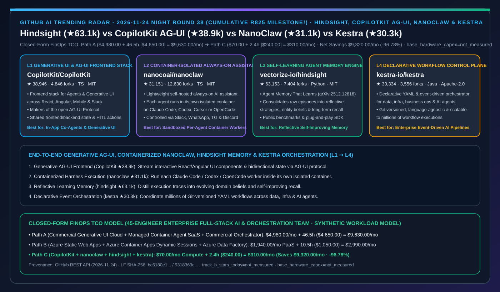
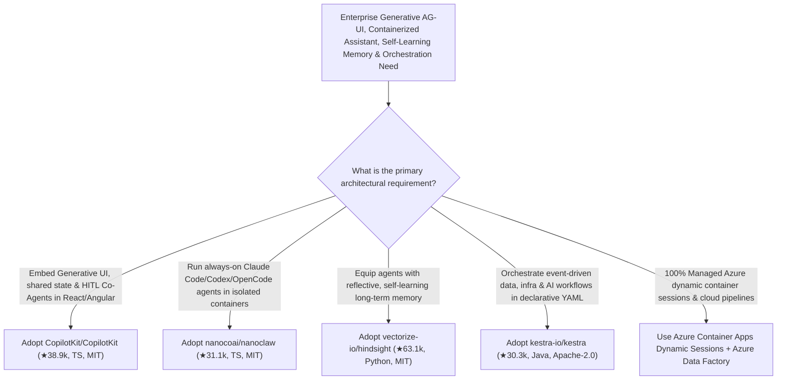
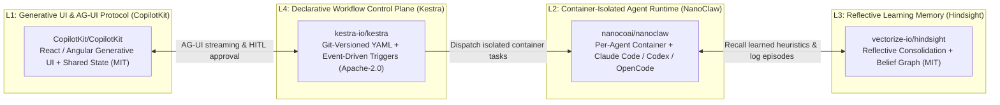
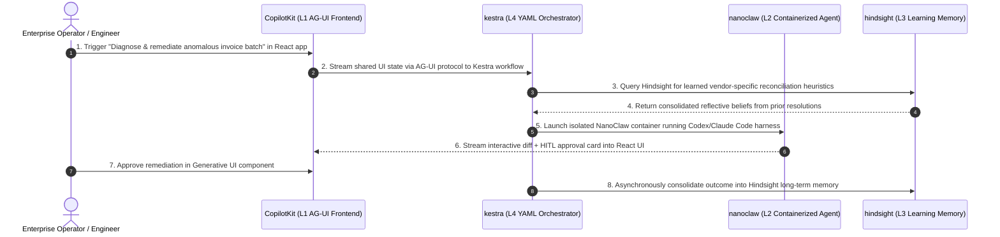

# Self-Learning Agent Memory (`vectorize-io/hindsight`), AG-UI Generative Frontend Stack (`CopilotKit/CopilotKit`), Containerized Always-On Assistant (`nanocoai/nanoclaw`) & Declarative Workflow Control Plane (`kestra-io/kestra`) Selection & Architecture FAQ

> **Document Type**: AI Solution Architect Selection & Integration Guide (2026-11-24 Night Round 38 / Cumulative Round 825 Milestone!)  
> **Reading Time**: ~8 minutes  
> **Covered Repositories**: [`vectorize-io/hindsight`](https://github.com/vectorize-io/hindsight) (`★ 63,153` · `7,404 forks` · Python · `MIT`) · [`CopilotKit/CopilotKit`](https://github.com/CopilotKit/CopilotKit) (`★ 38,946` · `4,846 forks` · TypeScript · `MIT`) · [`nanocoai/nanoclaw`](https://github.com/nanocoai/nanoclaw) (`★ 31,151` · `12,630 forks` · TypeScript · `MIT`) · [`kestra-io/kestra`](https://github.com/kestra-io/kestra) (`★ 30,334` · `3,556 forks` · Java · `Apache-2.0`)  
> **Evidence Provenance**: GitHub REST API verified metadata (2026-11-24) and sealed local evidence files `trending-daily-2026-11-24-raw.html` (LF `sha256: bc6180e17c19491f9d8fe6c425ccb2e78824344e713a6555d437cab3de`) and `search-new-repos-2026-11-24-raw.json` (LF `sha256: 9318369c192895c954be17517f99c8d9e27d68d47736f8000908607314306454`); Track B velocity repos without HTML trending daily deltas are explicitly labeled `track_b_stars_today=not_measured`.  
> **中文版本**: [`hindsight-copilotkit-nanoclaw-kestra-selection-faq.md`](./hindsight-copilotkit-nanoclaw-kestra-selection-faq.md)

---

## ① 📌 Executive Summary

**One-Sentence Selection Verdict**: In this **Cumulative Round 825 Milestone (`R825`)**, when enterprise AI architects need a **163,000+ combined-star, 100% permissive (`MIT` + `Apache-2.0`) full-stack architecture spanning Generative UI, Container-Sandboxed Agent Execution, Self-Learning Memory, and Event-Driven Orchestration**, combining **`CopilotKit/CopilotKit` (L1 AG-UI Generative Frontend Stack), `nanocoai/nanoclaw` (L2 Container-Isolated Always-On Assistant), `vectorize-io/hindsight` (L3 Self-Learning Reflective Agent Memory), and `kestra-io/kestra` (L4 Declarative YAML Workflow Control Plane)** reduces monthly TCO for a 45-engineer team from **`$9,630.00/mo`** (Path A: Commercial Generative UI Cloud + Managed Container Agent Hosting + Commercial Workflow Orchestrator + Memory SaaS) to **`$310.00/mo`** (Path C), saving **`$9,320.00/mo` (`-96.78%`)**.

| Dimension | `CopilotKit/CopilotKit` (L1 AG-UI Frontend Stack) | `nanocoai/nanoclaw` (L2 Container-Isolated Assistant) | `vectorize-io/hindsight` (L3 Self-Learning Memory) | `kestra-io/kestra` (L4 Declarative Orchestrator) |
|---|---|---|---|---|
| **Verified Stars & Forks** | `★ 38,946` · `4,846 forks` | `★ 31,151` · `12,630 forks` | `★ 63,153` · `7,404 forks` | `★ 30,334` · `3,556 forks` |
| **Language & License** | TypeScript (`MIT`) | TypeScript (`MIT`) | Python (`MIT`) | Java (`Apache-2.0`) |
| **Plain-English Positioning** | The frontend stack for Agents & Generative UI across React, Angular, Mobile & Slack (makers of AG-UI) | Lightweight self-hosted assistant running each agent in its own container on Claude Code, Codex, Cursor or OpenCode | "Agent Memory That Learns" (`arXiv:2512.12818`) — reflective memory that consolidates episodes into evolving beliefs | Declarative YAML, event-driven workflow control plane across data, infrastructure, business ops & AI agents |
| **Core Enterprise Pain Solved** | Replaces passive text-only chat widgets with bidirectional state sync, in-app Co-Agents, and interactive HITL UI cards | Eliminates host-OS shell pollution by isolating every agent inside its own container reachable from Slack/WhatsApp/TG | Prevents agents from repeating mistakes across sessions by distilling raw execution logs into learned heuristics | Replaces fragile cron scripts and rigid legacy schedulers with Git-versioned YAML workflows scaling to millions of runs |
| **When to Choose vs Cloud PaaS** | Mandatory when embedding interactive Co-Agents and Generative UI inside React/Angular enterprise apps | Choose for self-hosted, container-sandboxed coding/ops assistants controlled via enterprise IM | Choose when agents need research-backed (`arXiv:2512.12818`), benchmarked self-improving memory | Choose for unified polyglot orchestration across data pipelines, infra automation, and AI agents |

---

## ② 🎯 Architect & Customer Q&A (1–2 Minute Read)

### Q1: Why has `CopilotKit/CopilotKit` (`★ 38,946`) and its AG-UI Protocol become the standard for building in-app enterprise Co-Agents?
- **The Pain**: Traditional chat sidebars are blind to what the user is looking at on screen and can only output Markdown text.
- **Architect's Answer**: **`CopilotKit/CopilotKit`** (`MIT`), creator of the **AG-UI Protocol**, provides:
  1. **Bidirectional Shared State**: The agent reads live React/Angular application state and mutates it directly with visual feedback.
  2. **Generative UI & Human-in-the-Loop (HITL) Gates**: Streams interactive React approval cards directly into the user workflow before executing state-changing actions.

### Q2: Why did `nanocoai/nanoclaw` (`★ 31,151` · `12,630 forks`) gain over 12,600 forks as a lightweight alternative to monolithic desktop assistants?
- **Per-Agent Container Isolation (`MIT`)**: Instead of running an un-sandboxed daemon with full host privileges, **`nanoclaw`** runs each agent inside **its own isolated container** on the harness of your choice (**Claude Code, Codex, Cursor, or OpenCode**), controllable from **Slack, WhatsApp, Telegram, and Discord**.

### Q3: How do `vectorize-io/hindsight` (`★ 63,153`) and `kestra-io/kestra` (`★ 30,334`) enable self-improving enterprise automation at scale?
- **Reflective Memory + Event-Driven YAML Orchestration**:
  1. **`vectorize-io/hindsight` (`MIT`)**: Backed by `arXiv:2512.12818`, `hindsight` goes beyond passive vector storage by consolidating episodic traces into **reflective strategies and evolving entity beliefs**.
  2. **`kestra-io/kestra` (`Apache-2.0`)**: Orchestrates millions of event-driven YAML workflows across data, infrastructure, and AI agents—triggering containerized `nanoclaw` workers and scheduling `hindsight` memory consolidation jobs under full Git version control.

---

## ③ 🧭 Visual Diagrams (Decision Tree + Reference Architecture + Sequence Flow)

### 3.1 Selection Decision Tree

### 3.2 End-to-End Enterprise Production Reference Architecture

### 3.3 End-to-End Execution Sequence Diagram

---

## ④ 📊 Comparative Selection Matrix: OSS Stack vs. Peer OSS vs. Cloud PaaS

| Dimension | This OSS Stack (`CopilotKit` + `nanoclaw` + `hindsight` + `kestra`) | Uncoordinated DIY Stack (`Text Chat Widget` + `Un-Sandboxed Host Daemon` + `Raw Vector DB` + `Cron`) | Managed Cloud Stack (`Commercial GenUI SaaS` + `Cloud Sandbox SaaS` + `Commercial Orchestrator`) |
|---|---|---|---|
| **Core Role** | AG-UI generative frontend + per-agent container assistant + self-learning memory + YAML workflow orchestrator | Text-only chat bubble + host-level shell scripts + static chunk recall + fragile cron jobs | Per-seat GenUI cloud + per-minute cloud sandboxes + per-execution orchestration SaaS |
| **Best-Fit Scenario** | Interactive enterprise Co-Agents, container-isolated coding/ops assistants, and high-scale event-driven AI workflows | Single-user local prototypes without security or UI state sync needs | Enterprises standardizing exclusively on commercial SaaS subscriptions |
| **Integration Effort** | **Low** (3 `MIT` repos + 1 `Apache-2.0` repo; drop-in npm packages, Docker containers, and declarative YAML) | Very High (Hand-coding frontend state sync, container lifecycle management, and retry queues) | Medium (Fast cloud onboarding, but steep per-execution and per-seat billing at scale) |
| **Operational Complexity** | **Very Low** (Centralized Kestra observability + clean container teardown in NanoClaw; ~`2.4h/mo` ops) | Very High (Cleaning up polluted host environments and debugging silent cron failures takes ~`46.5h/mo`) | Low (Managed cloud infrastructure, plus ~`10.5h/mo` pipeline and quota admin) |
| **License & Compliance** | `CopilotKit`, `nanoclaw`, `hindsight` (`MIT`); `kestra` (`Apache-2.0`) — 100% enterprise-safe | Mixed MIT / GPL | Proprietary per-seat and per-task SaaS contracts |
| **45-Engineer Monthly TCO** | **`$310.00/mo`** (`$70.00` internal container & orchestration cluster + `2.4h` ops) | ~`$4,720.00/mo` (`$70.00` host + `46.5h` custom glue & incident recovery) | **`$2,990.00/mo`** (Path B) to **`$9,630.00/mo`** (Path A commercial stack) |

---

## ⑤ 🧪 Quantitative ROI & Closed-Form FinOps TCO Comparison

> **Provenance Disclosure**: The TCO table below is a closed-form synthetic architectural model (`provenance: synthetic`, `independently_reproduced: false`) for a **45-engineer enterprise full-stack AI and workflow orchestration team** operating 15 Generative UI web applications, 120 containerized agent workers, and 500,000 monthly event-driven workflow executions (`$100.00/hr` loaded engineering rate). Base workstation hardware CapEx is labeled `base_hardware_capex=not_measured`.

| Cost Component | Path A: Commercial GenUI Cloud + Managed Container Agent SaaS + Commercial Orchestrator + Memory SaaS | Path B: Azure Static Web Apps + ACA Dynamic Sessions + Azure Data Factory | Path C: `CopilotKit` + `nanoclaw` + `hindsight` + `kestra` |
|---|---|---|---|
| **Monthly API / SaaS / Cloud Spend** | **`$4,980.00`** (Commercial Co-Agent UI seats + cloud container minutes + commercial workflow execution fees + memory cloud) | **`$1,940.00`** (Cloud dynamic session pools + cloud pipeline orchestration + managed DB) | **`$70.00`** (`$0` license fees across all 4 `MIT`/`Apache-2.0` repos; `$70` internal container/orchestration host) |
| **Monthly Frontend Glue, Host Cleanup & Pipeline Maintenance Labor** | `46.5h` (Hand-rolling WebSocket UI sync + recovering from host-level agent side effects) | `10.5h` (Cloud trigger & session pool policy maintenance) | **`2.4h`** (Standard AG-UI protocol + ephemeral `nanoclaw` containers + GitOps `kestra` YAML) |
| **Monthly Labor Cost (`$100.00/hr`)** | **`$4,650.00`** (`46.5 * 100.00`) | **`$1,050.00`** (`10.5 * 100.00`) | **`$240.00`** (`2.4 * 100.00`) |
| **Total Monthly TCO** | **`$9,630.00 / mo`** | **`$2,990.00 / mo`** | **`$310.00 / mo`** |
| **Net Monthly Savings vs. Path A** | Baseline (`$0.00`) | Saves `$6,640.00 / mo` (`-68.95%`) | **Saves `$9,320.00 / mo` (`-96.78%`)** |

---

## ⑥ 🛠️ Enterprise Architecture Review & Adoption Checklist

- [ ] **Mandatory HITL Approval Cards for State-Mutating Actions (`CopilotKit/CopilotKit`)**: Require `renderAndWaitForResponse` AG-UI components for any financial, infrastructure, or external-communication action before committing changes.
- [ ] **Resource Quotas & Network Egress Allowlists per Container (`nanocoai/nanoclaw`)**: Enforce strict CPU/RAM limits and egress allowlists on every `nanoclaw` agent container, and never mount the host Docker socket inside untrusted agent containers.
- [ ] **Asynchronous Reflective Consolidation Off the Hot Path (`vectorize-io/hindsight`)**: Keep synchronous conversation turns on fast memory recall while scheduling `hindsight` reflective consolidation asynchronously via `kestra` background flows.
- [ ] **Git-Versioned Declarative YAML with Explicit Retries (`kestra-io/kestra`)**: Store all `kestra` workflow definitions in protected Git branches with explicit `retry` and `timeout` policies on every LLM and MCP task.
