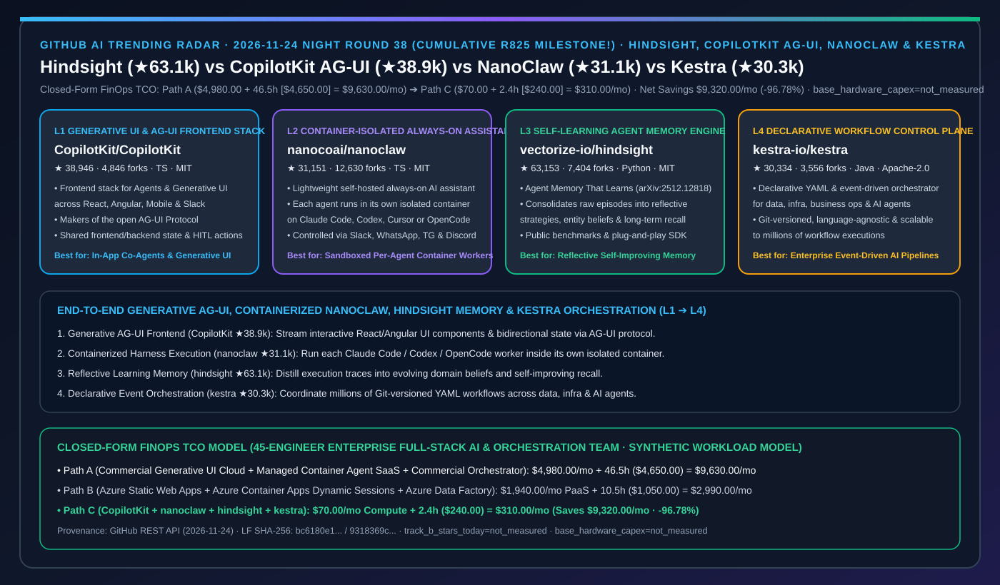
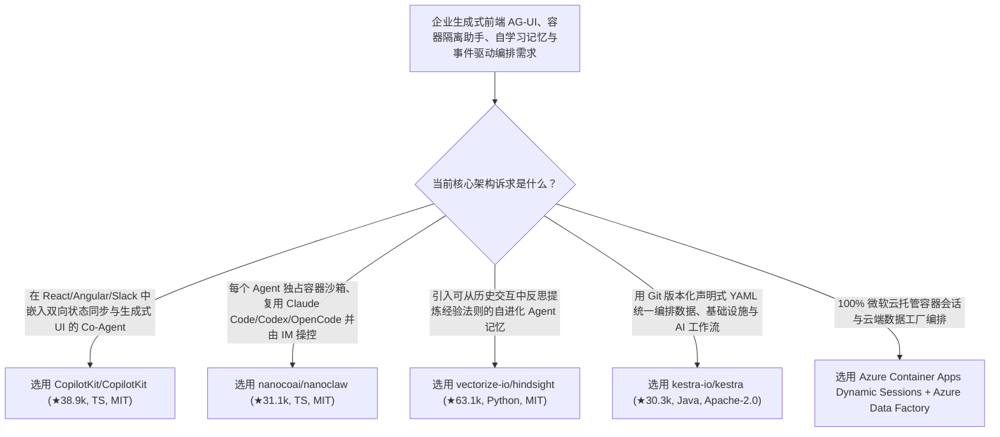
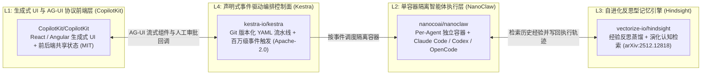
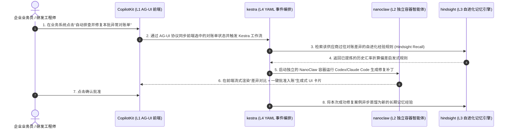

# 自进化智能体记忆（`vectorize-io/hindsight`）、AG-UI 生成式前端框架（`CopilotKit/CopilotKit`）、单容器隔离全天候智能体（`nanocoai/nanoclaw`）与声明式事件编排中枢（`kestra-io/kestra`）选型与集成 FAQ

> **文档类型**：AI 解决方案架构师（AI Solution Architect）选型决策指南（2026-11-24 Night Round 38 / 累计第 825 轮里程碑）  
> **阅读耗时**：约 8 分钟  
> **覆盖项目**：[`vectorize-io/hindsight`](https://github.com/vectorize-io/hindsight)（`★ 63,153` · `7,404 forks` · Python · `MIT`） · [`CopilotKit/CopilotKit`](https://github.com/CopilotKit/CopilotKit)（`★ 38,946` · `4,846 forks` · TypeScript · `MIT`） · [`nanocoai/nanoclaw`](https://github.com/nanocoai/nanoclaw)（`★ 31,151` · `12,630 forks` · TypeScript · `MIT`） · [`kestra-io/kestra`](https://github.com/kestra-io/kestra)（`★ 30,334` · `3,556 forks` · Java · `Apache-2.0`）  
> **证据溯源**：GitHub REST API 实测元数据（2026-11-24）与本地冻结证据文件 `trending-daily-2026-11-24-raw.html`（LF `sha256: bc6180e17c19491f9d8fe6c425ccb2e78824344e713a6555d437cab3de`）、`search-new-repos-2026-11-24-raw.json`（LF `sha256: 9318369c192895c954be17517f99c8d9e27d68d47736f8000908607314306454`）；Track B 仓库无 HTML 榜单对应的单日增量，统一标记为 `track_b_stars_today=not_measured`。  
> **English Version**: [`hindsight-copilotkit-nanoclaw-kestra-selection-faq.en.md`](./hindsight-copilotkit-nanoclaw-kestra-selection-faq.en.md)

---

## ① 📌 核心结论速览（Executive Summary）

**选型一句话结论**：在第 825 轮里程碑（`R825 Milestone`）中，当企业架构师需要一套**合计超 16.3 万 Star、100% 商业友好协议（`MIT` + `Apache-2.0`）的全栈 AI 智能体应用与编排底座**时，采用 **`CopilotKit/CopilotKit`（L1 制定开放 AG-UI 协议的生成式 UI 与应用内 Co-Agent 前端栈）+ `nanocoai/nanoclaw`（L2 每个 Agent 运行在独立容器沙箱内、支持 Claude Code/Codex/Cursor/OpenCode 的轻量全天候助手）+ `vectorize-io/hindsight`（L3 6.3 万星自进化反思型智能体记忆引擎）+ `kestra-io/kestra`（L4 支持百万级执行规模的声明式 YAML 事件驱动数据与 AI 工作流控制面）**，可将 45 人团队的月度 TCO 从商业生成式 UI 云 + 商业容器沙箱订阅 + 商业企业编排平台（Path A）的 **`$9,630.00/月`** 降至 **`$310.00/月`**（净省 **`$9,320.00/月`**，降幅 **`-96.78%`**）。

| 评估维度 | `CopilotKit/CopilotKit` (L1 AG-UI 生成式前端栈) | `nanocoai/nanoclaw` (L2 单容器隔离全天候助手) | `vectorize-io/hindsight` (L3 自进化智能体记忆) | `kestra-io/kestra` (L4 声明式事件编排中枢) |
|---|---|---|---|---|
| **GitHub 实测热度** | `★ 38,946` · `4,846 forks` | `★ 31,151` · `12,630 forks` | `★ 63,153` · `7,404 forks` | `★ 30,334` · `3,556 forks` |
| **实现语言与开源协议** | TypeScript (`MIT`) | TypeScript (`MIT`) | Python (`MIT`) | Java (`Apache-2.0`) |
| **一句话通俗定位** | 覆盖 React、Angular、移动端与 Slack 的智能体与生成式 UI 前端框架（AG-UI 协议缔造者） | 让每个 Agent 在独立容器中安全运行、可任选 Claude Code/Codex/Cursor/OpenCode 内核的轻量自托管助手 | “会自我学习的 Agent 记忆”——将零散交互自动提炼为长期反思与演化认知的高分记忆引擎 | 声明式 YAML、Git 版本化、跨数据/基础设施/业务流程与 AI Agent 的统一编排控制平面 |
| **解决的核心业务痛点** | 消除“后端 Agent 能查数据，但前端只能干巴巴吐 Markdown 文本、无法动态渲染交互式审批卡片与双向同步页面状态”的割裂感 | 解决重型助手直接在宿主机裸跑 Shell 权限过大、多任务互相污染环境的痛点，用“一 Agent 一容器”实现硬件级干净隔离 | 解决普通向量记忆“只存不学、同样的错误在第二次对话里照样犯”的静态缺陷 | 替代脆弱的 Cron 脚本与沉重的老旧调度器，用统一 YAML 编排百万级事件驱动 AI 与数据流水线 |
| **何时选它 vs 云托管** | 任何要在现有 React/Angular 业务系统中嵌入“懂当前页面状态、能渲染动态 UI 组件并支持人工点选审批”的 Co-Agent 必选 | 需要通过 Slack/WhatsApp/TG/Discord 远程指挥容器隔离版 Claude Code / Codex 时必选 | 需要经过学术论文（`arXiv:2512.12818`）与公开基准验证的自学习记忆底座时必选 | 跨语言（Python/Go/Node/SQL）统一编排企业数据 ETL、基础设施变更与 AI Agent 任务时必选 |

---

## ② 🎯 客户与架构师灵魂拷问 Q&A（1–2 分钟速读）

### Q1：为什么 `CopilotKit/CopilotKit`（`★ 38,946`）提出的 AG-UI（Agent-User Interaction Protocol）协议成了企业把 AI 塞进业务前端的标准？
- **痛点**：传统的企业 AI 改造就是在网页右下角挂一个死板的聊天气泡——用户说“帮我把表格里逾期超过 30 天的订单标红并发催款单”，气泡只能回复一段文字说明，无法读取前端 React 表格的选中状态，也无法弹出一个带“确认发送”按钮的原生表单组件。
- **架构师解答**：**`CopilotKit/CopilotKit`**（`MIT`）作为 **AG-UI 协议**的缔造者，打通了后端 Agent（如 LangGraph、Google ADK、CrewAI、Microsoft Agent Framework）与前端应用之间的双向神经：
  1. **共享应用状态（Shared State）**：前端 React/Angular 组件的状态变化实时同步给后端 Agent，Agent 修改状态后前端 UI 立即响应式刷新。
  2. **生成式 UI（Generative UI）与人机协同（HITL）**：Agent 在执行高风险操作前，直接在界面流式渲染交互式审批组件，用户点击批准后才继续执行。

### Q2：同样是全天候个人/团队 AI 助手，为什么 `nanocoai/nanoclaw`（`★ 31,151` · `12,630 forks`）能获得超过 1.26 万次 Fork？
- **核心收益**：企业研发与安全团队对早期个人助手最大的顾虑是“代码太庞大难审计，且所有 Agent 直接在宿主机共享同一个文件系统”。`nanocoai/nanoclaw`（`MIT`）坚持**极简可审计架构 + 严格的单 Agent 单容器隔离**：每个智能体运行在自己独立的轻量容器内，底层可自由挂载 **Claude Code、Codex、Cursor 或 OpenCode**，并通过 Slack、WhatsApp、Telegram、Discord 随时下达指令，兼顾极高安全性与多工具灵活性。

### Q3：`vectorize-io/hindsight`（`★ 63,153`）的“会学习的记忆（Agent Memory That Learns）”与 `kestra-io/kestra`（`★ 30,334`）如何配合实现大规模企业自进化自动化？
- **自进化记忆 + 百万级事件编排**：
  1. **`vectorize-io/hindsight`（`MIT`）**：基于论文 `arXiv:2512.12818`，不只是把历史聊天塞进向量库，而是在后台对交互经验进行**反思蒸馏（Reflective Consolidation）**，提炼出针对特定客户、代码库或业务规则的“经验法则（Beliefs & Heuristics）”，让 Agent 越用越聪明。
  2. **`kestra-io/kestra`（`Apache-2.0`）**：当 Webhook、Kafka 消息或数据库变更触发事件时，由 Kestra 的声明式 YAML 流水线拉起 `nanoclaw` 容器工作节点，并自动触发 `hindsight` 的周期性记忆反思任务，所有工作流定义全部受 Git 版本管控。

---

## ③ 🧭 直观可视化图解（Mermaid 决策树 + 集成架构 + 时序图）

### 3.1 技术选型决策树

### 3.2 企业端到端生产集成参考架构图

### 3.3 业务流全链路时序图

---

## ④ 📊 同类开源与商业云服务横向选型决策矩阵

| 对比维度 | 本轮开源组合 (`CopilotKit` + `nanoclaw` + `hindsight` + `kestra`) | 传统散装方案 (`纯文本聊天框` + `宿主机裸跑脚本` + `普通向量库` + `Cron`) | 商业云与 SaaS 方案 (`商业前端组件云` + `托管沙箱 SaaS` + `商业编排企业版`) |
|---|---|---|---|
| **功能定位** | AG-UI 生成式前端 + 单容器隔离助手 + 自学习反思记忆 + YAML 统一编排 | 单向文本气泡 + 无隔离本地进程 + 静态切片检索 + 脆弱定时脚本 | 商业 Generative UI 订阅 + 按秒计费云沙箱 + 按任务计费商业调度云 |
| **适用场景** | 深度嵌入企业 React/Angular 系统的交互式 Co-Agent、高安全容器化研发助手、规模化事件驱动 AI 流水线 | 仅需简单文本问答的内部测试 Demo | 100% 依赖商业 SaaS 订阅且无私有化容器合规要求的团队 |
| **集成成本** | **低**（三仓 `MIT` + 一仓 `Apache-2.0`，支持 npm、Docker Compose 与标准 YAML 快速接入） | 极高（自行实现前后端双向状态同步、容器生命周期管理与重试队列极耗工时） | 中（SaaS 接入快，但当并发容器数与工作流执行次数突破阈值后账单高昂） |
| **运维复杂度** | **极低**（Kestra 统一可视化监控所有 YAML 流水线与 NanoClaw 容器状态，月均维护仅 `2.4h`） | 极高（排查宿主机环境污染、Cron 静默失败与重复犯错耗费 `46.5h/月`） | 低（云端全托管，月均规则与配额管理约 `10.5h`） |
| **开源协议与合规** | `CopilotKit`、`nanoclaw`、`hindsight` 为 `MIT`；`kestra` 为 `Apache-2.0`（100% 商业合规） | MIT / GPL 混杂 | 商业闭源按席位 / 按执行次数计费 |
| **45 人团队月度 TCO** | **`$310.00/月`**（含 `$70.00` 内部容器与编排节点 + `2.4h` 运维） | 约 `$4,720.00/月`（含 `$70.00` 主机 + `46.5h` 前后端胶水开发与排障工时） | **`$2,990.00/月`**（Path B）至 **`$9,630.00/月`**（Path A 商业全栈） |

---

## ⑤ 🧪 应用落地定量收益 / TCO 对比（Closed-Form FinOps 模型）

> **数据性质声明（Provenance Metadata）**：以下 TCO 模型为面向 **45 人企业全栈 AI 应用、前端与自动化编排团队**（维护 15 个嵌入生成式 UI 的企业内部系统、运行 120 个容器隔离的智能体工作节点、调度月均 50 万次事件驱动工作流并持续沉淀自学习记忆，工程师折算时薪 `$100.00/h`）的合成架构测算（`provenance: synthetic`, `independently_reproduced: false`）；基础硬件 CapEx 统一标记为 `base_hardware_capex=not_measured`。

| 成本构成项 | Path A：商业生成式 UI 云 + 商业容器 Agent 托管 + 商业编排平台 + 托管记忆云 | Path B：Azure Static Web Apps + ACA Dynamic Sessions + Data Factory | Path C：`CopilotKit` + `nanoclaw` + `hindsight` + `kestra` |
|---|---|---|---|
| **API / SaaS / 云资源月费** | **`$4,980.00`**（商业 Co-Agent 前端云席位 + 按时长计费云端容器沙箱 + 商业编排任务费 + 记忆 SaaS） | **`$1,940.00`**（云端动态容器会话池 + 云端工作流管道执行费 + 托管数据库） | **`$70.00`**（四套 `MIT`/`Apache-2.0` 软件 `$0` 授权费；仅需 `$70` 内网容器宿主机） |
| **月度手写前后端状态同步、修复宿主机污染与维护调度脚本工时** | `46.5h`（手写 WebSocket 状态同步 + 清理失控 Agent 留下的脏文件与僵尸进程） | `10.5h`（云端管道触发器与容器池策略维护） | **`2.4h`**（AG-UI 标准协议同步 + `nanoclaw` 容器级销毁重建 + `kestra` GitOps 编排） |
| **人工研发与运维成本（`$100.00/h`）** | **`$4,650.00`** (`46.5 * 100.00`) | **`$1,050.00`** (`10.5 * 100.00`) | **`$240.00`** (`2.4 * 100.00`) |
| **月度总拥有成本（Total Monthly TCO）** | **`$9,630.00 / 月`** | **`$2,990.00 / 月`** | **`$310.00 / 月`** |
| **相对 Path A 净节省** | 基准线 (`$0.00`) | 节省 `$6,640.00 / 月` (`-68.95%`) | **净省 `$9,320.00 / 月` (`-96.78%`)** |

---

## ⑥ 🛠️ 企业引入与架构评审 Checklist

- [ ] **高风险业务写操作强制绑定 AG-UI 人机协同（HITL）审批组件（`CopilotKit/CopilotKit`）**：凡涉及财务付款、生产配置修改或外发客户邮件的 Agent 动作，必须通过 `useCopilotAction` 的 `renderAndWaitForResponse` 在前端渲染确认卡片，严禁无人工确认直接落库。
- [ ] **单容器最小权限与只读凭据挂载（`nanocoai/nanoclaw`）**：为每个 `nanoclaw` 容器配置独立的 CPU/内存配额与网络白名单，切勿将宿主机 Docker Socket（`/var/run/docker.sock`）直接裸挂进不可信的外部对话容器中。
- [ ] **异步执行记忆反思蒸馏以保障在线低延迟（`vectorize-io/hindsight`）**：在线对话仅调用 `hindsight` 的高速记忆检索接口，将耗时的经验反思与信念合并（Reflective Consolidation）交给后台异步队列或夜间批处理执行。
- [ ] **工作流 YAML 全量纳入 GitOps 与幂等重试治理（`kestra-io/kestra`）**：将所有 `kestra` 工作流定义存放在受分支保护的 Git 仓库中，并为每个调用外部大模型或 API 的 Task 显式声明 `retry` 与 `timeout` 策略。
