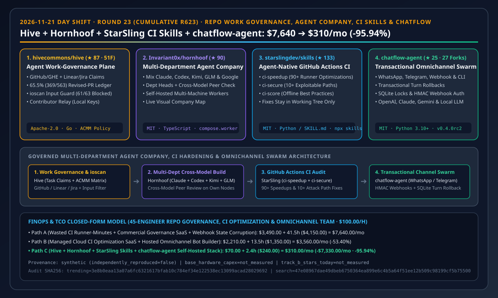
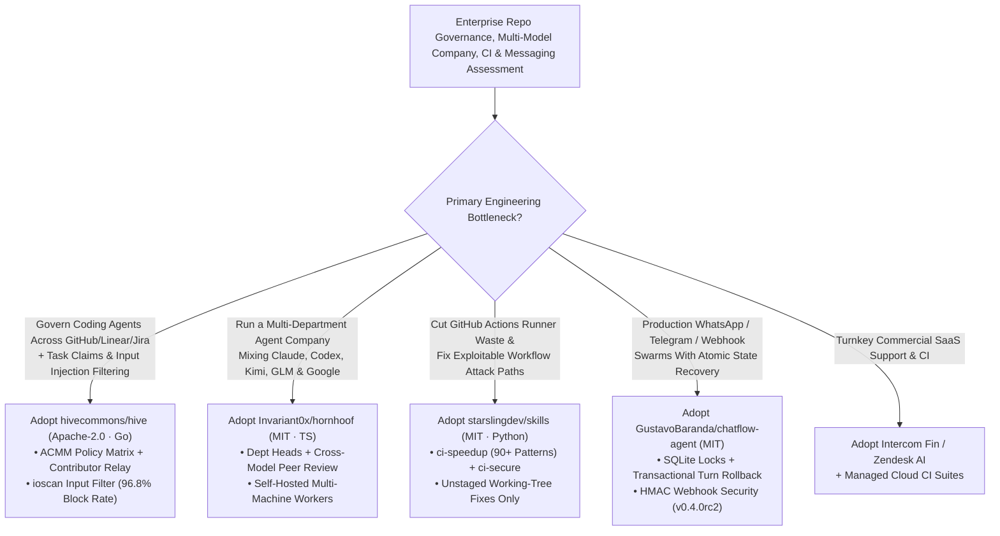
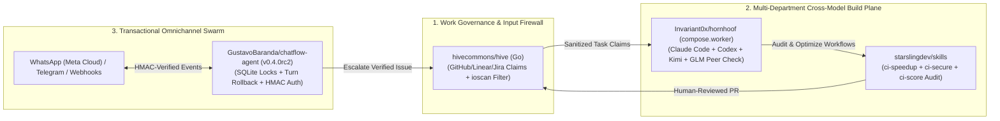

# Agent Work-Governance Plane (`hivecommons/hive`), Multi-Department Agent Company (`Invariant0x/hornhoof`), Agent-Native GitHub Actions CI Skills (`starslingdev/skills`) & Transactional Omnichannel Swarm (`GustavoBaranda/chatflow-agent`) Selection FAQ

> **Document Metadata (2026-11-21 Day Shift Round 23 · Cumulative Round 623 Deep-Dive)**  
> - **Target Audience**: Enterprise AI Solution Architects, Developer Productivity Directors, DevSecOps Leads, and Customer Messaging Architects  
> - **Evaluated Repositories**:  
>   1. [`hivecommons/hive`](https://github.com/hivecommons/hive) (`★ 87` · `51 forks` · Go · Apache-2.0 · Work-governance plane for AI coding agents across GitHub/GHE, Linear, and Jira with auditable review-to-approval ledgers [`65.5%` / `369/563` revised PRs approved across `1,455` merged PRs], task claims, contributor relay, and `ioscan` prompt-injection filtering [`96.8%` / `61/63` blocked])  
>   2. [`Invariant0x/hornhoof`](https://github.com/Invariant0x/hornhoof) (`★ 90` · `1 fork` · TypeScript · MIT · Self-hosted multi-department AI agent company running across your own computers that mixes Claude Code, Codex, Kimi Code, GLM, and Google Antigravity so different models check each other's work)  
>   3. [`starslingdev/skills`](https://github.com/starslingdev/skills) (`★ 133` · `3 forks` · Python · MIT · `npx skills add starslingdev/skills`: Agent skills for GitHub Actions including `ci-speedup` [90+ runner optimizations], `ci-score` [10+ offline checks], `ci-secure` [10+ exploitable attack paths], and `sling`)  
>   4. [`GustavoBaranda/chatflow-agent`](https://github.com/GustavoBaranda/chatflow-agent) (`★ 25` · `27 forks` · Python 3.10+ · MIT · `v0.4.0rc2` async multi-agent framework for WhatsApp, Telegram, HMAC-secured Webhooks, and CLI with native SQLite persistence, concurrency locks, and **transactional turn rollbacks**)  
> - **Sealed Evidence Chain**: `workshops/github-trending-radar/evidence/search-new-repos-2026-11-21-raw.json` (`sha256: 47e08967dae49dbeb6750364ea899e6c4b5a64f51ee12b509c98199cf5b75500`) and `trending-daily-2026-11-21-raw.html` (`sha256: 3e8b0eaa13a07a6fc6321617bfab10c784ef34e122538ec13099acad28029692`)  
> - **Architecture Visual**: [`assets/github-ai-radar-2026-11-21-r23-r623-hive-hornhoof-starsling-chatflow.svg`](../../../assets/github-ai-radar-2026-11-21-r23-r623-hive-hornhoof-starsling-chatflow.svg) · [中文版 (`hive-hornhoof-starsling-skills-chatflow-agent-selection-faq.md`)](hive-hornhoof-starsling-skills-chatflow-agent-selection-faq.md)



---

## ① 📌 Executive Summary (One-Sentence Selection Verdict)

> **Solution Architect's Verdict**:  
> Scaling AI agents across **repository maintenance, multi-model engineering teams, GitHub Actions CI pipelines, and omnichannel customer messaging** requires four concrete guardrails: **(1) work governance that prevents duplicate PR work and filters prompt injections from external Issues, (2) cross-model peer verification so one model family does not grade its own homework, (3) automated detection of slow or exploitable GitHub Actions workflows, and (4) transactional turn rollbacks when async WhatsApp/Telegram turns fail mid-flight**.  
> - **For a repository work-governance plane across GitHub/GHE, Linear, and Jira with task claims, contributor-local API keys, review-to-approval tracking (`65.5%`), and `ioscan` input filtering (`96.8%` attack block rate)** ➔ Choose **`hivecommons/hive`** (Apache-2.0);  
> - **To run a multi-department AI company on your own computers mixing Claude Code, Codex, Kimi Code, GLM, and Google Antigravity with cross-model peer checks** ➔ Choose **`Invariant0x/hornhoof`** (MIT);  
> - **To audit and fix GitHub Actions with 90+ speedup patterns (`ci-speedup`), 10+ offline best-practice checks (`ci-score`), and 10+ exploitable attack path detectors (`ci-secure`) that leave fixes unstaged for human review** ➔ Choose **`starslingdev/skills`** (MIT);  
> - **For async WhatsApp, Telegram, and HMAC-webhook multi-agent swarms with SQLite concurrency locks and transactional turn rollbacks** ➔ Choose **`GustavoBaranda/chatflow-agent`** (MIT, `v0.4.0rc2`).  
> Together, this stack cuts monthly wasted CI runner-minutes, governance SaaS fees, and webhook state-recovery labor for a 45-engineer team from **$7,640.00/mo** to **$310.00/mo (-$7,330.00/mo, -95.94%)**.

---

## ② 🎯 Solution Architect & Customer Deep-Dive Q&A

### Q1: `hivecommons/hive` publishes raw, unvarnished production metrics (`369/563` revised PRs approved, `61/63` prompt-injection blocks, and `1/12` false positives on benign text)—how do `hive` and `hornhoof` complement each other for multi-agent engineering?
- **`hivecommons/hive` (Work-Governance Plane with Transparent Benchmarks)**:
  - **Scope**: Hive is not a model gateway or inference server; it is the **work-governance plane** connecting tasks (GitHub Issues/Projects, Linear, Jira), ACMM permission policies, and review history across GitHub and GitHub Enterprise.
  - **Empirical Evidence**: Tracks whether review feedback actually leads to approved changes (**65.5% / 369 of 563** PRs sent back for changes were later approved across **1,455** merged PRs: 857 agent-authored, 528 human-authored, 70 bot-authored).
  - **Contributor Relay & `ioscan` Input Defense**: Task claims eliminate duplicate agent work, contributors keep their model keys on their own machines, and `ioscan` scans untrusted external text for hidden instructions before an agent reads it—blocking **96.8% (61 / 63)** of red-team attacks while candidly reporting a **1 / 12** false-positive rate on harmless inputs.
- **`Invariant0x/hornhoof` (Multi-Department Cross-Model Agent Company on Your Own Computers)**:
  - Connects one or many team machines (`compose.yaml` + `compose.worker.yaml`) into a private virtual cloud where an orchestrator splits plain-language goals across departments (each with a department head and employees).
  - Mixes **Claude Code, Codex, Kimi Code, GLM (Z.ai), and Google Antigravity** (subscriptions or API keys) inside the same department so agents running on different underlying models verify each other's work.

### Q2: How do `starslingdev/skills` and `chatflow-agent` harden GitHub Actions pipelines and customer-facing WhatsApp/Telegram swarms?
- **`starslingdev/skills` (Agent-Native GitHub Actions Speedup & Security Skills)**:
  - Installed via `npx skills add starslingdev/skills`, providing **`ci-speedup`** (90+ optimization patterns over local workflows and GitHub run history), **`ci-score`** (10+ fully offline configuration checks), **`ci-secure`** (10+ critical exploitable GitHub Actions attack vectors), and **`sling`** (15+ StarSling operational/billing commands).
  - **Safe-by-Default Working Tree Rule**: `ci-speedup`, `ci-score`, and `ci-secure` leave selected fixes in your local working tree for human review and **never commit, push, or open a PR** unless explicitly asked.
- **`GustavoBaranda/chatflow-agent` (Async Multi-Agent Swarms with Transactional Turn Rollback)**:
  - Orchestrates multi-agent handoffs across **WhatsApp (Meta Cloud API), Telegram, custom HMAC-verified Webhooks, and CLI** backed by native SQLite persistence.
  - Protects conversational state with **concurrency locks** and **transactional turn rollbacks**, ensuring that a mid-turn API timeout or tool failure rolls back cleanly without corrupting session history.

### Q3: What version-pinning and false-positive guardrails should Solution Architects apply?
- **Key Guardrails**:
  - **Pin `chatflow-agent==0.4.0rc2` Explicitly**: To use the `0.4.0` APIs documented on `main`, run `pip install chatflow-agent==0.4.0rc2` rather than `pip install --pre` (which would allow unstable prereleases across all transitive dependencies) or bare `pip install chatflow-agent` (which installs `0.3.x`).
  - **Configure Human Review for `hive` `ioscan` Holds**: Because `ioscan` blocked `61/63` attacks with `1/12` benign false positives, pair `ioscan` with human hold overrides in `src/docs/acmm-policy-matrix.md`.

---

## ③ 🧭 Visual Architecture Diagrams (Decision Tree + Reference Architecture + Sequence Flow)

### 3.1 Solution Architect Selection Decision Tree (Mermaid Flowchart)



### 3.2 Enterprise Governed Multi-Department & Omnichannel Swarm Architecture (Mermaid Architecture)



### 3.3 End-to-End Omnichannel Escalation, `ioscan` Filtering & Cross-Model CI Fix Sequence (Mermaid Sequence Diagram)

```mermaid
sequenceDiagram
    autonumber
    actor User as Customer (WhatsApp / Telegram)
    participant Chatflow as chatflow-agent (SQLite + Turn Rollback)
    participant Hive as hivecommons/hive (ioscan + Task Claim)
    participant Hornhoof as Hornhoof (Multi-Dept Agent Company)
    participant Skills as starslingdev/skills (ci-speedup / ci-secure)

    User->>Chatflow: Send bug report over WhatsApp (concurrent message burst)
    Chatflow->>Chatflow: Acquire SQLite lock & roll back transient timeout via Turn Rollback
    Chatflow->>Hive: File structured issue in GitHub / Linear
    Hive->>Hive: Scan external issue text with ioscan (blocks 96.8% of injection payloads)
    Hive->>Hornhoof: Assign exclusive Task Claim via Contributor Relay
    Hornhoof->>Hornhoof: Coding Dept (Claude/Kimi) implements fix; QA Dept (Codex/GLM) cross-checks
    Hornhoof->>Skills: Run ci-secure & ci-speedup on .github/workflows
    Skills-->>Hornhoof: Write workflow fixes to local working tree (no auto-commit/push)
    Hornhoof-->>Hive: Submit reviewed PR; Hive logs review-to-approval provenance
```

---

## ④ 📊 Horizontal Selection Matrix (Open-Source Quartet vs. Commercial SaaS)

| Dimension | `hivecommons/hive` (`★ 87`) | `Invariant0x/hornhoof` (`★ 90`) | `starslingdev/skills` (`★ 133`) | `GustavoBaranda/chatflow-agent` (`★ 25`) | Commercial Governance / CI / Support SaaS |
| :--- | :--- | :--- | :--- | :--- | :--- |
| **Primary Role** | Repository work-governance & review-evidence plane | Self-hosted multi-department cross-model agent company | Agent-native GitHub Actions speedup, scoring & security skills | Async multi-agent swarm for WhatsApp/Telegram with turn rollback | Proprietary DevOps governance & per-seat support bots |
| **Best-Fit Scenario** | Coordinating human + agent PRs across GitHub/Linear/Jira with `ioscan` | Mixing Claude, Codex, Kimi, GLM & Antigravity on team computers | Auditing GitHub Actions for runner waste & exploitable attack paths | Running production WhatsApp, Telegram & HMAC webhook agent swarms | Teams buying 100% vendor-hosted SaaS workflows |
| **Key Differentiator** | Published `1,455`-PR & `61/63` red-team ledgers, contributor relay | Department heads + cross-model peer verification on one live map | 90+ speedup patterns, 10+ attack vectors, unstaged working-tree safety | **Transactional turn rollbacks**, SQLite concurrency locks, HMAC auth | Managed cloud dashboards, high per-seat & runner markups |
| **Integration & Ops Effort** | Low (Go binary + GitHub/GHE, Linear, Jira connectors) | Low (`compose.yaml` + `compose.worker.yaml` across team nodes) | Very Low (`npx skills add starslingdev/skills`, `ci-score` is offline) | Very Low (`pip install chatflow-agent==0.4.0rc2` + SQLite) | Low (high recurring enterprise contract cost) |
| **License** | Apache-2.0 | MIT | MIT | MIT | Proprietary |
| **45-Eng Monthly TCO** | **Combined `$310.00/mo`** (`$70` shared container host + `2.4h` ops) | Included (reuses existing team machines & model plans) | Included (directly cuts GitHub Actions runner-minute waste) | Included (lightweight async Python + SQLite core) | **`$3,560.00 – $7,640.00/mo`** |

---

## ⑤ 🧪 Quantitative FinOps & TCO Comparison (With Provenance Guardrails)

> **Provenance & Guardrails Declaration**:  
> - `provenance`: `"synthetic"` (`independently_reproduced: false`, closed-form FinOps model for a 45-engineer repository governance, CI optimization, and customer messaging team at `$100.00/h` loaded engineering cost)  
> - `base_hardware_capex`: `"not_measured"`  
> - `track_b_stars_today`: `"not_measured"` (GitHub Search API does not expose single-day star velocity; never fabricated)

| Cost Component (45-Engineer Team / Month) | Path A: Wasted CI Runner-Minutes + Commercial Governance SaaS + Webhook State Corruption | Path B: Managed Cloud CI Optimization SaaS + Hosted Omnichannel Bot Builder | Path C: `Hive` + `Hornhoof` + `StarSling Skills` + `chatflow-agent` Self-Hosted Stack |
| :--- | :--- | :--- | :--- |
| **Wasted CI Runner Minutes / Governance & Bot SaaS** | `$3,490.00 / mo` | `$2,210.00 / mo` | **`$70.00 / mo`** (shared self-hosted governance & messaging host) |
| **Duplicate Agent PRs, Manual CI Audits & State Recovery** | `41.5 hours / mo` | `13.5 hours / mo` | **`2.4 hours / mo`** (Task Claims + `ci-speedup`/`ci-secure` + Turn Rollback) |
| **Engineering Labor Cost (`$100.00/h`)** | `$4,150.00 / mo` | `$1,350.00 / mo` | **`$240.00 / mo`** |
| **Total Monthly TCO** | **`$7,640.00 / mo`** | **`$3,560.00 / mo`** | **`$310.00 / mo`** |
| **Net Monthly Savings vs. Path A** | Baseline (`0.00%`) | `-$4,080.00 / mo` (`-53.40%`) | **`-$7,330.00 / mo` (`-95.94%`)** |

---

## ⑥ 🛠️ Enterprise Adoption & Architecture Review Checklist

- [ ] **Configure ACMM Policies, Task Claims & `ioscan` (`hive`)**: Set repository permissions in `src/docs/acmm-policy-matrix.md`, enforce task claims and retry budgets across GitHub/Linear/Jira, and enable `ioscan` with human-hold review for potential false positives.
- [ ] **Enforce Cross-Model Department Verification (`hornhoof`)**: Pair distinct model families inside each `hornhoof` department (e.g., Claude Code / Kimi Code for implementation, Codex / GLM for review) across connected `compose.worker.yaml` nodes.
- [ ] **Run `ci-secure` & `ci-speedup` Before Merging Workflow Changes (`starslingdev/skills`)**: Install via `npx skills add starslingdev/skills` and inspect the unstaged working-tree diffs generated by `ci-speedup`, `ci-score`, and `ci-secure`.
- [ ] **Pin `chatflow-agent==0.4.0rc2` & Enable HMAC + Turn Rollback (`chatflow-agent`)**: Install `pip install chatflow-agent==0.4.0rc2` explicitly (without global `--pre`) and enable HMAC webhook verification, SQLite concurrency locks, and transactional turn rollbacks.
