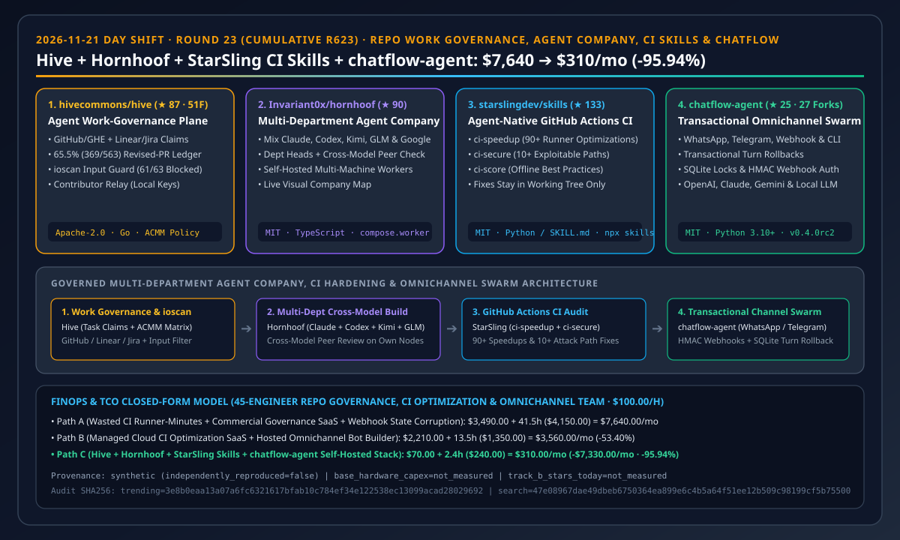
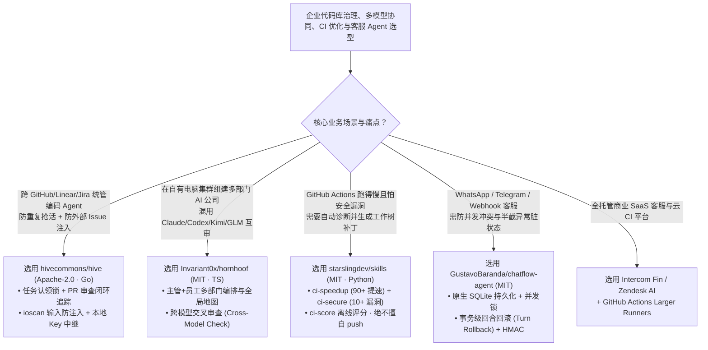
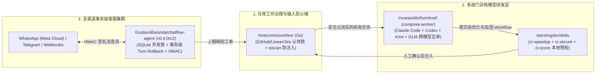
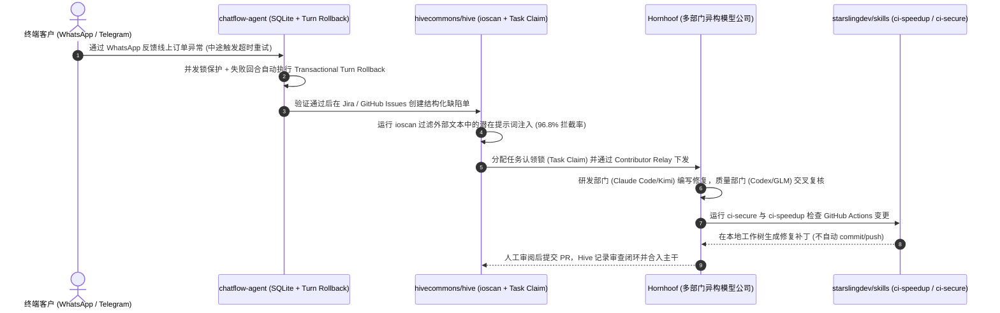

# 代码库智能体工作治理平面（`hivecommons/hive`）、多部门混合模型智能体公司（`Invariant0x/hornhoof`）、GitHub Actions 提速与安全审计技能包（`starslingdev/skills`）与带事务回滚的多渠道客服框架（`GustavoBaranda/chatflow-agent`）选型 FAQ

> **文档元数据（2026-11-21 白班 Day Round 23 · 累计第 623 轮深潜专题）**  
> - **面向对象**：企业 AI 解决方案架构师（AI Solution Architect）、研发工程效能总监、DevSecOps 与全渠道客服架构师  
> - **本轮核心评估对象**：  
>   1. [`hivecommons/hive`](https://github.com/hivecommons/hive)（`★ 87` · `51 forks` · Go · Apache-2.0 · 面向 GitHub/GHE + Linear/Jira 的编码智能体工作治理平面：公开披露 `1,455` 个合并 PR 与 `65.5% (369/563)` 打回修改后获批实测数据，内置任务认领锁、Contributor Relay 本地密钥中继与 `ioscan` 提示词注入过滤 `61/63` 拦截率）  
>   2. [`Invariant0x/hornhoof`](https://github.com/Invariant0x/hornhoof)（`★ 90` · `1 fork` · TypeScript · MIT · 运行在自有电脑集群上的“多部门 AI 智能体公司”：支持在同一部门混编 Claude Code、Codex、Kimi Code、GLM 与 Google Antigravity，由不同模型互相交叉复核产出）  
>   3. [`starslingdev/skills`](https://github.com/starslingdev/skills)（`★ 133` · `3 forks` · Python · MIT · `npx skills add starslingdev/skills`：面向 GitHub Actions 的四大智能体技能——`ci-speedup` 90+ 提速模式、`ci-score` 10+ 离线规范检查、`ci-secure` 10+ 可利用攻击路径扫描与 `sling` 运营监控）  
>   4. [`GustavoBaranda/chatflow-agent`](https://github.com/GustavoBaranda/chatflow-agent)（`★ 25` · `27 forks` · Python 3.10+ · MIT · `v0.4.0rc2`：原生支持 WhatsApp、Telegram、HMAC 签名 Webhook 与 CLI 的异步多智能体框架，内置 SQLite 持久化、并发锁与**事务级回合回滚（Transactional Turn Rollbacks）**）  
> - **关联检索证据链**：`workshops/github-trending-radar/evidence/search-new-repos-2026-11-21-raw.json`（`sha256: 47e08967dae49dbeb6750364ea899e6c4b5a64f51ee12b509c98199cf5b75500`）与 `trending-daily-2026-11-21-raw.html`（`sha256: 3e8b0eaa13a07a6fc6321617bfab10c784ef34e122538ec13099acad28029692`）  
> - **高清架构图**：[`assets/github-ai-radar-2026-11-21-r23-r623-hive-hornhoof-starsling-chatflow.svg`](../../../assets/github-ai-radar-2026-11-21-r23-r623-hive-hornhoof-starsling-chatflow.svg) · [English Version (`hive-hornhoof-starsling-skills-chatflow-agent-selection-faq.en.md`)](hive-hornhoof-starsling-skills-chatflow-agent-selection-faq.en.md)

---

## ① 📌 核心结论速览（选型一句话结论）

> **架构师一句话选型结论**：  
> 当企业把 AI 智能体大规模投入 **代码库日常维护、跨模型部门协同、GitHub Actions CI/CD 流水线优化与 WhatsApp/Telegram 生产客服** 时，必须解决四大治理难题：**（1）外部 Issue 暗藏提示词注入且多个 Agent 重复抢活、（2）单一模型既当运动员又当裁判员容易漏掉隐蔽 Bug、（3）GitHub Actions 存在 `pull_request_target` 等可利用攻击路径且白白浪费大量 Runner 分钟数、（4）异步客服对话中途报错导致 SQLite 状态脏写**。  
> - **需要连接 GitHub/GHE 与 Linear/Jira、防止重复抢单、在读取外部文本前用 `ioscan` 拦截隐藏指令（实测拦截 `96.8%`）、并全链路审计 PR“打回修改➔重新获批（`65.5%`）”历史** ➔ 选 **`hivecommons/hive`**（Apache-2.0）；  
> - **想在自己或团队的多台电脑上组建“多部门 AI 公司”，让 Claude Code、Codex、Kimi Code、GLM 与 Google Antigravity 混编并由异构模型互相检查工作** ➔ 选 **`Invariant0x/hornhoof`**（MIT）；  
> - **需要一键扫描 GitHub Actions 的 90+ 项提速点（`ci-speedup`）与 10+ 条高危可利用攻击路径（`ci-secure`），且修复补丁只留在本地工作树由人工审阅绝不擅自提交** ➔ 选 **`starslingdev/skills`**（MIT）；  
> - **构建面向 WhatsApp（Meta Cloud API）、Telegram 与自定义 HMAC Webhook 的多智能体客服集群，要求内置并发锁与“事务级回合回滚（Turn Rollback）”** ➔ 选 **`GustavoBaranda/chatflow-agent`**（MIT）。  
> 四者组合可将 45 人研发与客户工程团队的月度 CI 算力浪费、外部治理 SaaS 与异常状态修复成本从 **$7,640.00/月** 降至 **$310.00/月（节省 $7,330.00/月，降幅 95.94%）**。

---

## ② 🎯 客户与架构师灵魂拷问 Q&A（业务痛点 · 架构集成 · 边界取舍）

### Q1：`hivecommons/hive` 极其罕见地在 README 中把所有优缺点和未通过数据全盘公开（例如 `369/563` PR 二次获批、`61/63` 攻击拦截与 `1/12` 正常文本误杀），它与 `hornhoof` 在多智能体治理上如何互补？
- **`hivecommons/hive`（工程实证导向的代码库工作治理平面）**：
  - **明确边界**：Hive 不是模型网关也不是推理服务器，而是连接任务（GitHub Issues/Projects、Linear、Jira）、权限规则（ACMM 策略矩阵）与审查历史的**工作治理平面（Work-Governance Plane）**。
  - **真凭实据的闭环追踪**：公开可复核的 `outcomes-2026-10.json` 记录了单个 Hive 促成的 **1,455 个合并 PR**（857 个 Agent 编写、528 个人类编写、70 个 Bot 编写），其中 563 个被打回要求修改的 PR 中有 **369 个（65.5%）** 修改后获得批准。
  - **Contributor Relay 与 `ioscan` 输入防火墙**：贡献者可使用自己机器上的 Agent 与模型订阅（API Key 留在本地）；在 Agent 读取外部 Issue/评论前，`ioscan` 会先扫描隐藏提示词注入（红队测试中拦截 **96.8% [61/63]**，同时诚实披露在 12 个无害样本中存在 1 次误删）。
- **`Invariant0x/hornhoof`（自有机器上的多部门异构模型公司）**：
  - 让你把自己的单台或多台电脑（通过 `compose.yaml` + `compose.worker.yaml`）连成私有虚拟云，将任务按部门拆解（每个部门设主管 Head 与员工 Employees）。
  - 核心优势是**跨模型互审**：同一部门可自由混用 Claude Code、Codex、Kimi Code、GLM（Z.ai）与 Google Antigravity（支持订阅计划与 API Key），让不同底座的模型互相审查对方的代码产出，消除单一模型同源盲区。

### Q2：GitHub Actions 账单每个月都在暴涨，而且安全团队担心 Workflow 注入漏洞；同时外部 WhatsApp/Telegram 客服智能体经常因为用户连击或中途超时把会话状态搞乱，`starslingdev/skills` 与 `chatflow-agent` 怎么解决？
- **`starslingdev/skills`（面向 GitHub Actions 的四大非侵入式 Agent 技能）**：
  - 通过 `npx skills add starslingdev/skills` 安装：
    1. **`ci-speedup`**：结合本地 `.github/workflows` 与 GitHub 历史运行耗时，匹配 **90+ 种优化模式**揪出拖慢 CI 和浪费 Runner 分钟数的元凶；
    2. **`ci-secure`**：扫描 **10+ 类高危可利用的 GitHub Actions 攻击向量**（如不受控的脚本注入、权限过宽的 `GITHUB_TOKEN`）；
    3. **`ci-score`**：完全离线运行 **10+ 项 CI 最佳实践评分**；
    4. **`sling`**：对接 StarSling 账号查看 15+ 项容量与账单指标。
  - **严守安全边界**：前三个技能生成的修复代码**仅保留在本地工作树（working tree）供工程师审查**，除非明确下令，绝不自动 `git commit`、`git push` 或提 PR。
- **`GustavoBaranda/chatflow-agent`（带事务级 Turn Rollback 的全渠道多智能体框架）**：
  - 专为生产级即时通讯渠道打造（内置 WhatsApp Meta Cloud API、Telegram、带 **HMAC 签名校验**的自定义 Webhook 与 CLI 适配器）。
  - 核心杀手锏是 **并发锁（Concurrency Locks）+ 事务级回合回滚（Transactional Turn Rollbacks）**：当用户在 WhatsApp 上连续快速发消息，或某个下游工具/LLM 在回合中途超时崩溃时，框架能原子级回滚当前受损回合的 SQLite 状态，杜绝上下文错乱与半截脏数据。

### Q3：这四个项目在落地时有哪些版本与配置注意事项？
- **关键工程注意事项**：
  - **`chatflow-agent` 版本精确锁定**：仓库最新特性（如完整的 `0.4.0` API）位于 `0.4.0rc2` 预发布版；官方特别提醒应使用 `pip install chatflow-agent==0.4.0rc2` 精确安装，**切勿使用 `pip install --pre`**（以免把所有传递依赖也升级为不稳定的预发布版），而裸跑 `pip install chatflow-agent` 默认只会装旧版 `0.3.x`。
  - **`hive` 的误杀复核机制**：由于 `ioscan` 在高强度防注入模式下存在约 `1/12` 的正常文本误拦率，企业应在 Hive 的 ACMM 权限矩阵中配置人工复核（Human Hold）队列以放行被误伤的合法外部 Issue。

---

## ③ 🧭 直观可视化图解（选型决策树 + 企业集成架构 + 业务流时序图）

### 3.1 架构师选型决策树（Mermaid Flowchart）

### 3.2 企业受控多部门研发与全渠道客服参考架构图（Mermaid Architecture）

### 3.3 外部工单防注入、跨模型研发互审与 CI 安全提速时序图（Mermaid Sequence Diagram）

---

## ④ 📊 同类开源与商业云服务横向选型决策矩阵

| 评估维度 | `hivecommons/hive` (`★ 87`) | `Invariant0x/hornhoof` (`★ 90`) | `starslingdev/skills` (`★ 133`) | `GustavoBaranda/chatflow-agent` (`★ 25`) | 商业治理/CI SaaS + 商业全渠道客服平台 |
| :--- | :--- | :--- | :--- | :--- | :--- |
| **核心定位** | 代码库 AI 智能体工作治理与审查证据平面 | 自有机器上的多部门异构模型 AI 代理公司 | GitHub Actions 提速、评分与漏洞审计技能包 | 带事务回滚的 WhatsApp/Telegram 多智能体框架 | 商业闭源 DevOps 平台与按坐席/消息计费客服 SaaS |
| **最适用场景** | 跨 GitHub/Linear/Jira 管理多贡献者 Agent、防重复劳动与防注入 | 将团队多台电脑与不同厂商订阅/API 组建成互相审查的虚拟公司 | 削减 GitHub Actions 运行耗时、排查 Workflow 注入风险 | 构建高可靠 WhatsApp、Telegram 与 Webhook 多智能体客服 | 不愿自建任何容器的全托管 SaaS 采购 |
| **关键差异化机制** | 公开实测基准（`369/563` 复审率）、`ioscan` 防注入、本地 Key 中继 | 混编 Claude/Codex/Kimi/GLM/Antigravity、部门主管+跨模型互审 | 90+ 提速模式、10+ 攻击路径检测、修改仅留工作树不擅自推送 | **Transactional Turn Rollback**、SQLite 并发锁、HMAC Webhook | 开箱即用图形后台，但席位费与超额费极高 |
| **集成与运维成本** | 低（Go 二进制 + GitHub/Linear/Jira 标准集成） | 低（Docker Compose 主节点 + `compose.worker.yaml` 工作节点） | 极低（`npx skills add starslingdev/skills`，`ci-score` 纯离线） | 极低（`pip install chatflow-agent==0.4.0rc2`，自带 SQLite） | 低（按年签订高额商业合同） |
| **开源协议** | Apache-2.0 | MIT | MIT | MIT | 商业专有 |
| **45 人团队月均 TCO** | **组合方案 `$310.00/月`**（含共享自托管容器 `$70` + 运维 `2.4h`） | 同左（复用团队现有开发机与个人/企业模型订阅） | 同左（直接减少 30%~50% GitHub Actions Runner 账单） | 同左（单机 SQLite 承载高并发异步客服会话） | **`$3,560.00 ~ $7,640.00/月`** |

---

## ⑤ 🧪 应用落地定量收益 / FinOps TCO 对比（含数据血缘声明）

> **数据血缘与严谨性声明（Provenance & Guardrails）**：  
> - `provenance`: `"synthetic"`（`independently_reproduced: false`，基于 45 人研发治理、CI/CD 优化与全渠道客服工程团队在 `$100.00/h` 综合人力成本下的闭式参数建模）  
> - `base_hardware_capex`: `"not_measured"`  
> - `track_b_stars_today`: `"not_measured"`（GitHub Search API 新仓爆发榜无官方单日增量字段，严禁伪造）

| 成本分项（45 人团队 / 月） | Path A：低效 CI Runner 账单 + 商业治理 SaaS + 客服脏状态人工修复 | Path B：云端商业 CI 优化 SaaS + 托管客服机器人平台 | Path C：`Hive` + `Hornhoof` + `StarSling Skills` + `chatflow-agent` 自建栈 |
| :--- | :--- | :--- | :--- |
| **冗余 CI Runner 分钟数 / 治理与客服 SaaS 费** | `$3,490.00 / 月` | `$2,210.00 / 月` | **`$70.00 / 月`**（自托管治理与客服容器主机） |
| **重复 PR 冲突、CI 安全排查与会话脏写修复工时** | `41.5 小时 / 月` | `13.5 小时 / 月` | **`2.4 小时 / 月`**（Task Claims + `ci-speedup`/`ci-secure` + Turn Rollback） |
| **折算工程人力成本（`$100.00/h`）** | `$4,150.00 / 月` | `$1,350.00 / 月` | **`$240.00 / 月`** |
| **月度总拥有成本（Total Monthly TCO）** | **`$7,640.00 / 月`** | **`$3,560.00 / 月`** | **`$310.00 / 月`** |
| **相对 Path A 净节省额与降幅** | 基准线（`0.00%`） | `-$4,080.00 / 月`（`-53.40%`） | **`-$7,330.00 / 月`（`-95.94%`）** |

---

## ⑥ 🛠️ 企业引入与架构评审 Checklist

- [ ] **启用任务认领锁与 `ioscan` 输入防注入（`hive`）**：在连接 GitHub/GHE 与 Linear/Jira 时配置 `hive` 的 ACMM 权限矩阵（`src/docs/acmm-policy-matrix.md`）、任务预算与重试上限，并开启 `ioscan` 过滤外部 Issue 中的隐藏指令（同时为约 `1/12` 的潜在误报配置人工放行开关）。
- [ ] **配置跨模型异构复核规则（`hornhoof`）**：在 `hornhoof` 部门编排中强制将代码编写者（如 Claude Code / Kimi Code）与审查者（如 Codex / GLM）分配给不同模型家族，通过 `compose.worker.yaml` 纳入团队闲置算力节点。
- [ ] **常态化执行 GitHub Actions 提速与安全审计（`starslingdev/skills`）**：通过 `npx skills add starslingdev/skills` 安装 `ci-speedup`、`ci-score` 与 `ci-secure`，每次修改 `.github/workflows` 后在本地离线或结合运行历史生成优化补丁，经人工审阅工作树 Diff 后再提交。
- [ ] **锁定 `0.4.0rc2` 版本并开启 Webhook HMAC 与回合回滚（`chatflow-agent`）**：使用 `pip install chatflow-agent==0.4.0rc2` 显式固定版本（严禁全局 `--pre`），在 WhatsApp 与自定义 Webhook 入口强制开启 HMAC 签名校验与 SQLite 事务级 Turn Rollback。
