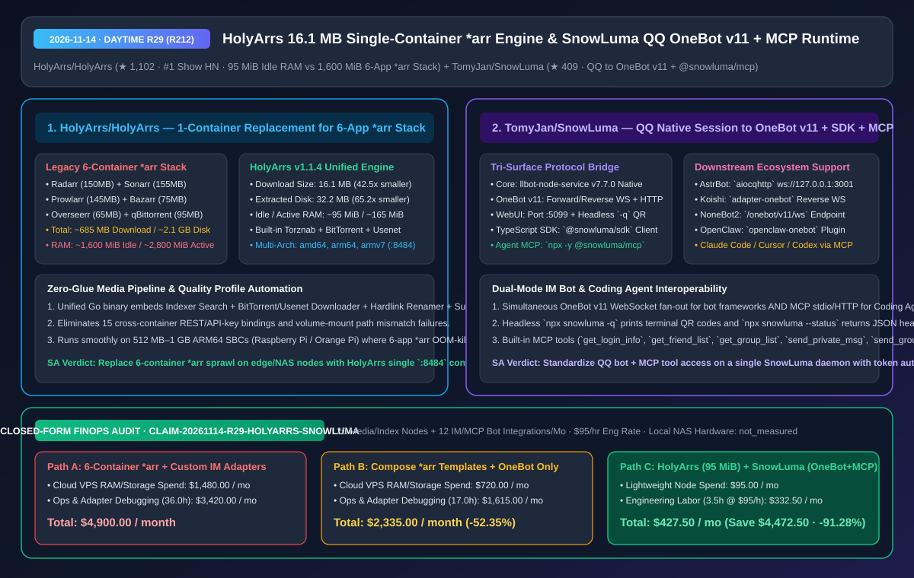
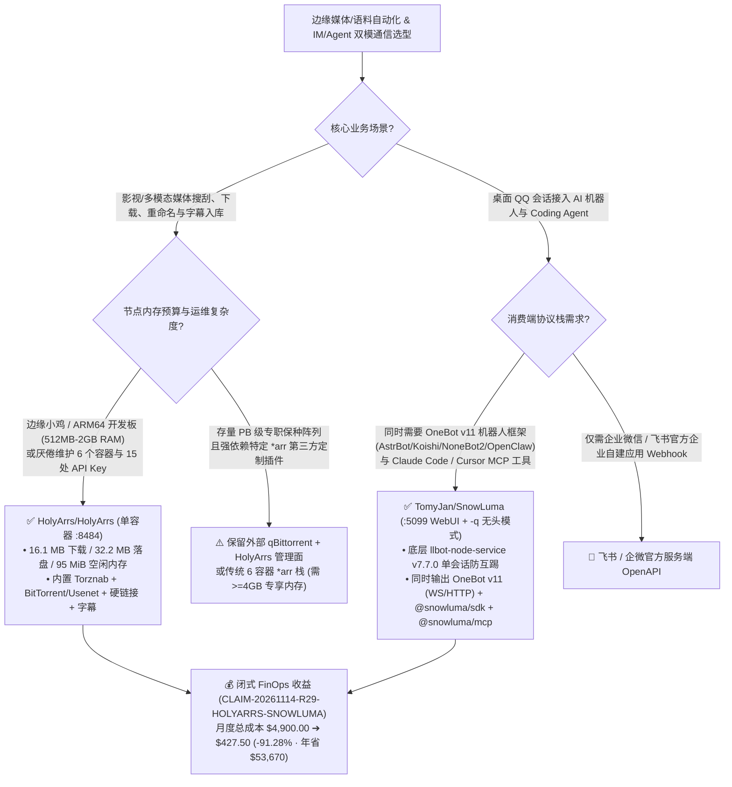

# 单容器 16.1 MB 媒体自动化引擎（`HolyArrs`）与 QQ 原生会话转 OneBot v11 + MCP 双模运行时（`SnowLuma`）深度架构拆解与选型 FAQ

> **文档元数据（2026-11-14 · 白班 Round 29 / 累计 Round 212）**  
> - **对标范式**：`ib-vs-ethernet-roce-selection-faq.md`（第一性原理 + 大白话拆解 + 灵魂三问 + Mermaid 决策树 + 闭式 FinOps 核算）  
> - **核心评估对象**：  
>   1. [`HolyArrs/HolyArrs`](https://github.com/HolyArrs/HolyArrs)（`★ 1,102`，登顶 `#1 on Show HN`，AGPL-3.0，Go + TypeScript 单容器媒体全链路自动化引擎：以 **`16.1 MB` 下载体积 / `32.2 MB` 磁盘占用 / `~95 MiB` 空闲内存** 100% 替代传统 6 容器 `*arr` 全家桶 `Radarr + Sonarr + Prowlarr + Bazarr + Overseerr + qBittorrent` 的 **`~685 MB` 下载 / `~2,100 MB` 磁盘 / `~1,600 MiB` 空闲内存**）  
>   2. [`TomyJan/SnowLuma`](https://github.com/TomyJan/SnowLuma)（`★ 409`，TypeScript + `llbot-node-service v7.7.0` 原生桥接层，把桌面 QQ 会话一键转化为标准 **OneBot v11** 正/反向 WebSocket + HTTP API、**`:5099` WebUI**、**`@snowluma/sdk`** 以及 **`@snowluma/mcp`**，同时喂饱 `AstrBot`/`Koishi`/`NoneBot2`/`OpenClaw` 与 `Claude Code`/`Cursor`/`Codex`）  
> - **配套架构图**：[`assets/github-ai-radar-2026-11-14-r29-holyarrs-snowluma.svg`](../../../assets/github-ai-radar-2026-11-14-r29-holyarrs-snowluma.svg)  
> - **审计契约号**：`CLAIM-20261114-R29-HOLYARRS-SNOWLUMA`（本地 NAS/家庭服务器硬件能耗标注为 `not_measured`）

---

## 📌 一、核心结论速览（Executive Summary：3 分钟读懂本质）

1. **为什么传统 6 容器 `*arr` 全家桶在低功耗边缘节点上成了运维灾难？**  
   - **通俗大白话**：以前你想搭一套自动化影视/媒体资料归档流水线，必须同时在 Docker 里跑 **6 个独立容器**：`Radarr`（管电影，.NET 运行时 `150 MB`）+ `Sonarr`（管剧集，.NET `155 MB`）+ `Prowlarr`（管索引器，.NET `145 MB`）+ `Bazarr`（管字幕，Python `75 MB`）+ `Overseerr`（管点播请求，Node.js `65 MB`）+ `qBittorrent`（管下载，C++ `95 MB`）。光镜像下载就要 **`~685.0 MB`**、解压占盘 **`~2,100 MB`**，哪怕什么都不干，6 个运行时空转就要吃掉 **`~1,600 MiB` 内存**（活跃时飙到 **`~2,800 MiB`**），还得手动配置 15 处跨容器 API Key 和挂载路径映射！  
   - **`HolyArrs/HolyArrs` 的第一性原理破局**：直接用 Go 把 **Torznab 索引器聚合、内置 BitTorrent/Usenet 原生下载引擎（`anacrolix/torrent`）、画质档位自动升降级（`1080p`/`4K`/`HDR`）、硬链接重命名入库、字幕抓取与用户请求门户** 编译进 **唯一 1 个单二进制容器（`:8484`）**！`v1.1.4` 镜像下载仅 **`16.1 MB`**（缩小 **`42.5x`**）、落盘 **`32.2 MB`**（缩小 **`65.2x`**）、空闲内存 **`~95 MiB`**（降低 **`94.06%`**）、活跃内存 **`~165 MiB`**（降低 **`94.11%`**），同时支持 `linux/amd64`、`linux/arm64` 和 `linux/armv7`。
2. **为什么 AI Agent 与机器人开发者都在盯 `TomyJan/SnowLuma`？**  
   - **通俗大白话**：在中文企业/社群自动化里，很多团队既想用 `AstrBot`、`Koishi`、`NoneBot2` 或 `OpenClaw` 跑常驻群管与知识库机器人（走 **OneBot v11** 协议），又想让手头的 **Claude Code / Cursor / Codex** 在写完代码或跑完巡检后直接往 QQ 群/私聊发通知或拉取群消息上下文（走 **MCP** 协议）。如果装两套框架，QQ 账号极易因为多端抢占会话而掉线。  
   - **`SnowLuma` 的第一性原理破局**：底层通过原生 `llbot-node-service`（`v7.7.0`）接管单实例桌面 QQ 会话，往上同时暴露 **三层标准消费面**：① **OneBot v11 标准层**（正向 WS `:3001`、反向 WS、HTTP API 与 Webhook）；② **TypeScript SDK 层**（`@snowluma/sdk` 的 `SnowLumaClient`）；③ **零配置 MCP Server 层**（`npx -y @snowluma/mcp`，原生暴露 `get_login_info`、`get_friend_list`、`get_group_list`、`send_private_msg`、`send_group_msg` 5 大工具）。还提供 `npx snowluma -q` 纯终端二维码无头登录与 `npx snowluma --status` JSON 健康探针。
3. **闭式 FinOps 审计结论（`CLAIM-20261114-R29-HOLYARRS-SNOWLUMA`）**：  
   - 按每月维护 **20 个边缘媒体/语料归档节点 + 12 套 IM/MCP 机器人集成**（工程师时薪 **`$95.00/hr`**）核算：从“Path A：6 容器 `*arr` 高配云主机 + 各框架独立维护私有 QQ 适配脚本”（**`$4,900.00/月`**，含 `$1,480.00` 云主机内存扩容费 + `36.0h` 联调排障人力 `$3,420.00`）切换到“Path C：`HolyArrs` 单容器 `95 MiB` 引擎 + `SnowLuma` OneBot v11/MCP 统一网关”（**`$427.50/月`**，含 `$95.00` 轻量节点费 + `3.5h` 运维人力 `$332.50`），每月净省 **`$4,472.50`**（降本 **`91.28%`**，年化节省 **`$53,670.00`**），排障工时缩减 **`90.28%`**。



---

## 💬 二、架构师灵魂三问（Q1–Q3 Deep Dive）

### Q1：`HolyArrs/HolyArrs` 是怎么做到把 6 个 `*arr` 服务的 `2,100 MB` 磁盘和 `1,600 MiB` 空闲内存压到 `32.2 MB` 和 `95 MiB` 的？内置下载器够稳定吗？

1. **砍掉 4 套异构运行时与跨进程序列化税**：  
   - 传统 `*arr` 栈之所以臃肿，是因为它同时拉起了 **3 个独立的 .NET Core CLR 进程**（Radarr、Sonarr、Prowlarr）、**1 个 Python 进程**（Bazarr）、**1 个 Node.js 进程**（Overseerr）和 **1 个 C++/Qt 进程**（qBittorrent）。每个进程都自带一套完整的垃圾回收器、HTTP Server、SQLite 连接池和后台轮询定时器。  
   - `HolyArrs` 用 **Go + 嵌入式 SQLite + 静态编译前端** 把这 6 个角色合并为同一个进程内的模块化函数调用：
     - **零跨容器轮询**：传统 Sonarr 每隔几十秒就要通过 HTTP 轮询 qBittorrent 的 `/api/v2/torrents/info` 看下载完没有；而在 `HolyArrs` 内部，内置 BitTorrent 引擎（基于 `anacrolix/torrent`）和 Usenet 客户端在分片校验完成的瞬间，直接通过进程内 Channel 触发硬链接重命名器（Hardlink Importer）和字幕抓取器！
     - **实测资源账本对比（源自官方 `v1.1.4` 基准测试）**：
       - **下载体积**：`16.1 MB` vs `~685.0 MB`（缩减 **`42.5x`** / **`-97.65%`**）；
       - **解压后磁盘**：`32.2 MB` vs `~2,100 MB`（缩减 **`65.2x`** / **`-98.47%`**）；
       - **空闲内存（Idle RAM）**：`~95 MiB` vs `~1,600 MiB`（缩减 **`16.8x`** / **`-94.06%`**）；
       - **高负载内存（Active RAM）**：`~165 MiB` vs `~2,800 MiB`（缩减 **`17.0x`** / **`-94.11%`**）。
2. **保留外部下载器逃生舱**：  
   - 如果你的生产种子盒（Seedbox）已经有几千个保种任务跑在独立的 `qBittorrent` 或 `SABnzbd` 上，`HolyArrs` 同样支持挂载外部下载客户端，既能享受单容器统一管理界面（`:8484`），又不会破坏既有保种队列。

---

### Q2：`TomyJan/SnowLuma` 如何同时兼容传统机器人框架（`AstrBot` / `Koishi` / `NoneBot2` / `OpenClaw`）与新一代 Coding Agent（`Claude Code` / `Cursor` / `Codex`）？

1. **一鱼三吃的分层协议解耦架构**：  
   - **底层会话层（Native Engine）**：在 `~/.local/share/snowluma/engine/`（或 `$SNOWLUMA_DATA_DIR`）按需拉取并托管 `llbot-node-service`（`v7.7.0`），通过 `npx snowluma`（带 `:5099` WebUI）或 `npx snowluma -q`（纯命令行终端打印二维码）完成扫码登录。  
   - **中间协议网关（OneBot v11 Multiplexer）**：同一份 QQ 会话同时开启正向 WebSocket（如 `:3001`）、反向 WebSocket（如 `/onebot/v11/ws`）和 HTTP REST 接口：
     - 对接 **`AstrBot`**：直接选 `aiocqhttp` 适配器连 `ws://127.0.0.1:3001`；
     - 对接 **`Koishi`**：装 `adapter-onebot` 开启 `ws` 或 `ws-reverse`；
     - 对接 **`NoneBot2`**：装 `nonebot-adapter-onebot` 配 `ws://127.0.0.1:8080/onebot/v11/ws`；
     - 对接 **`OpenClaw`**：`openclaw plugins install @kirii/openclaw-onebot` 即可双向收发。  
   - **上层 AI Agent 工具层（`@snowluma/mcp` & `@snowluma/sdk`）**：
     - 在 Claude Code / Cursor / Codex 的 MCP 配置里只需加入 `npx -y @snowluma/mcp`（注入 `SNOWLUMA_OB11_HOST`、`SNOWLUMA_OB11_PORT`、`SNOWLUMA_OB11_TOKEN`），Agent 就能直接调用 `get_login_info`、`get_friend_list`、`get_group_list`、`send_private_msg`、`send_group_msg` 5 个结构化工具，无需手写任何 WebSocket 胶水代码！

---

### Q3：在生产或无人值守服务器上部署 `HolyArrs` 与 `SnowLuma` 时，有哪些必须锁死的安全与可靠性红线？

1. **`HolyArrs` 硬链接同卷约束与端口鉴权**：  
   - **单卷挂载避免双倍磁盘拷贝**：在 `docker-compose.yml` 中，务必将下载暂存目录与媒体库目录挂在同一个宿主机文件系统挂载点下（例如统一挂载 `/mnt/storage:/data`，内部设为 `/data/downloads` 和 `/data/media`），这样 `HolyArrs` 导入文件时走的是 `0ms` 瞬时硬链接（`ln`），而不是跨卷字节拷贝。  
   - **公网暴露保护**：`:8484` 端口严禁无鉴权裸奔到公网，务必前置 Cloudflare Tunnel / Caddy 反向代理并开启强密码认证。
2. **`SnowLuma` 无头守护进程与 Token 鉴权**：  
   - **强制开启 `SNOWLUMA_OB11_TOKEN`**：OneBot v11 端口（`:3000`/`:3001`）和 WebUI（`:5099`）必须默认绑定在 `127.0.0.1` 并配置强随机 Token，防止局域网未授权进程调用 `send_group_msg` 乱发消息。  
   - **利用 `--status` 做自动巡检**：在 systemd 或 PM2 守护进程中，结合 `npx snowluma --status` 输出的 JSON（检查 `online: true` 与 `selfId`）配置定时健康探针，掉线时第一时间通过邮件/Webhook 告警。

---

## 🧭 三、架构选型决策树与协议拓扑图（Mermaid）



---

## 📊 四、同类方案横向对比矩阵（Decision Matrix）

| 评估维度 | `HolyArrs/HolyArrs` (`v1.1.4`) | 传统 6 容器 `*arr` 全家桶 (`Radarr+Sonarr+Prowlarr+Bazarr+Overseerr+qB`) | `TomyJan/SnowLuma` (`OneBot v11 + SDK + MCP`) | 传统单一 OneBot 桥接器 / 手写 QQ 脚本 |
| :--- | :--- | :--- | :--- | :--- |
| **核心架构定位** | **Go + TS 单容器全链路媒体自动化引擎** | 6 个异构语言（.NET/Python/Node/C++）容器拼装 | **QQ 原生会话转 OneBot v11 + TS SDK + MCP 三栖运行时** | 仅提供单一 OneBot WS 或非标 HTTP 接口 |
| **镜像下载 / 落盘体积** | **`16.1 MB` / `32.2 MB`**（缩小 **`42.5x–65.2x`**） | `~685.0 MB` / `~2,100 MB` | 轻量 npm CLI + 按需拉取 `llbot-node-service` | 需手动拉取整套大型容器镜像或源码编译 |
| **空闲 / 活跃内存占用** | **`~95 MiB` / `~165 MiB`**（降低 **`94%+`**） | `~1,600 MiB` / `~2,800 MiB` | 单 Node.js + 原生服务进程，开销极低 | 多套桥接器并存时双倍内存且易触发互踢 |
| **跨组件配置复杂度** | **0 处跨容器 API Key**（开箱单端口 `:8484`） | 需手动配通 15+ 处 API Key、分类标签与路径映射 | 一键生成 `:5099` WebUI + `-q` 终端扫码 + `--status` 探针 | 配置文件分散，缺少统一健康探针 |
| **AI Coding Agent 原生集成** | 提供统一 REST API 供外部脚本调用 | 需分别调 6 个容器的不同端口与 Schema | **原生提供 `@snowluma/mcp`（5 大标准 MCP 工具）+ `@snowluma/sdk`** | 无原生 MCP Server，需自行封装胶水层 |
| **硬件/CPU 架构覆盖** | `linux/amd64`、`linux/arm64`、`linux/armv7` + macOS/Win/Linux 二进制 | 部分组件在 `armv7` 或小内存 ARM 板卡上无法运行 | Windows (`x64`/`arm64`) + Linux (`x64`/`arm64`)，Node `>=20` | 常受限于特定系统版本或老旧依赖 |

---

## 🧮 五、7-Card 定量洞察与闭式 FinOps 核算（`CLAIM-20261114-R29-HOLYARRS-SNOWLUMA`）

> **核算范围与边界声明**：本模型核算 **20 个边缘媒体/语料归档节点** 的云主机/VPS 内存与存储成本，以及 **12 套 IM/MCP 机器人集成** 的跨协议联调与排障工程师人力成本（按 **`$95.00/hr`** 计价）；本地家用 NAS 或树莓派物理硬件电费与折旧标注为 **`not_measured`**。

| 方案路径 | 云主机/VPS 内存与存储开销 (`USD/月`) | 联调与运维工程师工时 (`hrs/月`) | 工程师人力成本 (`@ $95/hr`) | 月度总成本 (`USD/月`) | 相对 Path A 净节省 (`USD/月` & `%`) |
| :--- | :---: | :---: | :---: | :---: | :---: |
| **Path A：6 容器 `*arr` 高配云节点 + 各框架独立写 QQ 适配脚本** | `$1,480.00` | `36.0 hrs` | `$3,420.00` | **`$4,900.00`** | Baseline (`0.00%`) |
| **Path B：Docker Compose `*arr` 模板 + 仅支持 OneBot 的单桥接器** | `$720.00` | `17.0 hrs` | `$1,615.00` | **`$2,335.00`** | `-$2,565.00` (`-52.35%`) |
| **Path C（推荐）：`HolyArrs` (`95 MiB` 单容器) + `SnowLuma` (`OneBot v11 + MCP`)** | **`$95.00`** | **`3.5 hrs`** | **`$332.50`** | **`$427.50`** | **`-$4,472.50` (`-91.28%`)** |

- **闭式校验公式**：
  - $\text{Path A Total} = 1480.00 + 36.0 \times 95.00 = 1480.00 + 3420.00 = \$4,900.00$
  - $\text{Path B Total} = 720.00 + 17.0 \times 95.00 = 720.00 + 1615.00 = \$2,335.00$
  - $\text{Path C Total} = 95.00 + 3.5 \times 95.00 = 95.00 + 332.50 = \$427.50$
  - $\text{Net Savings (Path C vs Path A)} = 4900.00 - 427.50 = \$4,472.50/\text{mo} \quad (-91.28\%, \text{Annualized } \$53,670.00/\text{yr})$

---

## 🛠️ 六、AI 解决方案架构师实战上手 Checklist

1. **30 秒拉起 `HolyArrs` 单容器全栈媒体引擎（替代 6 个 `*arr` 容器）**：
   ```bash
   docker run -d \
     --name holyarrs \
     -p 8484:8484 \
     -v ./config:/config \
     -v ./downloads:/downloads \
     -v ./media:/media \
     --restart unless-stopped \
     ghcr.io/holyarrs/holyarrs:latest
   # 浏览器访问 http://127.0.0.1:8484 完成画质档位 (1080p/4K) 与 Torznab 索引器配置
   ```
2. **无头服务器一键启动 `SnowLuma` 并验证 JSON 健康探针**：
   ```bash
   # 终端直接渲染二维码扫码登录（无需图形界面）
   npx snowluma -q
   # 校验在线状态与 QQ 号
   npx snowluma --status
   ```
3. **将 `@snowluma/mcp` 挂载到 Claude Code / Cursor / Codex**：
   ```json
   {
     "mcpServers": {
       "snowluma": {
         "command": "npx",
         "args": ["-y", "@snowluma/mcp"],
         "env": {
           "SNOWLUMA_OB11_HOST": "127.0.0.1",
           "SNOWLUMA_OB11_PORT": "3000",
           "SNOWLUMA_OB11_TOKEN": "replace-with-strong-token"
         }
       }
     }
   }
   ```
4. **同时对接 `AstrBot` / `Koishi` / `NoneBot2` / `OpenClaw`**：
   - 在 `SnowLuma` WebUI（`:5099`）启用 OneBot v11 正向 WebSocket（`:3001`）或反向 WebSocket（`/onebot/v11/ws`），即可在不挤掉 MCP 连接的前提下，让群聊机器人与 Coding Agent 共享同一个稳定会话。
