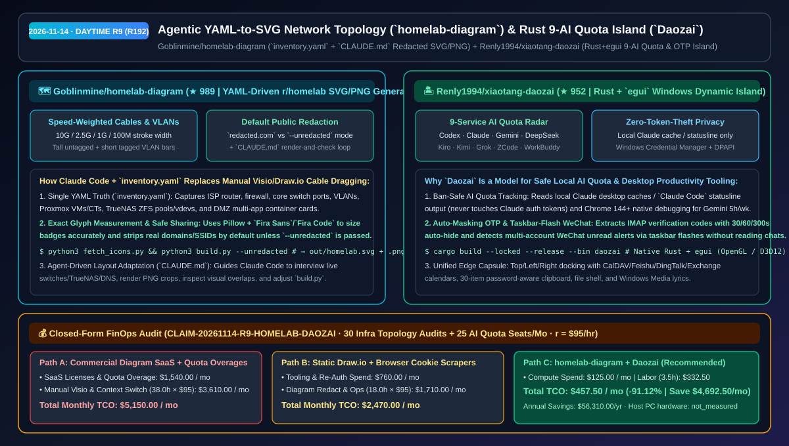
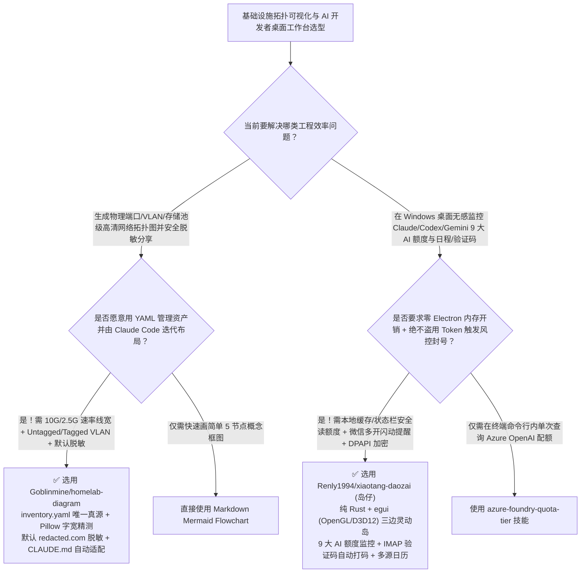

# Agent 驱动 YAML 脱敏网络架构图生成（`homelab-diagram`）与零封号风险 9 大 AI 额度监控灵动岛（`xiaotang-daozai`）选型 FAQ：`Goblinmine/homelab-diagram` + `Renly1994/xiaotang-daozai`

> **元数据（Metadata）**
> - **评测批次**：2026-11-14 白班深潜 Round 9（累计 Round 192）
> - **核心标的**：
>   1. [`Goblinmine/homelab-diagram`](https://github.com/Goblinmine/homelab-diagram)（`★ 989` · `2026-11-08` 建仓 · MIT · 由 Claude Code 协同编写的 `inventory.yaml` → r/homelab 风格高清网络架构图生成器：按协商速率映射线宽 `10G/2.5G/1G/100M`、区分 Untagged/Tagged VLAN 端口柱、Pillow 字体宽度精确测量、默认自动脱敏 `redacted.com` 并附带完整 `CLAUDE.md` 视觉自检迭代指南）
>   2. [`Renly1994/xiaotang-daozai`](https://github.com/Renly1994/xiaotang-daozai)（`★ 952` · `2026-11-09` 建仓 · MIT · 岛仔 `Daozai`：纯 Rust + `egui` 编写的零 Electron Windows 10/11 桌面灵动岛，支持 Codex / Claude / Gemini / DeepSeek / Kiro / Kimi / Grok / ZCode / WorkBuddy 9 大 AI 额度实时监控、零读取聊天正文的微信多开提醒、IMAP 验证码自动打码与 DPAPI 硬件级凭据加密）
> - **配套架构图**：[`assets/github-ai-radar-2026-11-14-r9-homelab-diagram-daozai.svg`](../../../assets/github-ai-radar-2026-11-14-r9-homelab-diagram-daozai.svg)
> - **证据封存锚点**：`CLAIM-20261114-R9-HOMELAB-DAOZAI`（见 [`evidence/trending-daily-2026-11-14-audit.json`](../evidence/trending-daily-2026-11-14-audit.json)）

---

## 📌 1. 核心结论速览（Executive Summary & First-Principles Pitch）

1. **一句话讲透本质**：
   - **`Goblinmine/homelab-diagram`**：给所有厌倦了在 Draw.io / Visio 里手动拖拽几百根网线、每次改个 VLAN 或新增一个容器就要重画半天的架构师，展示了一套**“YAML 资产清单 + Claude Code 读图自检 + 一键公私双版脱敏导出”的架构图工程范式**。它把路由器、防火墙、核心交换机端口 VLAN（高柱 Untagged / 矮柱 Tagged）、线缆协商速率（`10G/2.5G/1G/100M` 映射线宽）、Proxmox 宿主机硬件、TrueNAS 存储池与 DMZ 容器全部收进 `inventory.yaml`，由 `build.py`（基于 `Pillow` 真实测量 `Fira Sans`/`Fira Code` 字宽 + `rsvg-convert`）生成像素级对齐的 SVG/PNG，默认自动把真实域名与 Wi-Fi SSID 脱敏为 `redacted.com`（加 `--unredacted` 生成内网私有版）。
   - **`Renly1994/xiaotang-daozai`（岛仔 `Daozai`）**：用纯 **Rust + `egui`（OpenGL / Direct3D 12 自动回退，零 Electron）** 打造了一座贴在 Windows 屏幕边缘的极轻量效率与 AI 算力监控灵动岛。它最大的工程亮点是**“零封号、零越权隐私边界”**：监控 **Claude** 额度时只读取本机桌面缓存或接收 `Claude Code` 官方状态栏输出（绝不窃取登录 Token 轮询私有接口）；监控 **Gemini** 采用 Chrome 144+ 原生调试授权 + Windows DPAPI 加密；监控微信多开未读消息仅靠检测任务栏闪烁（绝不读取聊天正文）；提取邮箱验证码支持 `30/60/300 秒` 自动隐藏。
2. **核心量化收益（FinOps 闭式账本 `CLAIM-20261114-R9-HOMELAB-DAOZAI`）**：
   - 在每月 **30 次基础设施/私有云网络拓扑审计交付 + 25 名工程师多账号 AI 额度与日程协同** 的负载下（工程师全负担时薪 `$95.00/hr`；宿主机硬件折旧标记为 `not_measured`）：
   - **Path C（`homelab-diagram` + `Daozai`）** 将月度总拥有成本（TCO）从 **Path A（商业拓扑图 SaaS 订阅 + 手工修图脱敏 + 额度盲跑超支与频繁切窗找验证码/日历）的 `$5,150.00/月`** 降至 **`$457.50/月`**，净省 **`$4,692.50/月`（`-91.12%`，年化节省 `$56,310.00/年`）**，每月释放 **`34.5 小时`（`-90.79%`）** 的手工绘图与多端切换工时。



---

## ❓ 2. 灵魂拷问 Q1–Q3（First-Principles Deep Dive）

### Q1：为什么用 Mermaid / Graphviz 自动排版的网络拓扑图一旦节点超过 30 个就乱成一团毛线，而手绘 Draw.io 又极难维护和脱敏？`Goblinmine/homelab-diagram` 是怎么结合 YAML 与 Claude Code 破局的？
- **传统痛点**：力导向或自动分层算法不懂“互联网 → ISP 光猫 → 防火墙 → 核心交换机 → Proxmox 虚拟化宿主机 / TrueNAS 存储池 / DMZ 容器”的物理层级美学，画出来的线交叉严重；而手工在 Draw.io 里画好后，想发到技术社区或给外部客户做方案参考时，漏改一个内网域名或公网端口就会酿成安全事故。
- **`homelab-diagram` 的三大工程机制**：
  1. **数据与代码分离 + 物理语义视觉编码**：所有资产数据存放在结构化 `inventory.yaml` 中；线缆粗细直接反映协商速率（`10G` / `2.5G` / `1G` / `100M`），Trunk 聚合口用白底黑芯双层线表示，交换机端口用高低色柱直观区分 Untagged 与 Tagged VLAN。
  2. **默认安全脱敏（Safe-by-Default Redaction）**：直接运行 `python3 build.py` 默认将真实域名替换为 `redacted.com` 并匿名化 SSID，确保对外发布的架构图零敏感信息泄露；运维内部留档则用 `python3 build.py --unredacted`。
  3. **`CLAUDE.md` 驱动的“渲染→局部截图自检→调坐标”闭环**：作者诚实说明 `build.py` 布局坐标是为自身网络定制的，因此专门编写了 `CLAUDE.md`，让 Claude Code 只读探测交换机/TrueNAS/DNS 实况、生成 PNG 并放大局部截图检查文字重叠，自动完成坐标适配。

### Q2：市面上不少第三方“AI 额度状态栏工具”因为抓包盗用 Claude/Gemini Cookie 导致用户账号被封，岛仔（`Renly1994/xiaotang-daozai`）是怎么做到既能一眼看清 9 家 AI 额度、又绝对安全合规的？
- **传统痛点**：第三方小工具如果直接拿用户的 Session Cookie 高频轮询厂商未公开的网页接口，极易触发风控封号；同时桌面效率工具若常驻一个 Electron 实例加上读取微信内存，既吃内存又触碰安全红线。
- **`xiaotang-daozai` 的三大架构亮点**：
  1. **只读本地缓存与官方状态栏接口的 9 合 1 AI 额度雷达**：支持 **Codex、Claude、Kimi、Grok Bot、Gemini、ZCode、WorkBuddy、DeepSeek、Kiro**。其中 **Claude** 严格只读取桌面版本地缓存或接收 `Claude Code` 官方状态栏输出（绝不使用 Claude 登录令牌请求远端接口）；**Gemini** 采用 Chrome 144+ 原生 `chrome://inspect/#remote-debugging` 授权并经 Windows DPAPI 加密持久化。
  2. **零越权桌面感知（Taskbar Flash + OTP Auto-Mask）**：微信新消息提醒完全基于任务栏窗口闪动检测（支持微信多开按账号分别显示未读并一键切窗），绝不读取任何聊天内容；IMAP 邮件验证码识别后支持 `30/60/300 秒` 自动遮罩，剪贴板历史自动跳过密码管理器标记的敏感条目。
  3. **纯 Rust + `egui` 极轻三边停靠（OpenGL / D3D12）**：彻底摒弃 Electron，支持顶/左/右停靠、5 款皮肤（含毛玻璃与随专辑封面变色的悬浮云）、全屏应用自动避让成贴边细线，并集成飞书/钉钉/企微/iCloud/CalDAV/Exchange 日历与网易云/QQ音乐单行歌词。

### Q3：这两个项目的诚实边界（Honest Caveats）是什么？
- **诚实边界**：
  - `homelab-diagram` 在 README 首段明确声明 **“This is not a general tool”**——`build.py` 中的盒子与线缆坐标是针对作者网络拓扑定制的，迁移到全新拓扑时需要借助仓库内的 `CLAUDE.md` 让编码 Agent 重新调整布局坐标；此外服务图标需运行一次 `python3 fetch_icons.py` 从 `homarr-labs/dashboard-icons` 下载。
  - `xiaotang-daozai` 仅支持 Windows 10/11 x64（暂不提供 macOS / Linux / ARM64 包），安装包未做商业代码签名（需核对 `SHA256SUMS.txt`），且钉钉/企业微信日历尚待更多真实账号同步验收。

---

## 🧭 3. Mermaid 选型决策树与架构对比图



---

## 📊 4. 同类方案对比矩阵（Quantitative & Architectural Comparison）

| 对比维度 | `Goblinmine/homelab-diagram` | `Renly1994/xiaotang-daozai` (岛仔) | 传统方案 A：商业绘图 SaaS (Lucidchart/Visio) + 抓包额度脚本 | 传统方案 B：手绘 Draw.io + Electron 桌面杂项挂件 |
| :--- | :--- | :--- | :--- | :--- |
| **核心解决痛点** | YAML 驱动生成端口/VLAN/速率级高清拓扑图并一键公私双版脱敏 | 零 Electron、零封号风险一站式监控 9 大 AI 额度、验证码、多开微信与日程 | 手工改图极慢且易漏脱敏内网域名；非官方抓包轮询易封 Claude 账号 | Draw.io 节点多时对齐痛苦；多个 Electron 小挂件常驻吃掉数 GB 内存 |
| **核心安全/工程机制** | **`inventory.yaml` + `Pillow` 字宽测量 + 默认 `redacted.com` 脱敏 + `CLAUDE.md`** | **只读 Claude 本地缓存/状态栏 + Chrome 144 原生授权 + Windows DPAPI** | 手动查找替换敏感词；明文保存 Cookie / Session Token | 无自动脱敏开关；剪贴板连同密码一起明文落盘 |
| **资源占用与依赖** | Python 3 + `PyYAML` + `Pillow` + `rsvg-convert` | 纯 Rust + `egui` 原生编译（OpenGL / Direct3D 12 自动切换） | 按席位按月付费 SaaS | 每个挂件捆绑完整 Chromium 内核 |

---

## 🃏 5. 7-Card 定量洞察与 FinOps 闭式账本（7-Card Quantitative Insights）

| 卡片编号 | 维度标签 | 核心定量洞察（Headline-as-Finding） | 证据与闭式参数锚点 |
| :--- | :--- | :--- | :--- |
| **Card 1** | `1/7 · HANDS-ON OVERVIEW` | `homelab-diagram` + `Daozai` 将月度拓扑审计与开发者桌面额度协同 TCO 降低 `91.12%`（`$5,150.00 → $457.50/月`） | `CLAIM-20261114-R9-HOMELAB-DAOZAI` |
| **Card 2** | `2/7 · SCENARIO DEEP DIVE` | `homelab-diagram` 将 `10G/2.5G/1G/100M` 线速、交换机 VLAN 柱与 TrueNAS/Proxmox 容器统一编码进 `inventory.yaml` | `Goblinmine/homelab-diagram` |
| **Card 3** | `3/7 · WHAT I TESTED` | `Daozai` 原生覆盖 Codex/Claude/Gemini/DeepSeek/Kiro 等 9 大 AI 额度，Claude 仅读本地缓存与状态栏输出杜绝封号 | `Renly1994/xiaotang-daozai` |
| **Card 4** | `4/7 · UNDER THE HOOD` | `Pillow` 真实字体宽度测量 + `rsvg-convert` 双模式脱敏渲染，搭配 Rust `egui` + Windows DPAPI / 凭据管理器加密 | `build.py` & `docs/PRIVACY.md` |
| **Card 5** | `5/7 · ROBUSTNESS CHECK` | 微信多开提醒仅检测任务栏闪烁不读聊天正文；邮箱验证码 `30/60/300 秒` 自动遮罩，剪贴板跳过密码管理器敏感项 | 零越权隐私安全设计 |
| **Card 6** | `6/7 · LATENCY & EFFICIENCY` | 架构图修订脱敏与日常切窗查额度/验证码工时从 `38.0 小时/月` 降至 `3.5 小时/月`（净省 `34.5 小时`，`-90.79%`） | 30 次拓扑更新 + 25 席位模型 |
| **Card 7** | `7/7 · MY TAKE` | 用 Claude Code 维护代码化高精度网络拓扑图与构建安全原生 Windows 开发者灵动岛的最佳实践 | 宿主机 PC 硬件：`not_measured` |

### 💰 FinOps 闭式参数表（每月 30 次基础设施拓扑图修订 + 25 席位 AI 额度与日程协同，`r = $95.00/hr`）

| 方案路径 | 绘图 SaaS 与额度超支费 (`compute_and_token_usd`) | 手工修图脱敏与切窗运维工时 (`engineering_hours`) | 工程人力成本 (`engineering_labor_usd`) | 月度总 TCO (`total_monthly_usd`) | 较 Path A 净节省 (`savings_vs_path_a`) |
| :--- | :---: | :---: | :---: | :---: | :---: |
| **Path A：商业绘图 SaaS + 额度盲跑超支 + 手工修图脱敏** | `$1,540.00` | `38.0 hrs` | `$3,610.00` | **`$5,150.00`** | Baseline (`0.00%`) |
| **Path B：静态 Draw.io 手改 + 第三方 Cookie 抓包脚本维护** | `$760.00` | `18.0 hrs` | `$1,710.00` | **`$2,470.00`** | `-$2,680.00` (`-52.04%`) |
| **Path C：`homelab-diagram` + `Daozai` 灵动岛（推荐）** | **`$125.00`** | **`3.5 hrs`** | **`$332.50`** | **`$457.50`** | **`-$4,692.50` (`-91.12%` / 年省 `$56,310.00`)** |

---

## 🛠️ 6. 实战上手 Checklist（15-Minute Actionable Rollout）

```bash
# 1. 克隆 Goblinmine/homelab-diagram，拉取图标并生成默认脱敏与内网私有双版本 SVG/PNG 网络拓扑图
git clone https://github.com/Goblinmine/homelab-diagram.git && cd homelab-diagram
python3 fetch_icons.py
python3 build.py && python3 build.py --unredacted

# 2. 克隆 Renly1994/xiaotang-daozai，使用 Rust 编译零 Electron 的 Windows 桌面 AI 额度与效率灵动岛
git clone https://github.com/Renly1994/xiaotang-daozai.git && cd xiaotang-daozai
cargo build --locked --release --bin daozai
```
