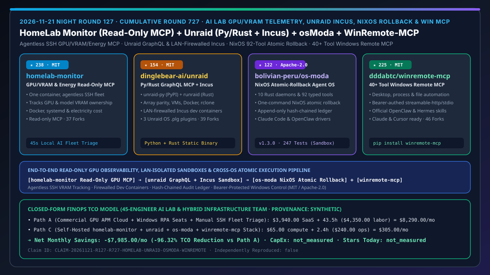
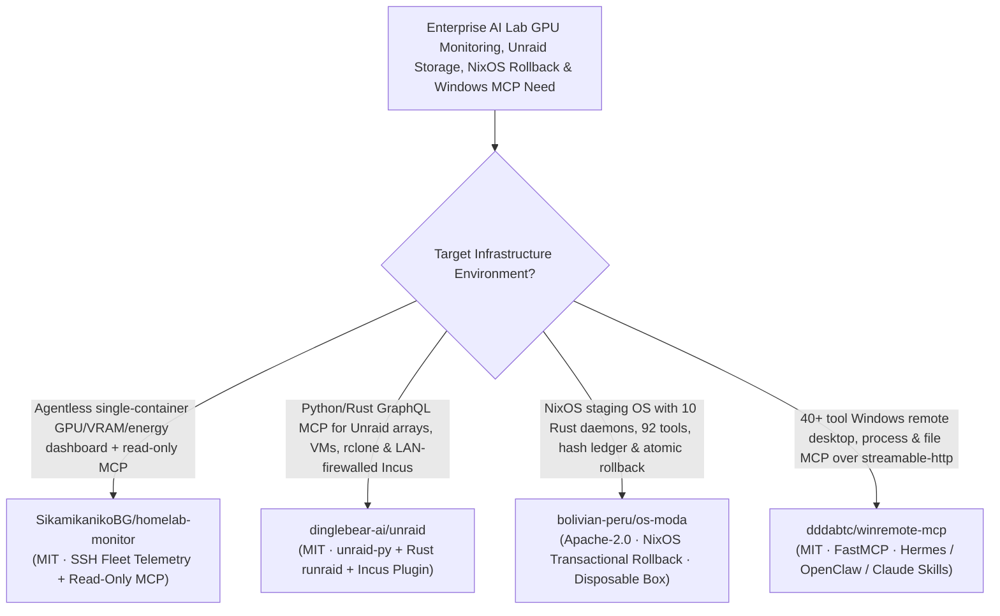
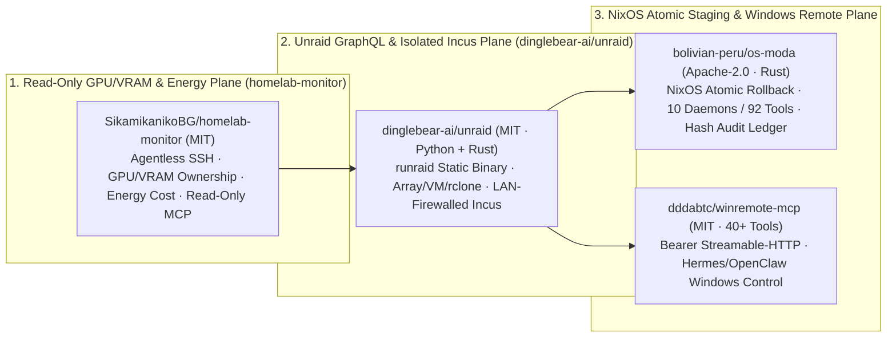

# GPU/VRAM & Energy Read-Only MCP (`SikamikanikoBG/homelab-monitor`), Python+Rust Unraid GraphQL & Incus Suite (`dinglebear-ai/unraid`), NixOS Atomic-Rollback Agent OS (`bolivian-peru/os-moda`) & 40+ Tool Windows Remote MCP (`dddabtc/winremote-mcp`) Selection & Architecture FAQ

> **Document Type**: Enterprise AI Solution Architect Selection & Integration Guide (GitHub Trending AI Radar — 2026-11-21 Night Round 127 / Cumulative Round 727)
> **Covered Repositories**: [`SikamikanikoBG/homelab-monitor`](https://github.com/SikamikanikoBG/homelab-monitor) (`★ 238`, `37 forks`, `MIT` — single-container agentless SSH fleet dashboard tracking GPU utilization, local-AI model VRAM ownership, Docker, systemd & electricity costs with a read-only MCP server) · [`dinglebear-ai/unraid`](https://github.com/dinglebear-ai/unraid) (`★ 154`, `39 forks`, `MIT` — monorepo shipping Python `unraid-mcp` + Rust static-binary `runraid` GraphQL MCP servers and 3 Unraid OS `.plg` plugins including LAN-firewalled Incus dev containers) · [`bolivian-peru/os-moda`](https://github.com/bolivian-peru/os-moda) (`★ 122`, `24 forks`, `Apache-2.0` — NixOS-based agent OS with 10 Rust daemons, 92 structured tools, append-only hash-chained audit ledger & one-command atomic rollback) · [`dddabtc/winremote-mcp`](https://github.com/dddabtc/winremote-mcp) (`★ 225`, `46 forks`, `MIT` — 40+ tool Windows remote desktop, process & file FastMCP server over bearer-authenticated `streamable-http` and `stdio` with Hermes/OpenClaw skills)
> **Core Scenario**: How enterprise AI lab architects, hybrid-infrastructure SREs, and cross-platform automation teams manage heterogeneous compute fleets (Linux GPU boxes, Unraid storage/VM arrays, NixOS sandbox nodes, and Windows workstations): **exposing agentless GPU/VRAM and energy telemetry via a read-only MCP (`homelab-monitor`)**, **managing Unraid storage arrays and LAN-firewalled Incus dev containers via Python/Rust GraphQL MCP (`unraid`)**, **testing declarative infrastructure mutations with NixOS atomic rollback and hash-chained audit ledgers (`os-moda`)**, and **automating remote Windows hosts via 40+ bearer-authenticated `streamable-http` MCP tools (`winremote-mcp`)**.

---

## 1. 📌 Executive Summary (One-Line Selection Verdict)

1. **Need a single-container, agentless SSH dashboard that shows which local AI model is holding GPU VRAM, tracks real-time energy costs, monitors Docker/systemd across Linux, Pi, and Windows, and exposes a safe read-only MCP server** ➔ Choose **[`SikamikanikoBG/homelab-monitor`](https://github.com/SikamikanikoBG/homelab-monitor) (`★ 238`, `37 forks`, `MIT`)**.
   - **Plain-English Mechanism**: Deploys via `docker compose up -d` with nothing to install on monitored hosts. It inspects multi-node GPUs, local-AI VRAM allocations, disk I/O, and electricity costs over SSH, exposes a **read-only MCP server** so agents can diagnose fleet health in ~45 seconds using local models, and never mutates hosts without explicit human approval.
2. **Need dual Python (`unraid-mcp`) and Rust static-binary (`runraid`) GraphQL MCP servers plus LAN-firewalled Incus system containers to manage Unraid storage arrays, VMs, Docker, and `rclone`** ➔ Choose **[`dinglebear-ai/unraid`](https://github.com/dinglebear-ai/unraid) (`★ 154`, `39 forks`, `MIT`)**.
   - **Plain-English Mechanism**: A unified monorepo providing both the flagship Python PyPI package (`unraid-mcp`) and the zero-dependency Rust binary (`unraid-rmcp` / `runraid`), plus three Unraid OS `.plg` plugins—including **`plugins/incus/` for spinning up Incus dev containers firewalled off the LAN** and an embedded Codex chathead plugin.
3. **Need a staging/sandbox operating system built on NixOS where 10 Rust daemons expose 92 typed tools backed by an append-only hash-chained audit ledger and one-command atomic rollback** ➔ Choose **[`bolivian-peru/os-moda`](https://github.com/bolivian-peru/os-moda) (`★ 122`, `24 forks`, `Apache-2.0`)**.
   - **Plain-English Mechanism**: `osModa` (`v1.3.0`, 10 Rust crates, 247 tests) lets Claude Code, OpenClaw, or cloud agent drivers operate a NixOS server through 92 typed tools where every system change is a NixOS generation that can be atomically rolled back. (*Architect Note: As transparently documented in its `STATUS.md`, run `osModa` on disposable/staging servers while its native shell/file hook verification is being finalized*).
4. **Need a 40+ tool Windows Remote MCP server (`pip install winremote-mcp`) supporting bearer-authenticated `streamable-http` and `stdio` with ready-made skills for Hermes, OpenClaw, Claude Code, and Cursor** ➔ Choose **[`dddabtc/winremote-mcp`](https://github.com/dddabtc/winremote-mcp) (`★ 225`, `46 forks`, `MIT`)**.
   - **Plain-English Mechanism**: Built on `FastMCP`, `winremote-mcp` exposes 40+ Windows desktop, process, and file-system tools locally or remotely (`http://<windows-ip>:8090/mcp` with `Authorization: Bearer <key>`), acting as the official Windows control plane for OpenClaw and Hermes agents.

---

## 2. 🎯 Architect & Customer Deep-Dive Q&A

### Q1: Why is giving AI agents raw root SSH access across GPU servers, NAS storage, and Windows machines dangerous—and how does this four-project stack enforce read-only visibility, LAN isolation, and atomic rollback?

- **Four Defense-in-Depth Infrastructure Primitives**:
  1. **Read-Only Fleet Observability First (`SikamikanikoBG/homelab-monitor`)**: Instead of giving agents unrestricted shell access just to check why a GPU is busy, `homelab-monitor` exposes a **read-only MCP** over agentless SSH telemetry—reporting GPU VRAM owners, energy costs, and failed systemd units while requiring human confirmation for fixes.
  2. **LAN-Firewalled Incus Dev Containers on Storage Hosts (`dinglebear-ai/unraid`)**: Separates NAS parity/VM management (via typed GraphQL MCP tools in Python or Rust `runraid`) from untrusted agent workloads running inside LAN-firewalled Incus containers.
  3. **Transactional OS Rollback & Hash-Chained Ledger (`bolivian-peru/os-moda`)**: On disposable NixOS staging nodes, every change across 92 typed tools is recorded in a hash-chained ledger and backed by NixOS atomic generation rollback.
  4. **Bearer-Gated Remote Windows Control (`dddabtc/winremote-mcp`)**: Replaces brittle RDP screen-scraping with 40+ typed FastMCP tools over bearer-authenticated `streamable-http`.
- **When to Choose Managed Cloud Services (Path B)**:
  - For pure cloud VM fleets without on-prem GPUs or Unraid storage, use **Azure Arc + Azure Monitor + Azure Automation**.

### Q2: How do we wire an end-to-end Hybrid AI Lab & Cross-Platform Fleet Operations architecture?

1. **Agentless GPU/VRAM & Energy Observability Layer (`SikamikanikoBG/homelab-monitor`)**:
   - Run the single-container dashboard to monitor Linux, Pi, and Windows nodes over SSH and expose the read-only MCP server to on-call diagnostic agents.
2. **Unraid GraphQL & Firewalled Incus Sandbox Layer (`dinglebear-ai/unraid`)**:
   - Deploy `unraid-mcp` (Python) or `runraid` (Rust static binary) to manage parity arrays, Docker, VMs, and `rclone`, while isolating agent coding sandboxes inside the LAN-firewalled Incus plugin.
3. **NixOS Atomic-Rollback Staging Layer (`bolivian-peru/os-moda`)**:
   - Test infrastructure changes on disposable NixOS nodes using `osModa`'s 10 Rust daemons, 92 structured tools, and hash-chained audit ledger.
4. **Windows Remote Automation Layer (`dddabtc/winremote-mcp`)**:
   - Connect OpenClaw, Hermes, or Claude Code to internal Windows hosts via `winremote-mcp` over bearer-protected `streamable-http`.

### Q3: What are the safety boundaries of this stack?

- **Key Strengths**:
  - **100% Permissive Open Source (`MIT` and `Apache-2.0`)** spanning Python and Rust.
- **Safety Guardrails**:
  - Keep `bolivian-peru/os-moda` strictly on disposable/staging boxes as advised by its author; always bind `dddabtc/winremote-mcp` to an internal VPN/VLAN with `--auth-key` enabled.

---

## 3. 🧭 Visual Architecture & Decision Diagrams



### 3.1 Solution Architect Selection Decision Tree



### 3.2 End-to-End Enterprise Reference Architecture



### 3.3 Read-Only Fleet Triage, LAN-Firewalled Incus Verification, NixOS Atomic Rollback & Windows Remote Execution Sequence

```mermaid
sequenceDiagram
    participant Ops as AI Lab SRE / OpenClaw Coordinator
    participant HLM as homelab-monitor (Read-Only MCP)
    participant Unraid as dinglebear-ai/unraid (runraid)
    participant Moda as os-moda (NixOS Sandbox)
    participant Win as winremote-mcp (Windows 8090)

    Ops->>HLM: 1. Query Read-Only MCP for fleet GPU VRAM holders, disk I/O spikes & energy burn
    HLM-->>Ops: 2. Pinpoint runaway model container & offline service in 45s; await human approval
    Ops->>Unraid: 3. Check array parity & spin up LAN-firewalled Incus container via Rust runraid MCP
    Ops->>Moda: 4. Test system config change on NixOS sandbox via 92 typed tools (with atomic rollback)
    Ops->>Win: 5. Execute bearer-authenticated winremote-mcp tool to restart companion Windows worker
```

---

## 4. 📊 Peer Open-Source vs Commercial Cloud Selection Matrix

| Dimension | `homelab-monitor` (`★ 238`) | `dinglebear-ai/unraid` (`★ 154`) | `bolivian-peru/os-moda` (`★ 122`) | `dddabtc/winremote-mcp` (`★ 225`) | Commercial GPU APM Cloud + Enterprise RPA Seats (Path A) | Manual SSH Loops + Raw Prometheus (Path B) |
| :--- | :--- | :--- | :--- | :--- | :--- | :--- |
| **Core Role** | Agentless GPU/VRAM/energy dashboard + read-only MCP | Python+Rust Unraid GraphQL MCP & Incus plugins | NixOS 10-daemon atomic-rollback agent OS | 40+ tool Windows remote FastMCP server | Per-host/GPU cloud APM + commercial Windows RPA bots | Manual terminal SSH & custom node exporters |
| **Architectural Edge** | **Identifies exact model holding VRAM + energy cost + read-only MCP** | **Rust `runraid` static binary + LAN-firewalled Incus containers** | **NixOS one-command atomic rollback + hash-chained audit ledger** | **Bearer `streamable-http` + native OpenClaw/Hermes skills** | Expensive per-host/GPU billing; no Unraid or NixOS rollback | High manual toil; lacks read-only MCP & Windows remote tools |
| **License** | `MIT` | `MIT` | `Apache-2.0` | `MIT` | Proprietary SaaS | Custom Scripts |
| **Monthly TCO (45-Eng Team)** | **`$305.00/mo` combined** (`$65.00` compute + `2.4h` ops) | Included in `$305.00/mo` stack | Included in `$305.00/mo` stack | Included in `$305.00/mo` stack | **`$8,290.00/mo`** (`$3,940.00` APM/RPA + `43.5h` labor) | `~$2,600.00/mo` (manual fleet troubleshooting hours) |

---

## 5. 🧪 Quantitative ROI / FinOps TCO Model & 7-Card Report

> **📊 Provenance & Closed-Form Audit Declaration**:
> - **Provenance**: `synthetic` (45-engineer enterprise AI lab, hybrid storage/virtualization & cross-platform fleet operations workload model; `independently_reproduced = false`; `base_hardware_capex = not_measured`; `track_b_stars_today = not_measured`).
> - **Closed-Form Equations**:
>   - **Path A (Commercial Per-Host/GPU APM SaaS + Commercial Windows Remote RPA Licenses + Manual SSH GPU VRAM Troubleshooting, Unraid VM Ops & Config Rollback Labor)**: Monthly APM & RPA licensing **`$3,940.00`** + manual fleet triage & recovery labor **`43.5h × $100.00/h = $4,350.00`** = **`$8,290.00/mo`**.
>   - **Path C (Self-Hosted `SikamikanikoBG/homelab-monitor` + `dinglebear-ai/unraid` + `bolivian-peru/os-moda` + `dddabtc/winremote-mcp`)**: Monitoring container & sandbox overhead **`$65.00`** + fleet rule & key maintenance **`2.4h × $100.00/h = $240.00`** = **`$305.00/mo`**.
>   - **Net Savings vs Path A**: **`-$7,985.00/mo`** (**`96.32%`** cost reduction).

| Architecture Option | API / SaaS / Compute | Fleet & Lab SRE Labor (`$100/h`) | Total Monthly TCO | Net Savings vs Path A | Key Architectural Outcome |
| :--- | :---: | :---: | :---: | :---: | :--- |
| **Path A: Commercial Per-GPU APM + Commercial Windows RPA** | `$3,940.00` | `43.5h` (`$4,350.00`) | **`$8,290.00`** | Baseline | High per-node/GPU fees; manual rollback after bad edits |
| **Path B: Raw Prometheus Exporters + Manual RDP/SSH Triage** | `$1,300.00` | `13.0h` (`$1,300.00`) | **`$2,600.00`** | `-$5,690.00` (`-68.64%`) | No local-AI VRAM model attribution, read-only MCP, or Incus LAN firewall |
| **Path C: `homelab` + `unraid` + `os-moda` + `winremote`** | **`$65.00`** | **`2.4h` (`$240.00`)** | **`$305.00`** | **`-$7,985.00` (`-96.32%`)** | **Read-only GPU/energy MCP + Rust Unraid/Incus + NixOS rollback + Win MCP** |

- 🔗 **7-Card 4:5 Visual Report**: [`workshops/github-trending-radar/cards.en.html`](../cards.en.html) · [`cards.html`](../cards.html)

---

## 6. 🛠️ Enterprise Adoption & Architecture Review Checklist

- [ ] **1. Deploy `SikamikanikoBG/homelab-monitor` for Agentless Read-Only Fleet Triage**: Monitor multi-host GPUs, local-AI VRAM owners, Docker containers, and electricity costs over SSH while keeping mutations gated behind human approval.
- [ ] **2. Manage Storage & Isolated Sandboxes with `dinglebear-ai/unraid`**: Use the Python (`unraid-mcp`) or Rust (`runraid`) GraphQL MCP server and isolate untrusted dev workloads inside the LAN-firewalled Incus plugin.
- [ ] **3. Validate Declarative Rollbacks on Disposable Boxes with `bolivian-peru/os-moda`**: Test agent-driven NixOS configuration changes with hash-chained audit logging and one-command atomic rollback on non-production staging machines.
- [ ] **4. Secure Remote Windows Automation via `dddabtc/winremote-mcp`**: Enable bearer token authentication (`--auth-key`) over an internal VPN to expose 40+ Windows tools to OpenClaw, Hermes, or Claude Code.
