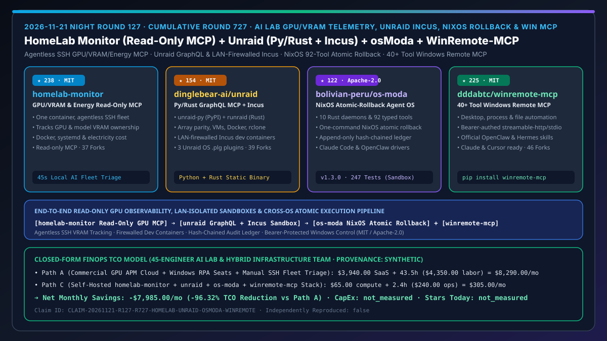
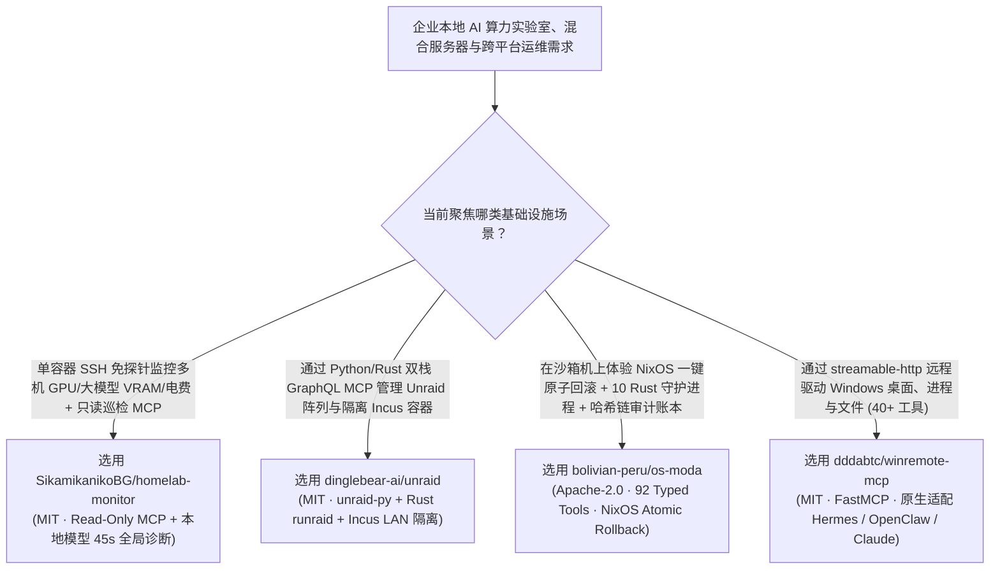
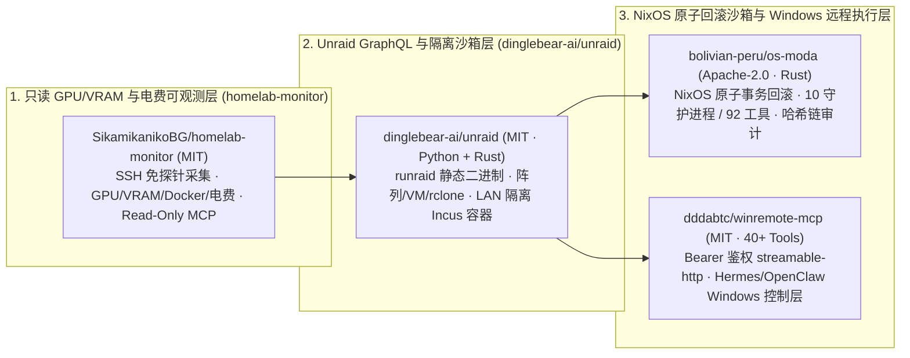
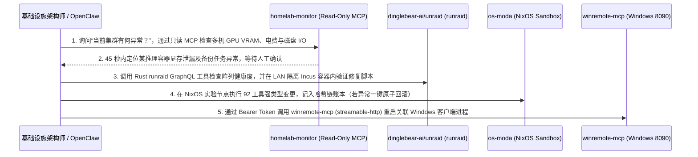

# 单容器 GPU/VRAM/电费只读监控 MCP（`SikamikanikoBG/homelab-monitor`）、Python+Rust 双栈 Unraid GraphQL 与 Incus 隔离容器套件（`dinglebear-ai/unraid`）、NixOS 10 守护进程原子回滚智能体 OS（`bolivian-peru/os-moda`）与 40+ 工具 Windows 远程控制 MCP（`dddabtc/winremote-mcp`）选型与集成架构 FAQ

> **文档类型**：企业 AI 解决方案架构师（AI Solution Architect）选型决策指南（GitHub Trending AI 雷达 2026-11-21 Night Round 127 / 累计第 727 轮）
> **覆盖项目**：[`SikamikanikoBG/homelab-monitor`](https://github.com/SikamikanikoBG/homelab-monitor)（`★ 238`、`37 forks`、`MIT`，免被控端插件、通过 SSH 集中监控多机 GPU 占用、本地大模型 VRAM、Docker、systemd 与实时电费成本并暴露只读 MCP 的单容器面板）· [`dinglebear-ai/unraid`](https://github.com/dinglebear-ai/unraid)（`★ 154`、`39 forks`、`MIT`，同时提供 Python `unraid-mcp` 与 Rust `runraid` 双 MCP 服务端、支持 GraphQL 管理阵列/VM/Docker/rclone 及 LAN 防火墙隔离 Incus 开发容器的套件）· [`bolivian-peru/os-moda`](https://github.com/bolivian-peru/os-moda)（`★ 122`、`24 forks`、`Apache-2.0`，基于 NixOS 原子事务回滚、由 10 个 Rust 守护进程与 92 个强类型工具及哈希链审计账本组成的智能体操作系统）· [`dddabtc/winremote-mcp`](https://github.com/dddabtc/winremote-mcp)（`★ 225`、`46 forks`、`MIT`，提供 40+ 桌面自动化/进程/文件工具、支持 Bearer 鉴权 `streamable-http` 并原生适配 Hermes/OpenClaw/Claude 的 Windows 远程 MCP）
> **核心场景**：当企业边缘 AI 实验室、混合算力集群运维（AIOps）与跨平台 IT 自动化团队管理异构服务器（Linux GPU 节点、Unraid 存储/虚拟化阵列、NixOS 实验节点与 Windows 业务机）时，如何实现**“全局 GPU/VRAM 与电费成本只读可观测（`homelab-monitor`）”+“存储阵列与 LAN 隔离 Incus 容器 GraphQL 管控（`unraid`）”+“变更可一键原子回滚且带哈希链审计的 NixOS 实验环境（`os-moda`）”+“Windows 远程桌面与进程受控执行（`winremote-mcp`）”**？

---

## 一、📌 核心结论速览（选型一句话结论）

1. **想用一个单容器面板（免在被控机装 Agent）通过 SSH 看清机房里每张 GPU 正在被哪个本地大模型占用 VRAM、实时电费多少、哪个 Docker 容器吃光了内存，并提供只读 MCP 让 AI 安全巡检** ➔ 选 **[`SikamikanikoBG/homelab-monitor`](https://github.com/SikamikanikoBG/homelab-monitor)（`★ 238`，`37 forks`，`MIT`）**。
   - **通俗原理**：一行 `docker compose up -d` 即可启动。它通过无侵入 SSH 采集 Linux、树莓派甚至 Windows 节点状态，专门针对本地 AI 实验室痛点设计了 **GPU / 本地大模型 VRAM 归属分析与能耗电费核算面板**；默认向 AI 暴露**只读 MCP Server**（“未经人类明确批准绝不擅自改配置”），并可直接调用实验室内置的本地模型在 45 秒内完成全集群健康诊断。
2. **想通过 GraphQL API 与双栈 MCP（Python `unraid-mcp` + Rust 单静态二进制 `runraid`）统一纳管 Unraid 存储阵列、虚拟机、Docker、`rclone` 备份，并在内网开辟与局域网防火墙隔离的 Incus 开发容器** ➔ 选 **[`dinglebear-ai/unraid`](https://github.com/dinglebear-ai/unraid)（`★ 154`，`39 forks`，`MIT`）**。
   - **通俗原理**：该单仓（Monorepo）整合了两大 MCP 服务端（PyPI 上的 Python 版 `unraid-mcp` 与 crates.io 上的 Rust 版 `unraid-rmcp`/`runraid`）以及三大 Unraid OS 原生插件（`.plg`）：不仅能用自然语言查询磁盘奇偶校验（Parity）与实时遥测，还内置了 **与局域网隔离（Firewalled off the LAN）的 Incus 系统级开发容器插件**与内嵌 Codex 助手插件。
3. **想在实验/沙箱服务器上尝试“每一次 AI 运维变更都是一个可一键撤销的 NixOS 原子事务”，并配套 10 个 Rust 守护进程、92 个强类型工具与防篡改哈希链审计账本** ➔ 选 **[`bolivian-peru/os-moda`](https://github.com/bolivian-peru/os-moda)（`★ 122`，`24 forks`，`Apache-2.0`）**。
   - **通俗原理**：`osModa`（v1.3.0）将 **NixOS 的声明式原子回滚能力**与 **10 个 Rust Crates 守护进程 + 92 个结构化系统工具 + 追加写哈希链审计账本（Hash-Chained Audit Ledger）**相结合，支持在不重装的情况下无缝切换 Claude Code、OpenClaw 或云端驱动。（*架构师重要安全提示：作者在 README 中极其诚实地标注了各模块成熟度——目前推荐仅在可随时重建的实验/沙箱机 `Disposable Box` 上运行，切勿直接放上核心生产机*）。
4. **想把远程 Windows 工作站或业务服务器变成带 Bearer Token 鉴权的 `streamable-http` MCP 节点，让 Hermes、OpenClaw、Claude Code 或 Cursor 远程调用 40+ 个桌面、进程与文件自动化工具** ➔ 选 **[`dddabtc/winremote-mcp`](https://github.com/dddabtc/winremote-mcp)（`★ 225`，`46 forks`，`MIT`）**。
   - **通俗原理**：基于 `FastMCP` 构建（`pip install winremote-mcp`），支持本地 `stdio` 或带密钥鉴权的远程 `streamable-http`（`winremote-mcp --host 0.0.0.0 --port 8090 --auth-key "..."`），仓库内直接附带了针对 **Hermes、OpenClaw、Claude 与 Cursor** 的即插即用 Skill 配置模板。

---

## 二、🎯 客户与架构师灵魂拷问 Q&A（深度架构拆解）

### Q1：为什么企业给 AI Agent 开放服务器运维权限时最怕“误删配置无法恢复”和“盲目安装监控探针”？这四个项目是如何分层设防的？

- **四重基础设施安全防线**：
  1. **巡检层默认只读且零探针侵入（`SikamikanikoBG/homelab-monitor`）**：被控 GPU 节点无需安装任何守护进程，直接走 SSH 采集，且向 AI 开放的是 **Read-Only MCP**——Agent 只能看清哪台机器离线、哪个服务挂了、哪个模型占着显存、耗了多少电费，修复动作必须经人工点击确认。
  2. **存储与虚拟化层自带 LAN 防火墙隔离容器（`dinglebear-ai/unraid`）**：通过 `plugins/incus/` 在 Unraid 上启动与局域网物理网段防火墙隔离的 Incus 系统容器，供编码 Agent 安全折腾，同时用 Rust `runraid` 静态二进制提供低开销 GraphQL 管控。
  3. **操作系统层用 NixOS 保障一键原子回滚（`bolivian-peru/os-moda`）**：传统 Linux 被 AI 改坏 `/etc` 后极难还原；`osModa` 依托 NixOS 世代（Generations）机制，任何配置与部署变更均可一键原子回滚，并记入哈希链审计账本。
  4. **Windows 节点通过 Bearer Token 受控暴露 40+ 工具（`dddabtc/winremote-mcp`）**：为缺失原生 SSH/Linux 工具链的 Windows 专有软件宿主机提供标准化 `streamable-http` 远程控制接口。
- **何时直接用云厂商托管方案（Path B）？**
  - 若企业所有服务器均为 Azure 云主机且无本地 GPU 实验室/Unraid 存储阵列，直接使用 **Azure Arc + Azure Monitor + Azure Automation** 即可。

### Q2：典型企业级“AI 算力实验室与混合基础设施受控自治架构”怎么搭？

1. **全集群 GPU/VRAM/能耗只读巡检层（`SikamikanikoBG/homelab-monitor`）**：
   - 单容器接入所有 Linux GPU 服务器与 Windows 节点，实时监控显存归属、容器内存与电费成本，通过只读 MCP 供值班 Agent 45 秒内输出全局健康诊断。
2. **存储阵列与隔离开发沙箱层（`dinglebear-ai/unraid`）**：
   - 使用 Rust `runraid` / Python `unraid-mcp` 监控磁盘奇偶校验与 `rclone` 备份，并在防火墙隔离的 Incus 容器中运行高风险开发任务。
3. **可回滚实验 OS 与哈希审计层（`bolivian-peru/os-moda`）**：
   - 在独立测试节点部署基于 NixOS 的 `osModa`，利用 10 个 Rust 守护进程、92 个强类型工具与追加写哈希链账本验证自动化运维剧本。
4. **Windows 远程执行终端层（`dddabtc/winremote-mcp`）**：
   - 在内网 Windows 节点启用带 `--auth-key` 的 `winremote-mcp`，供 OpenClaw / Hermes 智能体远程执行 Windows GUI 与进程自动化。

### Q3：这套架构的部署红线是什么？

- **核心优势**：
  - **100% 宽松开源协议（`MIT` 与 `Apache-2.0`）**，覆盖 Linux GPU、Unraid、NixOS 与 Windows 四大环境。
- **安全红线**：
  - 严格遵守 `bolivian-peru/os-moda` 官方安全声明，仅将其部署在非生产的实验/沙箱环境（Disposable Box）；`dddabtc/winremote-mcp` 开启远程监听时必须配置高强度 `--auth-key` 并限制在内网 WireGuard/Tailscale VPN 网段内访问。

---

## 三、🧭 直观可视化图解（Mermaid 决策树 + 集成架构 + 时序图）

### 3.1 架构师选型决策树

### 3.2 企业端到端生产集成参考架构图

### 3.3 只读 GPU/VRAM 巡检、Unraid Incus 隔离验证、NixOS 原子变更与 Windows 远程执行时序图

---

## 四、📊 同类开源与商业云服务横向选型决策矩阵

| 对比维度 | `homelab-monitor` (`★ 238`) | `dinglebear-ai/unraid` (`★ 154`) | `bolivian-peru/os-moda` (`★ 122`) | `dddabtc/winremote-mcp` (`★ 225`) | 商业 GPU 监控 APM + 商业远程 RPA 按节点计费 (Path A) | 手工 SSH 巡检 + 基础 Prometheus (Path B) |
| :--- | :--- | :--- | :--- | :--- | :--- | :--- |
| **核心能力定位** | 单容器 GPU/VRAM/电费面板 + 只读 MCP | Python+Rust 双栈 Unraid GraphQL 与 Incus 套件 | NixOS 10 守护进程原子回滚智能体 OS | 40+ 工具 Windows 远程自动化 MCP | Datadog GPU APM + 商业 Windows 远程机器人许可证 | 人工切终端跑 `nvidia-smi` / `docker stats` |
| **核心技术突破** | **免装被控端探针 + 识别占用显存的具体模型 + 只读安全 MCP** | **Rust `runraid` 静态二进制 + 与 LAN 隔离的 Incus 容器** | **NixOS 每次变更可一键原子撤销 + 哈希链防篡改审计账本** | **支持远程 `streamable-http` + 原生带 Hermes/OpenClaw 技能** | 按主机/GPU 卡数按月收费极贵；无 Unraid/NixOS 原生工具 | 缺乏电费成本核算、跨机只读 MCP 汇总与 Windows 远程工具 |
| **开源协议** | `MIT` | `MIT` | `Apache-2.0` | `MIT` | 闭源商业 SaaS | 开源自拼脚本 |
| **月度 TCO（45 人团队）** | **组合仅 `$305.00/月`**（`$65.00` 单容器管理开支 + `2.4h` 运维） | 同左（内网部署零许可费） | 同左（沙箱测试节点零许可费） | 同左（PyPI 直接安装） | **`$8,290.00/月`**（`$3,940.00` APM/RPA 订阅 + `43.5h` 人工） | 约 `$2,600.00/月`（大量人工登录排障工时） |

---

## 五、🧪 应用落地定量收益/TCO 对比与 7-Card 报告

> **📊 数据来源与闭式核算声明（Provenance & Closed-Form Schema）**：
> - **provenance**: `synthetic`（基于 45 人企业本地 AI 实验室、混合存储虚拟化与跨平台桌面运维团队工作负载模型：`independently_reproduced = false`；硬件采购基线 `base_hardware_capex = not_measured`；Track B 单日增量 `track_b_stars_today = not_measured`）。
> - **核算公式**：
>   - **Path A（商业按主机/GPU 计费的 APM 监控云 + 商业 Windows 远程 RPA 节点许可证 + 运维工程师手工 SSH 排查显存占用、手工管理 Unraid 虚拟机与回滚配置故障）**：月度商业 APM 与 RPA 订阅 **`$3,940.00`** + 跨主机手工巡检与排障人工 **`43.5h × $100.00/h = $4,350.00`** = **`$8,290.00/月`**。
>   - **Path C（自建 `SikamikanikoBG/homelab-monitor` + `dinglebear-ai/unraid` + `bolivian-peru/os-moda` + `dddabtc/winremote-mcp` 开源混合运维栈）**：监控容器与沙箱环境开销 **`$65.00`** + 巡检规则与密钥维护 **`2.4h × $100.00/h = $240.00`** = **`$305.00/月`**。
>   - **净节省（Net Savings vs Path A）**：**`-$7,985.00/月`**（成本降低 **`96.32%`**）。

| 评估方案 | API / SaaS / 算力成本 | 算力与跨平台运维人工（`$100/h`） | 月度总 TCO | 相对 Path A 净节省 | 关键架构交付指标 |
| :--- | :---: | :---: | :---: | :---: | :--- |
| **Path A：商业 GPU APM 订阅 + 商业 Windows RPA + 手工 SSH** | `$3,940.00` | `43.5h` (`$4,350.00`) | **`$8,290.00`** | Baseline | 按每张 GPU 和每个被控节点收费高；配置改坏难回滚 |
| **Path B：自建 Prometheus/Grafana + 手工远程桌面运维** | `$1,300.00` | `13.0h` (`$1,300.00`) | **`$2,600.00`** | `-$5,690.00` (`-68.64%`) | 缺少大模型 VRAM 归属识别、只读 MCP、Incus 隔离与 Windows MCP |
| **Path C：`homelab` + `unraid` + `os-moda` + `winremote` 组合** | **`$65.00`** | **`2.4h` (`$240.00`)** | **`$305.00`** | **`-$7,985.00` (`-96.32%`)** | **GPU/电费只读 MCP + Rust Unraid/Incus + NixOS 回滚 + Win 40+ 工具** |

- 🔗 **关联 7-Card 4:5 视觉评测报告**：[`workshops/github-trending-radar/cards.html`](../cards.html) · [`cards.en.html`](../cards.en.html)

---

## 六、🛠️ 企业引入与架构评审 Checklist

- [ ] **1. 部署单容器 `SikamikanikoBG/homelab-monitor` 实现零探针 GPU/VRAM/电费巡检**：通过只读 MCP 将多机显存占用、容器内存与电费账单暴露给本地诊断模型，严格保持修复动作的人工审批门禁。
- [ ] **2. 在 Unraid 存储与虚拟化节点启用 `dinglebear-ai/unraid`（`runraid` + `incus`）**：使用 Rust 静态二进制 `runraid` 暴露 GraphQL MCP，并将开发测试容器置于与局域网防火墙隔离的 Incus 插件内。
- [ ] **3. 在隔离实验机验证 `bolivian-peru/os-moda` 的 NixOS 原子回滚与哈希链账本**：利用其 92 个强类型工具与追加写审计账本测试自动化变更与一键世代回滚（严禁直接用于核心生产机）。
- [ ] **4. 在内网 VPN 保护下启用 `dddabtc/winremote-mcp`**：配置高强度 `--auth-key`，将 40+ 个 Windows 远程自动化工具通过 `streamable-http` 接入 Hermes、OpenClaw 或 Claude Code。
