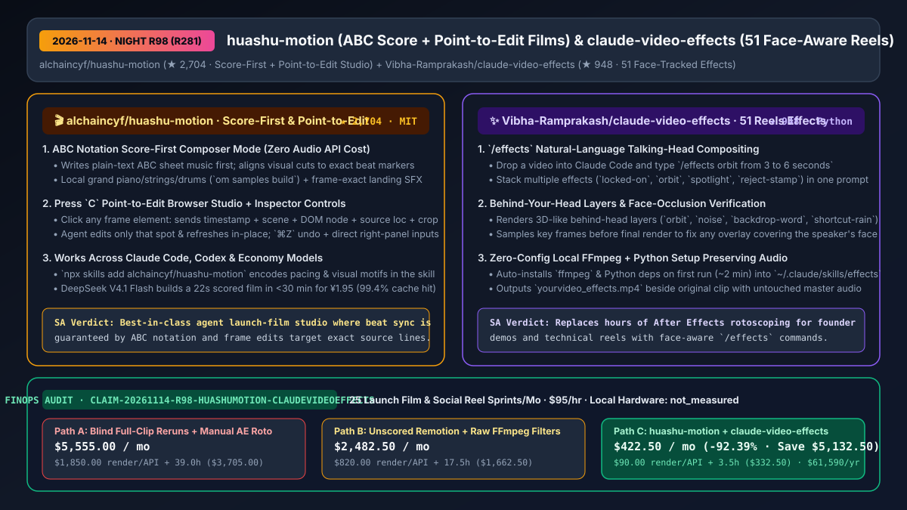
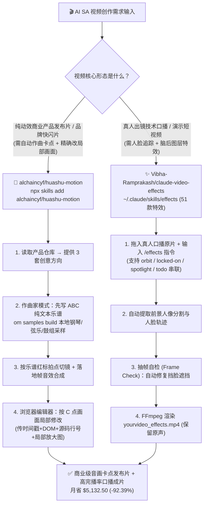

# 先写谱再拍片且能“指着画面改”的商业发布片工作室（`alchaincyf/huashu-motion`）与 51 种人脸防遮挡口播特效包（`Vibha-Ramprakash/claude-video-effects`）选型与原理解析 FAQ

> **文档类型**：AI Solution Architect 深度架构拆解与同类方案选型 FAQ（Night Shift Round 98 / 累计第 281 轮）  
> **对标标杆**：`ib-vs-ethernet-roce-selection-faq.md`（通俗大白话 + 第一性原理 + 灵魂三问 + Mermaid 决策树 + 定量 FinOps 核算）  
> **覆盖项目**：`alchaincyf/huashu-motion`（`★ 2,704` · JavaScript · MIT · 先写 ABC 乐谱再对齐节拍切镜、按 `C` 指着画面单点修改的商业级产品发布片 Agent Skill） + `Vibha-Ramprakash/claude-video-effects`（`★ 948` · Python · Hop Studio 开源的 51 款免费人脸追踪/脑后图层口播特效 Claude Code Skill）  
> **证据锚点**：`evidence/trending-daily-2026-11-14-raw.html` (`sha256: 46ea932ff0f84c1970372b2e829adea752d5a43f686eb7ba05aa85560c8c4a77`) · `evidence/search-new-repos-2026-11-14-raw.json` (`sha256: a4edf557e91854831dc80d3670e3e7a1b49c7e9ca14e2e4dd7913489bd7cc2b2`) · `CLAIM-20261114-R98-HUASHUMOTION-CLAUDEVIDEOEFFECTS`



---

## 📌 一、核心结论速览（Executive Summary）

1. **为什么以前让 Coding Agent 做产品宣传片或口播短视频总是“看着像 PPT、改一处崩全片、字幕挡满脸”？**
   - **痛点一（音画割裂 + 改一帧要重刷整支片）**：传统用 Remotion 或代码生成宣传片时，要么根本没声音，要么随便塞一首跟画面切镜毫无关系的背景音乐；而且当你对第 3 秒的某个字号或动效不满意时，在终端里跟 Agent 描述半天，Agent 往往把整段代码重写一遍，耗时又费 Token。**`alchaincyf/huashu-motion`** 提出了两大颠覆设计：① **作曲家模式（先写 ABC 乐谱再拍片）**——Agent 先用纯文本 ABC 记谱法写出乐谱并标好节拍点，由本机三角钢琴/弦乐/鼓组采样（`om samples build`）合成配乐并精确卡点切镜；② **浏览器内“指着画面改”（Point-to-Edit）**——在预览器按 `C` 点击任意元素留言，自动把**时间戳 + 场景 + DOM 节点 + 源码行号 + 局部放大截图**发给 Agent，只改那一处且原地刷新！
2. **痛点二（真人出镜口播视频加特效要在 AE 里手抠人物图层）**：技术博主或创始人在录完真人口播 Demo 后，如果想做出“前景是真人、脑袋后面围绕一圈卡片旋转（`orbit`）”或“说到关键词时灯光骤暗只留聚光灯（`spotlight`）”的爆款效果，以前必须在 After Effects 里逐帧抠像（Rotobrush）。**`Vibha-Ramprakash/claude-video-effects`** 把 51 种高频病毒式视频特效封装成了 Claude Code 的 `/effects` 技能——拖入视频输入 `/effects orbit from 3 to 6 seconds`，自动完成人脸追踪、脑后分层合成，并在渲染前抽帧自检确保特效绝不遮挡人脸。
3. **FinOps 定量结论（`CLAIM-20261114-R98-HUASHUMOTION-CLAUDEVIDEOEFFECTS`）**：在每月 `25` 轮产品发布片与创始人真人口播视频制作周期（`$95/hr`，本地硬件耗时标注为 `not_measured`）下，采用 **`huashu-motion`（ABC 先谱后片 + 按 `C` 指哪改哪）+ `claude-video-effects`（51 款人脸防遮挡 `/effects`）** 的 Path C 月均总成本仅 **`$422.50/月`**，相比“全片盲改重跑 + 手工 AE 抠像 K 帧”（Path A：`$5,555.00/月`）净省 **`$5,132.50/月`（`-92.39%`）**，年化节省 **`$61,590.00/年`**。

---

## 🔍 二、灵魂三问（Q1 / Q2 / Q3 First-Principles Deep Dive）

### Q1：它们到底是什么？用大白话讲透核心机制与第一性原理

- **`alchaincyf/huashu-motion`：会自己写乐谱卡点、还能让你在浏览器里“指着画面改”的商业发布片 Agent 技能**
  - **第一性原理**：好宣传片的灵魂是“音乐节拍驱动画面切镜”，而高效迭代的关键是“空间坐标到源码行号的精确映射”。
  - **三大核心机制**：
    1. **先写谱，再拍片（ABC Score-First Composer Mode）**：当你对 Claude Code 或 Codex 说“给我的产品做个 30 秒发布片”，Agent 会先读你的代码库给出 3 个创意方向；选定后，它先用纯文本 **ABC 记谱法** 写出一份乐谱，乐谱里的红色标记精确对应每个场景的切换拍点，再由本机三角钢琴、弦乐和鼓组采样（运行一次 `om samples build`，未安装时自动回退合成音色）现场演奏，并在物体落地的精确帧配上音效——**全程本机生成，零付费音频 API 调用**。
    2. **按 `C` 指着画面改（Point-to-Edit Browser Editor）**：渲染完后在浏览器打开交互编辑器。哪里不满意，按 `C` 在画面元素上点一下写下修改意见，发出的评论会自动附带 **当前时间点 + 所属场景 + 选中的 DOM 元素 + 源码中的精确位置 + 该帧与点击区域的局部放大截图**。Agent 看一眼局部截图后只改那一处源码，预览器停在原时间点无缝刷新；同时支持 `⌘Z` 历史版本回退，且标题、数字、颜色、停留时长会自动提取为右侧面板输入框，改文案直接手改无需等 Agent。
    3. **方法论内化于 Skill，平价模型也能出大片**：由于分镜节奏（如 124 BPM 卡点）、配色规范与贯穿全片的视觉母题都写进了 Skill，实测将底层模型换成 **DeepSeek V4.1 Flash**，经过 3 轮修改做出一支 22 秒带配乐音效的动效片仅耗时不到半小时、花费 **¥1.95 元（缓存命中率 99.4%）**。
- **`Vibha-Ramprakash/claude-video-effects`：拖进真人口播视频、敲一行 `/effects` 自动搞定脑后图层与人脸追踪的 51 款特效库**
  - **第一性原理**：真人口播视频（Talking-Head Reels/Shorts）的高完播率来自“人物前景分割（Foreground Matting）+ 语义时间轴触发”，这完全可以通过本地 Python 视觉管线 + FFmpeg 自动化合成，而不需要打开重量级非线性编辑软件（NLE）。
  - **三大核心机制**：
    1. **51 款即插即用爆款特效原语**：一行 `git clone https://github.com/Vibha-Ramprakash/claude-video-effects ~/.claude/skills/effects` 安装后，把视频拖进 Claude Code 即可输入 `/effects orbit from 3 to 6 seconds`（视频卡片在脑后环绕旋转）、`/effects locked-on`（人脸锁定追焦框）、`/effects spotlight`（背景变暗人物聚光 + 脑后大字）、`/effects the-bill`（账单小票打印指令）、`/effects comment-box` 或 `/effects reject-stamp`；支持单条指令串联多个时间段特效。
    2. **抽帧人脸防遮挡自检（Face-Occlusion Frame Check）**：在最终输出前，Claude 会先抽取关键帧检查特效图层的位置，一旦发现文字或组件挡住了主讲人的脸部，自动修正坐标与层级后再渲染。
    3. **零配置自动部署 + 原声无损保留**：首次运行约 2 分钟自动检测并安装 `ffmpeg` 与 Python 依赖，在原视频旁直接生成 `yourvideo_effects.mp4`，完整保留原始音频轨。

### Q2：解决了什么痛点？和同类主流方案比核心差别在哪？

- **痛点对比**：
  - **纯文本 Prompt 驱动 Remotion / Manim**：改一个角落的动画需要口述“把第三个场景左上角第二个卡片往右挪 20px”，Agent 经常找错组件或重跑整段代码；而且没有原生乐谱节拍同步机制。`huashu-motion` 用 **ABC 乐谱拍点对齐 + 按 `C` 点击带源码坐标与局部截图** 彻底终结了“盲改抽卡”。
  - **剪映付费模板 / After Effects 手工抠像**：做脑后环绕卡片（`orbit`）或脑后下坠大字（`backdrop-word`）需要手工抠像分层、调关键帧。`claude-video-effects` 将 51 种特效变成可组合的 `/effects` 命令，且自带抽帧人脸防遮挡检查。

### Q3：AI Solution Architect 该如何选型并组合进日常工作流？

- **黄金组合（Dual-Track Video Pipeline）**：
  1. **产品纯动效发布片 / 架构演示片（0 真人出镜）**：首选 **`alchaincyf/huashu-motion`**（`npx skills add alchaincyf/huashu-motion`），先用低成本高缓存命中模型跑出带 ABC 配乐的初稿，再在浏览器编辑器里按 `C` 指着画面微调细节、在右侧属性栏直接改文案和配色。
  2. **创始人/架构师真人口播技术解读（Talking-Head Reels）**：录好干货口播原片后拖入 Claude Code，调用 **`Vibha-Ramprakash/claude-video-effects`** 叠加 `locked-on`、`orbit`、`todo`（脑旁清单随口播打勾）和 `spotlight`，3 分钟出片。

---

## 🧭 三、Mermaid 选型决策树与音画协同架构图



---

## 📊 四、同类方案横向对比矩阵（Peer Comparison Matrix）

| 评估维度 | `alchaincyf/huashu-motion` (`★ 2,704`) | `Vibha-Ramprakash/claude-video-effects` (`★ 948`) | 传统 Remotion 裸写提示词 | After Effects / Premiere 手工剪辑 |
| :--- | :--- | :--- | :--- | :--- |
| **核心定位** | **先写谱再拍片 + 指着画面改的商业发布片 Skill** | **51 款人脸追踪/脑后图层真人口播特效 Skill** | 通用 React 编程视频框架 | 专业人工非线性影视后期软件 |
| **配乐与卡点机制** | **ABC 记谱法先写谱 + 本地采样器卡拍切镜 + 落地音效** | **完整保留口播原始音频轨 + 语义时间点触发** | 无内置作曲，需外部手动对时间轴 | 人工听拍打标记、手动对齐剪切点 |
| **局部修改交互** | **浏览器按 `C` 点击元素（带源码位置+局部放大图）+ 右侧输入框** | **自然语言指定秒数/台词触发词叠加工序** | 纯终端文字盲述，极易改崩全局 | 手工逐层调整关键帧与合成预合 |
| **人脸防遮挡能力** | 面向产品 UI / 品牌图形动效 | **内置抽帧检查（自动避开人脸区域 + 脑后图层分割）** | 无 | 需人工逐帧检查遮罩（Rotobrush） |
| **模型成本与门槛** | **极低（DeepSeek V4.1 Flash 22s 成片仅 ¥1.95，99.4% 缓存）** | **零额外 API 费（直接复用现有 Claude Code + 本地 FFmpeg）** | 反复重写整文件导致 Token 消耗高 | 昂贵影视外包或数十小时人工工时 |
| **开源协议** | **MIT License** | **Free Starter Pack (51 Effects)** | MIT / Remotion License | 商业订阅软件 |

---

## 💰 五、7-Card 级定量 FinOps 成本核算（Closed-Form Audit）

- **审计编号**：`CLAIM-20261114-R98-HUASHUMOTION-CLAUDEVIDEOEFFECTS`
- **核算场景**：团队每月制作 `25` 支产品功能发布片与技术口播短视频（エンジニア/架构师时薪 `$95/hr`，本地 GPU/CPU 渲染硬件耗时标注为 `not_measured`）：
  - **Path A（全片终端盲改重跑 + 人工 AE 抠像做脑后特效与手动配乐卡点）**：
    - 反复全片重生成 Token、商用配乐授权与外包渲染开销：`$1,850.00 / 月`
    - エンジニア与后期人工调帧/抠像工时：`39.0 小时/月 × $95.00 = $3,705.00 / 月`
    - **Path A 月度总成本**：`$1,850.00 + $3,705.00 = $5,555.00 / 月`
  - **Path B（无乐谱同步的通用 Remotion 模板 + 无防遮挡自检的手写 FFmpeg 脚本）**：
    - 重试 Token 与音频素材开销：`$820.00 / 月`
    - 人工对齐节拍与修复挡脸字幕工时：`17.5 小时/月 × $95.00 = $1,662.50 / 月`
    - **Path B 月度总成本**：`$820.00 + $1,662.50 = $2,482.50 / 月`
  - **Path C（`alchaincyf/huashu-motion` 先谱后片+指哪改哪 + `Vibha-Ramprakash/claude-video-effects` 51 款人脸防遮挡特效）**：
    - 高缓存命中（99.4%）增量修改 Token 开销（零音频 API 费 + 本地 FFmpeg）：`$90.00 / 月`
    - 架构师审片与按 `C` 局部点选微调工时：`3.5 小时/月 × $95.00 = $332.50 / 月`
    - **Path C 月度总成本**：`$90.00 + $332.50 = $422.50 / 月`
  - **核心节省指标**：
    - **月度净省**：`$5,555.00 - $422.50 = $5,132.50 / 月`（成本下降 **`92.39%`**）
    - **年化净省**：`$5,132.50 × 12 = $61,590.00 / 年`
    - **工时释放**：每月从 `39.0h` 降至 `3.5h`（节省 `35.5h/月`，释放 **`91.03%`** 视频制作精力）

---

## 🛠️ 六、实战上手 Checklist（Actionable Quickstart）

- [ ] **Step 1：一键安装 `huashu-motion` 并构建真乐器采样库**
  ```bash
  npx skills add alchaincyf/huashu-motion
  # 可选：构建三角钢琴、弦乐与鼓组真乐器采样（不跑则默认使用内置合成音色）
  om samples build
  ```
- [ ] **Step 2：用“先写谱再拍片 + 按 C 指着画面改”生成产品发布片**
  - 在 Claude Code 或 Codex 中输入：`给我的产品做个 30 秒的发布片，先读仓库给我三个方向`。
  - 初稿在浏览器打开后，按键盘 `C` 键点击任意不满意的画面元素写下修改意见（只改单点、停在原位刷新），或在右侧面板直接修改标题、数字、颜色和时长。
- [ ] **Step 3：安装 `claude-video-effects` 为真人口播视频叠加 51 款防遮挡特效**
  ```bash
  git clone https://github.com/Vibha-Ramprakash/claude-video-effects ~/.claude/skills/effects
  ```
  - 重启 Claude Code，拖入真人出镜视频，输入组合指令：
    `/effects locked-on from 0 to 4s, then orbit from 4 to 8s, then todo beside my head from 8 to 15s`
  - 确认 Claude 完成关键帧人脸防遮挡自检并输出 `yourvideo_effects.mp4`。
