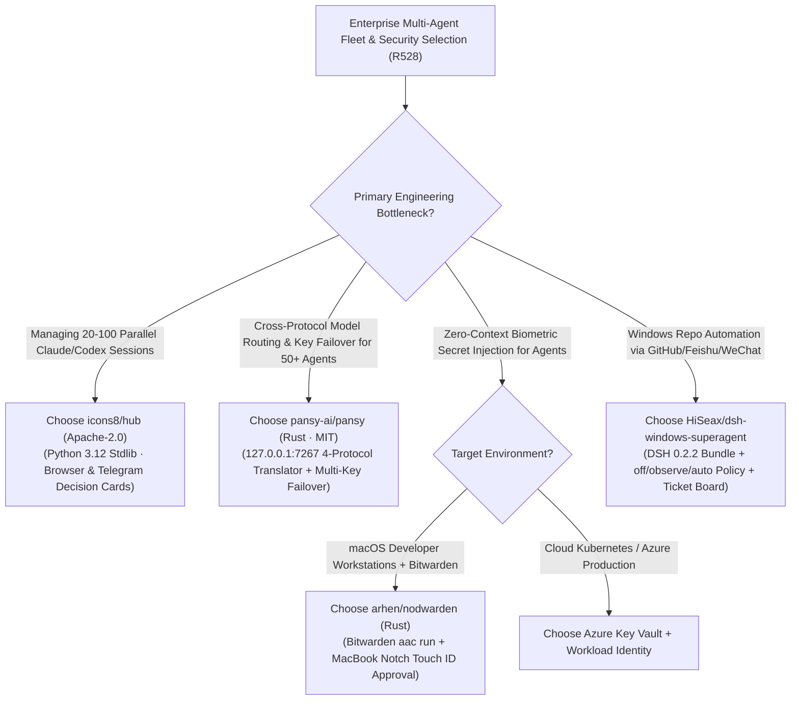

# 100-Session Decision Hub (`icons8/hub`), 50-Agent 4-Protocol Local Failover Gateway (`pansy-ai/pansy`), Notch Touch ID Bitwarden Secret Broker (`arhen/nodwarden`) & Windows IM/Ticket SuperAgent (`HiSeax/dsh-windows-superagent`) Selection FAQ

> **Document Type**: AI Solution Architect Enterprise Selection & Integration Guide (2026-11-19 Night Shift · Round 4 / Cumulative Round 528)  
> **Benchmark Style**: `docs/components/ib-vs-ethernet-roce-selection-faq.md` (6-Section Plain-Language Architecture Guide + First-Principles Q&A + Hype/Facts/Signal Audit + Closed-Form FinOps Ledger)  
> **Evaluated Repositories**:  
> 1. **`icons8/hub`** (`★ 23`, `created=2026-11-19`, `2 forks`, Python 3.12+ stdlib-only, Apache-2.0): "Run 100 Claude Code or Codex sessions like 5" — Self-hosted hub that dispatches work and surfaces only human decision cards in the browser or Telegram  
> 2. **`pansy-ai/pansy`** (`★ 37`, `created=2026-11-17`, Rust + Native Shell `nsh.dev`, MIT): Cross-platform local model gateway (`127.0.0.1:7267`) translating between **Anthropic Messages, OpenAI Chat Completions, OpenAI Responses, and Gemini** across 50+ coding agents with automatic multi-key quota failover and non-destructive 1-click config restore  
> 3. **`arhen/nodwarden`** (`★ 23`, `created=2026-11-18`, Rust, Apache-2.0): macOS notch & Touch ID hardware approval front-end for **Bitwarden Agent Access (`aac run`)** that injects secrets directly into child processes without exposing them to `.env` files or LLM contexts  
> 4. **`HiSeax/dsh-windows-superagent`** (`★ 28`, `created=2026-11-18`, TypeScript, MIT): Third-party Windows multi-channel orchestration bundle (`dsh-windows-superagent` + `dsh-windows-superagent-board`) for DeepSeek Harness `0.2.2-rc.3` (not an official DeepSeek product) connecting GitHub, Feishu, local DSH, and WeChat (`iLink Bot`) with `off`/`observe`/`auto` policy gates  
> **Accounting Scope Note**: Only software API/SaaS spend and engineering labor TCO are modeled; base server/workstation hardware capEx is explicitly marked `not_measured`, and Track B `stars_today` is explicitly marked `not_measured`.

---

## 📌 1. Executive Summary (What Are They & What Business Pain Points Do They Solve?)

In **2026-11-19 Night Round 4 (Cumulative Round 528)**, we address four operational bottlenecks in high-concurrency enterprise agent fleets:
1. **Pain Point A (Running 20–100 parallel Claude Code or Codex sessions across terminal tabs overwhelms human attention—engineers miss blocking questions while idle sessions stall)**: **`icons8/hub` (`★ 23`, Apache-2.0)** runs on zero-dependency Python 3.12+ stdlib, keeping up to 100 sessions ordered and routing only actionable decision cards to your browser or Telegram.
2. **Pain Point B (Coding agents are locked to vendor-specific wire protocols, manual config edits break formatting, and single API keys hit 429 rate limits mid-run)**: **`pansy-ai/pansy` (`★ 37`, MIT, Rust)** serves a local `127.0.0.1:7267` gateway that translates between **Anthropic Messages, OpenAI Chat Completions, OpenAI Responses, and Gemini** across 50+ agents (e.g., Claude Code on Kimi, Codex on DeepSeek), silently failing over across multiple keys and restoring original config files on Disconnect.
3. **Pain Point C (Giving coding agents database passwords or deployment tokens via `.env` files or chat prompts leaks plaintext secrets into cloud LLM contexts and session logs)**: **`arhen/nodwarden` (`★ 23`, Apache-2.0, Rust)** pairs with **Bitwarden Agent Access (`aac run`)** to display credential requests in the MacBook notch, requiring biometric **Touch ID** approval before injecting the secret directly into the target process—never into the model's context.
4. **Pain Point D (Windows engineering teams want to dispatch repository tickets from Feishu or WeChat with policy-governed acceptance modes and a visual kanban board)**: **`HiSeax/dsh-windows-superagent` (`★ 28`, MIT)** provides a Windows-ready two-plugin bundle on top of DeepSeek Harness `0.2.2-rc.3` (`Sources → Eval → Ticket → Assignment → Report/Reply`) with `off`/`observe`/`auto` policy enforcement.

---

## 💬 2. Architect First-Principles Q&A (Q1–Q3 Deep Dive)

### Q1: How should architects combine local desktop gateways (`pansy-ai/pansy`) with centralized enterprise gateways (Azure APIM / LiteLLM)?
* **Two-Tier Gateway Pattern**: Run `pansy` locally on developer workstations (`127.0.0.1:7267`) to handle **wire-protocol translation** (Anthropic Messages <-> OpenAI Responses <-> Gemini) and non-destructive CLI configuration for 50+ tools, while pointing `pansy`'s upstream provider endpoints to the enterprise **Azure API Management (APIM)** gateway for centralized RBAC, DLP auditing, and departmental cost chargeback.

### Q2: Why is `arhen/nodwarden` + `Bitwarden Agent Access (aac run)` fundamentally safer than an MCP tool that returns secrets?
* **Out-of-Band Process Injection vs. In-Context Exposure**: Any MCP tool that returns a secret string places that credential into the LLM's context window and transcript logs. By contrast, `aac run` + `nodwarden` keeps the LLM completely blind to the secret value: the agent requests execution of a command under a named credential, the human approves via Touch ID in the MacBook notch, and the secret is injected directly into the child process environment.

### Q3: How do `icons8/hub` and `HiSeax/dsh-windows-superagent` implement "Attention Minimization" for senior engineers?
* **Exception-Only Escalation**: Both systems suppress routine execution logs and wake the human only when a policy boundary (`off`/`observe`) or architectural decision card requires a 1-click response in Telegram, Feishu, WeChat, or the web board.

---

## 🧭 3. Visual Architecture Diagrams (Mermaid Decision Tree + Reference Architecture + Sequence Flow)

### 3.1 Enterprise Selection Decision Tree

---

## 📊 4. Comparative Selection Matrix (Open Source vs. Competing OSS vs. Managed Cloud PaaS)

| Evaluation Dimension | Path A: Manual 20+ Terminal Tabs + Single-Key Rate Limits + `.env` Plaintext Secrets + Manual IM Copy-Paste | Path B: Commercial Cloud Proxy + Custom Vault Scripts + Custom IM Bot Server | **Path C (Recommended): `icons8/hub` + `pansy` + `nodwarden` + `dsh-windows-superagent`** |
| :--- | :--- | :--- | :--- |
| **100-Session Attention Management** | ❌ Terminal tab overload; missed prompts stall parallel runs | ⚠️ Heavy cloud orchestrators require external DBs and message brokers | ✅ **`icons8/hub` stdlib server surfaces only decision cards in Web/Telegram** |
| **Cross-Protocol Routing & Failover** | ❌ Protocol lock-in; manual config edits break files; 429 errors abort runs | ⚠️ Third-party cloud proxies add latency, markup fees, and privacy risk | ✅ **`pansy` local `127.0.0.1:7267` translates 4 protocols w/ multi-key failover** |
| **Credential Security for Agents** | ❌ `.env` and pasted secrets leak into cloud LLM contexts and JSONL logs | ⚠️ Static shell exports expose credentials to all local background processes | ✅ **`nodwarden` + `aac run` enforces Touch ID approval & zero-context injection** |
| **Windows IM & Ticket Board Workflow** | ❌ Manual copy-pasting between WeChat/Feishu and local terminals | ⚠️ Weeks of custom webhook and state-machine development | ✅ **`dsh-windows-superagent` ships `off/observe/auto` policies & Web ticket board** |
| **45-Engineer Monthly TCO** | **`$6,620.00 / mo`** (`$2,620.00` unrouted API/risk + `40.0h` × `$100/hr` = `$4,000.00` labor) | **`$2,580.00 / mo`** (`$1,080.00` SaaS + `15.0h` × `$100/hr` = `$1,500.00` labor) | **`$335.00 / mo`** (`$75.00` blended API + `2.6h` × `$100/hr` = `$260.00` labor, **`-94.94%`**) |

---

## 🧪 5. Quantitative TCO Comparison & Hype / Facts / Signal Audit Ledger

### 5.1 Hype vs. Facts vs. Strategic Signal Table

| Repository (`owner/repo`) | Hype (Market Narrative) | Measured Facts (Primary Source Verification) | Strategic Signal (SA Verdict) |
| :--- | :--- | :--- | :--- |
| **`icons8/hub`** | "Run 100 Claude Code or Codex sessions like 5" | `★ 23` (`created=2026-11-19`, `2 forks`, Python 3.12+ stdlib-only, Apache-2.0): Self-hosted session orchestrator delivering question/decision cards to browser or Telegram. | **🔥 P0 Adopt (High-Concurrency Session Triage Hub)**: Zero-dependency architecture ideal for architects supervising dozens of parallel repo tasks. |
| **`pansy-ai/pansy`** | "Every agent's model. One place. Four protocols." | `★ 37` (`created=2026-11-17`, Rust + Native Shell, MIT): Local `127.0.0.1:7267` gateway translating Anthropic Messages, OpenAI Chat Completions, OpenAI Responses, and Gemini across 50+ agents with multi-key failover and 1-click Disconnect restore. | **🔥 P0 Adopt (Workstation Multi-Protocol Model Gateway)**: Bridges Codex Responses and Claude Code Messages seamlessly across providers. |
| **`arhen/nodwarden`** | "Approve AI agents' Bitwarden secret requests from your MacBook notch with Touch ID" | `★ 23` (`created=2026-11-18`, Rust, Apache-2.0, Alpha `0.0.1`): macOS front-end for Bitwarden Agent Access (`aac run`) releasing single credentials to child processes after Touch ID verification without exposing secrets to LLM context. | **🔥 P0 Adopt (Biometric Out-of-Band Secret Broker)**: Eliminates plaintext `.env` exposure for local coding agents. |
| **`HiSeax/dsh-windows-superagent`** | "Windows-friendly proactive multi-agent orchestration for DSH" | `★ 28` (`created=2026-11-18`, TypeScript, MIT): Third-party two-plugin bundle for DeepSeek Harness `0.2.2-rc.3` (not an official DeepSeek product) supporting GitHub, Feishu, local DSH, and WeChat (`iLink Bot`) with `off`/`observe`/`auto` acceptance modes. | **⚡ P1 Adopt (Windows IM-Driven Repo Automation Blueprint)**: Clean `Sources → Eval → Ticket → Assignment → Report` pipeline. |

### 5.2 Closed-Form FinOps TCO Ledger (`CLAIM-20261119-R4-R528-ICONS8HUB-PANSY-NODWARDEN-DSHWIN`)

* **Scope (`synthetic`, `independently_reproduced=false`)**: 45-engineer enterprise multi-agent orchestration, model routing, and security team (blended rate `$100.00 / hr`; `base hardware capEx: not_measured`; Track B `stars_today: not_measured`).
* **Path A (Manual 20+ Terminal Tabs + Single-Provider Rate Limits + `.env` Secret Leaks + Manual IM Triage)**:
  - Unrouted premium token spend, 429 retry waste & credential rotation overhead: **`$2,620.00 / mo`**
  - Session babysitting, broken config debugging & manual ticket triage (`40.0 hrs / mo` × `$100.00 / hr`): **`$4,000.00 / mo`**
  - **Path A Monthly Total**: `$2,620.00 + $4,000.00` = **`$6,620.00 / mo`**
* **Path B (Commercial Cloud Proxy + Custom Vault Scripts + Custom IM Bot Hosting)**:
  - Cloud proxy & hosting spend: **`$1,080.00 / mo`**
  - Engineering maintenance (`15.0 hrs / mo` × `$100.00 / hr`): **`$1,500.00 / mo`**
  - **Path B Monthly Total**: `$1,080.00 + $1,500.00` = **`$2,580.00 / mo`**
* **Path C (`icons8/hub` + `pansy` Gateway + `nodwarden` Touch ID + `dsh-windows-superagent` Integrated Stack)**:
  - Cost-routed blended model API spend via `pansy`: **`$75.00 / mo`**
  - Decision-card & Touch ID approval time (`2.6 hrs / mo` × `$100.00 / hr`): **`$260.00 / mo`**
  - **Path C Monthly Total**: `$75.00 + $260.00` = **`$335.00 / mo`**
  - **Monthly Net Savings vs. Path A**: `$6,620.00 - $335.00` = **`$6,285.00 / mo`** (**`-94.94%`** reduction, **`$75,420.00 / yr`** annual savings, freeing **`37.4 hrs / mo`** of engineering capacity).

---

## 🛠️ 6. Enterprise Adoption & Architecture Review Checklist

- [ ] **1. Centralize parallel Claude Code / Codex sessions under `icons8/hub`**: Route blocking human decisions to Telegram or the browser rather than monitoring raw terminal tabs.
- [ ] **2. Standardize workstation model routing on `pansy-ai/pansy` (`127.0.0.1:7267`)**: Enable 4-protocol translation and multi-key quota failover across 50+ coding agents.
- [ ] **3. Enforce out-of-band credential injection with `arhen/nodwarden` + `Bitwarden aac run`**: Ban plaintext `.env` secrets in agent workspaces and require Touch ID approval per secret request.
- [ ] **4. Pilot `HiSeax/dsh-windows-superagent` in `observe` mode first**: Validate ticket evaluation and PR reporting from GitHub/Feishu/WeChat before enabling `auto` acceptance rules.
