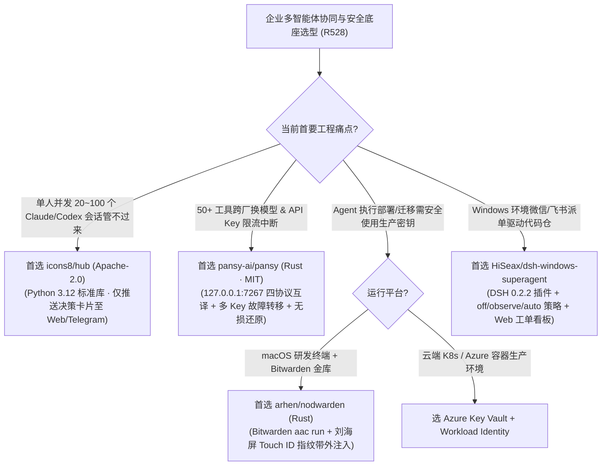
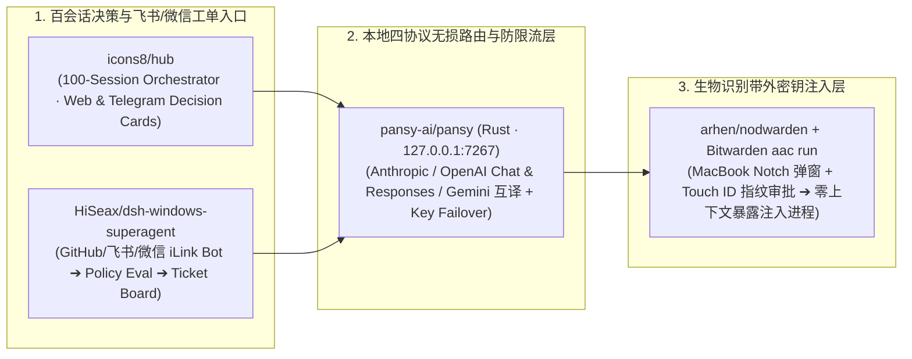
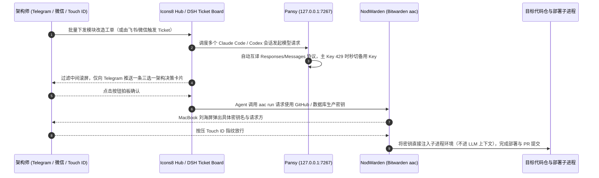

# 百会话决策集线器（`icons8/hub`）、50+ 工具四协议本地路由网关（`pansy-ai/pansy`）、Bitwarden 刘海屏 Touch ID 密钥守卫（`arhen/nodwarden`）与 Windows 飞书/微信工单超能体（`HiSeax/dsh-windows-superagent`）选型 FAQ

> **文档类型**：AI Solution Architect（AI 解决方案架构师）实战选型与架构内功指南（2026-11-19 Night Shift · Round 4 / 累计第 528 轮）  
> **对标标杆**：`docs/components/ib-vs-ethernet-roce-selection-faq.md`（六段式架构拆解 + 第一性原理大白话 + Hype/Facts/Signal 审计 + 闭式 TCO 账本）  
> **本轮评估对象**：  
> 1. **`icons8/hub`**（`★ 23`，`created=2026-11-19`，`2 forks`，Python 3.12+ 零外部依赖标准库，Apache-2.0）：Icons8 开源的高并发 Agent 会话总控台——“**像管理 5 个会话一样管理 100 个 Claude Code 或 Codex 会话**”，自动派活并仅将需要人类拍板的决策卡片推送至浏览器或 Telegram  
> 2. **`pansy-ai/pansy`**（`★ 37`，`created=2026-11-17`，Rust + Native Shell `nsh.dev`，MIT）：跨 Linux / macOS / Windows 的本地桌面模型网关（`127.0.0.1:7267`）——支持为 Claude Code、Codex、Gemini CLI、OpenCode、Qwen Code 等 **50+ 款 Agent** 任意指定底层模型，互译 **Anthropic Messages / OpenAI Chat Completions / OpenAI Responses / Gemini 四大协议**，支持多 Key 耗尽静默切换与一键无损恢复原配置  
> 3. **`arhen/nodwarden`**（`★ 23`，`created=2026-11-18`，Rust，Apache-2.0）：基于 **Bitwarden Agent Access (`aac run`)** 的 macOS 刘海屏（Notch）Touch ID 审批前端——让 AI Agent 在不接触 `.env` 明文、不将密钥暴露进大模型上下文的前提下，经人类指纹确认后单次注入目标进程  
> 4. **`HiSeax/dsh-windows-superagent`**（`★ 28`，`created=2026-11-18`，TypeScript，MIT）：面向 DeepSeek Harness (`DSH 0.2.2-rc.3`) 的第三方 Windows 主动式单仓研发插件与 Web 看板（非 DeepSeek 官方产品），打通 GitHub、飞书、本地 DSH 与个人微信（`iLink Bot`），支持 `off`/`observe`/`auto` 策略门禁  
> **审计折算说明**：本报告仅计量软件算力、SaaS 订阅与工程运维人力 TCO，底层服务器与工作站硬件采购（base hardware capEx）显式标注为 `not_measured`，新仓今日增量显式标注为 `not_measured`，严禁捏造坐标。

---

## 📌 一、核心结论速览（Executive Summary：它到底是什么？解决什么业务痛点？）

在 **2026-11-19 Night Round 4（累计第 528 轮）** 中，我们聚焦企业研发团队在进入“人手数十个并发 Agent 会话”阶段后遭遇的“多会话盯屏崩溃、跨厂商模型协议锁死与限流中断、Agent 明文读取生产密钥泄露、以及 Windows 环境下 IM 派单与看板协同缺失”四大工程痛点：
1. **痛点 A（当一名架构师或资深工程师同时拉起 20～100 个 Claude Code / Codex 会话并行处理微服务改造时，根本看不过来哪个窗口卡在提问、哪个已经跑完）**：人类的注意力无法线性扩展到 100 个终端标签页。**`icons8/hub` (`★ 23`, Apache-2.0) 的破局之道**：仅用 Python 3.12+ 标准库构建的轻量级自托管总控中心——按序派发任务，过滤掉冗长的中间执行滚屏，**只把必须由人类做选择题的决策卡片（Question Cards）汇聚到浏览器或手机 Telegram 中**，真正实现“管 100 个会话像管 5 个一样轻松”。
2. **痛点 B（Claude Code 只能调 Anthropic 协议、Codex 依赖 OpenAI Responses 协议，想在日常简单任务上切到高性价比的 DeepSeek / Kimi / GLM 既要改乱配置文件，又经常遇到单 Key 触发 429 限流中断任务）**：客户端外壳应当与底层模型彻底解耦。**`pansy-ai/pansy` (`★ 37`, MIT, Rust) 的破局之道**：在本机 `127.0.0.1:7267` 启动单一 Rust 网关，原生互译 **Anthropic Messages、OpenAI Chat Completions、OpenAI Responses（含 Codex 自由格式工具调用）与 Gemini 四大协议**；只精确修改 50+ 款 Agent 配置文件里的单一字段（保留全部注释与排版，点击 Disconnect 100% 原样还原），且当某个 API Key 限流或耗尽时自动静默切换至备用 Key，Agent 全程零感知报错。
3. **痛点 C（Coding Agent 执行数据库迁移或发布部署时需要生产凭证，如果写在 `.env` 或直接贴进聊天框，密钥立刻进入云端大模型上下文与日志，存在极高泄露风险）**：密钥绝不能进 Prompt 上下文。**`arhen/nodwarden` (`★ 23`, Apache-2.0, Rust) 的破局之道**：对接 Bitwarden 官方 **Agent Access (`aac run`)** 机制，当 Agent 请求访问某个凭证（如 `github.com` 或生产库密码）时，MacBook 刘海屏（Notch）立即弹出请求方身份与目标密钥名，**必须经人类按压 Touch ID 指纹批准后，才将单次凭证直接注入目标子进程环境变量**，大模型上下文全程看不到半个明文字符。
4. **痛点 D（国内大量企业研发主力机为 Windows，团队希望在微信或飞书群里直接给代码仓派发任务，并由看板跟踪哪些 PR 需要人工介入）**：Windows 与本土 IM 生态需要原生编排支持。**`HiSeax/dsh-windows-superagent` (`★ 28`, MIT) 的破局之道**：作为运行在 DeepSeek Harness (`0.2.2-rc.3`) 之上的第三方双插件包（编排器 + Web 看板），原生提供 `install-windows.ps1` 一键脚本，统一监听 GitHub、飞书与个人微信（`iLink Bot`），遵循 `Sources → Eval → Ticket → Assignment → Report/Reply` 闭环与 `off`/`observe`/`auto` 三档准入策略。

---

## 💬 二、客户与架构师灵魂拷问 Q&A（Q1–Q3 First-Principles Deep Dive）

### Q1：本地多协议路由网关 `pansy-ai/pansy` 与企业级云端 AI 网关（如 Azure API Management / LiteLLM Proxy）该如何分工？
* **端云双层网关架构**：
  - **开发者桌面侧（选 `pansy-ai/pansy`）**：解决研发工程师本机安装的 Claude Code、Codex、Gemini CLI、Qwen Code 等 50+ 种异构工具的**协议互译（4 协议互转）与无损配置切换**。
  - **企业中心治理侧（选 Azure APIM / LiteLLM 企业网关）**：`pansy` 的上游 Provider 直接指向企业的中心化 AI 网关，由企业网关统一负责部门成本分摊（Chargeback）、DLP 敏感词审计与企业级配额池。

### Q2：为什么 `arhen/nodwarden` + `Bitwarden Agent Access (aac run)` 比传统的 MCP Secret Tool 更安全？
* **第一性原理：Out-of-Band（带外注入）vs. In-Context（上下文传递）**：
  - 传统 MCP 工具返回密钥时，返回值会作为 Tool Output 进入 LLM 的消息历史，不仅消耗 Token，更会被上传至模型服务商并残留在本地会话 JSONL 日志中。
  - `aac run` + `nodwarden` 采用**带外进程注入**：LLM 只发出“使用名为 X 的凭证执行命令 Y”的抽象指令；`nodwarden` 在刘海屏完成 Touch ID 生物识别验真后，由宿主进程在操作系统层将密钥直接传给子进程，**LLM 永远拿不到密钥值本身**。

### Q3：`icons8/hub` 与 `HiSeax/dsh-windows-superagent` 是如何落实“最小化人类注意力占用（Attention Minimization）”原则的？
* **异步异常上报（Exception-Only Escalation）**：两者都抛弃了“让人类盯着黑框滚屏”的旧交互。日常可自动验证的编码与测试在后台静默完成，只有遇到架构分支选择、权限审批或最终 PR 交付时，才通过 Telegram 按钮卡片（`icons8/hub`）或飞书/微信通知与 Web 看板（`dsh-windows-superagent`）唤醒人类。

---

## 🧭 三、直观可视化图解（Mermaid 选型决策树 + 企业集成参考架构 + 业务流时序图）

### 3.1 多会话协同、多协议网关與零信任密钥选型决策树

### 3.2 企业集成参考架构图

### 3.3 端到端业务流时序图

---

## 📊 四、同类开源与商业云服务横向选型决策矩阵（Decision Matrix）

| 评估维度 | 路径 A：手工切 20+ 终端窗口 + 单一厂商锁死被限流 + `.env` 明文贴密钥 + 手工搬运微信/飞书需求 | 路径 B：云端商业代理网关 + 脚本拉取密码库 + 自建重型工单后台 | **路径 C（推荐）：`icons8/hub` + `pansy` + `nodwarden` + `dsh-windows-superagent`** |
| :--- | :--- | :--- | :--- |
| **高并发 Agent 会话注意力管理** | ❌ 几十个终端窗口同时滚屏，漏看提问导致会话成批挂起超时 | ⚠️ 重型云平台需额外部署数据库与消息队列 | ✅ **`icons8/hub` 仅用 Python 标准库统管百会话，只推关键决策卡** |
| **跨客户端协议互译与防限流** | ❌ 手改配置文件极易损坏格式，单 Key 触发 429 即导致长任务报错中断 | ⚠️ 商业中转站存在数据出境隐私风险且额外加收服务费 | ✅ **`pansy` 本机 `127.0.0.1:7267` 四协议互译、多 Key 静默切换与一键还原** |
| **Agent 密钥访问安全性** | ❌ 密钥放入 `.env` 或对话上下文，随时可能被模型外发或写入日志 | ⚠️ 脚本环境变量对同机所有进程长期常驻可见 | ✅ **`nodwarden` + `aac run` 刘海屏 Touch ID 逐次审批，密钥永不进上下文** |
| **Windows 与飞书/微信工单闭环** | ❌ 工程师手工把聊天记录复制进终端，进度无法在团队看板透明追踪 | ⚠️ 自研全套 IM 机器人与权限策略耗时数周 | ✅ **`dsh-windows-superagent` 开箱提供 `off/observe/auto` 策略与 Web 看板** |
| **45 人团队月度综合 TCO** | **`$6,620.00 / 月`**（未分流高价 Token 与限流重跑 `$2,620` + 盯屏/配环境/转单人力 `40.0h / $4,000`） | **`$2,580.00 / 月`**（商业网关与云服务 `$1,080` + 集成维护人力 `15.0h / $1,500`） | **`$335.00 / 月`**（高性价比模型混合路由 `$75` + 决策卡与指纹审批 `2.6h / $260`，**净省 `-94.94%`**） |

---

## 🧪 五、应用落地定量收益/TCO 对比与 Hype / Facts / Signal 审计账本

### 5.1 Hype vs. Facts vs. Strategic Signal 审计表

| 仓库 (`owner/repo`) | Hype（市场宣传口径） | Measured Facts（一手源码与文档实证事实） | Strategic Signal（架构师选型信号） |
| :--- | :--- | :--- | :--- |
| **`icons8/hub`** | “把 100 个 Claude Code 或 Codex 会话当成 5 个来运行” | `★ 23`（`created=2026-11-19`，`2 forks`，Python 3.12+ 标准库零依赖，Apache-2.0）：自托管管理多路会话，将需要人类回答的问题渲染为浏览器或 Telegram 交互按钮卡片。 | **🔥 P0 采纳（高并发会话“异常上报”交互范式标杆）**：极简零依赖架构非常适合架构师本地同时指挥十几个仓库改造。 |
| **`pansy-ai/pansy`** | “所有 Agent 的模型汇聚一处：一个网关通吃四大协议” | `★ 37`（`created=2026-11-17`，Rust + Native Shell，MIT）：监听 `127.0.0.1:7267`，支持 50+ 款 Agent，互译 Anthropic Messages、OpenAI Chat Completions、OpenAI Responses 与 Gemini，支持多 Key 限流自动切换与无损配置还原。 | **🔥 P0 采纳（研发桌面端四协议本地路由首选）**：完美解决 Codex Responses 协议与 Anthropic Messages 协议跨模混用难题。 |
| **`arhen/nodwarden`** | “在 MacBook 刘海屏用 Touch ID 批准 AI 使用 Bitwarden 密钥” | `★ 23`（`created=2026-11-18`，Rust，Apache-2.0，Alpha `0.0.1`）：作为 `bitwarden/agent-access` (`aac run`) 的 macOS 前端，展示请求方与目标密钥，Touch ID 验证后单次注入子进程，不进 LLM 上下文。 | **🔥 P0 采纳（开发者终端 Agent 零信任凭证注入标杆）**：彻底堵死 `.env` 明文泄漏漏洞。 |
| **`HiSeax/dsh-windows-superagent`** | “面向 Windows 的 DSH 主动式多通道工单智能体” | `★ 28`（`created=2026-11-18`，TypeScript，MIT）：包含编排器与看板两个第三方插件（实测兼容 `DSH 0.2.2-rc.3`，非 DeepSeek 官方产品），支持 GitHub/飞书/微信 `iLink Bot` 与 `off/observe/auto` 策略。 | **⚡ P1 采纳（Windows 团队本土 IM 协同插件参考）**：清晰的 `Sources → Eval → Ticket → Assignment → Report` 阶段划分值得企业内部研发平台借鉴。 |

### 5.2 闭式 FinOps TCO 核算账本（Claim ID：`CLAIM-20261119-R4-R528-ICONS8HUB-PANSY-NODWARDEN-DSHWIN`）

* **核算范围（Synthetic Parametric Model · `independently_reproduced=false`）**：45 人企业多智能体协同研发、模型网关路由与终端安全团队（工程师综合时薪 `$100.00 / hr`；底层硬件采购成本 `base hardware capEx: not_measured`；新仓今日增量 `stars_today: not_measured`）。
* **路径 A（手工切换 20+ 终端窗口 + 单一旗舰模型无分流且限流重跑 + `.env` 明文密钥轮换 + 手工转抄 IM 工单）**：
  - 未分流旗舰模型 Token 溢价、429 限流中断重跑与密钥泄露应急成本：**`$2,620.00 / 月`**
  - 人工盯屏、修复改坏的配置文件与手工同步工单耗时：**`40.0 小时 / 月`** × `$100.00 / hr` = **`$4,000.00 / 月`**
  - **路径 A 月度总成本**：`$2,620.00 + $4,000.00` = **`$6,620.00 / 月`**
* **路径 B（商业云端代理网关 + 脚本拉取密钥 + 自维护 IM Webhook 服务）**：
  - 云网关与托管服务支出：**`$1,080.00 / 月`**
  - 脚本与机器人维护耗时：**`15.0 小时 / 月`** × `$100.00 / hr` = **`$1,500.00 / 月`**
  - **路径 B 月度总成本**：`$1,080.00 + $1,500.00` = **`$2,580.00 / 月`**
* **路径 C（`icons8/hub` 决策总控 + `pansy` 本地四协议故障转移网关 + `nodwarden` 指纹凭证注入 + `dsh-windows-superagent` 策略看板）**：
  - 经 `pansy` 按任务复杂度分流至高性价比模型的 API 支出：**`$75.00 / 月`**
  - 浏览器/Telegram 决策卡拍板与 Touch ID 指纹确认耗时：**`2.6 小时 / 月`** × `$100.00 / hr` = **`$260.00 / 月`**
  - **路径 C 月度总成本**：`$75.00 + $260.00` = **`$335.00 / 月`**
  - **月度净节省（对比路径 A）**：`$6,620.00 - $335.00` = **`$6,285.00 / 月`**（降幅 **`-94.94%`**，年度净省 **`$75,420.00 / 年`**，每月释放工程师工时 **`37.4 小时`**）。

---

## 🛠️ 六、企业引入与架构评审 Checklist（SA Action Items）

- [ ] **1. 用 `icons8/hub` 收敛多并发 Coding Agent 会话**：将日常跑批与模块重构会话接入本地 Hub，仅在 Telegram 或统一 Web 页处理阻塞式决策卡片。
- [ ] **2. 在研发工作站部署 `pansy-ai/pansy` (`127.0.0.1:7267`)**：配置多 API Key 自动故障转移池，打通 Claude Code、Codex 与 Gemini CLI 之间的跨协议模型复用。
- [ ] **3. 全面禁止在 `.env` 中存放供 Agent 读取的生产密钥，引入 `arhen/nodwarden` + `Bitwarden aac run`**：强制所有高危凭证调用通过 Touch ID 带外进程注入。
- [ ] **4. 在 Windows 研发环境评估 `HiSeax/dsh-windows-superagent` 的三档策略（`off`/`observe`/`auto`）**：先以 `observe` 观察模式对接飞书/GitHub 工单，验证稳定后再按白名单开启 `auto`。
