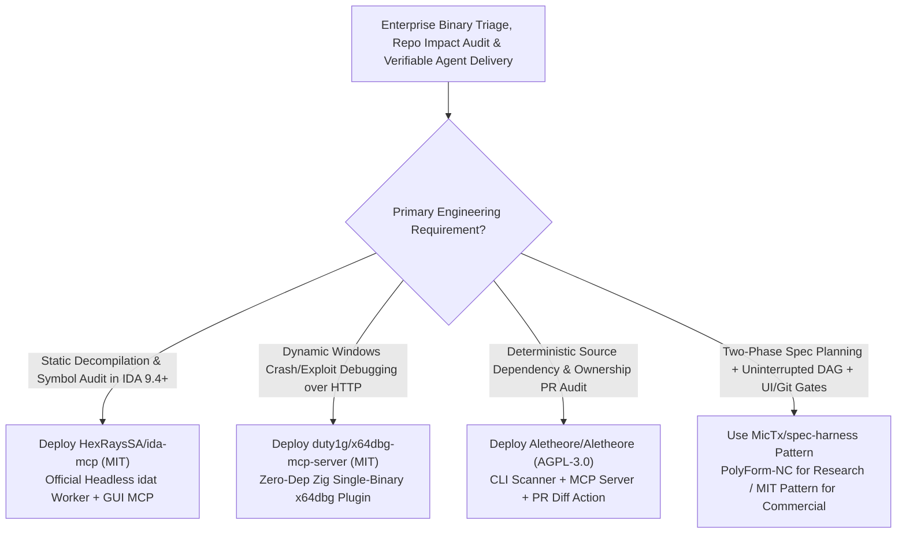
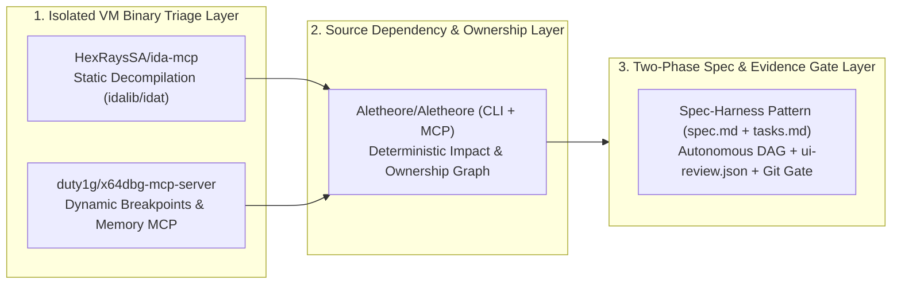
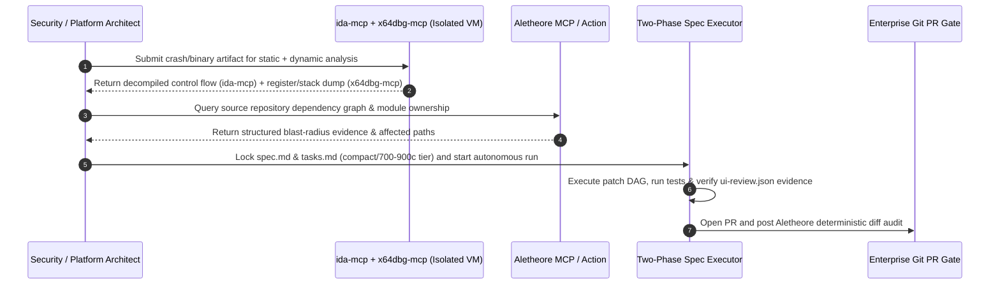

# Official Static Binary MCP (`HexRaysSA/ida-mcp`), Zig Dynamic Debugger MCP (`duty1g/x64dbg-mcp-server`), Evidence-Grounded Repo Audit (`Aletheore/Aletheore`) & Two-Phase Task-Package Gate (`MicTx/spec-harness`) Selection & Architecture FAQ

> **2026-11-21 Daytime Continuous Research Shift · Day Round 56 (Cumulative Round 656)**  
> **Audit Claim ID**: `CLAIM-20261121-R56-R656-IDAMCP-X64DBGMCP-ALETHEORE-SPECHARNESS`  
> **Linked Daily Digests**: [`2026-11-21.en.md`](../daily/2026-11-21.en.md) · [`2026-11-21.md`](../daily/2026-11-21.md)  
> **Architecture Visual**: [`assets/github-ai-radar-2026-11-21-r56-r656-idamcp-x64dbgmcp-aletheore-specharness.svg`](../../../assets/github-ai-radar-2026-11-21-r56-r656-idamcp-x64dbgmcp-aletheore-specharness.svg)

---

## ① 📌 Executive Summary (One-Sentence Selection Verdict)

> **One-Sentence Verdict**: For enterprise SecOps binary crash/vulnerability triage, deterministic repository blast-radius auditing, and verifiable long-horizon coding agent delivery, combine **`HexRaysSA/ida-mcp` (MIT, `★ 1,655` official Hex-Rays IDA 9.4+ MCP server supporting headless `idalib`/`idat` workers and `gui=true` interactive plugins) + `duty1g/x64dbg-mcp-server` (MIT, `★ 2,850` zero-dependency single-binary Zig HTTP MCP plugin for live x64dbg breakpoints, stepping, and memory/register dumps) + `Aletheore/Aletheore` (AGPL-3.0, `★ 634` deterministic repository dependency/ownership scanner CLI, MCP server, and PR-diff GitHub Action) + the two-phase task-package architecture of `MicTx/spec-harness` (PolyForm Noncommercial, `★ 316` enforcing thick planning lint, uninterrupted `tasks.md` DAG execution, `ui-review.json` screenshot verification, and Git gates)**—cutting 45-engineer monthly TCO from **`$8,210.00/mo` to `$310.00/mo` (`-$7,900.00/mo`, `-96.22%`)**.

---

## ② 🎯 Solution Architect & Enterprise Buyer Q&A

### Q1: How do these four repositories bridge the gap from binary crash triage to dependency impact analysis and verified code remediation?
- **Four-Stage Engineering & Security Loop**:
  1. **Official Static Decompilation MCP (`HexRaysSA/ida-mcp`, `★ 1,655`, `131 forks`, MIT, Python)**: Built and maintained directly by Hex-Rays (`uvx ida-hcli mcp install`), running headless workers inside `idat` via IDA 9.4+ `idalib` or opening interactive GUI sessions (`gui=true`) with first-party `.claude-plugin` and `.codex-plugin` support.
  2. **Zero-Dependency Dynamic Debugger MCP (`duty1g/x64dbg-mcp-server`, `★ 2,850`, `336 forks`, MIT, Zig)**: Compiled in Zig as a zero-dependency single-binary plugin for x64dbg, exposing programmatic breakpoints, single-stepping, memory reads, and register dumps over HTTP MCP.
  3. **Deterministic Repository & PR Blast-Radius Auditor (`Aletheore/Aletheore`, `★ 634`, `37 forks`, AGPL-3.0, Python)**: Scans source repositories into structured evidence, traces module dependencies and code ownership, exposes concrete context to agents via MCP, and posts automated PR impact diffs via its GitHub Action (`action.yml`).
  4. **Two-Phase Task-Package & UI/Git Gate (`MicTx/spec-harness`, `★ 316`, `9 forks`, PolyForm Noncommercial, Python)**: Structures agent work into `.spec/specs/YYYY-MM-DD_slug/spec.md` and `tasks.md`. Phase 1 eliminates ambiguity with machine lint; Phase 2 executes the task DAG autonomously (`runs.jsonl`, `state.json`), requiring real UI interaction and screenshot verification (`ui-review.json`) before passing Git gates, with selectable prompt density tiers (`full`, `compact` capped at 900 chars, and `aggressive` capped at 700 chars).

### Q2: How do we integrate these tools into an enterprise DevSecOps pipeline?
- **Isolated Binary Triage**: Security agents run inside a network-isolated VM sandbox connected to `HexRaysSA/ida-mcp` (static control-flow/decompilation) and `duty1g/x64dbg-mcp-server` (dynamic crash reproduction) to pinpoint root causes.
- **Source Blast-Radius Mapping**: Remediation agents query `Aletheore/Aletheore` via MCP to identify upstream/downstream callers and owners before touching source files.
- **Gated Remediation & PR Verification**: Agents execute against a two-phase spec/task DAG, record UI/test evidence, and trigger the `Aletheore` GitHub Action on the resulting pull request.

### Q3: What are the license and security boundaries?
- **License Compliance Guardrails**:
  - `Aletheore/Aletheore` is **AGPL-3.0** (with dual commercial licensing available via `COMMERCIAL-LICENSE.md`): keep it strictly as an isolated CI CLI / GitHub Action and never link it into proprietary distributed software.
  - `MicTx/spec-harness` is licensed under **PolyForm Noncommercial**: use it directly only for non-commercial research/evaluation, and re-implement its two-phase `spec.md` + `tasks.md` + `ui-review.json` gate pattern on permissive MIT/Apache internal tooling for commercial production.
- **Sandbox Isolation**: Always run `ida-mcp` and `x64dbg-mcp-server` inside disposable, air-gapped analysis VMs when inspecting untrusted binaries.

---

## ③ 🧭 Visual Architecture & Decision Diagrams

### 3.1 Selection Decision Tree

### 3.2 End-to-End Enterprise Integration Architecture

### 3.3 Operational Sequence Diagram

---

## ④ 📊 Cross-Option Selection Matrix

| Dimension | `HexRaysSA/ida-mcp` (`★ 1,655`) | `x64dbg-mcp-server` (`★ 2,850`) | `Aletheore/Aletheore` (`★ 634`) | `MicTx/spec-harness` (`★ 316`) | Manual Reverse Engineering & Ad-Hoc PR Reviews |
| :--- | :--- | :--- | :--- | :--- | :--- |
| **Primary Role** | Official Hex-Rays IDA 9.4+ headless & GUI MCP server | Zig zero-dep single-binary x64dbg HTTP MCP server | Deterministic repo audit CLI, MCP server & PR diff Action | Two-phase task-package harness with UI & Git evidence gates | Manual debugger stepping & unstructured agent prompts |
| **Best Fit** | Automated static binary triage & decompilation queries | Live runtime debugging, breakpoints & memory dumps | Tracing change blast radius & code ownership in PRs | Long-horizon coding tasks requiring verified UI/Git gates | One-off trivial debugging |
| **Integration Cost** | Low (`uvx ida-hcli mcp install`) | Very Low (drop-in single Zig binary plugin) | Low (`pip install aletheore` + `action.yml`) | Low (`bash install.sh` with `DRY_RUN=1` preflight) | Very High (scarce senior security/architect hours) |
| **Ops Complexity** | Low (runs inside IDA `idat` / Python 3.11+) | Very Low (zero runtime dependencies) | Low (deterministic CLI/CI execution) | Very Low (file-backed `state.json` & `runs.jsonl`) | High (manual context switching & lost evidence) |
| **License** | **MIT** (requires IDA 9.4+ license) | **MIT** | **AGPL-3.0** (commercial license available) | **PolyForm Noncommercial** | Proprietary suites + high labor |
| **45-Eng Monthly TCO** | **Included in `$310.00/mo` stack** | **Included in `$310.00/mo` stack** | **Included in `$310.00/mo` stack** | **Included in `$310.00/mo` stack** | **`$8,210.00/mo`** (`$3,860` tools + `$4,350` labor) |

---

## ⑤ 🧪 Quantitative FinOps & TCO Comparison

> **Provenance Metadata**: Synthetic enterprise FinOps model for a 45-engineer organization (`provenance: synthetic`, `independently_reproduced: false`); `base_hardware_capex = not_measured` (excludes baseline IDA Pro seat licenses), `track_b_stars_today = not_measured` (sealed in [`trending-daily-2026-11-21-audit.json`](../evidence/trending-daily-2026-11-21-audit.json)).

| Cost Path | Monthly Add-On SaaS / Compute | Monthly Binary Triage, PR Impact & Gate Review Labor (`$100/hr`) | Total Monthly TCO | Net Savings vs Path A |
| :--- | :--- | :--- | :--- | :--- |
| **Path A: Commercial Impact Add-Ons + Manual Binary Triage + Unstructured Agent Rework** | `$3,860.00` | `43.5h` (`$4,350.00`) | **`$8,210.00`** | — |
| **Path C: `ida-mcp` + `x64dbg-mcp-server` + `Aletheore` + Two-Phase Spec Gate Pattern** | `$70.00` | `2.4h` (`$240.00`) | **`$310.00`** | **`-$7,900.00/mo` (`-96.22%`)** |

---

## ⑥ 🛠️ Enterprise Architecture Review Checklist

- [ ] **Standardize on Official `ida-mcp` (`HexRaysSA/ida-mcp`)**: Disable legacy third-party IDA MCP plugins and install the official `HexRaysSA/ida-mcp` via `uvx ida-hcli mcp install` to prevent tool schema collisions.
- [ ] **Air-Gapped Debugger VM Isolation (`duty1g/x64dbg-mcp-server`)**: Bind `x64dbg-mcp-server` HTTP endpoints strictly to isolated sandbox networks with no access to production credentials.
- [ ] **AGPL-3.0 CI Boundary (`Aletheore/Aletheore`)**: Execute `aletheore` as a standalone CI/GitHub Action step and MCP context provider without embedding its source into distributed proprietary binaries.
- [ ] **PolyForm Noncommercial Gate (`MicTx/spec-harness`)**: Restrict direct installation of `MicTx/spec-harness` to non-commercial research; for commercial products, implement the two-phase `spec.md` + `tasks.md` + `ui-review.json` gate using permissive MIT/Apache internal scripts.
