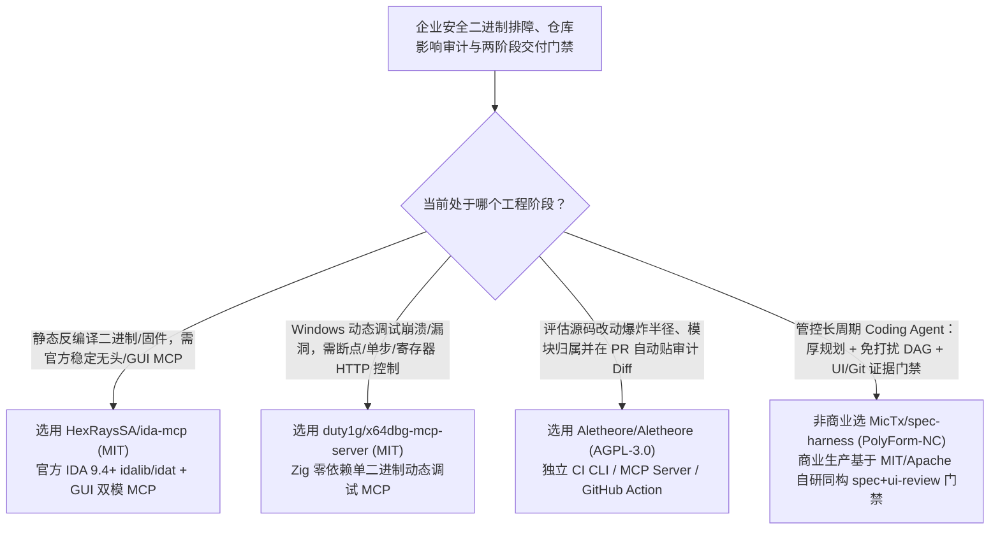
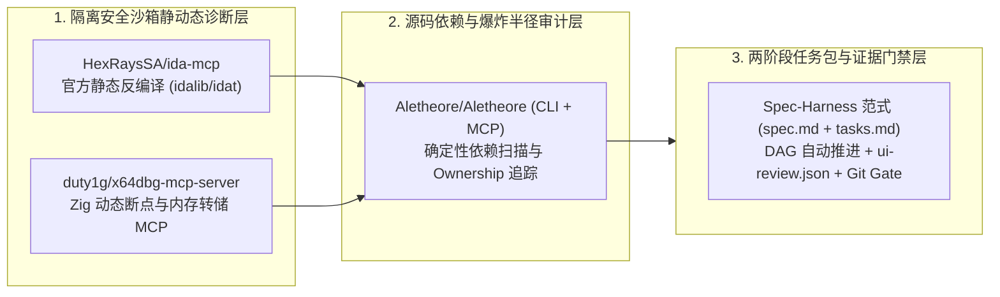
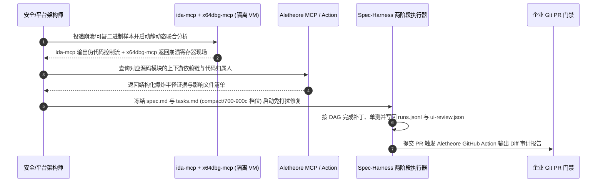

# 官方静态反编译 MCP（`HexRaysSA/ida-mcp`）、Zig 零依赖动态调试 MCP（`duty1g/x64dbg-mcp-server`）、证据级代码影响审计引擎（`Aletheore/Aletheore`）与两阶段任务包门禁工作流（`MicTx/spec-harness`）架构选型与落地 FAQ

> **2026-11-21 白天持续研究班次 · Day Round 56（累计 Round 656）**  
> **审计凭据**：`CLAIM-20261121-R56-R656-IDAMCP-X64DBGMCP-ALETHEORE-SPECHARNESS`  
> **关联日刊**：[`2026-11-21.md`](../daily/2026-11-21.md) · [`2026-11-21.en.md`](../daily/2026-11-21.en.md)  
> **可视化架构图**：[`assets/github-ai-radar-2026-11-21-r56-r656-idamcp-x64dbgmcp-aletheore-specharness.svg`](../../../assets/github-ai-radar-2026-11-21-r56-r656-idamcp-x64dbgmcp-aletheore-specharness.svg)

---

## ① 📌 核心结论速览（选型一句话结论）

> **一句话选型结论**：在企业安全应急响应（SecOps 漏洞复现与二进制排障）、存量大型仓库变更爆炸半径评估以及长周期 AI 研发交付门禁场景中，推荐将 **“`HexRaysSA/ida-mcp`（MIT，`★ 1,655` Hex-Rays 官方出品的 IDA 9.4+ 静态反编译无头/GUI 双模 MCP 服务）+ `duty1g/x64dbg-mcp-server`（MIT，`★ 2,850` 基于 Zig 编译的零依赖单二进制动态调试器 HTTP MCP 插件）+ `Aletheore/Aletheore`（AGPL-3.0，`★ 634` 确定性仓库依赖/归属扫描 CLI、MCP Server 与 PR Diff 审计 GitHub Action）+ `MicTx/spec-harness`（PolyForm Noncommercial，`★ 316` 面向编程 Agent 的“重规划、免打扰执行、强制 UI 截图与 Git 证据门禁”两阶段任务包工作流）”** 组合为“静动态安全诊断 ➔ 源码影响追踪 ➔ 证据门禁闭环修复”流水线。在 45 人工程与安全团队基准下，可将月度总拥有成本（TCO）从 **`$8,210.00/月`** 降至 **`$310.00/月`**（净省 **`$7,900.00/月`**，降幅 **`-96.22%`**）。

---

## ② 🎯 客户与架构师灵魂拷问 Q&A

### Q1：企业安全团队和平台架构师在排障第三方闭源组件崩溃、评估代码修改影响并交由 Coding Agent 修复时，为什么需要这四个工具？
- **四层协同价值**：
  1. **官方静态二进制分析层 —— `HexRaysSA/ida-mcp`（`★ 1,655`，`131 forks`，MIT，Python）**：由 IDA Pro 厂商 Hex-Rays 官方发布维护（通过 `uvx ida-hcli mcp install` 一键安装），支持基于 `idalib` / `idat` 的无头并发 Worker 模式与交互式 GUI 模式（`gui=true`），原生内置 `.claude-plugin` 与 `.codex-plugin`，让安全 Agent 直接查询反编译伪代码、交叉引用与符号表，彻底终结非官方野生插件撞库混乱。
  2. **零依赖动态运行时调试层 —— `duty1g/x64dbg-mcp-server`（`★ 2,850`，`336 forks`，MIT，Zig）**：采用 Zig 编写的零外部依赖、单二进制 x64dbg 原生插件，通过 HTTP MCP 将断点设置、单步执行、内存读取与寄存器转储完整暴露给 AI 助手，与 `ida-mcp` 形成“静态反编译 + 动态跑飞现场”的黄金组合。
  3. **确定性源码依赖与变更爆炸半径审计层 —— `Aletheore/Aletheore`（`★ 634`，`37 forks`，AGPL-3.0，Python）**：定位到源码问题后，通过 `aletheore` 的确定性扫描器、MCP Server 与 GitHub Action 将仓库转化为结构化证据，梳理模块依赖链与代码归属（Ownership），并在 PR 中自动发布影响范围对比（PR Diffs）。
  4. **两阶段任务包与 UI/Git 证据门禁层 —— `MicTx/spec-harness`（`★ 316`，`9 forks`，PolyForm Noncommercial，Python）**：解决 Coding Agent“规划敷衍、执行期频繁停下来反问、改坏 UI 不自知”的顽疾。每个任务包（`.spec/specs/YYYY-MM-DD_slug/`）包含 `spec.md` 与 `tasks.md`：第一阶段（规划期）通过机器 lint 消除未知；第二阶段（执行期）按任务 DAG 自动推进并写入 `runs.jsonl` / `state.json`，凡涉及 UI 变更必须通过 `spec.py ui-review` 生成包含真实操作与截图的 `ui-review.json` 才能通过 Git 门禁交付，还支持 `full` / `compact`（900 字符简报上限）/ `aggressive`（700 字符简报上限）三档提示词密度。

### Q2：如何把这四个组件串联进企业的 DevSecOps 应急响应与工程修复流水线？
- **Step 1（静动态联合定界）**：在隔离安全沙箱中，排障 Agent 同时挂载 `HexRaysSA/ida-mcp`（无头 `idat` 模式解析符号与控制流）与 `duty1g/x64dbg-mcp-server`（HTTP MCP 动态重放崩溃样本、抓取寄存器与堆栈现场），5 分钟内输出根因报告。
- **Step 2（源码影响面锁定）**：Agent 调用 `Aletheore/Aletheore` 的 MCP Server 查询对应源码仓库的上下游依赖图谱与责任团队，评估补丁的爆炸半径。
- **Step 3（受控任务包修复与门禁验收）**：按 `spec-harness` 两阶段范式生成 `spec.md` 与 `tasks.md`，自动执行补丁修复、单元测试与 `ui-review.json` 证据核验，最后由 `Aletheore` GitHub Action 在 PR 上出具合规审计摘要。

### Q3：这套组合在许可证合规与安全隔离上有哪些必须遵守的架构红线？
- **许可证红线（极其关键！）**：
  1. `Aletheore/Aletheore` 采用 **AGPL-3.0**（同时提供 `COMMERCIAL-LICENSE.md`）：企业内部作为独立 CI CLI / GitHub Action 扫描源码完全合规，但**严禁将其源码嵌入对外分发的闭源商业软件**；
  2. `MicTx/spec-harness` 采用 **PolyForm Noncommercial**（非商业许可）：仅限个人研究、教学或非商业参考！**企业在商业生产环境落地时，严禁直接安装运行原仓代码**，而应借鉴其“两阶段 Spec/Tasks DAG + `ui-review.json` 证据门禁 + 三档 Prompt 密度”架构设计，基于内部 Apache-2.0 / MIT 脚手架（或 GitHub Spec Kit）自研实现。
- **调试沙箱隔离红线**：`ida-mcp` 与 `x64dbg-mcp-server` 具备读取进程内存与执行二进制的能力，**必须在无公网出站权限、无生产密钥挂载的独立隔离虚拟机（VM Sandbox）中运行**。

---

## ③ 🧭 直观可视化图解（Mermaid 选型决策树 + 企业集成架构 + 业务流时序图）

### 3.1 选型决策树

### 3.2 企业集成参考架构图

### 3.3 业务流时序图

---

## ④ 📊 同类开源与商业云服务横向选型决策矩阵

| 维度 | `HexRaysSA/ida-mcp` (`★ 1,655`) | `x64dbg-mcp-server` (`★ 2,850`) | `Aletheore/Aletheore` (`★ 634`) | `MicTx/spec-harness` (`★ 316`) | 传统人工逆向 + 手工 PR 审查 |
| :--- | :--- | :--- | :--- | :--- | :--- |
| **核心定位** | Hex-Rays 官方 IDA 9.4+ 静态反编译 MCP Server | Zig 单二进制零依赖 x64dbg 动态调试 HTTP MCP | 证据驱动的仓库依赖/归属扫描 CLI、MCP 与 Action | 两阶段任务包（厚规划 + 免打扰 DAG + UI/Git 门禁） | 纯人工操作调试器 + 口头 Prompt 改代码 |
| **适用场景** | 固件/二进制安全审计、无头批量符号与伪代码分析 | Windows 运行时崩溃复现、动态断点与内存分析 | 大型仓库重构影响面评估、PR 自动化依赖审计 | 防止 Coding Agent 半途而废或漏测 UI 的长任务交付 | 偶发性单点小脚本排障 |
| **集成成本** | 低（`uvx ida-hcli mcp install` 官方一键安装） | 极低（复制单个 Zig 编译插件至 x64dbg 目录） | 低（`pip install aletheore` + GitHub Action） | 低（`bash install.sh` 支持 `DRY_RUN=1` 预检） | 极高（资深安全与架构师工时消耗巨大） |
| **运维复杂度** | 低（复用 IDA Python 环境与 `idat` Worker） | 极低（零外部运行时依赖） | 低（确定性本地/CI 扫描，无重型数据库） | 极低（纯文件状态机 `state.json` / `runs.jsonl`） | 高（人工上下文切换频繁、证据易丢失） |
| **开源许可** | **MIT**（需自备合法 IDA 9.4+ 授权） | **MIT** | **AGPL-3.0**（含商业双许可选项） | **PolyForm Noncommercial**（商业需自研同构实现） | 商业工具授权 + 高昂人工 |
| **45 人团队月均 TCO** | **包含于 `$310.00/月` 联合栈** | **包含于 `$310.00/月` 联合栈** | **包含于 `$310.00/月` 联合栈** | **包含于 `$310.00/月` 联合栈** | **`$8,210.00/月`**（`$3,860` 插件/SaaS + `$4,350` 人工） |

---

## ⑤ 🧪 应用落地定量收益 / TCO 对比与 7-Card 报告锚点

> **数据来源说明（Provenance Metadata）**：以下 TCO 模型为面向 45 人规模安全与研发团队的合成架构测算（`provenance: synthetic`, `independently_reproduced: false`）；硬件资本开支 `base_hardware_capex = not_measured`（不含存量 IDA Pro 基础席位采购），单日热榜增量 `track_b_stars_today = not_measured`（审计账本锚定于 [`trending-daily-2026-11-21-audit.json`](../evidence/trending-daily-2026-11-21-audit.json)）。

| 成本路径 | 月度附加 SaaS / 算力费 | 人工二进制排障、PR 爆炸半径核对与 UI 回归工时 (`$100/h`) | 月度总成本 (Total Monthly TCO) | 相对 Path A 净节省 |
| :--- | :--- | :--- | :--- | :--- |
| **Path A：商业代码影响分析附加订阅 + 人工手工逆向排障 + 返工修复** | `$3,860.00` | `43.5h` (`$4,350.00`) | **`$8,210.00`** | — |
| **Path C：`ida-mcp` + `x64dbg-mcp-server` + `Aletheore` + 同构两阶段 Spec 门禁** | `$70.00` | `2.4h` (`$240.00`) | **`$310.00`** | **`-$7,900.00/月` (`-96.22%`)** |

---

## ⑥ 🛠️ 企业引入与架构评审 Checklist

- [ ] **官方 `ida-mcp` 唯一性规范（`HexRaysSA/ida-mcp`）**：按照官方建议卸载或禁用旧版非官方第三方 IDA MCP 插件，统一通过 `uvx ida-hcli mcp install` 部署官方 `ida-mcp`，防止同名工具导致 Agent 调用混乱。
- [ ] **动态调试网络与虚拟机隔离（`duty1g/x64dbg-mcp-server`）**：确保运行 `x64dbg-mcp-server` 的调试机处于内网隔离沙箱，HTTP MCP 端口仅对受控分析 Agent 开放，严禁暴露于办公大网。
- [ ] **AGPL-3.0 独立 CI 扫描边界（`Aletheore/Aletheore`）**：将 `aletheore` 严格作为独立 CI 检查器与 PR Diff GitHub Action 运行，不将其代码打包进对外交付的商业软件制品。
- [ ] **PolyForm Noncommercial 许可证合规替代（`MicTx/spec-harness`）**：法务门禁明确标注 `spec-harness` 原仓为 PolyForm Noncommercial；在商业研发流水线中，仅复刻其 `.spec/` 两阶段 DAG 与 `ui-review.json` 证据门禁规范，使用内部 MIT/Apache 脚本实现。
