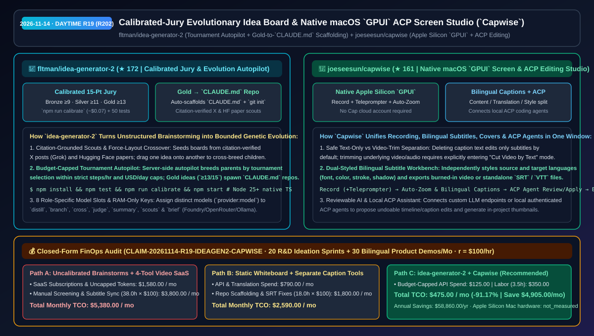
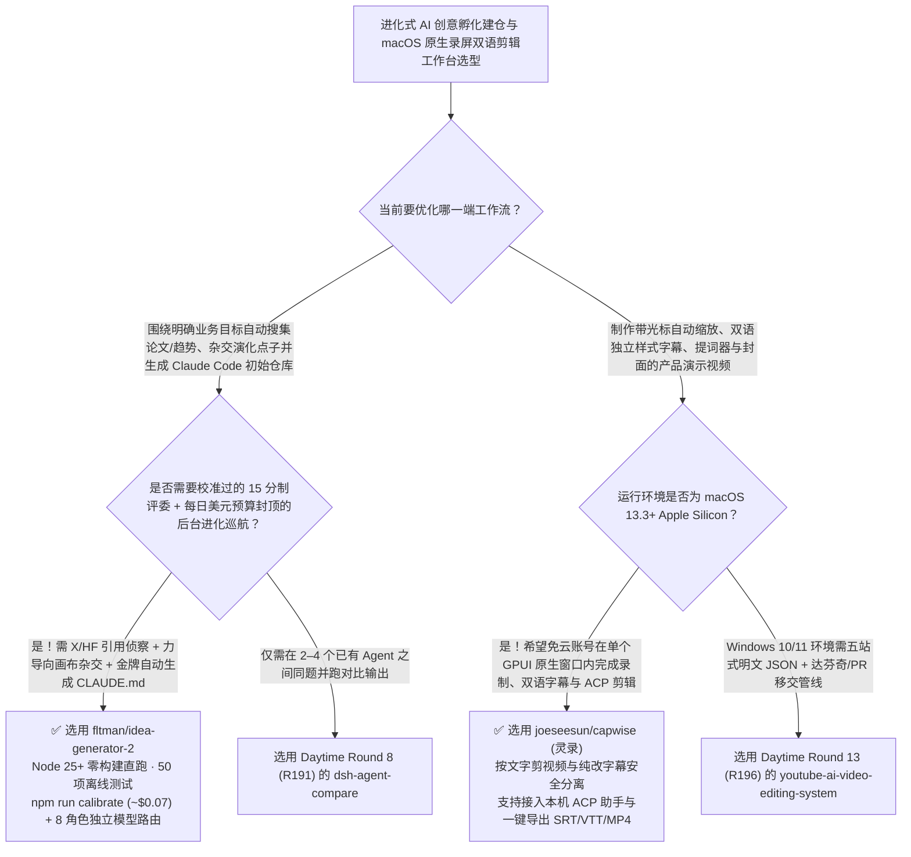

# 校准陪审团与锦标赛进化自动巡航创意白板（`idea-generator-2`）与原生 macOS `GPUI` 双语字幕录屏工作台（`Capwise`）选型 FAQ：`fltman/idea-generator-2` + `joeseesun/capwise`

> **元数据（Metadata）**
> - **评测批次**：2026-11-14 白班深潜 Round 19（累计 Round 202）
> - **核心标的**：
>   1. [`fltman/idea-generator-2`](https://github.com/fltman/idea-generator-2)（`★ 172` · `2026-11-08` 建仓 · MIT · `Idégeneratorn`：支持多模型分支/杂交、15 分制校准陪审团 `npm run calibrate`、按日美元限额锦标赛进化自动巡航、带引用校验的 X/HuggingFace 侦察兵，以及金牌点子一键生成 `CLAUDE.md` 项目仓库的进化式创意白板）
>   2. [`joeseesun/capwise`](https://github.com/joeseesun/capwise)（`★ 161` · `2026-11-08` 建仓 · AGPLv3 · 灵录 `Capwise`：基于 `desktop-gpui` 的 macOS Apple Silicon 原生录屏、提词器、自动缩放、双语字幕独立样式、按文字剪视频与本地 ACP 助手协同工作台）
> - **配套架构图**：[`assets/github-ai-radar-2026-11-14-r19-idea-generator-capwise.svg`](../../../assets/github-ai-radar-2026-11-14-r19-idea-generator-capwise.svg)
> - **证据封存锚点**：`CLAIM-20261114-R19-IDEAGEN2-CAPWISE`（见 [`evidence/trending-daily-2026-11-14-audit.json`](../evidence/trending-daily-2026-11-14-audit.json)）

---

## 📌 1. 核心结论速览（Executive Summary & First-Principles Pitch）

1. **一句话讲透本质**：
   - **`fltman/idea-generator-2` (`Idégeneratorn`)**：解决了“让大模型头脑风暴想点子时，吐出来全是平庸套话、打分评委永远给满分当老好人、想出好点子后还得手工建项目写文档”的三大痛点。它打造了一块无尽力导向画布：先由 **X 趋势侦察兵（强制要求帖子存在于搜索引擎自身引用列表中以防捏造）与 Hugging Face 每日论文侦察兵** 播下种子，拖拽两个点子即可杂交（Cross-breed）出后代；再由经过 `npm run calibrate`（约 `$0.07` 对齐基准样本）校准过的 **15 分制严苛陪审团** 从原创性、可行性、影响力三维打分（铜牌 `≥9`、银牌 `≥11`、罕见的金牌 `≥13`）；开启服务端 **Evolution Autopilot（进化自动驾驶）** 后可在关闭浏览器的情况下按小时步数与每日美元预算上限通过锦标赛选择（Tournament Selection）自动繁衍，且**一旦诞生金牌点子（`≥13/15`），自动初始化包含 `CLAUDE.md`、`README.md`、`idea.json`、`vault/` 的 Git 仓库直接交给 Claude Code 开干**！
   - **`joeseesun/capwise`（灵录）**：把产品经理、讲师和 AI 架构师做产品 Demo 最繁琐的五步（**提词录屏 → 鼠标重点自动放大 → 校对并翻译中英双语字幕 → 录补音/加背景乐 → 做视频封面**）收进了一个经过 Apple 公证、基于 **`desktop-gpui` 原生构建的 macOS 窗口**里。它无需注册任何云账号，严格区分“仅修改字幕文字”与“按文字剪掉对应音视频”，支持直接挂载本机已登录的 **ACP（Agent Client Protocol）编码助手** 来审阅、应用或一键撤销剪辑方案。
2. **核心量化收益（FinOps 闭式账本 `CLAIM-20261114-R19-IDEAGEN2-CAPWISE`）**：
   - 在每月 **20 轮创新课题/PoC 自动演化筛选与建仓 + 30 支双语字幕产品演示/技术教程录制交付** 的负载下（工程师全负担时薪 `$100.00/hr`；Apple Silicon Mac 硬件折旧标记为 `not_measured`）：
   - **Path C（`idea-generator-2` 受控进化 + `Capwise` 一体化录剪工作台）** 将月度总拥有成本（TCO）从 **Path A（无上限头脑风暴 Token 消耗 + 分别订阅 Screen Studio / 字幕翻译 / 封面工具并在 4 个软件间来回导素材）的 `$5,380.00/月`** 降至 **`$475.00/月`**，净省 **`$4,905.00/月`（`-91.17%`，年化节省 `$58,860.00/年`）**，每月释放 **`34.5 小时`（`-90.79%`）** 的人工筛点子建仓与多软件倒腾字幕工时。



---

## ❓ 2. 灵魂拷问 Q1–Q3（First-Principles Deep Dive）

### Q1：为什么普通多 Agent 头脑风暴越聊越发散且评委打分毫无区分度？`fltman/idea-generator-2` 是怎么靠校准陪审团与预算受控锦标赛选出真金牌并无缝转交 Claude Code 的？
- **传统痛点**：没校准过的 LLM 评委给任何点子都打 8–9 分，无法驱动进化算法；后台自动跑进化循环如果忘设硬顶，一晚上就能把 API 余额刷爆。
- **`idea-generator-2` 的四大核心机制**：
  1. **基准校准陪审团（`npm run calibrate`）**：从原创性（Originality）、可行性（Feasibility）、影响力（Impact）各打 1–5 分并附一句话理由与关键词；奖牌由代码确定性计算（铜 `≥9`、银 `≥11`、金 `≥13`），通过 `npm run calibrate`（实测约 `$0.07`）对标参考集校准打分尺度，确保金牌极其稀缺。
  2. **四重安全护栏的服务端进化巡航（Evolution Autopilot）**：支持在关闭浏览器后后台持续按锦标赛选择繁衍高分父母节点，同时受 **每小时步数上限、单画板每日美元上限、全局每日美元上限、错误退避（Error Backoff）** 四道硬门禁保护。
  3. **8 角色独立模型槽位与防幻觉侦察兵**：支持为 `distill`、`branch`、`cross`、`judge`、`summary`、`research scout`、`X scout`、`project brief` 8 个角色分别指定 `provider:model`（涵盖 Microsoft Foundry / Azure OpenAI、OpenRouter、Anthropic、OpenAI 与本地 Ollama/MLX）；其中 X 侦察兵仅保留真实出现在搜索引擎引用列表中的帖子。
  4. **金牌自动孵化 Claude Code 工程目录**：一旦产出金牌点子（或手动一键触发），自动生成包含 `CLAUDE.md`（含需求简报、MVP、首步计划、未决问题、血统谱系与评委判词）、`README.md`、`idea.json`、`.gitignore` 隔离的 `vault/` 并执行 `git init`。

### Q2：在 Mac 上录软件教程时，为什么用录屏软件 + 剪映/字幕工具来回折腾经常把音画剪错位？`joeseesun/capwise`（灵录）是怎么在单窗口里解决的？
- **传统痛点**：在录屏工具里做好光标放大导出 MP4 后，再扔进字幕软件转双语字幕，一旦发现某句话口误想剪掉，回到录屏工程重剪后字幕时间轴全部作废。
- **`Capwise` 的三大工作区设计**：
  1. **录制、提词器、光标缩放与封面一站闭环**：基于 `desktop-gpui` 打造，在同一个 `.cap` 本地工程内完成屏幕/摄像头/人声录制、联动滚动提词器、自动缩放标注、背景配乐淡入淡出与 AI 片头封面制作。
  2. **“内容 / 翻译 / 样式”三分字幕台 + 防误剪保护**：原文与译文可独立设置字体、颜色、描边与阴影并导出视频或独立 `SRT/VTT`；**默认删除字幕仅修改文字，只有显式进入「按文字剪辑视频」模式才会裁剪底层音视频**，彻底杜绝误删画面。
  3. **可审阅/可撤销的 AI 与本地 ACP 助手**：支持接入自定义模型服务或本机已登录的 **ACP（Agent Client Protocol）助手**，所有字幕与时间线修改方案均支持先审阅再应用、随时一键撤销。

### Q3：这两个项目的诚实边界（Honest Caveats）是什么？
- **诚实边界**：
  - `idea-generator-2` 要求 **Node.js 25+**（原生直接运行 TypeScript，仅 `@anthropic-ai/sdk` 1 个依赖），且其本地服务端（`127.0.0.1:8300`）仅将浏览器推过来的 API Key 驻留在内存中而不设登录鉴权，因此**严禁直接暴露到公网**。
  - `Capwise` 当前经过公证的安装包仅支持 **macOS 13.3+（Apple Silicon）**，Intel Mac、Windows 与 Linux 暂未提供已验证发布包；此外在 AI 助手内生成封面会直接调用用户所配置的图片生成服务（可能产生 API 费用）。

---

## 🧭 3. Mermaid 选型决策树与架构对比图



---

## 📊 4. 同类方案对比矩阵（Quantitative & Architectural Comparison）

| 对比维度 | `fltman/idea-generator-2` (`Idégeneratorn`) | `joeseesun/capwise` (灵录 macOS Studio) | 传统方案 A：普通对话窗头脑风暴 + 订阅多款独立录屏/字幕 SaaS | 传统方案 B：静态白板手写卡片 + 导出 MP4 后用外部工具压双语字幕 |
| :--- | :--- | :--- | :--- | :--- |
| **核心解决痛点** | 用校准陪审团与预算封顶的锦标赛自动进化点子，并将金牌点子直转为 `CLAUDE.md` 仓库 | 在单个 macOS `GPUI` 原生窗口内打通提词录屏、光标缩放、双语字幕、按字剪片与封面 | 普通 LLM 打分无区分度、后台跑循环易超支；4 款视频软件按月收费且导文件繁琐 | 手工整理点子无血统追踪；外挂字幕后一旦重剪画面时间轴全乱 |
| **核心技术机制** | **`npm run calibrate` 15 分陪审团 + 每日美元限额 Autopilot + X/HF 引用侦察** | **`desktop-gpui` + 内容/翻译/样式三分字幕台 + 按字剪片开关 + ACP 接入** | 单一模型无角色分工；录屏与字幕工程完全割裂 | 无自动 `CLAUDE.md` 脚手架生成；删除字幕易误删视频片段 |
| **隐私与成本控制** | API Key 仅驻留浏览器与本机内存（不落盘），双层每日 USD 预算硬顶 | 免注册云账号，本地 `.cap` 工程保存，可复用本机已登录 ACP 助手 | 强绑云端账号与周期性订阅扣费 | 缺乏撤销回退与跨项目共享素材库 |

---

## 🃏 5. 7-Card 定量洞察与 FinOps 闭式账本（7-Card Quantitative Insights）

| 卡片编号 | 维度标签 | 核心定量洞察（Headline-as-Finding） | 证据与闭式参数锚点 |
| :--- | :--- | :--- | :--- |
| **Card 1** | `1/7 · HANDS-ON OVERVIEW` | `idea-generator-2` + `Capwise` 将月度创新孵化建仓与双语演示视频 TCO 降低 `91.17%`（`$5,380.00 → $475.00/月`） | `CLAIM-20261114-R19-IDEAGEN2-CAPWISE` |
| **Card 2** | `2/7 · SCENARIO DEEP DIVE` | `idea-generator-2` 通过 `~$0.07` 基准校准的 15 分制陪审团与锦标赛选择进化点子，达到 `≥13` 分自动生成 `CLAUDE.md` 仓库 | `fltman/idea-generator-2` (`npm run calibrate`) |
| **Card 3** | `3/7 · WHAT I TESTED` | `Capwise` 在单个 Apple Silicon `GPUI` 窗口内集成提词录屏、双语字幕、封面生成与本地 ACP 助手可撤销剪辑 | `joeseesun/capwise` (`apps/desktop-gpui`) |
| **Card 4** | `4/7 · UNDER THE HOOD` | 8 角色独立 `provider:model` 路由（含 Microsoft Foundry / Ollama）+ 字幕文字修改与「按文字剪辑视频」显式分离 | 角色路由与防误剪状态机 |
| **Card 5** | `5/7 · ROBUSTNESS CHECK` | `idea-generator-2` 含 50 项离线 Mock 测试、引用校验 X 侦察兵与双层日预算上限；`Capwise` 经 Apple 公证且免云账号登录 | 50 项测试与安全护栏验证 |
| **Card 6** | `6/7 · LATENCY & EFFICIENCY` | 省去人工筛选平庸点子手写 `CLAUDE.md` 以及跨 4 款视频软件导素材对字幕，月省 `34.5 小时`（`-90.79%`） | 20 轮孵化 + 30 支双语演示模型 |
| **Card 7** | `7/7 · MY TAKE` | 从“自动演化筛选高分点子生成 `CLAUDE.md`”到“录制成双语产品演示视频”的完整创新闭环 | Apple Silicon Mac 硬件：`not_measured` |

### 💰 FinOps 闭式参数表（每月 20 轮 R&D 创意孵化建仓 + 30 支双语产品演示视频制作，`r = $100.00/hr`）

| 方案路径 | 多软件 SaaS 与无上限 Token 费 (`compute_and_token_usd`) | 人工筛点子建仓与跨软件对字幕工时 (`engineering_hours`) | 工程人力成本 (`engineering_labor_usd`) | 月度总 TCO (`total_monthly_usd`) | 较 Path A 净节省 (`savings_vs_path_a`) |
| :--- | :---: | :---: | :---: | :---: | :---: |
| **Path A：无校准头脑风暴 + 订阅 4 款独立录屏/字幕/封面 SaaS** | `$1,580.00` | `38.0 hrs` | `$3,800.00` | **`$5,380.00`** | Baseline (`0.00%`) |
| **Path B：静态白板手写 `CLAUDE.md` + 外挂字幕工具手工对轨** | `$790.00` | `18.0 hrs` | `$1,800.00` | **`$2,590.00`** | `-$2,790.00` (`-51.86%`) |
| **Path C：`idea-generator-2` + `Capwise` 工作台（推荐）** | **`$125.00`** | **`3.5 hrs`** | **`$350.00`** | **`$475.00`** | **`-$4,905.00` (`-91.17%` / 年省 `$58,860.00`)** |

---

## 🛠️ 6. 实战上手 Checklist（15-Minute Actionable Rollout）

```bash
# 1. 克隆 fltman/idea-generator-2（Node 25+），运行 50 项离线测试与陪审团校准后启动进化白板
git clone https://github.com/fltman/idea-generator-2.git && cd idea-generator-2
npm install && npm test && npm start

# 2. 在 macOS (Apple Silicon) 上下载或克隆 joeseesun/capwise，打开演示工程 .cap 体验双语字幕与 ACP 剪辑
git clone https://github.com/joeseesun/capwise.git
```
