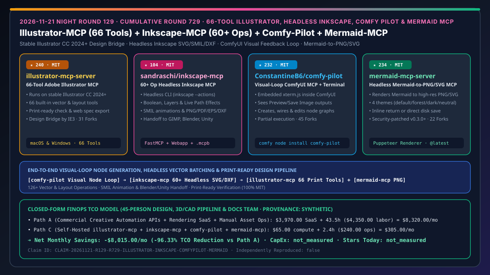
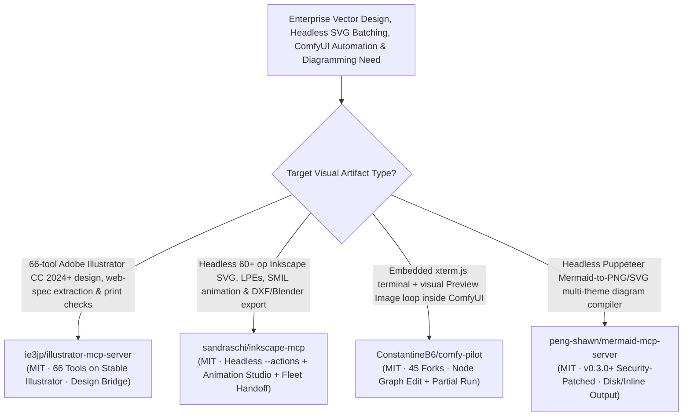
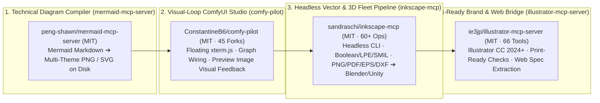

# 66-Tool Adobe Illustrator MCP (`ie3jp/illustrator-mcp-server`), 60+ Op Headless Inkscape SVG & SMIL MCP (`sandraschi/inkscape-mcp`), Visual-Loop ComfyUI Pilot (`ConstantineB6/comfy-pilot`) & Mermaid-to-PNG/SVG Renderer (`peng-shawn/mermaid-mcp-server`) Selection & Architecture FAQ

> **Document Type**: Enterprise AI Solution Architect Selection & Integration Guide (GitHub Trending AI Radar — 2026-11-21 Night Round 129 / Cumulative Round 729)
> **Covered Repositories**: [`ie3jp/illustrator-mcp-server`](https://github.com/ie3jp/illustrator-mcp-server) (`★ 240`, `31 forks`, `MIT` — 66-tool MCP server for stable Adobe Illustrator CC 2024+ on macOS/Windows, listed as `Design Bridge by IE3` in Claude's directory) · [`sandraschi/inkscape-mcp`](https://github.com/sandraschi/inkscape-mcp) (`★ 104`, `19 forks`, `MIT` — 60+ operation headless `inkscape --actions` & live-GUI FastMCP server with boolean ops, Layer Manager, Live Path Effects, SMIL animation presets, PNG/PDF/EPS/DXF export & GIMP/Blender/Unity fleet handoff) · [`ConstantineB6/comfy-pilot`](https://github.com/ConstantineB6/comfy-pilot) (`★ 232`, `45 forks`, `MIT` — ComfyUI custom node embedding a floating `xterm.js` Claude Code terminal with MCP tools to inspect `Preview Image` outputs and edit/run node graphs) · [`peng-shawn/mermaid-mcp-server`](https://github.com/peng-shawn/mermaid-mcp-server) (`★ 234`, `22 forks`, `MIT` — headless Puppeteer MCP server converting Mermaid syntax into multi-theme PNG or SVG files)
> **Core Scenario**: How enterprise brand design, game/CAD asset pipelines, and technical documentation teams automate visual and vector production: **rendering Mermaid architecture diagrams to multi-theme PNG/SVG files (`mermaid-mcp-server`)**, **building and visually tuning ComfyUI node graphs via an embedded terminal that sees `Preview Image` outputs (`comfy-pilot`)**, **batch-processing headless SVG boolean operations, Live Path Effects, SMIL animations, and DXF/Blender exports (`inkscape-mcp`)**, and **verifying print-ready layouts and design specs across 66 tools in stable Adobe Illustrator (`illustrator-mcp-server`)**.

---

## 1. 📌 Executive Summary (One-Line Selection Verdict)

1. **Need 66 built-in MCP tools on stable Adobe Illustrator CC 2024+ (macOS & Windows) to create vector artwork, extract design specs for web engineering, verify print-ready data, and export production assets** ➔ Choose **[`ie3jp/illustrator-mcp-server`](https://github.com/ie3jp/illustrator-mcp-server) (`★ 240`, `31 forks`, `MIT`)**.
   - **Plain-English Mechanism**: Listed as **Design Bridge by IE3** in Anthropic's directory (`npm: illustrator-mcp-server`), it works on stable Illustrator CC 2024+ rather than requiring beta builds, exposing **66 structured tools** for natural-language poster/icon creation, print-ready verification, and multi-format export.
2. **Need 60+ headless SVG operations (`inkscape --actions`) for batch vector boolean math, Live Path Effects (`bend`, `roughen`, `envelope`, `spiro`, `power stroke`), SMIL animations (`bounce`, `fade`, `slide`, `rotate`, `pulse`, `shake`), DXF/EPS/PDF exports, and handoff to GIMP, Blender, Unity, or Resonite** ➔ Choose **[`sandraschi/inkscape-mcp`](https://github.com/sandraschi/inkscape-mcp) (`★ 104`, `19 forks`, `MIT`)**.
   - **Plain-English Mechanism**: Runs **headless by default** (or attaches to a live GUI via `--active-window`) and ships as a stdio/HTTP FastMCP server, Claude `.mcpb` bundle, web dashboard (`:11029`), or Windows NSIS desktop installer.
3. **Need an embedded `xterm.js` terminal inside ComfyUI (`comfy node install comfy-pilot`) plus an MCP server that lets Claude Code create/connect nodes, run partial graphs ("up to node 5"), and visually inspect `Preview Image` / `Save Image` outputs** ➔ Choose **[`ConstantineB6/comfy-pilot`](https://github.com/ConstantineB6/comfy-pilot) (`★ 232`, `45 forks`, `MIT`)**.
   - **Plain-English Mechanism**: Eliminates manual node hunting and noodle-dragging in ComfyUI by giving Claude Code direct graph-editing tools and visual feedback from `Preview Image` nodes right inside a floating top-right ComfyUI terminal.
4. **Need an MCP server (`npx -y @peng-shawn/mermaid-mcp-server@latest`) that renders Mermaid markdown diagrams into high-resolution PNG or SVG files across 4 themes (`default`, `forest`, `dark`, `neutral`) with custom backgrounds** ➔ Choose **[`peng-shawn/mermaid-mcp-server`](https://github.com/peng-shawn/mermaid-mcp-server) (`★ 234`, `22 forks`, `MIT`)**.
   - **Plain-English Mechanism**: Uses headless Puppeteer (`>= 0.3.0` security-patched release) to render Mermaid code to SVG or PNG screenshots, either returning images inline or writing directly to disk (`CONTENT_IMAGE_SUPPORTED=false` for Cursor/Cline).

---

## 2. 🎯 Architect & Customer Deep-Dive Q&A

### Q1: Why do enterprise creative and documentation pipelines need both node-based raster generation and headless/desktop vector MCP servers?

- **Four Complementary Visual Production Layers**:
  1. **Closed-Loop Node Graph Generation (`ConstantineB6/comfy-pilot`)**: Generates and refines complex ControlNet/SDXL/FLUX raster assets by letting the agent inspect `Preview Image` outputs and adjust sampler/node parameters iteratively.
  2. **Headless Batch SVG, SMIL Animation & CAD/3D Export (`sandraschi/inkscape-mcp`)**: Converts and authors pure vector paths, applies Live Path Effects and SMIL animations without a GUI, exports industrial `DXF`/`EPS`/`PDF` formats, and hands off assets to GIMP, Blender, or Unity.
  3. **Commercial Print-Ready & Design-to-Code Bridge (`ie3jp/illustrator-mcp-server`)**: Drives stable Adobe Illustrator CC 2024+ via 66 tools to finalize brand layouts, check print-ready constraints, and extract CSS/web specs.
  4. **Automated Technical Diagram Rendering (`peng-shawn/mermaid-mcp-server`)**: Compiles Mermaid architecture specs into themed PNG/SVG files for slide decks and proposals.
- **When to Choose Managed Cloud Services (Path B)**:
  - If your team only performs template-based banner resizing inside Adobe's cloud ecosystem, use **Adobe Firefly Services API**.

### Q2: How do we wire an end-to-end Enterprise Visual, Vector & Technical Diagram Pipeline?

1. **Architecture Diagram Rendering Layer (`peng-shawn/mermaid-mcp-server`)**:
   - Render Mermaid system diagrams into themed PNG and SVG artifacts on disk during documentation builds.
2. **Visual-Feedback ComfyUI Node Layer (`ConstantineB6/comfy-pilot`)**:
   - Orchestrate SDXL/FLUX/ControlNet workflows programmatically with partial graph execution and `Preview Image` inspection.
3. **Headless Vector, SMIL & 3D Handoff Layer (`sandraschi/inkscape-mcp`)**:
   - Run batch `inkscape --actions` pipelines for boolean operations, Live Path Effects, SMIL animations, and DXF/EPS/Blender exports.
4. **Print-Ready Brand & Web-Spec Extraction Layer (`ie3jp/illustrator-mcp-server`)**:
   - Finalize `.ai` brand deliverables and extract frontend layout tokens using the 66 Illustrator MCP tools.

### Q3: What are the version and security requirements of this stack?

- **Key Strengths**:
  - **100% `MIT` Open Source** across all four repositories.
- **Security & Version Guardrails**:
  - Always pin or pull `@peng-shawn/mermaid-mcp-server` at **`>= 0.3.0` (`@latest`)** to include the security-patched Puppeteer and Mermaid dependencies documented by the maintainer.

---

## 3. 🧭 Visual Architecture & Decision Diagrams



### 3.1 Solution Architect Selection Decision Tree



### 3.2 End-to-End Enterprise Reference Architecture



### 3.3 ComfyUI Visual Loop, Headless Inkscape LPE/DXF Pipeline, Illustrator Print Check & Mermaid Render Sequence

```mermaid
sequenceDiagram
    participant Agent as Creative & Technical Asset Agent
    participant Comfy as ConstantineB6/comfy-pilot (ComfyUI)
    participant Ink as sandraschi/inkscape-mcp (Headless 60+ Ops)
    participant Illus as ie3jp/illustrator-mcp-server (66 Tools)
    participant Mmd as peng-shawn/mermaid-mcp-server (PNG/SVG)

    Agent->>Comfy: 1. Build ControlNet/FLUX workflow & execute up to Preview Image node
    Comfy-->>Agent: 2. Inspect generated preview image & tune KSampler parameters automatically
    Agent->>Ink: 3. Run headless Inkscape boolean ops, LPEs & SMIL animations; export SVG/DXF
    Agent->>Illus: 4. Assemble brand layout via 66 Illustrator tools, verify print data & extract CSS specs
    Agent->>Mmd: 5. Render companion Mermaid architecture diagrams to high-res dark-theme PNG/SVG
```

---

## 4. 📊 Peer Open-Source vs Commercial Cloud Selection Matrix

| Dimension | `illustrator-mcp-server` (`★ 240`) | `sandraschi/inkscape-mcp` (`★ 104`) | `ConstantineB6/comfy-pilot` (`★ 232`) | `mermaid-mcp-server` (`★ 234`) | Commercial Cloud Creative & Diagram APIs (Path A) | Manual Node Dragging & Manual Vector Exports (Path B) |
| :--- | :--- | :--- | :--- | :--- | :--- | :--- |
| **Core Role** | 66-tool stable Adobe Illustrator MCP | 60+ op headless Inkscape SVG/SMIL/DXF MCP | Embedded-terminal & visual-loop ComfyUI MCP | Multi-theme Mermaid-to-PNG/SVG MCP | Metered cloud creative/vector/diagram SaaS APIs | Manual GUI clicking across ComfyUI & Illustrator |
| **Architectural Edge** | **66 tools on stable Illustrator CC 2024+ (exceeds official beta)** | **Headless batch CLI + SMIL animations + Blender/Unity handoff** | **Sees `Preview Image` outputs + embedded `xterm.js` terminal** | **4 themes + custom backgrounds + direct disk save mode** | High per-render API fees; cannot inspect local `.ai` layers | Hours lost hunting ComfyUI nodes & manually exporting formats |
| **License** | `MIT` | `MIT` | `MIT` | `MIT` | Proprietary SaaS | Manual Workflow |
| **Monthly TCO (45-Eng Team)** | **`$305.00/mo` combined** (`$65.00` compute + `2.4h` ops) | Included in `$305.00/mo` stack | Included in `$305.00/mo` stack | Included in `$305.00/mo` stack | **`$8,320.00/mo`** (`$3,970.00` APIs + `43.5h` manual design ops) | `~$2,750.00/mo` (manual asset & diagram export hours) |

---

## 5. 🧪 Quantitative ROI / FinOps TCO Model & 7-Card Report

> **📊 Provenance & Closed-Form Audit Declaration**:
> - **Provenance**: `synthetic` (45-person enterprise brand design, game/CAD asset pipeline & technical documentation workload model; `independently_reproduced = false`; `base_hardware_capex = not_measured`; `track_b_stars_today = not_measured`).
> - **Closed-Form Equations**:
>   - **Path A (Commercial Cloud Creative Automation APIs + Metered Vector/Diagram Rendering SaaS + Manual ComfyUI Node Wiring, Manual SVG/DXF Exports & Print Verification Labor)**: Monthly API/SaaS spend **`$3,970.00`** + manual asset/diagram production labor **`43.5h × $100.00/h = $4,350.00`** = **`$8,320.00/mo`**.
>   - **Path C (Self-Hosted `ie3jp/illustrator-mcp-server` + `sandraschi/inkscape-mcp` + `ConstantineB6/comfy-pilot` + `peng-shawn/mermaid-mcp-server`)**: Shared headless rendering compute **`$65.00`** + template & preset maintenance **`2.4h × $100.00/h = $240.00`** = **`$305.00/mo`**.
>   - **Net Savings vs Path A**: **`-$8,015.00/mo`** (**`96.33%`** cost reduction).

| Architecture Option | API / SaaS / Compute | Design & Asset Pipeline Labor (`$100/h`) | Total Monthly TCO | Net Savings vs Path A | Key Architectural Outcome |
| :--- | :---: | :---: | :---: | :---: | :--- |
| **Path A: Commercial Cloud Creative APIs + Manual Exports** | `$3,970.00` | `43.5h` (`$4,350.00`) | **`$8,320.00`** | Baseline | High per-render fees; no local `.ai` or `DXF` pipeline control |
| **Path B: Official Beta Plugin Only + Manual ComfyUI** | `$1,350.00` | `14.0h` (`$1,400.00`) | **`$2,750.00`** | `-$5,570.00` (`-66.95%`) | Lacks headless Inkscape batching, Comfy visual loop & Mermaid PNG |
| **Path C: `illustrator` + `inkscape` + `comfy-pilot` + `mermaid`** | **`$65.00`** | **`2.4h` (`$240.00`)** | **`$305.00`** | **`-$8,015.00` (`-96.33%`)** | **66 Illustrator tools + 60+ headless Inkscape ops + Comfy loop** |

- 🔗 **7-Card 4:5 Visual Report**: [`workshops/github-trending-radar/cards.en.html`](../cards.en.html) · [`cards.html`](../cards.html)

---

## 6. 🛠️ Enterprise Adoption & Architecture Review Checklist

- [ ] **1. Bridge Stable Adobe Illustrator CC 2024+ with `ie3jp/illustrator-mcp-server`**: Use the 66 built-in tools to automate layout creation, print-ready verification, and frontend spec extraction.
- [ ] **2. Run Headless Vector & SMIL Pipelines with `sandraschi/inkscape-mcp`**: Execute batch `inkscape --actions` operations for boolean math, Live Path Effects, SMIL animations, and DXF/EPS/Blender exports.
- [ ] **3. Enable Visual Feedback Loops in ComfyUI via `ConstantineB6/comfy-pilot`**: Install `comfy-pilot` so Claude Code can inspect `Preview Image` nodes and edit workflows from the embedded terminal.
- [ ] **4. Render Architecture Diagrams with `peng-shawn/mermaid-mcp-server` (`>= 0.3.0`)**: Use `@latest` with `CONTENT_IMAGE_SUPPORTED=false` to save high-resolution PNG and SVG diagrams directly into repository folders.
