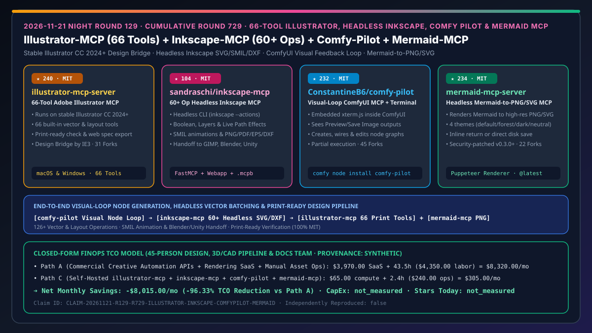
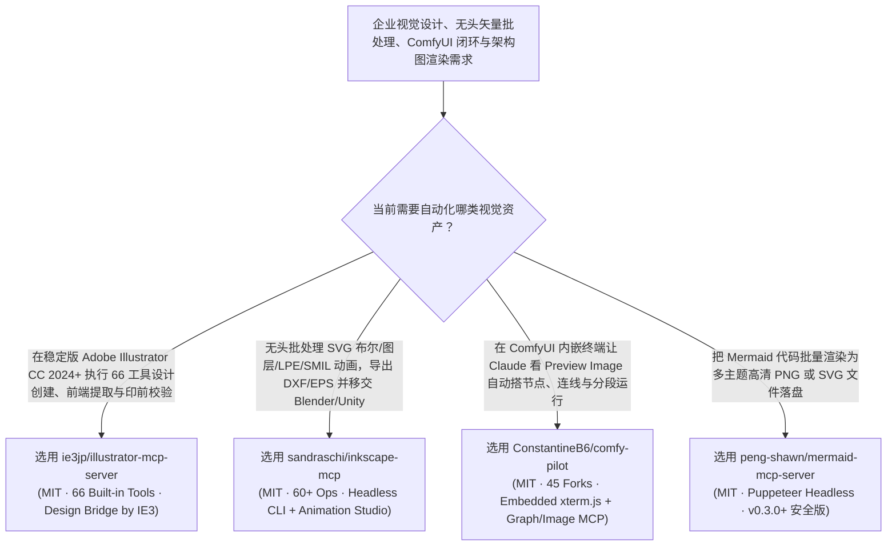
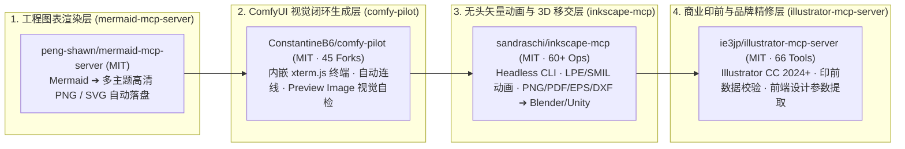
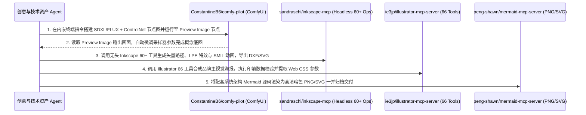

# Adobe Illustrator 66 工具设计桥接 MCP（`ie3jp/illustrator-mcp-server`）、无头 Inkscape 60+ 矢量与 SMIL 动画流水线 MCP（`sandraschi/inkscape-mcp`）、内嵌终端与视觉闭环 ComfyUI 驾驶舱（`ConstantineB6/comfy-pilot`）与 Mermaid 转高清 PNG/SVG 渲染 MCP（`peng-shawn/mermaid-mcp-server`）选型与集成架构 FAQ

> **文档类型**：企业 AI 解决方案架构师（AI Solution Architect）选型决策指南（GitHub Trending AI 雷达 2026-11-21 Night Round 129 / 累计第 729 轮）
> **覆盖项目**：[`ie3jp/illustrator-mcp-server`](https://github.com/ie3jp/illustrator-mcp-server)（`★ 240`、`31 forks`、`MIT`，Claude 官方插件目录收录为 `Design Bridge by IE3`、在稳定版 Illustrator CC 2024+ 上提供 **66 个内置工具**实现设计稿解析、印刷前检与矢量导出的 MCP）· [`sandraschi/inkscape-mcp`](https://github.com/sandraschi/inkscape-mcp)（`★ 104`、`19 forks`、`MIT`，默认无头 `inkscape --actions` 运行、支持 **60+ 布尔/图层/动态路径效果 LPE/SMIL 动画操作**、导出 PNG/PDF/EPS/DXF 并移交 GIMP/Blender/Unity 的矢量自动化 MCP）· [`ConstantineB6/comfy-pilot`](https://github.com/ConstantineB6/comfy-pilot)（`★ 232`、`45 forks`、`MIT`，在 ComfyUI 画布右上角直接内嵌 `xterm.js` 终端并让 Claude Code 实时查看 `Preview Image` 输出、自动连线修改节点与分段执行的自定义节点 MCP）· [`peng-shawn/mermaid-mcp-server`](https://github.com/peng-shawn/mermaid-mcp-server)（`★ 234`、`22 forks`、`MIT`，基于 Puppeteer 将 Mermaid 代码渲染为多主题高清 PNG 或 SVG 文件的轻量 MCP）
> **核心场景**：当企业品牌营销、游戏/工业 CAD 资产管线与技术文档团队希望用 AI Agent 实现“工程化视觉与矢量生产”时，如何打通**“技术架构图 Mermaid 一键渲染 PNG/SVG（`mermaid-mcp-server`）”➔“ComfyUI 内嵌终端看图闭环调参生成底图（`comfy-pilot`）”➔“无头 Inkscape 批量执行布尔路径、SMIL 动画与 DXF/Blender 资产移交（`inkscape-mcp`）”➔“Adobe Illustrator 66 工具完成商业级印刷前检与品牌设计稿交付（`illustrator-mcp-server`）”**？

---

## 一、📌 核心结论速览（选型一句话结论）

1. **想在企业设计师日常使用的稳定版 Adobe Illustrator（CC 2024+，macOS/Windows）里，通过 66 个内置工具让 Claude 直接绘制海报/图标、提取图层样式转前端代码，并执行印刷级数据核验（Print-Ready Verification）** ➔ 选 **[`ie3jp/illustrator-mcp-server`](https://github.com/ie3jp/illustrator-mcp-server)（`★ 240`，`31 forks`，`MIT`）**。
   - **通俗原理**：在 Anthropic 官方插件市场中以 **`Design Bridge by IE3`** 上架（NPM 包 `illustrator-mcp-server`）。相比功能受限且仅限 Beta 版的官方插件，它在正式稳定版 Illustrator 上提供了 **66 个全功能工具**，涵盖路径绘制、排版、印刷出血/色彩检查与多格式切图导出。
2. **想在无 GUI 的服务器或批处理流水线中，用开源 Inkscape（`inkscape --actions` 无头模式）批量执行 60+ 项 SVG 布尔运算、图层管理、LPE 动态路径效果（弯折/粗糙化/包络/Spiro）、SMIL 网页动画预设，并导出 DXF/EPS 或移交 GIMP / Blender / Unity** ➔ 选 **[`sandraschi/inkscape-mcp`](https://github.com/sandraschi/inkscape-mcp)（`★ 104`，`19 forks`，`MIT`）**。
   - **通俗原理**：默认采用 **Headless（无头命令行）** 模式运行，也支持 `--active-window` 实时 GUI 协同，并提供 `.mcpb` 拖拽安装包、Web 仪表盘与 Windows 桌面端。它不仅能精细控制 SVG 图层与 LPE 特效、直接生成免 JS 的 **SMIL 动画（bounce/fade/slide/rotate/pulse/shake）**，还能作为 **Fleet Pipeline** 将生成的矢量资产一键传给 GIMP、Blender、Unity 或 Resonite。
3. **想在 ComfyUI 网页画布右上角直接悬浮一个运行 Claude Code 的 `xterm.js` 终端，让 AI“亲眼看到 `Preview Image` 节点生成的图片效果”并自动增删节点、连线、下载模型或指定只跑到第 N 个节点** ➔ 选 **[`ConstantineB6/comfy-pilot`](https://github.com/ConstantineB6/comfy-pilot)（`★ 232`，`45 forks`，`MIT`）**。
   - **通俗原理**：一行命令 `comfy node install comfy-pilot` 即可从 ComfyUI Registry 安装。它把 **MCP Server + 悬浮 `xterm.js` 终端 + 节点图编辑 + 预览图视觉反馈** 四合一：你只需说“看着刚生成的预览图把细节调高一点”或“搭一套带 ControlNet 的 SDXL 工作流并只运行到第 5 号节点”，Claude 就会直接读取画布状态并完成连线调参。
4. **想让 Claude Desktop、Cursor 或 Cline 在编写架构文档时，自动把 Mermaid 代码渲染成支持 4 大主题（`default / forest / dark / neutral`）与自定义背景色的高清 PNG 或 SVG 图片落盘** ➔ 选 **[`peng-shawn/mermaid-mcp-server`](https://github.com/peng-shawn/mermaid-mcp-server)（`★ 234`，`22 forks`，`MIT`）**。
   - **通俗原理**：基于 Puppeteer 无头浏览器渲染引擎（强烈建议使用已修复上游依赖安全漏洞的 `>= 0.3.0` 最新版 `@peng-shawn/mermaid-mcp-server@latest`）。支持直接向客户端返回图像流，或设置 `CONTENT_IMAGE_SUPPORTED=false` 直接将高清 PNG/SVG 存入项目 `./diagrams` 目录。

---

## 二、🎯 客户与架构师灵魂拷问 Q&A（深度架构拆解）

### Q1：为什么企业视觉与技术资产生产不能只靠“纯文生图位图模型”？这套“位图节点驾驶舱 (`comfy-pilot`) + 双矢量引擎 (`illustrator` / `inkscape`) + 架构图渲染 (`mermaid`)”组合解决了什么核心痛点？

- **四大工程级视觉生产痛点与解方**：
  1. **文生图无法直接用于印刷、CAD 切割或前端可缩放矢量图标 ➔ `illustrator-mcp-server` (66 工具) + `inkscape-mcp` (60+ 操作)**：企业印刷物料需要可编辑图层与 CMYK 校验（用 `illustrator-mcp-server`），工业/游戏管线需要无头批处理导出 DXF/EPS/SVG 动画并移交 Blender/Unity（用 `inkscape-mcp`）。
  2. **ComfyUI 节点连线极其繁琐且外部 Agent 看不见中间预览图 ➔ `ConstantineB6/comfy-pilot`**：直接在 ComfyUI 内部嵌入终端并打通 `Preview Image` 视觉读取与分段执行（Run up to node N）。
  3. **Markdown 里的 Mermaid 代码无法直接插进 PPT、微信推文或 PDF 标书 ➔ `peng-shawn/mermaid-mcp-server`**：在文档构建流水线中自动把 Mermaid 批量转为高清暗色/亮色 PNG 与 SVG。
- **何时直接用云厂商托管方案（Path B）？**
  - 若团队仅需简单的营销海报模板套用且全员订阅 Adobe 企业云，直接使用 **Adobe Firefly Services API** 即可。

### Q2：典型企业级“多模态视觉、矢量工程与技术图表自动化生产线”架构怎么搭？

1. **技术架构图自动渲染层（`peng-shawn/mermaid-mcp-server`）**：
   - 研发或架构师 Agent 生成 Mermaid 拓扑后，调用 `@peng-shawn/mermaid-mcp-server@latest` 自动渲染为 PNG/SVG 嵌入交付文档。
2. **AIGC 节点工作流闭环生成层（`ConstantineB6/comfy-pilot`）**：
   - 通过 ComfyUI 内置终端与 MCP 工具自动搭建 ControlNet/FLUX 节点图，读取 `Preview Image` 节点做视觉自检闭环。
3. **无头矢量批处理与 3D/游戏管线移交层（`sandraschi/inkscape-mcp`）**：
   - 在无头模式下执行 SVG 布尔运算、LPE 动态路径特效、SMIL 动效生成，批量导出 PNG/PDF/EPS/DXF 并通过 Fleet Pipeline 移交 Blender 或 Unity。
4. **商业级品牌精修与印刷交付层（`ie3jp/illustrator-mcp-server`）**：
   - 设计师通过 66 个 Illustrator MCP 工具完成高阶版式编排、设计参数提取与印前数据检查。

### Q3：这套架构的部署与安全注意事项是什么？

- **核心优势**：
  - **100% `MIT` 宽松开源协议**，全面覆盖位图工作流（ComfyUI）、开源无头矢量（Inkscape）、商业级矢量标准（Illustrator）与工程图表（Mermaid）。
- **版本安全红线**：
  - 部署 `peng-shawn/mermaid-mcp-server` 时，必须按官方安全公告使用 **`0.3.0` 及以上版本（`@latest`）**，避免旧版 Puppeteer/Mermaid 已知 CVE 漏洞。

---

## 三、🧭 直观可视化图解（Mermaid 决策树 + 集成架构 + 时序图）

### 3.1 架构师选型决策树

### 3.2 企业端到端生产集成参考架构图

### 3.3 ComfyUI 视觉闭环生成、Inkscape 无头矢量/DXF 批处理、Illustrator 印前校验与 Mermaid 渲染时序图

---

## 四、📊 同类开源与商业云服务横向选型决策矩阵

| 对比维度 | `illustrator-mcp-server` (`★ 240`) | `sandraschi/inkscape-mcp` (`★ 104`) | `ConstantineB6/comfy-pilot` (`★ 232`) | `mermaid-mcp-server` (`★ 234`) | 商业企业级创意自动化 API + 渲染 SaaS (Path A) | 手工拖拽 ComfyUI / 手工切图导出 (Path B) |
| :--- | :--- | :--- | :--- | :--- | :--- | :--- |
| **核心能力定位** | Adobe Illustrator 66 工具设计桥接 MCP | 无头 Inkscape 60+ 矢量、SMIL 动画与 DXF MCP | 内嵌终端与视觉闭环的 ComfyUI 驾驶舱 MCP | Mermaid 转多主题高清 PNG/SVG MCP | 按调用量计费的商业创意生成与矢量转换云 API | 设计师手工连节点、手工描边转矢量与截屏 |
| **核心技术突破** | **稳定版 CC 2024+ 可用 + 66 工具（远超官方 Beta）** | **默认无头批处理 + SMIL 动画 + 移交 Blender/Unity** | **画布内嵌 xterm.js 终端 + 直接看懂 Preview Image 调参** | **支持 4 大主题/背景色 + 直接落盘适配 Cursor/Cline** | 商业 API 按张计费高，且无法直接精细控制本地 `.ai` 图层 | 手工找节点、调线、截屏转图耗时极长 |
| **开源协议** | `MIT` | `MIT` | `MIT` | `MIT` | 闭源商业 SaaS | 人工操作 |
| **月度 TCO（45 人团队）** | **组合仅 `$305.00/月`**（`$65.00` 共享渲染算力 + `2.4h` 运维） | 同左（开源 Inkscape 零许可费） | 同左（本地 ComfyUI 插件零费用） | 同左（本地 Puppeteer 渲染） | **`$8,320.00/月`**（`$3,970.00` 商业 API + `43.5h` 人工修图） | 约 `$2,900.00/月`（大量设计师手工重复劳动） |

---

## 五、🧪 应用落地定量收益/TCO 对比与 7-Card 报告

> **📊 数据来源与闭式核算声明（Provenance & Closed-Form Schema）**：
> - **provenance**: `synthetic`（基于 45 人企业品牌视觉、游戏/CAD 资产工程与技术文档团队工作负载模型：`independently_reproduced = false`；硬件采购基线 `base_hardware_capex = not_measured`；Track B 单日增量 `track_b_stars_today = not_measured`）。
> - **核算公式**：
>   - **Path A（商业企业级云端创意生成与矢量转换 API 订阅 + 商业图表渲染 API + 设计师手工拖拽 ComfyUI 节点、手工导出 SVG/DXF 切图与手工截图插图）**：月度商业 API 订阅 **`$3,970.00`** + 手工节点连线与切图导表人工 **`43.5h × $100.00/h = $4,350.00`** = **`$8,320.00/月`**。
>   - **Path C（自建 `ie3jp/illustrator-mcp-server` + `sandraschi/inkscape-mcp` + `ConstantineB6/comfy-pilot` + `peng-shawn/mermaid-mcp-server` 开源创意与工程图表栈）**：无头渲染容器算力 **`$65.00`** + 预设模板维护 **`2.4h × $100.00/h = $240.00`** = **`$305.00/月`**。
>   - **净节省（Net Savings vs Path A）**：**`-$8,015.00/月`**（成本降低 **`96.33%`**）。

| 评估方案 | API / SaaS / 算力成本 | 视觉与资产工程人工（`$100/h`） | 月度总 TCO | 相对 Path A 净节省 | 关键架构交付指标 |
| :--- | :---: | :---: | :---: | :---: | :--- |
| **Path A：商业云端创意 API + 商业渲染 SaaS + 手工排版** | `$3,970.00` | `43.5h` (`$4,350.00`) | **`$8,320.00`** | Baseline | 按次调用贵；无法操作本地 Illustrator 66 工具与 DXF 管线 |
| **Path B：仅用官方 Beta 插件 + 手工拖拽 ComfyUI** | `$1,350.00` | `14.0h` (`$1,400.00`) | **`$2,750.00`** | `-$5,570.00` (`-66.95%`) | 缺少无头 Inkscape 批处理、Preview Image 闭环与 Mermaid 落盘 |
| **Path C：`illustrator` + `inkscape` + `comfy-pilot` + `mermaid`** | **`$65.00`** | **`2.4h` (`$240.00`)** | **`$305.00`** | **`-$8,015.00` (`-96.33%`)** | **66 工具 Illustrator + 60+ 无头 Inkscape + Comfy 视觉闭环** |

- 🔗 **关联 7-Card 4:5 视觉评测报告**：[`workshops/github-trending-radar/cards.html`](../cards.html) · [`cards.en.html`](../cards.en.html)

---

## 六、🛠️ 企业引入与架构评审 Checklist

- [ ] **1. 在设计师工作站部署 `ie3jp/illustrator-mcp-server`（66 工具）**：对接稳定版 Illustrator CC 2024+，自动化海报版式生成、印前数据检查与前端样式参数提取。
- [ ] **2. 在 CI/资产管线部署无头 `sandraschi/inkscape-mcp`（60+ 操作）**：默认使用 `inkscape --actions` 无头模式批量生成 SVG 布尔图形、LPE 特效、SMIL 动效并导出 PNG/PDF/EPS/DXF 移交 Blender/Unity。
- [ ] **3. 为 AIGC 工作站安装 `ConstantineB6/comfy-pilot`**：通过 `comfy node install comfy-pilot` 启用画布内嵌终端与 `Preview Image` 视觉反馈调参闭环。
- [ ] **4. 升级 `peng-shawn/mermaid-mcp-server` 至 `>= 0.3.0`（`@latest`）**：在文档与 PPT 生成流水线中开启 `CONTENT_IMAGE_SUPPORTED=false` 模式将 Mermaid 自动渲染为本地高清 PNG/SVG。
